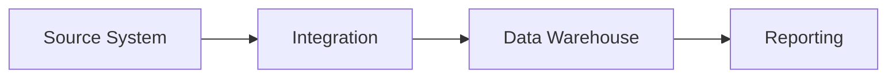
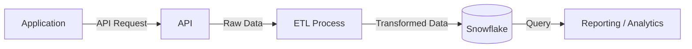

# H&H Technical Documentation

## Overview

This repository serves as the central source of technical documentation for **applications, integrations, and supporting technologies used at H&H**.

The goal is to maintain technical knowledge in a centralized, searchable, and version-controlled location that can be easily maintained as our systems evolve.


## Documentation Standard

Documentation in this repository should be written primarily in **Markdown (`.md`)** format. Whenever practical, documentation should be stored as text rather than proprietary document formats such as Word or PDF.

Markdown allows documentation to remain lightweight and human-readable while integrating naturally with GitHub. Diagrams may also be created using **Mermaid** when visual documentation is helpful.


## Repository Structure

Documentation should be organized by technical area, application, or integration.

```text id="46k5q2"
/
├── applications/
│   ├── application-a/
│   └── application-b/
│
├── integrations/
│   ├── integration-a/
│   └── integration-b/
│
├── architecture/
├── data-platform/
├── infrastructure/
├── standards/
├── runbooks/
└── adr/
```

Each application or integration directory should contain a `README.md` that provides an overview of the system and links to any additional documentation within that directory.


## Mermaid Diagrams

**Mermaid** allows diagrams to be created using text directly inside Markdown files. GitHub automatically renders Mermaid code blocks as diagrams when viewing a Markdown file.

A Mermaid diagram is created by adding a fenced code block with `mermaid` as the language, which renders as a diagram.

Some examples:


```text
flowchart LR
    A[Source System] --> B[Integration]
    B --> C[Data Warehouse]
    C --> D[Reporting]
```




```text
flowchart LR
    A[Application] -->|API Request| B[API]
    B -->|Raw Data| C[ETL Process]
    C -->|Transformed Data| D[(Snowflake)]
    D -->|Query| E[Reporting / Analytics]
```




## Contributing

Documentation should be treated as part of the technical system itself.

When an application, integration, configuration, architecture, or technical process changes, the corresponding documentation should be updated as part of that work.

When adding documentation:

1. Use Markdown (`.md`) whenever possible.
2. Place documentation in the appropriate application, integration, or technical-area directory.
3. Use clear headings and descriptive file names.
4. Link related documentation where helpful.
5. Use Mermaid for diagrams when appropriate.
6. Keep documentation current as systems and processes change.