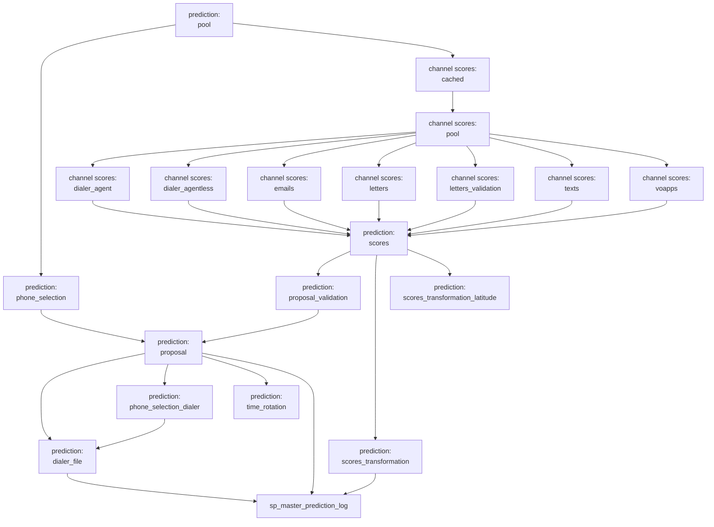
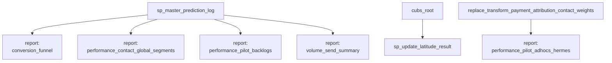
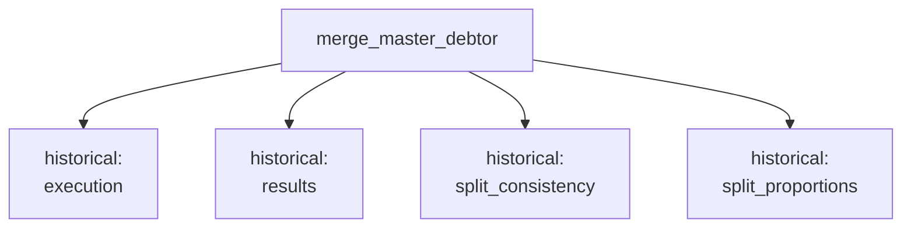

# Hermes repository overview

Hermes is a Snowflake-based contact recommendation pipeline. It combines account eligibility, contact history, model predictions, configured priorities, and spending/call limits to propose letters, texts, VOAPPS, emails, and dialer contacts. It records the decisions and exposes CUBS and Latitude export views for downstream operational systems.

This overview describes the checked-in SQL. Task enablement, deployed model versions, and live database contents are not verified here. The root task in [ddl.sql](../../src/sql/ddl.sql) declares a daily **02:00 America/Chicago** schedule on `hermes_wh`.

**Repository layout**

| Location | Role |
| --- | --- |
| [src/sql](../../src/sql) | Configuration, eligibility transforms, scoring, allocation, exports, logging, and reports. |
| [src/sql/ddl.sql](../../src/sql/ddl.sql) | Schema/log-table definitions and the Hermes root task. |
| [src/sql/training](../../src/sql/training) | Versioned model population, training, validation, comparison, and deployment SQL. |
| [src/py](../../src/py) | Earlier model-development notebooks and related SQL. |
| [src/r](../../src/r) | Analysis and manual SQL-refresh notebooks. The [EZrefresh notebook](master_prediction_pool_EZrefresh.md) uses filename ordering rather than the task graph. |
| [src/sql/tests](../../src/sql/tests), [src/sql/migration-scripts](../../src/sql/migration-scripts) | Historical experiment/report queries and operational rerun scripts. |
| [doc](..) | Operational reference documents, spreadsheets, and this documentation. |

**Inputs**

| Input family | Examples and purpose |
| --- | --- |
| Debtor/client population | `edwprodhh.pub_jchang.master_debtor`, `master_client`, and `master_plgroup_map`: identifiers, packet membership, balances, placement dates, industry, source system, and grouping. |
| Contact destinations and permissions | Phone and email directories, DNC and opt-out lists, mailing addresses, source-system flags, and bounce records. |
| History | Calls, letters, texts, VOAPPS, emails, transactions, payment attribution, and Hermes proposal/dialer logs. Prior selected proposals help prevent repeated recommendations before delivery history catches up. |
| Auxiliary warehouse data | `edwprodhh.dw` fiscal/debtor/client tables, `edwprodhh.liquid` Latitude data, ZIP/time-zone mappings, income statistics, and client-specific appointment data. |
| Configuration | `master_config*` tables/views supply channel permissions, exclusions, templates, costs, budgets, minimums, calendars, segment boundaries, and dialer list sizes. Most are loaded by standalone SQL, not refreshed by daily tasks. |
| Prediction functions | Deployed `edwprodhh.hermes.PROD_PREDICT_V5_*_REG` and `*_CLF` functions return channel predictions from debtor features. Both dialer variants use the DIALER model pair. |
| Manual requests | [master_prediction_fasttrack](master_prediction_fasttrack.md) supplies explicit debtor/channel/template requests consumed by proposal generation. |

`debtor_idx` identifies an account, while `packet_idx` groups related accounts. Many constraints and phone choices operate at packet level. `client_idx` and `pl_group` link configuration; artificial groups can combine clients for budget allocation, and dialer departments supply dialer grouping.

**Operations and decision points**

1. **Build routing and checks.** The treatment router creates debtor routing fields (currently all test/treatment fields are null). Criteria transforms evaluate client activation, account status, geography, destinations, validation, contact sequences, and settlement options. Business-rule transforms calculate balances, age, income, contact minimums/delays/cooldowns, and model features.
2. **Assemble the pool.** [master_prediction_pool](master_prediction_pool.md) joins the diagnostics and calculates separate eligibility flags for each channel. There is no single universal list of required checks: client/template exceptions and channel-specific rules determine which flags matter. A priority flag does not by itself mean a contact will be proposed.
3. **Choose phone options and score accounts.** Text/VOAPPS phone selection runs alongside the scoring branch. Phone selection weights historical results and randomizes choices; it resolves shared phones within each channel. Scoring filters the eligible population and calls seven pairs of regression/classification functions. The [cache](transform_prediction_scores_cached.md) currently refreshes to an empty table because of `WHERE FALSE`.
4. **Combine scores and derive segments.** [master_prediction_scores](master_prediction_scores.md) computes `(1 + classification) * regression` for each channel and takes the greatest channel score (nulls treated as zero) as the debtor score. Generic transformation produces percentiles, deciles, and fixed segments. Latitude validation segments use separate thresholds: `1` is best, `10` is lowest, and `0` marks an already validated packet.
5. **Allocate contacts.** Validation proposals are selected separately. [Ordinary proposals](master_prediction_proposal.md) rank the remaining options by priorities and weighted profit/margin ranks, then apply packet uniqueness and global/group/channel/batch constraints through several allocation passes. Special contacts, minimums, subscriptions, and dynamic reserve have distinct handling. Fast-track requests use their own branch and are cleared after processing.
6. **Build dialer and timing outputs.** After ordinary proposals, dialer phone selection and allocation consider existing digital recommendations. Agent calls are allocated before agentless calls. VOAPPS time rotation independently chooses an upload-date timestamp within the overlapping ZIP/area-code window and converts it to UTC.
7. **Log and expose results.** [master_prediction_execution](master_prediction_execution.md) calls snapshot procedures with one execution timestamp and writes aggregate proposal counts. CUBS/Latitude views expose selected logged rows for the current upload date. Downstream report tasks analyze contact volume, performance, and conversion. [latitude_result.sql](../../src/sql/latitude_result.sql) separately merges recent Latitude processing outcomes into Hermes history.

**Outputs**

| Output | Contents / decision meaning |
| --- | --- |
| [master_prediction_pool](master_prediction_pool.md) | Wide account diagnostics, model inputs, templates, and channel eligibility. |
| [master_prediction_scores](master_prediction_scores.md) | Combined and component channel scores plus the overall debtor score. |
| [Score transformations](master_prediction_scores_transformation.md) | Generic score ranks/segments and separate [Latitude validation segments](master_prediction_scores_transformation_latitude.md). |
| [Phone selection](master_prediction_phone_selection.md) / [dialer phone selection](master_prediction_phone_selection_dialer.md) | Candidate phone rows with probabilities, history, and selected-phone indicators. |
| [master_prediction_proposal_validation](master_prediction_proposal_validation.md) | Validation candidates with selection flags, costs, and upload dates. |
| [master_prediction_proposal](master_prediction_proposal.md) | Ordinary/fast-track candidates, selected channel/template/phone, financial estimates, allocation pass, request ID, and upload date. |
| [master_prediction_dialer_file](master_prediction_dialer_file.md) | Dialer candidates, selected-phone metadata, group, priority, and upload date. |
| [master_prediction_time_rotation](master_prediction_time_rotation.md) | Selected VOAPPS target timestamps. |
| [CUBS proposals](master_prediction_proposal_cubs.md) / [CUBS dialer views](master_prediction_dialer_file_cubs.md) | Today's selected CUBS rows, with logon-specific views and migrated placement groups excluded. |
| [Latitude proposals](master_prediction_proposal_latitude.md) / [validation export](master_prediction_scores_transformation_latitude_export.md) | Today's Latitude recommendations and validation segments. |
| `*_log` tables | Appended snapshots with `execute_time`; some preserve rejected candidates as well as selected ones. Export views generally require `is_proposed_contact = 1` and today's `upload_date`. |
| Reports and `latitude_result` | Conversion/performance/volume analysis and returned execution outcomes. |

`execute_time` identifies the snapshot run; `upload_date` determines when a recommendation appears in an export. They are different dates/timestamps and should not be used interchangeably. Selection is indicated by `is_proposed_contact` or a selected-phone flag, not merely by the existence of a candidate row.

**Task sequence**

The diagrams are split into stages for readability. Every arrow represents an explicit, uncommented `AFTER` dependency in the SQL. A task with multiple incoming arrows waits for all listed predecessors; branches without an edge between them have no declared ordering. Boundary tasks are repeated between diagrams. Views, static configuration, and procedure calls inside the logging procedure are not separate task nodes.

Labels abbreviate task names as follows; the default namespace is `edwprodhh.hermes`:

| Diagram label | Full task-name pattern |
| --- | --- |
| `businessrules: x` | `replace_transform_businessrules_x` |
| `criteria: x` | `replace_transform_criteria_x` |
| `channel scores: x` | `replace_transform_prediction_scores_x` |
| `prediction: x` | `replace_master_prediction_x` |
| `config: x` | `replace_master_config_x` |
| `report: x` | `replace_report_x` |
| `historical: x` | `edwprodhh.pub_jchang.replace_report_test_replace_letters_20231211_x` |

Routing, criteria, business rules, and the pool:

```mermaid
flowchart TD
    T0["hermes_root"]
    T1["config:<br/>treatment_router"]
    T5["prediction:<br/>pool"]
    T16["businessrules:<br/>contact_cooldown"]
    T17["businessrules:<br/>contact_priority_delay"]
    T18["businessrules:<br/>contact_priority_minimums"]
    T19["businessrules:<br/>debtor_balance"]
    T20["businessrules:<br/>debtor_debttype"]
    T21["businessrules:<br/>debtor_income"]
    T22["businessrules:<br/>debtor_maturity"]
    T23["businessrules:<br/>debtor_prevpacket"]
    T24["criteria:<br/>address_allowed_email"]
    T25["criteria:<br/>address_allowed_mail"]
    T26["criteria:<br/>calendar_requirement"]
    T27["criteria:<br/>debtor_client_active"]
    T28["criteria:<br/>debtor_state"]
    T29["criteria:<br/>debtor_status"]
    T30["criteria:<br/>misc"]
    T31["criteria:<br/>phone_allowed"]
    T32["criteria:<br/>phone_allowed_dialer"]
    T33["criteria:<br/>phone_allowed_texts"]
    T34["criteria:<br/>phone_allowed_voapps"]
    T35["criteria:<br/>sequence_requirement"]
    T36["criteria:<br/>settlement_calculation"]
    T37["criteria:<br/>texts_exclusions"]
    T38["criteria:<br/>validation_eligibility"]
    T39["criteria:<br/>validation_requirement"]
    T0 --> T1
    T16 --> T5
    T18 --> T5
    T17 --> T5
    T19 --> T5
    T22 --> T5
    T21 --> T5
    T20 --> T5
    T23 --> T5
    T38 --> T5
    T39 --> T5
    T35 --> T5
    T26 --> T5
    T29 --> T5
    T28 --> T5
    T27 --> T5
    T31 --> T5
    T25 --> T5
    T24 --> T5
    T30 --> T5
    T1 --> T5
    T18 --> T16
    T1 --> T17
    T1 --> T18
    T1 --> T19
    T1 --> T20
    T1 --> T21
    T1 --> T22
    T1 --> T23
    T1 --> T24
    T22 --> T25
    T1 --> T26
    T1 --> T27
    T1 --> T28
    T1 --> T29
    T1 --> T30
    T34 --> T31
    T33 --> T31
    T32 --> T31
    T27 --> T31
    T37 --> T32
    T37 --> T33
    T22 --> T33
    T37 --> T34
    T36 --> T35
    T39 --> T35
    T1 --> T36
    T39 --> T36
    T1 --> T37
    T39 --> T38
    T1 --> T39
```

Scoring, phone selection, proposal allocation, and logging:

Reporting and separate externally rooted tasks:

Historical experiment tasks in [src/sql/tests/2023-12-28-replace-letters](../../src/sql/tests/2023-12-28-replace-letters), shown separately from the daily Hermes graph:

The separate `sp_update_latitude_result` and `replace_report_performance_pilot_adhocs_hermes` tasks are in `edwprodhh.pub_jchang`. Their predecessor tasks, `cubs_root` and `replace_transform_payment_attribution_contact_weights`, are referenced here but not defined in this repository. They are not declared children of `hermes_root`.

The four historical experiment tasks are also in `edwprodhh.pub_jchang` and depend on its `merge_master_debtor` task, whose definition is external to this repository. Their presence in historical SQL does not establish whether they are currently deployed or enabled.

**Behavior and dependency notes**

- The logging task waits for ordinary proposals, generic score transformation, and the dialer file. It reads Latitude score transformation and time rotation outputs without an explicit or transitive dependency on those two refresh tasks. The diagrams preserve that gap; current-run availability of those outputs is not guaranteed by the declared graph.
- The root's schedule does not express an upstream warehouse-refresh dependency. Source-table readiness and whether tasks are enabled are deployment concerns outside the declared Hermes graph.
- Validation email/text eligibility is currently zero; the new validation-letter branch is restricted to the specified NTTA backlog case. The global validation-letter budget is currently zero as well; client and allocation rules still determine the resulting selection.
- Upload rules vary by source and channel. Ordinary proposal logic includes weekday suppressions and explicit holiday dates, so a completed daily run does not imply every channel has an upload that day.
- Scores, phone selection, settlements, send times, and request IDs contain random elements. Re-running against the same inputs can produce different selections or identifiers. Snapshot inserts append; they do not deduplicate repeated executions.
- Ordinary proposal margin uses `profit / cost`; dialer margin uses `profit / fee`. The execution summary counts channels in the ordinary proposal table and does not aggregate the separate dialer-file table.
- Some files contain standalone maintenance, truncate, or reload statements in addition to object definitions. The documentation describes those operations; producing these documents did not execute repository SQL against Snowflake.

Each matching source file has a Markdown document in this directory with its objects, declared dependencies, logic, and output columns. Column inventories describe the final table/view or inserted snapshot fields; internal staging columns are included only when inherited by a final output.

## Output columns

Common fields across repository outputs are summarized below. Individual file documents list every output column for their tables and views.

| Column | Meaning |
| --- | --- |
| `debtor_idx` | Unique debtor/account identifier. |
| `packet_idx` | Identifier grouping related debtor accounts into a packet. |
| `client_idx` | Unique client identifier used to join configuration and client data. |
| `pl_group` | Placement group associated with the account or configuration rule. |
| `proposed_channel` | Contact channel associated with a candidate, recommendation, or requirement. |
| `is_proposed_contact` | 1 when the candidate was selected as a contact recommendation; 0 otherwise. |
| `template` | Contact template identifier. |
| `phone_number` | Selected contact phone number; null when the contact does not use a phone. |
| `request_id` | Identifier used to correlate a selected recommendation with downstream processing/contact history. |
| `upload_date` | Date the recommendation or segment is intended to appear in the operational export. |
| `execute_time` | Timestamp supplied by the logging caller to identify the execution snapshot. |
