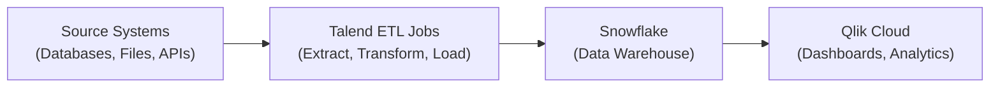

# System Overview

*Generated: 2026-09-15 06:57 UTC*

## Platform Summary

| Platform | Component | Count |
|----------|-----------|-------|
| Talend | Projects | 1 |
| Talend | ETL Jobs | 56 |
| Talend | DB Connections | 2 |
| Talend | Context Groups | 2 |

## Architecture

## Data Flow Summary

The system follows a standard ETL → Warehouse → BI pattern:

1. **Talend** extracts data from source systems, applies transformations,
   and loads results into Snowflake.
2. **Snowflake** serves as the central data warehouse.
3. **Qlik Cloud** connects to Snowflake for analytics and reporting.

---

*Feed this document along with the detailed job and app documentation*
*to Claude or another AI for narrative enrichment and flow diagrams.*