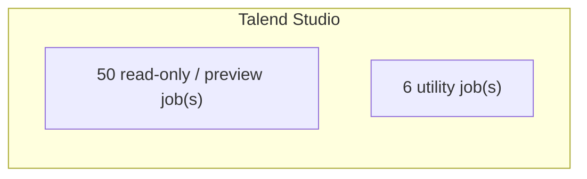

# System Architecture Document

## What actually exists

| Layer | Observed state |
|---|---|
| Talend Studio workspace | 1 project(s) — `LATITUDE` (56 jobs) |
| Database connections | 2 defined: Liquid_0.1, TalendLog_0.1 |
| Context variables | 2 group(s): Directories_0.1, LEGACY_DW_0.1 — used by 56/56 jobs |

## Observed data flow (Mermaid)

This diagram reflects only what the extracted metadata shows — reload schedules, real connection targets, and any app-to-warehouse linkage must come from re-running the extractors once those are configured.
