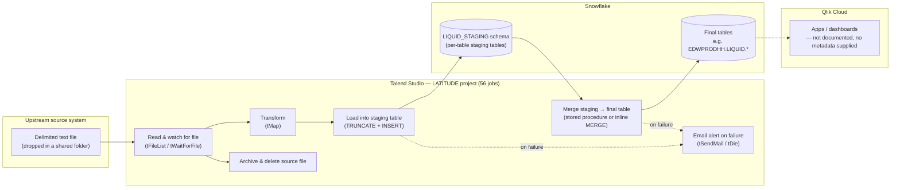

# System Architecture Document

## Overview

This platform moves debt-collection data for the LATITUDE book of business from flat files dropped by upstream systems into a Snowflake data warehouse, where it becomes available for reporting. A single Talend Studio project (`LATITUDE`, 56 jobs) does the extract-and-load work: each job waits for a delimited text file, stages its rows in a Snowflake "staging" schema, then calls a Snowflake stored procedure (or runs an inline `MERGE`) to fold those staged rows into a permanent table, before archiving and deleting the source file. Two jobs exist purely to send email alerts, and one is a gatekeeper that waits for an upstream export to finish before the rest of the pipeline is allowed to run. No Qlik Cloud metadata was available at the time this documentation was generated (see Gaps below), so the Qlik half of the platform — which dashboards exist, what they load, and on what schedule — could not be documented from the attached files.

## Detail table

| Item | Value |
|---|---|
| Project / tenant name | LATITUDE |
| Total Talend jobs | 56 |
| Total DB connections (Talend repository) | 2 — `Liquid_0.1` (Microsoft SQL Server), `TalendLog_0.1` (defined but empty — no host/port/database configured) |
| Total context/variable groups | 2 — `Directories_0.1`, `LEGACY_DW_0.1` |
| Total Qlik apps | Unable to determine from metadata — verify with team (no `qlik_metadata.json` was supplied) |

Neither repository connection above is actually what the jobs use to reach Snowflake. Every job's Snowflake component references a **repository-managed Snowflake connection that isn't in the two `database_connections` entries at all** — its account, warehouse, database and credentials are supplied entirely through the `LEGACY_DW_0.1` context group (see the Glossary in `06_dependency_matrix.md` for what that implies operationally).

## Data flow

This diagram reflects the pattern actually observed across the 56 jobs' components and SQL text in the metadata (see `06_dependency_matrix.md` for the per-job breakdown). The Snowflake-to-Qlik hop is drawn dashed because no Qlik extraction has been run against this tenant yet.

## Glossary

| Term | Plain-English meaning |
|---|---|
| Context group | A named bundle of settings (folder paths, database credentials, warehouse names) that a job reads at run time instead of having those values hard-coded. This project has two: `Directories_0.1` (file-system paths) and `LEGACY_DW_0.1` (the real Snowflake connection details). |
| Repository connection | A reusable "saved" database connection Talend Studio stores centrally so jobs can share it. Only 2 exist here, and neither is the Snowflake connection the jobs actually use — that one lives in the context group instead. |
| Staging table | A landing-zone table (schema `LIQUID_STAGING`) that a job truncates and reloads on every run; it holds only the most recent file's raw rows, not history. |
| Final / production table | The permanent table (seen in the metadata as e.g. `EDWPRODHH.LIQUID.<name>`) that a `MERGE`/stored-procedure step updates from the staging table — this is what downstream reporting is expected to query. |
| Reload task (Qlik) | Qlik's term for a scheduled refresh of an app's data. Not documented here — no Qlik metadata was available. |
| Space (Qlik) | Qlik's term for a shared folder/permission boundary that apps live in. Not documented here — no Qlik metadata was available. |
