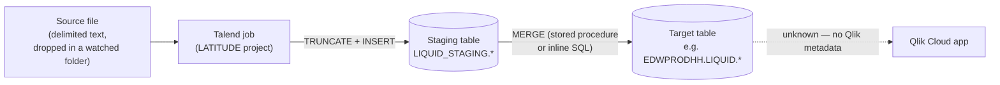

# Data Lineage Map

## Overview

Read this trace left to right: an upstream system drops a delimited text file → a named Talend job in the LATITUDE project picks it up → the job lands the rows in a Snowflake staging table and then folds them into a target table (usually via a stored procedure, occasionally via an inline `MERGE` statement written directly in the job) → from there the trail goes cold, because no Qlik Cloud metadata was available to show which app or dashboard, if any, reads that target table. The table below is built directly from each job's SQL text and Snowflake component configuration in the extracted metadata (`talend_metadata.json`) — not inferred from job names alone.

## Trace (general pattern)

**Hop 1 — source file → Talend job.** Every load job reads from `context.sourceDir`, a path supplied by the `Directories_0.1` context group. The metadata shows two different values recorded for that path — a local Windows folder (`C:/Data/Latitude/`) and a mounted Linux path (`/mnt/analytics_team/PROD/LATITUDE/Liquid/`) — consistent with a developer/production context pair, though the extractor doesn't label which value belongs to which named context. `Export_File_Check` is the one job that doesn't load anything itself; it waits (up to 4 hours) for a `*_zz-done.csv` marker file to appear in that same folder before anything downstream is allowed to proceed, and emails `jmach@harriscollect.com` and fails the run if the marker never shows up.

**Hop 2 — Talend job → staging table.** 49 of the 56 jobs execute a `TRUNCATE TABLE` against a table in (or implicitly in) the `LIQUID_STAGING` schema before loading it fresh from the current file. This means the staging table only ever holds the most recently loaded file's rows — it is not a history table.

**Hop 3 — staging table → target table.** 46 jobs then call a Snowflake stored procedure (named `MERGE_TXT_INTO_<TABLE>()`, `MERGE_INTO_<TABLE>()`, or similar) to merge the staged rows into a permanent table; a few jobs (`MiscExtra_Text_Load`, `Roles_Text_Load`) run the equivalent `MERGE INTO ... USING ...` SQL directly inside the Talend job instead of calling a procedure. Either way, the actual target table name is only visible in the two jobs that inline their SQL (`LIQUID.MISCEXTRA` and `EDWPRODHH.LIQUID.ROLES`); for the 44 jobs that call a stored procedure, the procedure's body — and therefore its real target table — lives in Snowflake, outside what Talend's metadata captures.

**Hop 4 — target table → Qlik.** Unable to determine from metadata — verify with team. No `qlik_metadata.json` was supplied, so there is no record of which Qlik apps, if any, connect to this Snowflake database or reload from these tables.

## Job → staging table → merge mechanism (full trace)

| Talend job | Loads Snowflake table | Staging table (from `TRUNCATE`) | Merge mechanism |
|---|---|---|---|
| `Address_Text_Load` | ADDRESS | LIQUID_STAGING.ADDRESS | proc `MERGE_TXT_INTO_ADDRESS()` |
| `Bankruptcy_Text_Load` | BANKRUPTCY | LIQUID_STAGING.BANKRUPTCY | proc `LIQUID_STAGING.MERGE_TXT_INTO_BANKRUPTCY()` |
| `Carrier_Text_Load` | CARRIER | STAGING.CARRIER | proc `MERGE_TXT_INTO_CARRIER()` |
| `CBR_Metro2_Accounts_Table_Text_Load` | CBR_METRO2_ACCOUNTS_TXT | CBR_METRO2_ACCOUNTS_TXT | proc `MERGE_TXT_INTO_CBR_METRO2_ACCOUNTS()` |
| `cmi_CapioSellerContracts_Table_Text_Load` | CMI_CAPIOSELLERCONTRACTS_TXT | CMI_CAPIOSELLERCONTRACTS_TXT | proc `MERGE_TXT_INTO_CMI_CAPIOSELLERCONTRACTS()` |
| `cmi_Customer_Ext_Text_Load` | CMI_CUSTOMER_EXT_TXT | LIQUID_STAGING.CMI_CUSTOMER_EXT_TXT | proc `MERGE_TXT_INTO_CMI_CUSTOMER_EXT()` |
| `cmi_CustomerGrouping_Text_Load` | CMI_CUSTOMERGROUPING_TXT | LIQUID_STAGING.CMI_CUSTOMERGROUPING_TXT | proc `MERGE_TXT_INTO_CMI_CUSTOMERGROUPING()` |
| `cmi_Dialer_Plan_History_Table_Text_Load` | cmi_Dialer_Plan_History_TXT | Unable to determine from metadata | proc `MERGE_TXT_INTO_CMI_DIALER_PLAN_HISTORY()` |
| `cmi_Dialer_SBT_History_Table_Text_Load` | CMI_DIALER_SBT_HISTORY_TXT | CMI_DIALER_SBT_HISTORY_TXT | proc `MERGE_TXT_INTO_CMI_DIALER_SBT_HISTORY()` |
| `cmi_dialer_SubscriberStatus_Text_Load` | CMI_DIALER_SUBSCRIBERSTATUS_TXT | CMI_DIALER_SUBSCRIBERSTATUS_TXT | proc `MERGE_TXT_INTO_CMI_DIALER_SUBSCRIBERSTATUS()` |
| `cmi_dialer_SubscriberStatusHistory_Text_Load` | CMI_DIALER_SUBSCRIBERSTATUSHISTORY_TXT | CMI_DIALER_SUBSCRIBERSTATUSHISTORY_TXT | proc `MERGE_TXT_INTO_CMI_DIALER_SUBSCRIBERSTATUSHISTORY()` |
| `cmi_Hermes_Recommendations_Load` | CMI_HERMES_RECOMMENDATIONS | LIQUID_STAGING.CMI_HERMES_RECOMMENDATIONS | proc `MERGE_TXT_INTO_CMI_HERMES_RECOMMENDATIONS()` |
| `cmi_renkim_ReturnHistory_Text_Load` | CMI_RENKIM_RETURNHISTORY_TXT | CMI_RENKIM_RETURNHISTORY_TXT | proc `MERGE_TXT_INTO_CMI_RENKIM_RETURNHISTORY()` |
| `cmi_Score_Text_Load` | CMI_SCORE_TXT | CMI_SCORE_TXT | proc `MERGE_TXT_INTO_CMI_SCORE()` |
| `cmi_VoApp_Results_Load` | CMI_VOAPPS_RESULTS | LIQUID_STAGING.CMI_VOAPPS_RESULTS | proc `MERGE_TXT_INTO_CMI_VOAPPS_RESULTS()` |
| `Custom_cmi_Email_Text_Load` | CUSTOM_CMI_EMAIL_TXT | CUSTOM_CMI_EMAIL_TXT | proc `MERGE_TXT_INTO_CUSTOM_CMI_EMAIL()` |
| `Customer_Table_Text_Load` | CUSTOMER_TXT | CUSTOMER_TXT | proc `MERGE_TXT_INTO_CUSTOMER()` |
| `Debtor_Table_Text_Load` | DEBTOR_TXT | DEBTOR_TXT | proc `MERGE_TXT_INTO_DEBTORS()` |
| `DebtorCC_Table_Text_Load` | DEBTORCREDITCARDS_TXT | DEBTORCREDITCARDS_TXT | proc `MERGE_TXT_INTO_DEBTORCREDITCARDS()` |
| `Deceased_Text_Load` | DECEASED | LIQUID_STAGING.DECEASED | proc `LIQUID_STAGING.MERGE_TXT_INTO_DECEASED()` |
| `Desk_Text_Load` | DESK | LIQUID_STAGING.DESK | proc `MERGE_TXT_INTO_DESK()` |
| `DeskChangeHistory_Text_Load` | DESKCHANGEHISTORY | LIQUID_STAGING.DESKCHANGEHISTORY | proc `LIQUID_STAGING.MERGE_TXT_INTO_DESKCHANGEHISTORY()` |
| `Dialer_CallTracking_Load` | DIALER_CALLTRACKING | LIQUID_STAGING.DIALER_CALLTRACKING | proc `MERGE_TXT_INTO_DIALER_CALLTRACKING()` |
| `Email_Text_Load` | EMAIL_TXT | LIQUID_STAGING.EMAIL_TXT | proc `LIQUID_STAGING.MERGE_TXT_INTO_EMAIL()` |
| `HH_Violation_Text_Load` | HH_VIOLATION | LIQUID_STAGING.HH_VIOLATION | proc `MERGE_TXT_INTO_HH_VIOLATION()` |
| `Insurance_Text_Load` | INSURANCE | LIQUID_STAGING.INSURANCE | proc `MERGE_TXT_INTO_INSURANCE()` |
| `letter_Text_Load` | LETTER_TXT | LETTER_TXT | proc `MERGE_TXT_INTO_LETTER()` |
| `LetterRequest_Table_Text_Load` | LETTERREQUEST_TXT | LETTERREQUEST_TXT | proc `MERGE_TXT_INTO_LETTERREQUEST()` |
| `LetterType_Text_Load` | LETTERTYPE_TXT | LETTERTYPE_TXT | proc `MERGE_TXT_INTO_LETTERTYPE()` |
| `Livevox_Daily_Load` | LIVEVOX_CALLS | LIQUID_STAGING.LIVEVOX_CALLS | proc `LIQUID_STAGING.MERGE_INTO_LIVEVOX()` |
| `master_prediction_proposal_Load` | MASTER_PREDICTION_PROPOSAL | LIQUID_STAGING.MASTER_PREDICTION_PROPOSAL | proc `INSERT_TXT_INTO_MASTER_PREDICTION_PROPOSAL()` (note: an insert, not a merge — see Gaps) |
| `Master_Special_Info_Text_Load` | MASTER_SPECIAL_INFO_TXT | MASTER_SPECIAL_INFO_TXT | proc `MERGE_TXT_INTO_MASTER_SPECIAL_INFO()` |
| `Master_Table_Text_Load` | MASTER_TXT | MASTER_TXT | proc `MERGE_TXT_INTO_MASTER()` |
| `Master_Table_Text_Load_HC15` | MASTER_TXT | MASTER_TXT | proc `MERGE_TXT_INTO_MASTER()` — **same staging table and same merge procedure as `Master_Table_Text_Load`** (see Gaps) |
| `MiscExtra_Text_Load` | MISCEXTRA_TXT | MISCEXTRA_TXT | inline `MERGE INTO LIQUID.MISCEXTRA` |
| `PatientInfo_Text_Load` | PATIENTINFO | LIQUID_STAGING.PATIENTINFO | proc `MERGE_TXT_INTO_PATIENTINFO()` |
| `PayHistory_Table_Text_Load` | PAYHIST_TXT | PAYHIST_TXT | proc `MERGE_TXT_INTO_PAYHISTORY()` |
| `PDC_Text_Load` | PDC_TXT | PDC_TXT | proc `MERGE_TXT_INTO_PDC()` |
| `Phones_Consent_Table_Text_Load` | PHONES_CONSENT_TXT | PHONES_CONSENT_TXT | proc `MERGE_TXT_INTO_PHONES_CONSENT()` |
| `Phones_Master_Table_Text_Load` | PHONES_MASTER_TXT | PHONES_MASTER_TXT | proc `MERGE_TXT_INTO_PHONES_MASTER()` |
| `Promises_Text_Load` | PROMISES_TXT | PROMISES_TXT | proc `MERGE_TXT_INTO_PROMISES()` |
| `Result_Table_Text_Load` | RESULT_TXT | RESULT_TXT | proc `MERGE_TXT_INTO_RESULT()` |
| `Roles_Text_Load` | ROLES | LIQUID_STAGING.ROLES | inline `MERGE INTO EDWPRODHH.LIQUID.ROLES` |
| `ScheduledPayment_Text_Load` | SCHEDULEDPAYMENT_TXT | LIQUID_STAGING.SCHEDULEDPAYMENT_TXT | proc `LIQUID_STAGING.MERGE_TXT_INTO_SCHEDULEDPAYMENT()` |
| `ServiceHistory_Text_Load` | SERVICEHISTORY_TXT | SERVICEHISTORY_TXT | proc `MERGE_TXT_INTO_SERVICEHISTORY()` |
| `Services_LexisNexis_Batch_A2_Text_Load` | SERVICES_LEXISNEXIS_BATCH_A2_TXT | LIQUID_STAGING.SERVICES_LEXISNEXIS_BATCH_A2_TXT | proc `MERGE_TXT_INTO_SERVICES_LEXISNEXIS_BATCH_A2()` |
| `StatusHistory_Text_Load` | STATUSHISTORY_TXT | STATUSHISTORY_TXT | proc `MERGE_TXT_INTO_STATUSHISTORY()` |
| `Users_Text_Load` | Users | LIQUID_STAGING.USERS | proc `MERGE_TXT_INTO_USERS()` |
| `ValidationNotice_Text_Load` | VALIDATIONNOTICE | VALIDATIONNOTICE | proc `MERGE_TXT_INTO_VALIDATIONNOTICE()` |
| `Voapps_Response_Load` | VOAPPS | LIQUID_STAGING.VOAPPS | proc `MERGE_TXT_INTO_VOAPPS()` |
| `Last4SSN_Extract` | LAST4SSN | Unable to determine from metadata — no `TRUNCATE`/`MERGE` SQL found | Unable to determine from metadata |

Four jobs load **from** Snowflake **to** a file instead of the other way around, so they sit outside the trace above: `Hermes_Latitude_Recommendations`, `Master_Config_Val_Segs_Export`, and `Master_Prediction_Scores_Export` each read a Snowflake table and write a delimited export file (their downstream destination is Unable to determine from metadata). `Export_File_Check`, `Plan_Success_Alert`, and `Roles_Text_Load`'s peers were already covered above; `Export_File_Check` and `Plan_Success_Alert` load nothing themselves.

## Gaps

- **Stored-procedure bodies are invisible to this trace.** For the 44 jobs that call a `MERGE_TXT_INTO_*`/similar procedure, the procedure's own SQL (and therefore its real target table, any additional joins, and any row-filtering logic) lives in Snowflake, not in the Talend job metadata. Only the two jobs with inline `MERGE` SQL (`MiscExtra_Text_Load`, `Roles_Text_Load`) show a confirmed target table name.
- **Two jobs share one staging table and one merge procedure.** `Master_Table_Text_Load` and `Master_Table_Text_Load_HC15` both truncate/load `MASTER_TXT` and both call `MERGE_TXT_INTO_MASTER()`. Whether these run at different times against the same table (and could race or double-load each other's data if scheduled close together) is unable to determine from metadata — verify with team.
- **`master_prediction_proposal_Load` calls an `INSERT_TXT_INTO_...` procedure, not a `MERGE_TXT_INTO_...` one** — unlike every other job in this list. Whether that means it only appends (with the same "same row loaded twice" risk that `MERGE` avoids elsewhere) is unable to determine from metadata — verify with team.
- **`Last4SSN_Extract` writes to `LAST4SSN` with no truncate/merge step found.** How it avoids duplicating rows on a rerun is unable to determine from metadata.
- **Qlik Cloud is entirely undocumented here.** No `qlik_metadata.json` was supplied, so this map cannot say which (if any) Qlik apps read the target tables above, on what schedule, or whether they exist at all.
- **Which context (dev vs. prod) is active at run time is not captured.** The extracted `Directories_0.1` context group shows two full sets of path values (one Windows-style, one Linux-mount-style) but not which one a live scheduled run actually uses.
