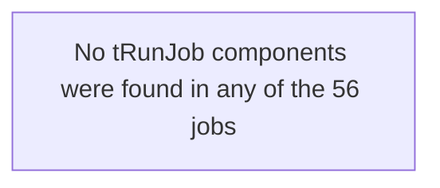

# Dependency Matrix

## Overview

This matrix shows what each of the 56 LATITUDE jobs actually depends on to run: which database connection, which shared context (variable) group, and — separately — which other jobs it triggers. Read the "risky" callouts at the end before assuming any of these are safe to change without warning the whole team; a few of them concern nearly every job in the project at once.

## Jobs → database connection

| Repository connection | Jobs that use it |
|---|---|
| `Liquid_0.1` (Microsoft SQL Server, `CHI-DEV-LQDB:1433/LiquidModel`) | None of the 56 jobs in this project reference it. |
| `TalendLog_0.1` (no host/port/database configured) | None of the 56 jobs in this project reference it. |
| *(unnamed — see note)* Snowflake connection | 54 of 56 jobs use a Snowflake component (`tSnowflakeConnection`/`tSnowflakeRow`/`tSnowflakeOutput`/`tSnowflakeInput`). |

**Note on the Snowflake connection:** neither `Liquid_0.1` nor `TalendLog_0.1` is a Snowflake connection, yet 54 jobs read from or write to Snowflake. That's because the real Snowflake connection isn't a standalone repository connection object in this metadata at all — its account, warehouse, database, role and credentials come from the `LEGACY_DW_0.1` context group instead (see below), either through a shared repository-linked connection component that most jobs reuse, or (in 3 jobs) by reading the `LEGACY_DW_*` context variables directly.

## Jobs → context group

| Context group | Jobs that reference it | How |
|---|---|---|
| `Directories_0.1` (file paths: `sourceDir`, `archiveDir`, `filePath`, `fileName`, `logDir`, `keystorePath`) | 55 of 56 jobs (all except `Plan_Success_Alert`, which only sends a canned email) | Directly, via `context.sourceDir` etc. in file-handling components. |
| `LEGACY_DW_0.1` (Snowflake account/warehouse/database/credentials) | 3 jobs reference it **by name** in a component parameter: `Master_Config_Val_Segs_Export`, `Master_Prediction_Scores_Export`, `Livevox_Daily_Load`. The other ~51 Snowflake-using jobs depend on it **indirectly**, through a shared repository-linked Snowflake connection object that itself draws on this same context group. | Direct (3 jobs) or indirect via the shared connection (the rest). |

**Inconsistency worth knowing about:** most jobs share one repository-managed Snowflake connection object, but 3 jobs (`Master_Config_Val_Segs_Export`, `Master_Prediction_Scores_Export`, `Livevox_Daily_Load`) instead build their own Snowflake connection inline from the same context variables. Functionally this should reach the same Snowflake account, but it means a future credential or account change has to be made in two different places to reach every job — the shared connection object, and these three jobs' own component configuration.

## Jobs → jobs (`tRunJob` orchestration)

None of the 56 jobs in this project call another job via `tRunJob`. Each job is triggered independently (by whatever external scheduler runs it — not visible in this metadata), not chained together from within Talend.

## Notes — what looks risky here

- **One shared context group is a single point of failure for almost the whole platform.** 54 of 56 jobs ultimately depend on the Snowflake account/warehouse/credentials stored in `LEGACY_DW_0.1`. A credential rotation, account migration, or warehouse rename has to account for both the shared connection object most jobs use *and* the 3 jobs that read those context variables directly — miss one and only part of the platform breaks.
- **`TalendLog_0.1` is defined but orphaned.** It has no host, port, database, or schema configured, and no job in this project references it. Either it's meant for a use case that was never wired up, or it's leftover configuration that can be removed — worth confirming with the team rather than assuming either way.
- **51 of 56 jobs hardcode a developer workstation path** (`C:/Talend-Studio-20211109_1610-V8.0.1/workspace/...`) inside file-archiving components, alongside otherwise-parameterized context variables for the same purpose. This is the same finding called out in `05_operational_runbook.md`'s "Configuration risks" — flagging it here too because it's a dependency in the sense that every one of those 51 jobs depends on that exact folder existing on whatever machine runs them.
- **Two jobs point at the same staging table and the same merge procedure**: `Master_Table_Text_Load` and `Master_Table_Text_Load_HC15` both load `MASTER_TXT` and both call `MERGE_TXT_INTO_MASTER()`. If both are scheduled anywhere close together, one could truncate the staging table out from under the other mid-run — unable to determine from metadata whether they're scheduled to avoid this; verify with team.
- **No job-to-job orchestration exists in Talend at all.** With zero `tRunJob` links, whatever ordering these 56 jobs need to run in (for example, loading a lookup table before a job that depends on it) must be enforced entirely by an external scheduler. That scheduler's configuration wasn't part of this extraction, so today there's no way to confirm from Talend alone that jobs run in a safe order.
