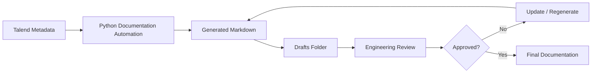
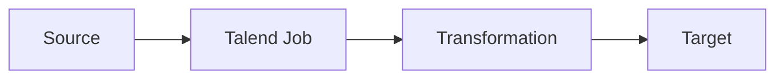
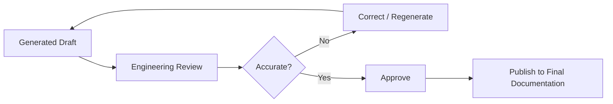

# Talend Documentation - Drafts

This folder contains **generated Talend technical documentation** produced by the Talend Documentation Automation toolkit.

The documents are generated from Talend metadata and are intended for **engineering review and validation before final publication**.

## Purpose

The `drafts` folder provides a temporary/review area for:

- Generated Talend job documentation
- Source and target information
- Job/component details
- Data-flow information
- Dependencies
- Database and connection information
- Technical descriptions
- Mermaid diagrams
- AI-enriched documentation, when enabled

## Documentation Flow



## Folder Structure

```text
applications/
└── talend/
    └── drafts/
        ├── README.md
        ├── Address_Text_Load.md
        ├── Bankruptcy_Text_Load.md
        ├── Carrier_Text_Load.md
        └── ...
```

Each `.md` file represents documentation for a Talend job or related technical artifact.

## Mermaid Diagrams

Documentation may contain Mermaid diagrams to make job flows and technical relationships easier to understand.

Example:



## Review Process

Draft documentation should follow this process:



Reviewers should validate:

- Job name and purpose
- Source and target systems
- Talend components
- Data flow
- Database connections
- Dependencies
- Processing logic
- Technical descriptions
- Mermaid diagrams
- Any AI-generated content

## Important

The documents in this folder are **drafts** and should not be considered the final source of truth until they have been reviewed and approved by the engineering team.

AI-generated descriptions, where present, must also be validated against the actual Talend implementation.

## Generated By

The documentation is generated by the **Talend Documentation Automation** Python project.

```text
Talend Source
     ↓
Metadata Extraction
     ↓
Sensitive Data Redaction
     ↓
Documentation Generation
     ↓
Optional AI Enrichment
     ↓
Markdown + Mermaid
     ↓
applications/talend/drafts/
     ↓
Engineering Review
```
