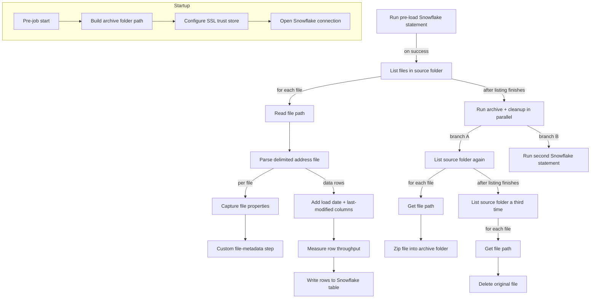

# Talend Job: Address_Text_Load

## Overview

`Address_Text_Load` is a Talend ETL job in the **LATITUDE** project. It picks up
pipe-delimited text files containing debtor/customer address records from a
source folder, loads them into a Snowflake table, and then cleans up after
itself by zipping the processed files into an archive folder and deleting the
originals from the source folder. Along the way it opens a secured (SSL
keystore-based) connection to Snowflake, tracks how many rows it processes,
and captures file metadata (size, modified time, etc.) for each file it
handles. Error handling around the two direct Snowflake "row" steps is
present but the actual SQL statements they run were not captured in the
extracted metadata.

## Detail Table

| Field | Value |
|---|---|
| Job name | Address_Text_Load |
| Version | 0.1 |
| Project | LATITUDE |
| Job Type | Standard |
| Author | jmach@harriscollect.com |
| Created | 2025-08-04T10:40:42.490-0700 |
| Last Modified | 2026-07-12T13:49:17.054-0700 |

## Step-by-Step Data Flow

The job runs in three logical stages: **startup/connection setup**, **the
main load loop**, and a **parallel cleanup stage** (archive + delete) that
kicks off once all files have been listed.

1. **Startup** — The pre-job step (`tPrejob_1`) runs a small piece of Java
   code (`tJava_1`) that builds the full archive-folder path (it appends a
   Talend-generated timestamp/token to `context.archiveDir`). It then
   configures an SSL trust store (`tSetKeystore_1`) so the job can talk to
   Snowflake over a trusted connection, and finally opens the Snowflake
   connection itself (`tDBConnection_1`).
2. **Pre-load Snowflake step** — `tDBRow_1` runs an unspecified Snowflake
   statement (the actual SQL text was not present in the extracted
   metadata) before the file loop starts. If it succeeds, the job moves on
   to listing files.
3. **File discovery** — `tFileList_1` lists every file in `context.sourceDir`
   (non-recursive, case-sensitive). For **each** file found it loops
   (`ITERATE`) into the load branch described in step 4. Once the listing
   itself is finished (`SUBJOB_OK`, i.e. after all files have been
   discovered — not per file), it also kicks off the parallel cleanup
   branch described in step 6.
4. **Per-file load** — For each file in the list:
   - `tJava_2` reads the current file's path out of the file-list iterator
     and stores it in `context.filePath`.
   - `tFileInputDelimited_1` reads that file as a delimited file using an
     unusual custom row separator, `"|$|"`, and parses it into the address
     schema described below.
   - The parsed rows flow (`FLOW`) into `tMap_1`, which adds two computed
     columns — a load timestamp (`LOAD_DT`) and a `LASTMODIFIED` value — on
     top of every address column from the source file.
   - The mapped rows flow into `tFlowMeter_1`, which measures row
     throughput/volume as the data passes through (it does not change the
     data).
   - The rows then flow into `tDBOutput_1`, which writes them to a
     Snowflake table.
   - Separately, for the same file, `tFileInputDelimited_1` also iterates
     into `tFileProperties_1`, which captures file-system metadata about
     the file (size, path, last-modified time, etc.). That metadata flows
     into `tJavaRow_1`, a custom Java row step whose generated code was not
     included in the extracted metadata.
5. **Parallel cleanup trigger** — Once `tFileList_1` has finished listing
   all files, `tParallelize_1` runs two independent branches at the same
   time (up to 100ms sleep between checks, waiting for **all** branches to
   finish, and configured to *not* die if one branch errors):
   - Branch A re-lists the source folder (`tFileList_2`) and, for each file
     found, iterates through `tJava_3` (captures the file path) into
     `tFileArchive_1`, which zips the file into the archive folder built in
     step 1.
   - Branch B runs a second Snowflake statement (`tDBRow_2`) — again, the
     SQL text itself was not captured in the metadata.
6. **Delete originals** — After the archive branch's file listing
   (`tFileList_2`) completes, the job lists the source folder a **third**
   time (`tFileList_3`) and, for each file, iterates through `tJava_4`
   (captures the file path) into `tFileDelete_1`, which deletes the
   original file from the source folder. This step is configured to fail
   the job if a delete fails (`FAILON=true`).

### Data Flow Diagram

## Settings Tables

### Source: `tFileList_1` / `tFileList_2` / `tFileList_3` (directory listing)

| Setting | Value | What it means |
|---|---|---|
| Directory | `context.sourceDir` (context variable) | Folder scanned for incoming address files — not hardcoded, so it can differ per environment. |
| List mode | Files | Only files are listed, not sub-folders. |
| Include sub-directories | No | Only the top level of the folder is scanned. |
| Case sensitive | Yes | File name matching respects letter case. |

### Source: `tFileInputDelimited_1` (reads the address file)

| Setting | Value | What it means |
|---|---|---|
| Filename | `context.filePath` (context variable, set per file by `tJava_2`) | The specific file currently being processed in the loop. |
| Row separator | `"|$|"` | Rows in the source file are split on this unusual, non-standard delimiter rather than a normal line break. |
| CSV option | Off | The file is treated as a plain delimited file rather than full CSV (quoted-field) parsing. |
| Filename text field | Value in metadata reads as UI help text ("When the input source is a stream or a zip file…") rather than an actual path | This looks like an export artifact rather than a real setting — see Issues Observed. |

### Target: `tDBOutput_1` (writes to Snowflake)

| Setting | Value | What it means |
|---|---|---|
| Connection | Row-based, linked to the Snowflake connection opened by `tDBConnection_1` | Uses the shared Snowflake session established at job start. |
| Output schema | Address columns + `LOAD_DT` + `LASTMODIFIED`, plus Snowflake load-error columns (`columnName`, `rowNumber`, `category`, `sqlState`, `code`, etc.) | The component is built to capture per-row load errors from Snowflake, but the extracted metadata does not show where that error output is connected — see Issues Observed. |

### Target: `tFileArchive_1` (zips processed files)

| Setting | Value | What it means |
|---|---|---|
| Source | `context.sourceDir` | Folder whose files get zipped. |
| Source file (hardcoded) | `"C:/Talend-Studio-20211109_1610-V8.0.1/workspace/s…"` (truncated in metadata) | A hardcoded, developer-machine-specific Windows path — see Issues Observed. |
| Target | `context.archiveDir + context.fileName + ".zip"` | Destination zip file, built from context variables (partly parameterized). |
| Create directory if missing | Yes | The archive folder is created automatically if it doesn't already exist. |

### Target: `tFileDelete_1` (removes processed files)

| Setting | Value | What it means |
|---|---|---|
| Filename | `context.filePath` | The specific file just archived. |
| Directory / Path (hardcoded) | `"C:/Talend-Studio-20211109_1610-V8.0.1/workspace/d…"` (truncated in metadata) | Another hardcoded, developer-machine-specific Windows path — see Issues Observed. |
| Fail on error | Yes | If a delete fails, the whole job fails rather than continuing. |

### Security: `tSetKeystore_1` (SSL trust configuration)

| Setting | Value | What it means |
|---|---|---|
| Trust store type | JKS | Format of the trust store used to validate the Snowflake server's certificate. |
| Trust store path (hardcoded) | `"C:/clientTrustStore.trustStore"` | A hardcoded, developer-machine-specific Windows path used for SSL trust — see Issues Observed. |
| Keystore type | PKCS12 | Format used if a client keystore is also configured. |

## Dependencies & Configuration

- **Other jobs triggered or depended on:** Unable to determine from
  metadata — no job-call components (e.g. `tRunJob`) appear in the extracted
  component list, so this job does not appear to trigger other jobs, and no
  evidence shows another job triggering this one. Verify with team.
- **Context variables relied on:**
  - `context.sourceDir` — folder the job reads incoming files from and later
    deletes them from.
  - `context.archiveDir` — base folder the job zips processed files into
    (built up further at runtime by `tJava_1`).
  - `context.filePath` — set at runtime for whichever file is currently
    being processed in each loop.
  - `context.fileName` — used to name the archive zip file.
- **Snowflake connection:** Established once at job start (`tDBConnection_1`)
  and reused by `tDBRow_1`, `tDBRow_2`, and `tDBOutput_1`. The specific
  Snowflake account/database/schema/warehouse values were not visible in the
  extracted metadata (the `PROPERTIES` field was truncated to an internal
  component reference ID) — verify with team.

## Glossary

| Term | Plain-English meaning |
|---|---|
| `tPrejob` / `tPostjob` | Special start/end markers Talend uses to run setup or cleanup steps before/after the main job logic. |
| `tJava` / `tJavaRow` | A block of custom Java code the developer wrote — `tJava` runs once, `tJavaRow` runs once per data row. |
| `tSnowflakeConnection` | Opens a reusable connection to a Snowflake database for the rest of the job to use. |
| `tSnowflakeRow` | Runs a single SQL statement against Snowflake (the statement text itself wasn't captured in this metadata). |
| `tSnowflakeOutput` | Writes a stream of rows into a Snowflake table. |
| `tFileList` | Scans a folder and produces a list of files for the job to loop over. |
| `tFileInputDelimited` | Reads a text file where columns are separated by a delimiter character (or, here, a custom multi-character separator). |
| `tFileProperties` | Reads file-system details about a file (size, timestamps, path) without reading its contents. |
| `tMap` | Transforms and reshapes data as it flows through — renaming, combining, or adding columns. |
| `tFlowMeter` | Counts/measures rows passing through a point in the job, for monitoring — it does not change the data. |
| `tFileArchive` | Compresses one or more files into a zip archive. |
| `tFileDelete` | Deletes a file from disk. |
| `tParallelize` | Runs two or more branches of the job at the same time instead of one after another. |
| `tSetKeystore` | Configures the SSL certificates/trust settings the job uses when connecting to secure services. |
| Context variable | A named setting (like a folder path) that can be set differently per environment instead of being hardcoded into the job. |

## Issues Observed

- **Hardcoded, developer-machine-specific file paths.** Three components
  reference literal Windows paths under
  `C:/Talend-Studio-20211109_1610-V8.0.1/workspace/...`: `tFileArchive_1`'s
  `SOURCE_FILE`, `tFileDelete_1`'s `DIRECTORY`/`PATH`, and
  `tSetKeystore_1`'s trust store path (`C:/clientTrustStore.trustStore`).
  Every other path in this job (source folder, archive folder, file path)
  is already parameterized through context variables, so these four values
  stand out as likely leftovers from the original developer's local machine
  that should be parameterized the same way before this job is safely run
  outside that machine.
- **Possible unfinished/placeholder field.** `tFileInputDelimited_1`'s
  `FILENAMETEXT` parameter contains what reads as Talend Studio's own UI
  help text ("When the input source is a stream or a zip file…") rather
  than a real value. This may just be how the extraction tool captured this
  particular field, but it's worth a manual check in Talend Studio to
  confirm the component's filename setting is what's documented above
  (`context.filePath`).
- **Unclear error-row handling on the Snowflake load.** `tDBOutput_1`'s
  schema includes a full set of Snowflake load-error columns (`columnName`,
  `rowNumber`, `category`, `sqlState`, `code`, etc.), which normally feed a
  reject/error output link. The extracted metadata does not show that
  link connected to anything downstream, so it is unclear whether rows that
  fail to load into Snowflake are captured, logged, or silently dropped.
  Verify with team.
- **SQL text not captured for both direct Snowflake steps.** `tDBRow_1`
  (runs before the file loop) and `tDBRow_2` (runs in parallel with
  archiving) both execute Snowflake statements, but the extracted metadata
  only shows a truncated internal property reference, not the actual SQL.
  What these two steps do (e.g. truncate a staging table, log a run,
  update a control table) cannot be determined from the metadata alone —
  verify with team.
- **Duplicated column list in the `tFileInputDelimited_1` schema.** The
  extracted schema for this component lists the full address column set
  twice in a row before the trailing `errorCode`/`errorMessage` columns.
  This may reflect how the export tool captured a combined main/reject
  schema, but the cause could not be determined from the metadata alone —
  verify with team.
- **Fail-fast configuration in two places.** `tMap_1` has `DIE_ON_ERROR=true`
  and `tFileDelete_1` has `FAILON=true`. This means a single bad row during
  mapping, or a single failed file deletion, will stop the whole job rather
  than skip and continue — worth confirming this is the intended behavior
  for a recurring load job.
- **Generic monitoring label.** `tFlowMeter_1`'s label is set to the
  default placeholder `"MyLabel"` rather than something identifying this
  specific job/stage, which would make its output harder to distinguish
  from other jobs' flow-meter metrics if monitoring is aggregated
  centrally.

---

*Note: This document was generated from a single job's extracted metadata
file (`job_Address_Text_Load.md`) only. The full six-document documentation
set described in the source prompt (system architecture, all Qlik apps,
lineage map, runbook, dependency matrix) requires the accompanying
`talend_metadata.json` summary and `qlik_metadata.json` files, which were
not provided in this session.*
