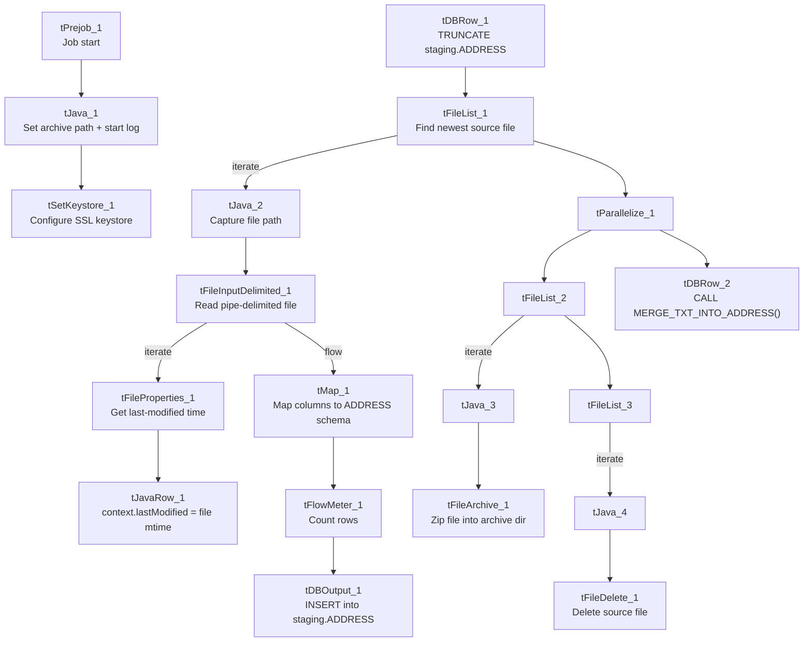

# Talend Job: Address_Text_Load

## Overview

This job is one of roughly four dozen near-identical "text load" jobs in the LATITUDE project: it watches a shared folder for a new address-data file, loads its rows into a Snowflake staging table, merges that staging data into the permanent `ADDRESS` table using a Snowflake stored procedure, and then archives and deletes the source file so it isn't picked up again. It has no scheduling information in this metadata — something outside Talend (a scheduler or trigger) decides when it runs.

## Detail table

| Field | Value |
|---|---|
| Job name | Address_Text_Load |
| Version | 0.1 |
| Project | LATITUDE |
| Author | jmach@harriscollect.com |
| Created | 2025-08-04T10:40:42.490-0700 |
| Last Modified | 2026-07-12T13:49:17.054-0700 |

## Step-by-step data flow

1. **Set up.** The job connects to Snowflake (`tDBConnection_1`) and appends today's date to the archive path it will use later (`context.archiveDir = context.archiveDir + <yyyyMMdd> + "/"`), and starts a log file for this run.
2. **Empty the staging table.** `tDBRow_1` runs `TRUNCATE TABLE LIQUID_STAGING.ADDRESS;` — wiping out whatever staging data was left from the previous run before loading anything new.
3. **Find the file.** `tFileList_1` lists the files sitting in `context.sourceDir`, newest-modified first, and skips anything ending in `.txt`. Its first matching file becomes `context.filePath`.
4. **Read and reshape the file.** `tFileInputDelimited_1` reads that file as a pipe-delimited file (columns separated by `|~|`, rows separated by `|$|`, with a header row). `tFileProperties_1` grabs the file's last-modified timestamp, and a small piece of custom code (`tJavaRow_1`) copies that timestamp into `context.lastModified` so it can be stamped onto every row. `tMap_1` then maps the file's columns onto the `ADDRESS` table's columns.
5. **Load staging.** The mapped rows flow through a row counter (`tFlowMeter_1`) into `tDBOutput_1`, which inserts them into the `ADDRESS` table in Snowflake (action: `INSERT`, no table-structure changes).
6. **Merge into the permanent table.** In parallel (`tParallelize_1`), the job calls `CALL MERGE_TXT_INTO_ADDRESS();` (`tDBRow_2`) — a Snowflake stored procedure that reconciles the newly staged rows into whatever the real, permanent `ADDRESS` table is. What that procedure actually does (which columns it matches on, whether it's really `LIQUID_STAGING.ADDRESS` → some other schema) is not visible in this metadata — see Issues observed.
7. **Archive and clean up.** The same source file is then zipped into the archive folder (`tFileArchive_1`, target `context.archiveDir/<filename>.zip`) and deleted from the source folder (`tFileDelete_1`).
8. **Security setup.** `tSetKeystore_1` configures the SSL client keystore (`context.keystorePath`) used for the Snowflake connection.

## Settings tables

### Source: `tFileInputDelimited_1` (reads the source file)

| Setting | Value | What it means |
|---|---|---|
| FILENAME | `context.filePath` | Reads whichever file `tFileList_1` just found — not a fixed filename. |
| FIELDSEPARATOR | `\|~\|` | Columns in the source file are separated by the three characters `\|~\|`, not a comma or tab. |
| ROWSEPARATOR | `\|$\|` | Rows are separated by `\|$\|` rather than a plain newline. |
| HEADER | 1 | The first line of the file is a header row, not data. |
| ENCODING | ISO-8859-15 | The file is read as Western European (ISO-8859-15) text, not UTF-8. |
| EXCLUDEFILEMASK (on `tFileList_1`) | `*.txt` | `.txt` files in the source folder are skipped — the expected input is not a plain `.txt` extension. |

### Target: `tDBOutput_1` (loads the Snowflake staging table)

| Setting | Value | What it means |
|---|---|---|
| Table | ADDRESS | Writes into a table named `ADDRESS` (in the `LIQUID_STAGING` schema, per the `TRUNCATE` statement just before it). |
| Output action | INSERT | Adds rows; it does not update or delete existing ones (that happens later, in the merge step). |
| Table action | NONE | Does not create, drop, or truncate the table itself — truncation is done separately by `tDBRow_1`. |

### Merge step: `tDBRow_2`

| Setting | Value | What it means |
|---|---|---|
| Query | `CALL MERGE_TXT_INTO_ADDRESS();` | Runs a Snowflake stored procedure (defined outside Talend) that folds the staged rows into the real, permanent table. |

## Dependencies & configuration

- **Triggers/depends on other jobs:** none found — this job has no `tRunJob` links to or from any other job in the extracted metadata.
- **Context variables used:** `context.sourceDir`, `context.archiveDir`, `context.filePath`, `context.fileName`, `context.logDir`, `context.keystorePath`, `context.lastModified` (all from the `Directories_0.1` context group, plus one job-local variable `lastModified` set at runtime). It does not reference the `LEGACY_DW_0.1` (Snowflake credential) context group by name — its Snowflake connection is a shared, repository-linked connection object instead (see `06_dependency_matrix.md`).
- **Hardcoded values found:** `tFileArchive_1`'s `SOURCE_FILE` (`C:/Talend-Studio-20211109_1610-V8.0.1/workspace/source.csv`), `tFileDelete_1`'s `DIRECTORY`/`PATH` (`C:/Talend-Studio-20211109_1610-V8.0.1/workspace/delete_folder...`), `tFileInputDelimited_1`'s `TEMP_DIR`, and `tSetKeystore_1`'s `SSL_TRUSTSERVER_TRUSTSTORE` (`C:/clientTrustStore.trustStore`) are all fixed Windows paths rather than context variables — see Issues observed.

## Glossary

| Component type | Plain-English meaning |
|---|---|
| `tPrejob` / `tParallelize` | Job-flow control: `tPrejob` marks setup steps that must finish before the main job starts; `tParallelize` runs its downstream branches at the same time instead of one after another. |
| `tFileList` | Lists files in a folder (optionally matching a pattern), one at a time, so the job can loop over them. |
| `tFileInputDelimited` | Reads a delimited (e.g., pipe- or comma-separated) text file row by row. |
| `tFileProperties` | Reads file-system metadata about a file (like its last-modified time) rather than its contents. |
| `tMap` | Maps and transforms columns from an input format into an output format — the core "translate columns" step. |
| `tFlowMeter` | Counts how many rows pass through a point in the job, for logging/monitoring. |
| `tDBOutput` / `tSnowflakeOutput` | Writes rows into a database table — here, Snowflake. |
| `tDBRow` / `tSnowflakeRow` | Runs a single SQL statement against the database (not a full data flow) — used here for `TRUNCATE` and `CALL <procedure>`. |
| `tJava` / `tJavaRow` | A small block of custom Java code — used here for simple string/date manipulation the built-in components don't cover. |
| `tFileArchive` | Compresses a file (here, into a `.zip`) and moves it to an archive location. |
| `tFileDelete` | Deletes a file from disk. |
| `tSetKeystore` | Configures the SSL certificate/keystore used for secure connections (here, for the Snowflake connection). |

## Issues observed

- **The real merge target and logic are invisible from Talend.** `CALL MERGE_TXT_INTO_ADDRESS();` is a Snowflake stored procedure; its body (and therefore the actual permanent table name, join keys, and update logic) isn't part of this metadata. Confirm with whoever owns Snowflake stored procedures what `MERGE_TXT_INTO_ADDRESS` actually does.
- **Several hardcoded, machine-specific paths exist alongside otherwise-parameterized ones**: `tFileArchive_1.SOURCE_FILE`, `tFileDelete_1.DIRECTORY`/`PATH`, `tFileInputDelimited_1.TEMP_DIR`, and `tSetKeystore_1.SSL_TRUSTSERVER_TRUSTSTORE` are all fixed to a specific `C:/Talend-Studio-20211109_1610-V8.0.1/...` or `C:/clientTrustStore.trustStore` path rather than a context variable, unlike `sourceDir`/`archiveDir`/`keystorePath`, which are already parameterized. This is the same pattern flagged project-wide in `05_operational_runbook.md` (51 of 56 jobs) — it means this job is very likely tied to running on one specific machine/install today.
- **No explicit error handling on the merge step.** Unlike `cmi_Hermes_Recommendations_Load` and seven other jobs (see `05_operational_runbook.md`), this job has no `tDie`/`tWarn` component reacting to whether `MERGE_TXT_INTO_ADDRESS()` succeeded — a failed merge here would only surface as whatever generic error Talend produces, not a job-specific message.
