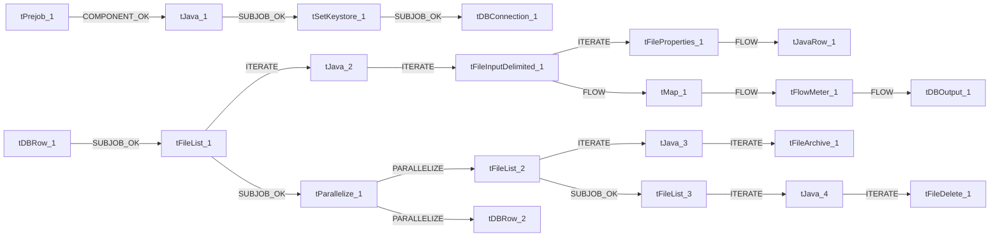

# Talend Job: Address_Text_Load

**Project:** LATITUDE | **Type:** Standard Talend Job

## 1. Overview

`Address_Text_Load` ingests debtor address records into Snowflake. The job
scans a configurable source directory for delimited text files, parses each
file, appends a load timestamp and a last-modified indicator to every
record, and writes the resulting rows to a Snowflake table. In parallel, it
executes a secondary SQL step against Snowflake, archives the processed
source file to a zip, and removes the file from the source directory. Prior
to execution, the job configures an SSL trust store and establishes the
Snowflake connection used downstream.

The extracted metadata does not show an explicit link between the
connection-setup sequence and the data-loading sequence; how the two are
related at runtime could not be confirmed from the available metadata (see
Section 7, *Issues Observed*).

## 2. Job Details

| Field | Value |
|---|---|
| Job name | Address_Text_Load |
| Version | 0.1 |
| Project | LATITUDE |
| Author | jmach@harriscollect.com |
| Created | 2025-08-04T10:40:42.490-0700 |
| Last modified | 2026-07-12T13:49:17.054-0700 |

## 3. Data Flow

1. **Initialization.** `tPrejob_1` runs first to sequence setup ahead of
   the main job. `tJava_1` executes custom code that appends a value to
   `context.archiveDir` (the appended value is truncated in the extracted
   metadata but appears to construct the archive destination path).
   `tSetKeystore_1` then configures the SSL trust store used for secure
   connections, and `tDBConnection_1` establishes the Snowflake connection.

2. **File discovery.** `tFileList_1` enumerates the files present in
   `context.sourceDir` (files only, subdirectories excluded).
   `tDBRow_1` executes immediately beforehand and is wired to trigger this
   step, though the SQL it runs is not present in the extracted metadata.

3. **Read and transform.** For each file identified, `tJava_2` assigns the
   current file to `context.filePath`, and `tFileInputDelimited_1` parses
   the file using `|$|` as the row delimiter — a non-standard choice, as
   most delimited files use a line break. `tMap_1` maps the parsed columns
   to the output schema and adds two computed columns, `LOAD_DT` and
   `LASTMODIFIED`. This component is configured to terminate the job on a
   mapping error (`DIE_ON_ERROR`). `tFlowMeter_1` records a row count
   without altering the data, and `tDBOutput_1` writes the resulting rows
   to a Snowflake table.

4. **File property capture (parallel path).** For the same file,
   `tFileProperties_1` retrieves filesystem attributes (path, size,
   modification time), and `tJavaRow_1` applies custom code to this data.
   The purpose of this transformation is not evident from the metadata
   beyond the schema matching the file-properties output.

5. **Archival.** Once file discovery (step 2) completes,
   `tParallelize_1` initiates two concurrent branches. The first
   re-enumerates the source directory (`tFileList_2`), resolves each file
   path (`tJava_3`), and compresses the file into the archive directory
   (`tFileArchive_1`). The second executes a further Snowflake SQL
   statement (`tDBRow_2`).

6. **Deletion.** Following completion of the archive-listing branch
   (`tFileList_2`), the job re-enumerates the source directory a third
   time (`tFileList_3`), resolves each file path (`tJava_4`), and deletes
   the file (`tFileDelete_1`). This step is configured to fail the job if
   deletion is unsuccessful.

## 4. Settings

### 4.1 `tDBConnection_1` (`tSnowflakeConnection`) — Connection Setup

| Setting | Value | Meaning |
|---|---|---|
| Connection format | row | Standard row-based connection mode (not bulk). |
| Properties | Truncated in extracted metadata (`{"@id":2,"@type":"org.talend.components.snowflake...`) | The target account, warehouse, database, and schema could not be determined from the available metadata. Verify with team. |

### 4.2 `tFileInputDelimited_1` — Source File

| Setting | Value | Meaning |
|---|---|---|
| Filename | `context.filePath` | The source file is supplied dynamically by `tJava_2` from the current file-list entry rather than hardcoded. |
| Row separator | `\|$\|` | Records are delimited by the literal sequence `\|$\|` rather than a standard line break — a non-standard file format requiring upstream awareness. |
| CSV option | false | The file is not parsed using the standard CSV parser. |
| Use existing dynamic schema | false | The column layout is fixed in the job design rather than inferred at runtime. |

### 4.3 `tDBOutput_1` (`tSnowflakeOutput`) — Target Table

| Setting | Value | Meaning |
|---|---|---|
| Connection format | row | Standard row-based write (not bulk load). |
| Properties | Truncated in extracted metadata (`{"@id":4,"@type":"org.talend.components.snowflake...`) | The destination table and schema could not be confirmed from the available metadata. Verify with team. |
| Schema | Includes `columnName`, `rowNumber`, `category`, `character`, `errorMessage`, `byteOffset`, `line`, `sqlState`, `code` in addition to the address columns | These are Snowflake's standard reject/error fields, indicating a reject flow is configured for rows that fail to load. |

### 4.4 `tFileArchive_1` — File Archival

| Setting | Value | Meaning |
|---|---|---|
| Source | `context.sourceDir` | Files are archived from the configurable source directory. |
| Source file | Hardcoded, truncated: `"C:/Talend-Studio-20211109_1610-V8.0.1/workspace/s...` | A specific Windows development-machine path is hardcoded rather than parameterized. See Section 7. |
| Target | `context.archiveDir + context.fileName + ".zip"` | The archive is written to the configurable archive directory, named for the source file. |
| Create directory if missing | true | The archive directory is created automatically if absent. |

### 4.5 `tFileDelete_1` — File Deletion

| Setting | Value | Meaning |
|---|---|---|
| Filename | `context.filePath` | The file to delete is the current file-list entry. |
| Directory / path | Hardcoded, truncated: `"C:/Talend-Studio-20211109_1610-V8.0.1/workspace/d...` | A further Windows development-machine path is hardcoded. See Section 7. |
| Fail on error | true | Deletion failure causes the job to fail. |

### 4.6 `tSetKeystore_1` — SSL Trust Store

| Setting | Value | Meaning |
|---|---|---|
| Set truststore | false | The truststore flag is not explicitly enabled, despite a truststore path being configured below. |
| SSL trust server truststore | Hardcoded: `"C:/clientTrustStore.trustStore"` | A specific file path on a Windows machine is hardcoded as the SSL trust store location. See Section 7. |
| Keystore type | PKCS12 | Format used for the key store, where applicable. |

## 5. Dependencies & Configuration

- **Job dependencies:** None identified in the extracted metadata. No
  job-invocation component (e.g., `tRunJob`) is present.
- **Context variables:** `context.sourceDir`, `context.archiveDir`,
  `context.fileName`, `context.filePath`. The metadata provided does not
  include a context variable/group definition; default values,
  environment-specific overrides, and group membership could not be
  determined. Verify with team.
- **Connection reuse:** A Snowflake connection is established by
  `tDBConnection_1`. The metadata does not indicate whether `tDBRow_1`,
  `tDBRow_2`, and `tDBOutput_1` reuse this connection or establish their
  own. Verify with team.

## 6. Glossary

| Term | Plain-English Definition |
|---|---|
| `tSnowflakeConnection` | Establishes and holds open a connection to Snowflake for use by other components. |
| `tPrejob` | Runs setup steps that must complete before the rest of the job starts. |
| `tJava` | A block of custom code for logic not covered by a standard component. |
| `tSnowflakeRow` | Executes a SQL statement directly against Snowflake, independent of a row-by-row data flow. |
| `tFileList` | Scans a directory and lists its files for sequential processing. |
| `tFileInputDelimited` | Parses a delimited text file into structured rows. |
| `tFileProperties` | Retrieves filesystem metadata for a file (size, modification time, etc.). |
| `tJavaRow` | Applies custom code to each row of data as it flows through the job. |
| `tMap` | Maps columns from input to output, optionally adding or transforming columns. |
| `tFlowMeter` | Records the number of rows passing a point in the job for monitoring purposes, without altering data. |
| `tSnowflakeOutput` | Writes a stream of rows into a Snowflake table. |
| `tFileArchive` | Compresses one or more files into a zip archive. |
| `tParallelize` | Executes two or more branches concurrently. |
| `tFileDelete` | Deletes a file from disk. |
| `tSetKeystore` | Configures the SSL/TLS trust and key store files used for secure network connections. |

## 7. Issues Observed

1. **Hardcoded, machine-specific file paths.** The `SOURCE_FILE` setting
   on `tFileArchive_1` and the `DIRECTORY`/`PATH` settings on
   `tFileDelete_1` are hardcoded to
   `C:/Talend-Studio-20211109_1610-V8.0.1/workspace/...`, a specific
   Windows development-workstation path rather than a context variable.
   Execution on any other machine would likely fail or resolve to an
   incorrect location.

2. **Hardcoded SSL trust store path.** The `SSL_TRUSTSERVER_TRUSTSTORE`
   setting on `tSetKeystore_1` is hardcoded to
   `"C:/clientTrustStore.trustStore"`, also a Windows-style absolute path.
   This value should be parameterized to support execution across
   development, test, and production environments without modifying the
   job.

3. **Unmodified default row-counter label.** The `METTERLABEL` setting on
   `tFlowMeter_1` is set to the literal value `"MyLabel"`, consistent with
   an unmodified default rather than a deliberately assigned identifier.
   Monitoring or logging built on this label would not distinguish this
   metric from others sharing the same default.

4. **No visible link between connection setup and data-processing
   sequences.** The extracted data flow shows `tPrejob_1 → tJava_1 →
   tSetKeystore_1 → tDBConnection_1` as one sequence and `tDBRow_1 →
   tFileList_1 → ...` as a separate sequence, with no explicit connector
   between them. Whether the connection established by `tDBConnection_1`
   is the one used by `tDBRow_1`, `tDBRow_2`, and `tDBOutput_1` could not
   be confirmed from the metadata. Verify with team.

5. **Duplicated column list in the `tFileInputDelimited_1` schema.** The
   extracted schema for this component lists the full set of
   approximately 30 address columns twice in immediate succession, prior
   to the `errorCode`/`errorMessage` columns. This does not match the
   expected pattern of a primary schema plus a reject-flow addition and
   may indicate a metadata extraction artifact or an unusual schema
   configuration. Verify with team before relying on this schema as
   authoritative.

6. **SQL content not visible.** `tDBRow_1` and `tDBRow_2` expose only an
   `errorCode`/`errorMessage` output schema in the extracted metadata; the
   underlying SQL statements are not included, so their effect on the
   Snowflake database could not be determined.
