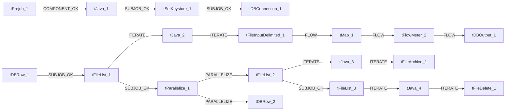

# Talend Job: Bankruptcy_Text_Load

- **Project**: LATITUDE
- **Version**: 0.1
- **Job Type**: Standard

- **Created**: 2026-06-24T14:37:08.660-0700
- **Last Modified**: 2026-06-25T17:10:44.797-0700

## Components

| # | Component | Type | Key Parameters |
|---|-----------|------|----------------|
| 1 | tPrejob_1 | `tPrejob` | `CONNECTION_FORMAT`=row |
| 2 | tJava_1 | `tJava` | `CODE`=context.archiveDir = context.archiveDir + TalendDa, `IMPORT`=//import java.util.List;, `CONNECTION_FORMAT`=row |
| 3 | tSetKeystore_1 | `tSetKeystore` | `SET_TRUSTSTORE`=false, `SET_TRUSTSTORE_KEYSTORE`=false, `TRUSTSTORE_TYPE`=JKS, `SSL_TRUSTSERVER_TRUSTSTORE`="C:/clientTrustStore.trustStore", `KEYSTORE_TYPE`=PKCS12 |
| 4 | tDBConnection_1 | `tSnowflakeConnection` | `CONNECTION_FORMAT`=row, `PROPERTIES`={"@id":2,"@type":"org.talend.components.snowflake. |
| 5 | tDBRow_1 | `tSnowflakeRow` | `CONNECTION_FORMAT`=row, `PROPERTIES`={"@id":3,"@type":"org.talend.components.snowflake. |
| 6 | tFileList_1 | `tFileList` | `DIRECTORY`=context.sourceDir, `LIST_MODE`=FILES, `INCLUDSUBDIR`=false, `CASE_SENSITIVE`=YES, `ERROR`=false |
| 7 | tJava_2 | `tJava` | `CODE`=context.filePath=((String)globalMap.get("tFileList, `IMPORT`=//import java.util.List;, `CONNECTION_FORMAT`=row |
| 8 | tFileInputDelimited_1 | `tFileInputDelimited` | `USE_EXISTING_DYNAMIC`=false, `FILENAMETEXT`="When the input source is a stream or a zip file,f, `FILENAME`=context.filePath, `CSV_OPTION`=false, `ROWSEPARATOR`="|$|" |
| 9 | tMap_1 | `tMap` | `LINK_STYLE`=AUTO, `DIE_ON_ERROR`=true, `LKUP_PARALLELIZE`=false, `LEVENSHTEIN`=0, `JACCARD`=0 |
| 10 | tFlowMeter_2 | `tFlowMeter` | `USEROWLABEL`=true, `METTERLABEL`="MyLabel", `ABSOLUTE`=Absolute, `CONNECTION_FORMAT`=row |
| 11 | tDBOutput_1 | `tSnowflakeOutput` | `CONNECTION_FORMAT`=row, `PROPERTIES`={"@id":4,"@type":"org.talend.components.snowflake. |
| 12 | tFileList_2 | `tFileList` | `DIRECTORY`=context.sourceDir, `LIST_MODE`=FILES, `INCLUDSUBDIR`=false, `CASE_SENSITIVE`=YES, `ERROR`=false |
| 13 | tJava_3 | `tJava` | `CODE`=context.filePath=((String)globalMap.get("tFileList, `IMPORT`=//import java.util.List;, `CONNECTION_FORMAT`=row |
| 14 | tFileArchive_1 | `tFileArchive` | `SOURCE`=context.sourceDir, `SOURCE_FILE`="C:/Talend-Studio-20211109_1610-V8.0.1/workspace/s, `SUB_DIRECTROY`=false, `TARGET`=context.archiveDir + context.fileName+".zip", `MKDIR`=true |
| 15 | tParallelize_1 | `tParallelize` | `WAIT_FOR`=All, `SLEEPTIME`=100, `DIE_ON_ERROR`=false, `CONNECTION_FORMAT`=row |
| 16 | tDBRow_2 | `tSnowflakeRow` | `CONNECTION_FORMAT`=row, `PROPERTIES`={"@id":3,"@type":"org.talend.components.snowflake. |
| 17 | tFileList_3 | `tFileList` | `DIRECTORY`=context.sourceDir, `LIST_MODE`=FILES, `INCLUDSUBDIR`=false, `CASE_SENSITIVE`=YES, `ERROR`=false |
| 18 | tJava_4 | `tJava` | `CODE`=context.filePath=((String)globalMap.get("tFileList, `IMPORT`=//import java.util.List;, `CONNECTION_FORMAT`=row |
| 19 | tFileDelete_1 | `tFileDelete` | `FILENAME`=context.filePath, `DIRECTORY`="C:/Talend-Studio-20211109_1610-V8.0.1/workspace/d, `PATH`="C:/Talend-Studio-20211109_1610-V8.0.1/workspace/d, `FAILON`=false, `FOLDER`=false |

## Schemas

### tDBRow_1

| Column | Type | Nullable | Length |
|--------|------|----------|--------|
| errorCode | id_String | No | 255 |
| errorMessage | id_String | No | 255 |

### tFileInputDelimited_1

| Column | Type | Nullable | Length |
|--------|------|----------|--------|
| BankruptcyID | id_BigDecimal | Yes | -1 |
| AccountID | id_BigDecimal | Yes | -1 |
| DebtorID | id_BigDecimal | Yes | -1 |
| Chapter | id_BigDecimal | Yes | -1 |
| DateFiled | id_String | Yes | 30 |
| CaseNumber | id_String | Yes | 20 |
| CourtCity | id_String | Yes | 50 |
| CourtDistrict | id_String | Yes | 200 |
| CourtDivision | id_String | Yes | 100 |
| CourtPhone | id_String | Yes | 50 |
| CourtStreet1 | id_String | Yes | 128 |
| CourtStreet2 | id_String | Yes | 128 |
| CourtState | id_String | Yes | 3 |
| CourtZipcode | id_String | Yes | 15 |
| Trustee | id_String | Yes | 50 |
| TrusteeStreet1 | id_String | Yes | 128 |
| TrusteeStreet2 | id_String | Yes | 128 |
| TrusteeCity | id_String | Yes | 100 |
| TrusteeState | id_String | Yes | 3 |
| TrusteeZipcode | id_String | Yes | 10 |
| TrusteePhone | id_String | Yes | 30 |
| Has341Info | id_String | Yes | 30 |
| DateTime341 | id_String | Yes | 30 |
| Location341 | id_String | Yes | 200 |
| Comments | id_String | Yes | 500 |
| Status | id_String | Yes | 100 |
| TransmittedDate | id_String | Yes | 30 |
| ConvertedFrom | id_String | Yes | 30 |
| DateNotice | id_String | Yes | 30 |
| ProofFiled | id_String | Yes | 30 |
| DischargeDate | id_String | Yes | 30 |
| DismissalDate | id_String | Yes | 30 |
| ConfirmationHearingDate | id_String | Yes | 30 |
| HasAsset | id_BigDecimal | Yes | -1 |
| Reaffirm | id_String | Yes | 1 |
| ReaffirmDateFiled | id_String | Yes | 30 |
| ReaffirmAmount | id_String | Yes | 20 |
| ReaffirmTerms | id_String | Yes | 50 |
| VoluntaryDate | id_String | Yes | 30 |
| VoluntaryAmount | id_String | Yes | 20 |
| VoluntaryTerms | id_String | Yes | 50 |
| SurrenderDate | id_String | Yes | 30 |
| SurrenderMethod | id_String | Yes | 50 |
| AuctionHouse | id_String | Yes | 50 |
| AuctionDate | id_String | Yes | 30 |
| AuctionAmount | id_String | Yes | 20 |
| AuctionFee | id_String | Yes | 20 |
| AuctionAmountApplied | id_String | Yes | 20 |
| SecuredAmount | id_String | Yes | 20 |
| SecuredPercentage | id_String | Yes | 20 |
| UnsecuredAmount | id_String | Yes | 20 |
| UnsecuredPercentage | id_String | Yes | 20 |
| ctl | id_String | Yes | 3 |
| WithdrawnDate | id_String | Yes | 30 |
| CreatedDate | id_String | Yes | 30 |
| UpdatedDate | id_String | Yes | 30 |
| CourtCounty | id_String | Yes | 128 |
| CourtCountry | id_String | Yes | 128 |
| TrusteeCounty | id_String | Yes | 128 |
| TrusteeCountry | id_String | Yes | 128 |
| Country | id_String | Yes | 128 |
| County | id_String | Yes | 128 |
| BankruptcyID | id_BigDecimal | Yes | -1 |
| AccountID | id_BigDecimal | Yes | -1 |
| DebtorID | id_BigDecimal | Yes | -1 |
| Chapter | id_BigDecimal | Yes | -1 |
| DateFiled | id_String | Yes | 30 |
| CaseNumber | id_String | Yes | 20 |
| CourtCity | id_String | Yes | 50 |
| CourtDistrict | id_String | Yes | 200 |
| CourtDivision | id_String | Yes | 100 |
| CourtPhone | id_String | Yes | 50 |
| CourtStreet1 | id_String | Yes | 128 |
| CourtStreet2 | id_String | Yes | 128 |
| CourtState | id_String | Yes | 3 |
| CourtZipcode | id_String | Yes | 15 |
| Trustee | id_String | Yes | 50 |
| TrusteeStreet1 | id_String | Yes | 128 |
| TrusteeStreet2 | id_String | Yes | 128 |
| TrusteeCity | id_String | Yes | 100 |
| TrusteeState | id_String | Yes | 3 |
| TrusteeZipcode | id_String | Yes | 10 |
| TrusteePhone | id_String | Yes | 30 |
| Has341Info | id_String | Yes | 30 |
| DateTime341 | id_String | Yes | 30 |
| Location341 | id_String | Yes | 200 |
| Comments | id_String | Yes | 500 |
| Status | id_String | Yes | 100 |
| TransmittedDate | id_String | Yes | 30 |
| ConvertedFrom | id_String | Yes | 30 |
| DateNotice | id_String | Yes | 30 |
| ProofFiled | id_String | Yes | 30 |
| DischargeDate | id_String | Yes | 30 |
| DismissalDate | id_String | Yes | 30 |
| ConfirmationHearingDate | id_String | Yes | 30 |
| HasAsset | id_BigDecimal | Yes | -1 |
| Reaffirm | id_String | Yes | 1 |
| ReaffirmDateFiled | id_String | Yes | 30 |
| ReaffirmAmount | id_String | Yes | 20 |
| ReaffirmTerms | id_String | Yes | 50 |
| VoluntaryDate | id_String | Yes | 30 |
| VoluntaryAmount | id_String | Yes | 20 |
| VoluntaryTerms | id_String | Yes | 50 |
| SurrenderDate | id_String | Yes | 30 |
| SurrenderMethod | id_String | Yes | 50 |
| AuctionHouse | id_String | Yes | 50 |
| AuctionDate | id_String | Yes | 30 |
| AuctionAmount | id_String | Yes | 20 |
| AuctionFee | id_String | Yes | 20 |
| AuctionAmountApplied | id_String | Yes | 20 |
| SecuredAmount | id_String | Yes | 20 |
| SecuredPercentage | id_String | Yes | 20 |
| UnsecuredAmount | id_String | Yes | 20 |
| UnsecuredPercentage | id_String | Yes | 20 |
| ctl | id_String | Yes | 3 |
| WithdrawnDate | id_String | Yes | 30 |
| CreatedDate | id_String | Yes | 30 |
| UpdatedDate | id_String | Yes | 30 |
| CourtCounty | id_String | Yes | 128 |
| CourtCountry | id_String | Yes | 128 |
| TrusteeCounty | id_String | Yes | 128 |
| TrusteeCountry | id_String | Yes | 128 |
| Country | id_String | Yes | 128 |
| County | id_String | Yes | 128 |
| errorCode | id_String | Yes | 255 |
| errorMessage | id_String | Yes | 255 |

### tMap_1

| Column | Type | Nullable | Length |
|--------|------|----------|--------|
| LOAD_DT | id_Date | Yes | -1 |
| BANKRUPTCYID | id_BigDecimal | No | 38 |
| ACCOUNTID | id_BigDecimal | No | 38 |
| DEBTORID | id_BigDecimal | No | 38 |
| CHAPTER | id_BigDecimal | Yes | 38 |
| DATEFILED | id_String | Yes | 30 |
| CASENUMBER | id_String | No | 20 |
| COURTCITY | id_String | No | 50 |
| COURTDISTRICT | id_String | No | 200 |
| COURTDIVISION | id_String | No | 100 |
| COURTPHONE | id_String | No | 50 |
| COURTSTREET1 | id_String | Yes | 128 |
| COURTSTREET2 | id_String | Yes | 128 |
| COURTSTATE | id_String | No | 3 |
| COURTCOUNTY | id_String | Yes | 128 |
| COURTCOUNTRY | id_String | Yes | 128 |
| COURTZIPCODE | id_String | No | 15 |
| TRUSTEE | id_String | No | 50 |
| TRUSTEESTREET1 | id_String | Yes | 128 |
| TRUSTEESTREET2 | id_String | Yes | 128 |
| TRUSTEECITY | id_String | No | 100 |
| TRUSTEESTATE | id_String | No | 3 |
| TRUSTEEZIPCODE | id_String | No | 10 |
| TRUSTEECOUNTY | id_String | Yes | 128 |
| TRUSTEECOUNTRY | id_String | Yes | 128 |
| TRUSTEEPHONE | id_String | No | 30 |
| HAS341INFO | id_String | No | 30 |
| DATETIME341 | id_String | Yes | 30 |
| LOCATION341 | id_String | No | 200 |
| COMMENTS | id_String | No | 500 |
| STATUS | id_String | No | 100 |
| TRANSMITTEDDATE | id_String | Yes | 30 |
| CONVERTEDFROM | id_String | Yes | 30 |
| DATENOTICE | id_String | Yes | 30 |
| PROOFFILED | id_String | Yes | 30 |
| DISCHARGEDATE | id_String | Yes | 30 |
| DISMISSALDATE | id_String | Yes | 30 |
| CONFIRMATIONHEARINGDATE | id_String | Yes | 30 |
| HASASSET | id_BigDecimal | Yes | 38 |
| REAFFIRM | id_String | Yes | 1 |
| REAFFIRMDATEFILED | id_String | Yes | 30 |
| REAFFIRMAMOUNT | id_String | Yes | 20 |
| REAFFIRMTERMS | id_String | Yes | 50 |
| VOLUNTARYDATE | id_String | Yes | 30 |
| VOLUNTARYAMOUNT | id_String | Yes | 20 |
| VOLUNTARYTERMS | id_String | Yes | 50 |
| SURRENDERDATE | id_String | Yes | 30 |
| SURRENDERMETHOD | id_String | Yes | 50 |
| AUCTIONHOUSE | id_String | Yes | 50 |
| AUCTIONDATE | id_String | Yes | 30 |
| AUCTIONAMOUNT | id_String | Yes | 20 |
| AUCTIONFEE | id_String | Yes | 20 |
| AUCTIONAMOUNTAPPLIED | id_String | Yes | 20 |
| SECUREDAMOUNT | id_String | Yes | 20 |
| SECUREDPERCENTAGE | id_String | Yes | 20 |
| UNSECUREDAMOUNT | id_String | Yes | 20 |
| UNSECUREDPERCENTAGE | id_String | Yes | 20 |
| CTL | id_String | Yes | 3 |
| COUNTRY | id_String | Yes | 128 |
| COUNTY | id_String | Yes | 128 |
| WITHDRAWNDATE | id_String | Yes | 30 |
| CREATEDDATE | id_String | No | 30 |
| UPDATEDDATE | id_String | Yes | 30 |

### tFlowMeter_2

| Column | Type | Nullable | Length |
|--------|------|----------|--------|
| LOAD_DT | id_Date | Yes | -1 |
| BANKRUPTCYID | id_BigDecimal | No | 38 |
| ACCOUNTID | id_BigDecimal | No | 38 |
| DEBTORID | id_BigDecimal | No | 38 |
| CHAPTER | id_BigDecimal | Yes | 38 |
| DATEFILED | id_String | Yes | 30 |
| CASENUMBER | id_String | No | 20 |
| COURTCITY | id_String | No | 50 |
| COURTDISTRICT | id_String | No | 200 |
| COURTDIVISION | id_String | No | 100 |
| COURTPHONE | id_String | No | 50 |
| COURTSTREET1 | id_String | Yes | 128 |
| COURTSTREET2 | id_String | Yes | 128 |
| COURTSTATE | id_String | No | 3 |
| COURTCOUNTY | id_String | Yes | 128 |
| COURTCOUNTRY | id_String | Yes | 128 |
| COURTZIPCODE | id_String | No | 15 |
| TRUSTEE | id_String | No | 50 |
| TRUSTEESTREET1 | id_String | Yes | 128 |
| TRUSTEESTREET2 | id_String | Yes | 128 |
| TRUSTEECITY | id_String | No | 100 |
| TRUSTEESTATE | id_String | No | 3 |
| TRUSTEEZIPCODE | id_String | No | 10 |
| TRUSTEECOUNTY | id_String | Yes | 128 |
| TRUSTEECOUNTRY | id_String | Yes | 128 |
| TRUSTEEPHONE | id_String | No | 30 |
| HAS341INFO | id_String | No | 30 |
| DATETIME341 | id_String | Yes | 30 |
| LOCATION341 | id_String | No | 200 |
| COMMENTS | id_String | No | 500 |
| STATUS | id_String | No | 100 |
| TRANSMITTEDDATE | id_String | Yes | 30 |
| CONVERTEDFROM | id_String | Yes | 30 |
| DATENOTICE | id_String | Yes | 30 |
| PROOFFILED | id_String | Yes | 30 |
| DISCHARGEDATE | id_String | Yes | 30 |
| DISMISSALDATE | id_String | Yes | 30 |
| CONFIRMATIONHEARINGDATE | id_String | Yes | 30 |
| HASASSET | id_BigDecimal | Yes | 38 |
| REAFFIRM | id_String | Yes | 1 |
| REAFFIRMDATEFILED | id_String | Yes | 30 |
| REAFFIRMAMOUNT | id_String | Yes | 20 |
| REAFFIRMTERMS | id_String | Yes | 50 |
| VOLUNTARYDATE | id_String | Yes | 30 |
| VOLUNTARYAMOUNT | id_String | Yes | 20 |
| VOLUNTARYTERMS | id_String | Yes | 50 |
| SURRENDERDATE | id_String | Yes | 30 |
| SURRENDERMETHOD | id_String | Yes | 50 |
| AUCTIONHOUSE | id_String | Yes | 50 |
| AUCTIONDATE | id_String | Yes | 30 |
| AUCTIONAMOUNT | id_String | Yes | 20 |
| AUCTIONFEE | id_String | Yes | 20 |
| AUCTIONAMOUNTAPPLIED | id_String | Yes | 20 |
| SECUREDAMOUNT | id_String | Yes | 20 |
| SECUREDPERCENTAGE | id_String | Yes | 20 |
| UNSECUREDAMOUNT | id_String | Yes | 20 |
| UNSECUREDPERCENTAGE | id_String | Yes | 20 |
| CTL | id_String | Yes | 3 |
| COUNTRY | id_String | Yes | 128 |
| COUNTY | id_String | Yes | 128 |
| WITHDRAWNDATE | id_String | Yes | 30 |
| CREATEDDATE | id_String | No | 30 |
| UPDATEDDATE | id_String | Yes | 30 |

### tDBOutput_1

| Column | Type | Nullable | Length |
|--------|------|----------|--------|
| LOAD_DT | id_Date | Yes | -1 |
| BANKRUPTCYID | id_BigDecimal | No | 38 |
| ACCOUNTID | id_BigDecimal | No | 38 |
| DEBTORID | id_BigDecimal | No | 38 |
| CHAPTER | id_BigDecimal | Yes | 38 |
| DATEFILED | id_String | Yes | 30 |
| CASENUMBER | id_String | No | 20 |
| COURTCITY | id_String | No | 50 |
| COURTDISTRICT | id_String | No | 200 |
| COURTDIVISION | id_String | No | 100 |
| COURTPHONE | id_String | No | 50 |
| COURTSTREET1 | id_String | Yes | 128 |
| COURTSTREET2 | id_String | Yes | 128 |
| COURTSTATE | id_String | No | 3 |
| COURTCOUNTY | id_String | Yes | 128 |
| COURTCOUNTRY | id_String | Yes | 128 |
| COURTZIPCODE | id_String | No | 15 |
| TRUSTEE | id_String | No | 50 |
| TRUSTEESTREET1 | id_String | Yes | 128 |
| TRUSTEESTREET2 | id_String | Yes | 128 |
| TRUSTEECITY | id_String | No | 100 |
| TRUSTEESTATE | id_String | No | 3 |
| TRUSTEEZIPCODE | id_String | No | 10 |
| TRUSTEECOUNTY | id_String | Yes | 128 |
| TRUSTEECOUNTRY | id_String | Yes | 128 |
| TRUSTEEPHONE | id_String | No | 30 |
| HAS341INFO | id_String | No | 30 |
| DATETIME341 | id_String | Yes | 30 |
| LOCATION341 | id_String | No | 200 |
| COMMENTS | id_String | No | 500 |
| STATUS | id_String | No | 100 |
| TRANSMITTEDDATE | id_String | Yes | 30 |
| CONVERTEDFROM | id_String | Yes | 30 |
| DATENOTICE | id_String | Yes | 30 |
| PROOFFILED | id_String | Yes | 30 |
| DISCHARGEDATE | id_String | Yes | 30 |
| DISMISSALDATE | id_String | Yes | 30 |
| CONFIRMATIONHEARINGDATE | id_String | Yes | 30 |
| HASASSET | id_BigDecimal | Yes | 38 |
| REAFFIRM | id_String | Yes | 1 |
| REAFFIRMDATEFILED | id_String | Yes | 30 |
| REAFFIRMAMOUNT | id_String | Yes | 20 |
| REAFFIRMTERMS | id_String | Yes | 50 |
| VOLUNTARYDATE | id_String | Yes | 30 |
| VOLUNTARYAMOUNT | id_String | Yes | 20 |
| VOLUNTARYTERMS | id_String | Yes | 50 |
| SURRENDERDATE | id_String | Yes | 30 |
| SURRENDERMETHOD | id_String | Yes | 50 |
| AUCTIONHOUSE | id_String | Yes | 50 |
| AUCTIONDATE | id_String | Yes | 30 |
| AUCTIONAMOUNT | id_String | Yes | 20 |
| AUCTIONFEE | id_String | Yes | 20 |
| AUCTIONAMOUNTAPPLIED | id_String | Yes | 20 |
| SECUREDAMOUNT | id_String | Yes | 20 |
| SECUREDPERCENTAGE | id_String | Yes | 20 |
| UNSECUREDAMOUNT | id_String | Yes | 20 |
| UNSECUREDPERCENTAGE | id_String | Yes | 20 |
| CTL | id_String | Yes | 3 |
| COUNTRY | id_String | Yes | 128 |
| COUNTY | id_String | Yes | 128 |
| WITHDRAWNDATE | id_String | Yes | 30 |
| CREATEDDATE | id_String | No | 30 |
| UPDATEDDATE | id_String | Yes | 30 |
| columnName | id_String | No | 255 |
| rowNumber | id_String | No | 255 |
| category | id_String | No | 255 |
| character | id_String | No | 255 |
| errorMessage | id_String | No | 255 |
| byteOffset | id_String | No | 255 |
| line | id_String | No | 255 |
| sqlState | id_String | No | 255 |
| code | id_String | No | 255 |

### tDBRow_2

| Column | Type | Nullable | Length |
|--------|------|----------|--------|
| errorCode | id_String | No | 255 |
| errorMessage | id_String | No | 255 |

## Data Flow

