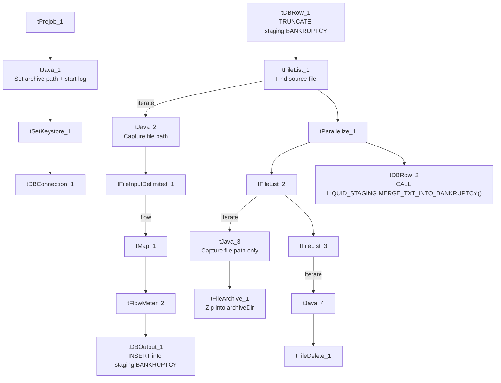

# Talend Job: Bankruptcy_Text_Load

## Overview

This job follows the project's standard "text load" pattern: it watches the shared LATITUDE source folder for a bankruptcy-data file, loads its rows into a Snowflake staging table, merges that staging data into the permanent `BANKRUPTCY` table via a Snowflake stored procedure, and then archives and deletes the source file. It has no `author` recorded in its metadata, which is unusual compared to most other jobs in this project.

## Detail table

| Field | Value |
|---|---|
| Job name | Bankruptcy_Text_Load |
| Version | 0.1 |
| Project | LATITUDE |
| Author | *(blank in metadata — not recorded)* |
| Created | 2026-06-24T14:37:08.660-0700 |
| Last Modified | 2026-06-25T17:10:44.797-0700 |

## Step-by-step data flow

1. **Set up.** `tPrejob_1` runs first; `tJava_1` appends today's date to `context.archiveDir` and opens a log file in `context.logDir`; `tSetKeystore_1` configures the SSL client keystore; `tDBConnection_1` opens the Snowflake connection.
2. **Empty the staging table.** `tDBRow_1` runs `TRUNCATE TABLE LIQUID_STAGING.BANKRUPTCY;`.
3. **Find and read the file.** `tFileList_1` lists files in `context.sourceDir` (excluding `*.txt`, no explicit sort order); `tJava_2` captures the found file's path into `context.filePath`; `tFileInputDelimited_1` reads it as a pipe-delimited file (`|~|` fields, `|$|` rows, header row present, US-ASCII encoding).
4. **Transform and load staging.** `tMap_1` maps the file's ~60 bankruptcy-detail columns (case number, court/trustee details, discharge/dismissal dates, secured/unsecured amounts, etc.) onto the `BANKRUPTCY` schema and adds `LOAD_DT`. Rows pass through a row counter (`tFlowMeter_2`) into `tDBOutput_1`, which inserts them into the staging table.
5. **Merge and clean up — in parallel.** `tFileList_1`'s success also triggers `tParallelize_1`, which splits into two branches:
   - **Merge branch:** `tDBRow_2` runs `CALL LIQUID_STAGING.MERGE_TXT_INTO_BANKRUPTCY();` — a Snowflake stored procedure that folds the staged rows into the permanent table. No result-code check follows it (no `tDie`/`tWarn`).
   - **Cleanup branch:** the source folder is listed again (`tFileList_2`), then in parallel: `tJava_3` captures the file path (but **not** the file name) and `tFileArchive_1` zips it into `context.archiveDir`; separately `tFileList_3` → `tJava_4` → `tFileDelete_1` deletes the original file from the source folder.

## Settings tables

### Source: `tFileInputDelimited_1`

| Setting | Value | What it means |
|---|---|---|
| FILENAME | `context.filePath` | Reads whichever file `tFileList_1` just found. |
| FIELDSEPARATOR / ROWSEPARATOR | `\|~\|` / `\|$\|` | The project's standard pipe-delimited format. |
| HEADER | 1 | First line is a header row. |
| ENCODING | US-ASCII | Plain ASCII — same as `cmi_Hermes_Recommendations_Load`, but a step down from ISO-8859-15 used by `Address_Text_Load` and most peers; worth confirming this file never carries accented characters. |
| DIE_ON_ERROR | true | A malformed row fails the job immediately (no bad-file redirect like `HH_Violation_Text_Load`). |
| TEMP_DIR | `"C:/Talend-Studio-20211109_1610-V8.0.1/workspace"` | Hardcoded Windows path (see Issues observed). |
| EXCLUDEFILEMASK (on `tFileList_1`) | `*.txt` | `.txt` files are skipped as usual. |

### Target: `tDBOutput_1`

| Setting | Value | What it means |
|---|---|---|
| Table | BANKRUPTCY | Loads into the staging copy (`LIQUID_STAGING.BANKRUPTCY`, per the preceding TRUNCATE). |
| Output action | INSERT | Adds rows only. |
| Table action | NONE | Table structure is untouched. |

### Merge step: `tDBRow_2`

| Setting | Value | What it means |
|---|---|---|
| Query | `CALL LIQUID_STAGING.MERGE_TXT_INTO_BANKRUPTCY();` | Runs the Snowflake procedure that folds staged rows into the permanent table. Notably this call explicitly qualifies the procedure with the `LIQUID_STAGING` schema, whereas most peer jobs (e.g. `Address_Text_Load`, `HH_Violation_Text_Load`) call the equivalent procedure unqualified — a cosmetic naming inconsistency across the project, not necessarily a functional difference. |

### Archive/delete: `tFileArchive_1` / `tFileDelete_1`

| Setting | Value | What it means |
|---|---|---|
| TARGET (`tFileArchive_1`) | `context.archiveDir + context.fileName + ".zip"` | Intended to name the zip after the source file — but see Issues observed: `context.fileName` is never actually set anywhere in this job. |
| SOURCE_FILE (`tFileArchive_1`) | `"C:/Talend-Studio-.../workspace/source.csv"` | Hardcoded Windows path (see Issues observed). |
| DIRECTORY / PATH (`tFileDelete_1`) | `"C:/Talend-Studio-.../workspace/delete_folder"` / `"...delete_folder or delete_file"` | Hardcoded Windows paths; actual deletion target is `FILENAME=context.filePath`. |
| FAILON (`tFileDelete_1`) | false | If the delete fails, the job doesn't fail. |

## Dependencies & configuration

- **Triggers/depends on other jobs:** none found — no `tRunJob` links to or from any other job.
- **Context variables used:** `context.sourceDir`, `context.archiveDir`, `context.filePath`, `context.fileName`, `context.logDir`, `context.keystorePath` (all `Directories_0.1`, each with a Windows-style dev value and a Linux-mount-style value in `_shared_context.json`, e.g. `sourceDir` = `C:/Data/Latitude/` or `/mnt/analytics_team/PROD/LATITUDE/Liquid/`). It uses the shared, repository-linked Snowflake connection object rather than referencing `LEGACY_DW_0.1` variables directly.

## Glossary

| Component type | Plain-English meaning |
|---|---|
| `tPrejob` / `tParallelize` | Job-flow control (see job_Address_Text_Load.md). |
| `tSnowflakeConnection` (`tDBConnection`) | Opens the reusable Snowflake connection that the job's other Snowflake components share. Its parameters are empty in this job's metadata because it uses a shared, repository-linked connection object rather than inline settings. |
| `tFileList` | Lists files in a folder for iteration (see job_Address_Text_Load.md). |
| `tFileInputDelimited` | Reads a delimited text file row by row (see job_Address_Text_Load.md). |
| `tMap` | Maps/transforms columns (see job_Address_Text_Load.md). |
| `tFlowMeter` | Counts rows passing through (see job_Address_Text_Load.md). |
| `tDBOutput` / `tSnowflakeOutput` | Writes rows to a Snowflake table (see job_Address_Text_Load.md). |
| `tDBRow` / `tSnowflakeRow` | Runs a single SQL statement (see job_Address_Text_Load.md). |
| `tJava` | Custom Java code block (see job_Address_Text_Load.md). |
| `tFileArchive` | Zips a file into an archive location (see job_Address_Text_Load.md). |
| `tFileDelete` | Deletes a file (see job_Address_Text_Load.md). |
| `tSetKeystore` | Configures the SSL keystore for the Snowflake connection (see job_Address_Text_Load.md). |

## Issues observed

- **`context.fileName` is never set anywhere in this job, but `tFileArchive_1` depends on it.** Both `tJava_2` (main read branch) and `tJava_3` (archive branch) only assign `context.filePath`; no component in this job assigns `context.fileName`. Since `tFileArchive_1`'s `TARGET` is `context.archiveDir + context.fileName + ".zip"`, and `fileName` defaults to an empty string in the `Directories_0.1` context group, the archived file is very likely being written as just `<archiveDir>/.zip` rather than a properly named file. Every comparable job checked (`Debtor_Table_Text_Load`, `HH_Violation_Text_Load`, `MiscExtra_Text_Load`, etc.) sets both `filePath` and `fileName` in its archive-branch `tJava` step — this job appears to be missing that second assignment. Worth confirming directly with the team / checking the archive folder for oddly-named zip files.
- **Merge procedure call is schema-qualified (`LIQUID_STAGING.MERGE_TXT_INTO_BANKRUPTCY`)** while most peer jobs call the equivalent procedure unqualified (`MERGE_TXT_INTO_ADDRESS`, `MERGE_TXT_INTO_HH_VIOLATION`, etc.) — a naming/style inconsistency, not necessarily a functional issue.
- **No `author` recorded** in this job's metadata, unlike every other job reviewed (all show `jmach@harriscollect.com`).
- **Hardcoded, machine-specific paths** on `tSetKeystore_1.SSL_TRUSTSERVER_TRUSTSTORE`, `tFileInputDelimited_1.TEMP_DIR`, `tFileArchive_1.SOURCE_FILE`, and `tFileDelete_1.DIRECTORY`/`PATH` — the same project-wide pattern flagged in other jobs' documentation.
- **The merge procedure's own logic is outside Talend** — its column-matching and update logic live in Snowflake, not visible in this metadata.
