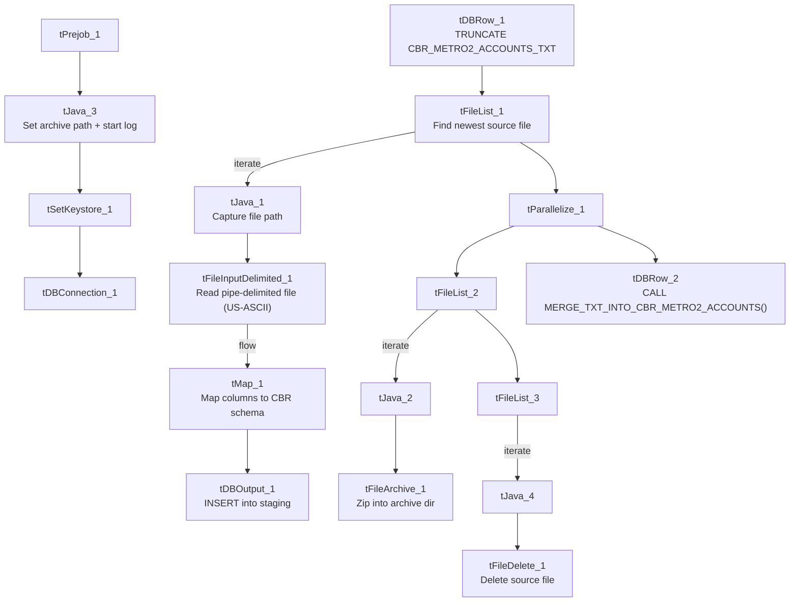

# Talend Job: CBR_Metro2_Accounts_Table_Text_Load

## Overview

This job follows the project's standard "text load" pattern: it watches a shared folder for a new CBR/Metro 2 accounts file (Metro 2 is the standard format lenders/collectors use to furnish account data to credit bureaus), loads it into a Snowflake staging table, merges the staged rows into the permanent `CBR_METRO2_ACCOUNTS_TXT`-related table via a stored procedure, and then archives and deletes the source file. It has no built-in error handling if the merge fails — like most jobs in this project, a failure would only show up as a generic Talend error.

## Detail table

| Field | Value |
|---|---|
| Job name | CBR_Metro2_Accounts_Table_Text_Load |
| Version | 0.1 |
| Project | LATITUDE |
| Author | jmach@harriscollect.com |
| Created | 2024-10-29T12:32:19.729-0700 |
| Last Modified | 2025-09-29T10:23:08.445-0700 |

## Step-by-step data flow

1. **Set up.** `tJava_3` appends today's date to `context.archiveDir` and starts a log file in `context.logDir`; `tSetKeystore_1` configures the SSL keystore; `tDBConnection_1` opens the Snowflake connection.
2. **Empty the staging table.** `tDBRow_1` runs `TRUNCATE TABLE CBR_METRO2_ACCOUNTS_TXT;` — note this statement does **not** qualify the table with the `LIQUID_STAGING` schema the way `Address_Text_Load` does (`TRUNCATE TABLE LIQUID_STAGING.ADDRESS;`); it relies on the Snowflake connection's default schema already being `LIQUID_STAGING`.
3. **Find the file.** `tFileList_1` lists files in `context.sourceDir`, skipping anything ending in `.txt`. Its first match becomes `context.filePath` via `tJava_1`.
4. **Read and reshape.** `tFileInputDelimited_1` reads the file as pipe-delimited (`|~|` fields, `|$|` rows, header row present), encoded as **US-ASCII** (not ISO-8859-15 like `Address_Text_Load` — see Issues observed). `tMap_1` maps the file's ~32 Metro-2-style columns (account status, balances, dates, charge-off amount, payment history profile, etc.) onto the target schema, adding `LOAD_DT`.
5. **Load staging.** Mapped rows flow into `tDBOutput_1`, which inserts them into `CBR_METRO2_ACCOUNTS_TXT` (action: `INSERT`, no table-structure changes).
6. **Merge into the permanent table — in parallel with cleanup.** `tParallelize_1` splits into two branches:
   - **Merge branch:** `tDBRow_2` runs `CALL MERGE_TXT_INTO_CBR_METRO2_ACCOUNTS();`, a Snowflake stored procedure that folds staged rows into the real table. No `tDie`/`tWarn` reacts to its outcome.
   - **Cleanup branch:** the source file is listed again, archived (`tFileArchive_1`, zipped into `context.archiveDir/<filename>.zip`), and — via a second file-list/capture — deleted (`tFileDelete_1`).

## Settings tables

### Source: `tFileInputDelimited_1`

| Setting | Value | What it means |
|---|---|---|
| FILENAME | `context.filePath` | Reads whichever file `tFileList_1` just found. |
| FIELDSEPARATOR / ROWSEPARATOR | `\|~\|` / `\|$\|` | The project's standard custom-delimited format. |
| HEADER | 1 | First line is a header, not data. |
| ENCODING | US-ASCII | Plain ASCII, not ISO-8859-15 like `Address_Text_Load` and most peers — see Issues observed. |
| EXCLUDEFILEMASK (on `tFileList_1`) | `*.txt` | `.txt` files are skipped in the source folder. |

### Target: `tDBOutput_1`

| Setting | Value | What it means |
|---|---|---|
| Table | CBR_METRO2_ACCOUNTS_TXT | Staging table the mapped rows are inserted into. |
| Output action | INSERT | Adds rows only. |
| Table action | NONE | Doesn't create/drop/truncate — that's handled separately by `tDBRow_1`. |

### Merge step: `tDBRow_2`

| Setting | Value | What it means |
|---|---|---|
| Query | `CALL MERGE_TXT_INTO_CBR_METRO2_ACCOUNTS();` | Snowflake stored procedure that folds staged rows into the permanent table; its own logic is outside Talend. |

## Dependencies & configuration

- **Triggers/depends on other jobs:** none — no `tRunJob` links found.
- **Context variables used:** `context.sourceDir`, `context.archiveDir`, `context.filePath`, `context.fileName`, `context.logDir`, `context.keystorePath` (all `Directories_0.1`). It uses the shared Snowflake connection object (`tDBConnection_1`) rather than referencing `LEGACY_DW_0.1` variables directly — `context_vars_referenced` contains no `LEGACY_DW_` entries.
- **Hardcoded values found:** `tFileInputDelimited_1.TEMP_DIR`, `tFileArchive_1.SOURCE_FILE`, `tFileDelete_1.DIRECTORY`/`PATH`, and `tSetKeystore_1.SSL_TRUSTSERVER_TRUSTSTORE` are all fixed `C:/Talend-Studio-20211109_1610-V8.0.1/...` or `C:/clientTrustStore.trustStore` paths rather than context variables — the same pattern seen across most jobs in this project.

## Glossary

| Component type | Plain-English meaning |
|---|---|
| `tPrejob` / `tParallelize` | Job-flow control: setup-before-main-job, and run-branches-at-the-same-time (see `job_Address_Text_Load.md`). |
| `tFileList` | Lists files in a folder for the job to loop over (see `job_Address_Text_Load.md`). |
| `tFileInputDelimited` | Reads a delimited text file row by row (see `job_Address_Text_Load.md`). |
| `tMap` | Maps/transforms input columns to output columns (see `job_Address_Text_Load.md`). |
| `tDBOutput` / `tSnowflakeOutput` | Writes rows into a Snowflake table (see `job_Address_Text_Load.md`). |
| `tDBRow` / `tSnowflakeRow` | Runs a single SQL statement against Snowflake — used here for `TRUNCATE` and `CALL <procedure>` (see `job_Address_Text_Load.md`). |
| `tJava` / `tJavaRow` | Custom Java code snippets for string/date manipulation (see `job_Address_Text_Load.md`). |
| `tFileArchive` | Zips a file into an archive location (see `job_Address_Text_Load.md`). |
| `tFileDelete` | Deletes a file from disk (see `job_Address_Text_Load.md`). |
| `tSetKeystore` | Configures the SSL keystore for the Snowflake connection (see `job_Address_Text_Load.md`). |

## Issues observed

- **File encoding is US-ASCII**, unlike `Address_Text_Load` and most peers, which use ISO-8859-15. Worth confirming this is intentional for CBR/Metro 2 data (which is often plain-ASCII bureau-format data) rather than an oversight.
- **The `TRUNCATE` statement doesn't qualify the schema** (`CBR_METRO2_ACCOUNTS_TXT` rather than `LIQUID_STAGING.CBR_METRO2_ACCOUNTS_TXT`), unlike some peer jobs (e.g. `Deceased_Text_Load`, `cmi_Customer_Ext_Text_Load`) that do qualify it. This only works correctly if the Snowflake connection's default/current schema is already `LIQUID_STAGING` — worth confirming with whoever manages the Snowflake connection.
- **No `tDie`/`tWarn` on the merge step** — same as `Address_Text_Load`, a failed merge here surfaces only as a generic Talend error, not a job-specific one.
- **Standard hardcoded machine-specific paths** present (`TEMP_DIR`, `tFileArchive_1.SOURCE_FILE`, `tFileDelete_1.DIRECTORY`/`PATH`, `tSetKeystore_1.SSL_TRUSTSERVER_TRUSTSTORE`) — same project-wide pattern documented elsewhere.
