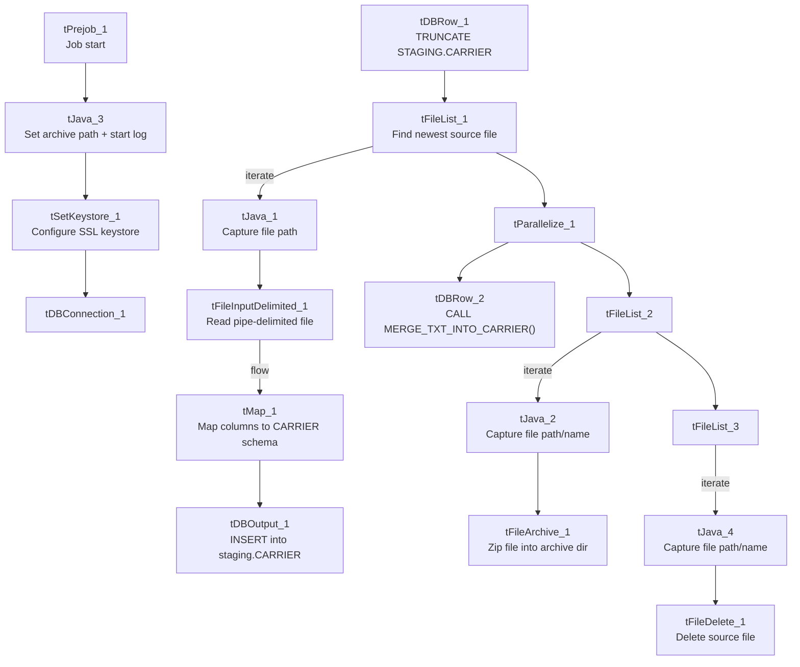

# Talend Job: Carrier_Text_Load

## Overview

This job is one of the project's standard "text load" jobs: it watches a shared folder for a new carrier (insurance carrier) data file, loads its rows into a Snowflake staging table, merges that staging data into the permanent `CARRIER` table using a Snowflake stored procedure, and then archives and deletes the source file. It follows the same truncate → load → merge → archive/delete pattern as `Address_Text_Load`, with a couple of small differences called out below.

## Detail table

| Field | Value |
|---|---|
| Job name | Carrier_Text_Load |
| Version | 0.1 |
| Project | LATITUDE |
| Author | jmach@harriscollect.com |
| Created | 2026-01-19T09:03:18.128-0800 |
| Last Modified | 2026-01-19T09:23:43.426-0800 |

## Step-by-step data flow

1. **Set up.** `tPrejob_1` runs first; `tJava_3` appends today's date to the archive path (`context.archiveDir = context.archiveDir + <yyyyMMdd> + "/"`) and starts a log file, then `tSetKeystore_1` configures the SSL keystore and `tDBConnection_1` opens the Snowflake connection.
2. **Empty the staging table.** `tDBRow_1` runs `TRUNCATE TABLE STAGING.CARRIER;` — note the schema here is `STAGING`, not `LIQUID_STAGING` as in most peer jobs (see Issues observed).
3. **Find the file.** `tFileList_1` lists files in `context.sourceDir`, sorted by last-modified date (`ORDER_BY_MODIFIEDDATE`=true, `ORDER_ACTION_ASC`=true), skipping `.txt` files. The first match becomes `context.filePath` (set by `tJava_1`).
4. **Read and reshape.** `tFileInputDelimited_1` reads the file as pipe-delimited (`|~|` fields, `|$|` rows) with a header row, encoded as US-ASCII. `tMap_1` maps the file's columns onto the `CARRIER` table's columns.
5. **Load staging.** The mapped rows flow into `tDBOutput_1`, which inserts them into the `CARRIER` table in Snowflake (action: `INSERT`, no table-structure changes).
6. **Merge, archive, and delete — in parallel.** `tParallelize_1` splits into two branches:
   - **Merge branch:** `tDBRow_2` runs `CALL MERGE_TXT_INTO_CARRIER();`, a Snowflake stored procedure that folds the staged rows into the permanent table. There is no `tDie`/`tWarn` check on its result in this job.
   - **Cleanup branch:** the source file is listed again (`tFileList_2`), archived into `context.archiveDir` as a `.zip` (`tFileArchive_1`), listed again (`tFileList_3`), and deleted (`tFileDelete_1`).

## Settings tables

### Source: `tFileInputDelimited_1`

| Setting | Value | What it means |
|---|---|---|
| FILENAME | `context.filePath` | Reads whichever file `tFileList_1` just found. |
| FIELDSEPARATOR | `\|~\|` | Columns are separated by `\|~\|`. |
| ROWSEPARATOR | `\|$\|` | Rows are separated by `\|$\|`. |
| CSVROWSEPARATOR | `\r\n` | Fallback row separator if CSV mode is used (`CSV_OPTION` is false here, so this is largely inert). |
| HEADER | 1 | First line is a header row. |
| ENCODING | US-ASCII | Plain ASCII — same as `cmi_Hermes_Recommendations_Load`, unlike `Address_Text_Load`'s ISO-8859-15. |
| SCHEMA_REJECT | repository schema `"customer"` | The reject-row schema reference points at a schema named "customer", not "carrier" — likely a copy-paste leftover from a template job (see Issues observed). |
| EXCLUDEFILEMASK (on `tFileList_1`) | `*.txt` | `.txt` files are skipped. |

### Target: `tDBOutput_1` (loads the Snowflake staging table)

| Setting | Value | What it means |
|---|---|---|
| Table | CARRIER | Writes into a table named `CARRIER`. |
| Output action | INSERT | Adds rows only. |
| Table action | NONE | Doesn't create/drop/truncate the table — that's done separately by `tDBRow_1`. |

### Truncate step: `tDBRow_1`

| Setting | Value | What it means |
|---|---|---|
| Query | `TRUNCATE TABLE STAGING.CARRIER;` | Empties the staging table before loading. Note the schema qualifier is `STAGING`, not `LIQUID_STAGING` as in most peer jobs — see Issues observed. |

### Merge step: `tDBRow_2`

| Setting | Value | What it means |
|---|---|---|
| Query | `CALL MERGE_TXT_INTO_CARRIER();` | Runs a Snowflake stored procedure (defined outside Talend) that folds the staged rows into the permanent table. |

## Dependencies & configuration

- **Triggers/depends on other jobs:** none found — no `tRunJob` links to or from any other job in the extracted metadata.
- **Context variables used:** `context.sourceDir`, `context.archiveDir`, `context.filePath`, `context.fileName`, `context.logDir`, `context.keystorePath` (all from the `Directories_0.1` context group). It does not reference `LEGACY_DW_0.1` variables directly — its Snowflake connection is the shared, repository-linked connection object (`tDBConnection_1` / `tSnowflakeConnection`).
- **Hardcoded values found:** `tFileInputDelimited_1.TEMP_DIR`, `tFileArchive_1.SOURCE_FILE`, `tFileDelete_1.DIRECTORY`/`PATH`, and `tSetKeystore_1.SSL_TRUSTSERVER_TRUSTSTORE` are all fixed `C:/...` Windows paths rather than context variables — the same project-wide pattern seen in `Address_Text_Load`.

## Glossary

| Component type | Plain-English meaning |
|---|---|
| `tPrejob` / `tParallelize` | Job-flow control (see `job_Address_Text_Load.md`). |
| `tFileList` | Lists files in a folder for the job to loop over (see `job_Address_Text_Load.md`). |
| `tFileInputDelimited` | Reads a delimited text file row by row (see `job_Address_Text_Load.md`). |
| `tMap` | Maps/transforms columns (see `job_Address_Text_Load.md`). |
| `tDBOutput` / `tSnowflakeOutput` | Writes rows into a Snowflake table (see `job_Address_Text_Load.md`). |
| `tDBRow` / `tSnowflakeRow` | Runs a single SQL statement against Snowflake — here, `TRUNCATE` and `CALL <procedure>` (see `job_Address_Text_Load.md`). |
| `tJava` | Small custom Java code blocks for string/date/logging work (see `job_Address_Text_Load.md`). |
| `tFileArchive` | Zips a file into an archive location (see `job_Address_Text_Load.md`). |
| `tFileDelete` | Deletes a file from disk (see `job_Address_Text_Load.md`). |
| `tSetKeystore` | Configures the SSL keystore for the Snowflake connection (see `job_Address_Text_Load.md`). |

## Issues observed

- **The truncate step targets a different schema than the load/merge steps imply.** `tDBRow_1` truncates `STAGING.CARRIER`, whereas the equivalent step in most peer jobs (e.g. `Address_Text_Load`, `Insurance_Text_Load`, `DeskChangeHistory_Text_Load`) truncates `LIQUID_STAGING.<table>`. It's not clear from this metadata whether `STAGING` is an alias/synonym for `LIQUID_STAGING` or a genuinely different schema — worth confirming with whoever owns the Snowflake schema layout, since a mismatch here would mean the truncate and the subsequent `tDBOutput_1` insert are not necessarily hitting the same table.
- **Reject-schema mismatch.** `tFileInputDelimited_1`'s `SCHEMA_REJECT:REPOSITORY_SCHEMA_TYPE` points at a repository schema named "customer" rather than a carrier-specific one — the same mismatched reference appears in `Result_Table_Text_Load`, `cmi_Dialer_Plan_History_Table_Text_Load`, and `cmi_renkim_ReturnHistory_Text_Load`, suggesting all four were built from the same copy-paste template and the reject schema was never updated. Low risk in practice (it only affects the shape of rejected-row metadata), but worth a cleanup pass.
- **No merge-result checking.** Unlike `PatientInfo_Text_Load` and `cmi_Hermes_Recommendations_Load`, this job has no `tDie`/`tWarn` reacting to whether `MERGE_TXT_INTO_CARRIER()` succeeded.
- **Several hardcoded, machine-specific paths** exist alongside the parameterized ones (see Dependencies & configuration) — the same project-wide pattern flagged in `Address_Text_Load`.
