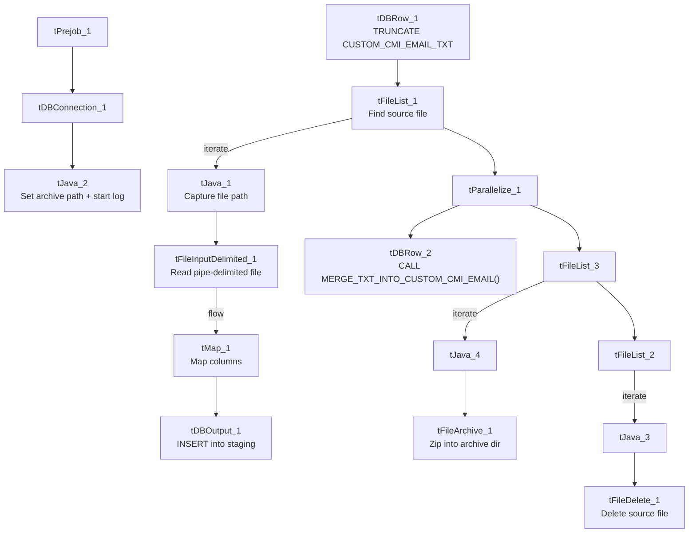

# Talend Job: Custom_cmi_Email_Text_Load

## Overview

This job loads a customer-email data file (a customized/"custom" variant of the CMI email feed) into Snowflake: it watches the shared source folder for a new pipe-delimited file, loads its rows into a staging table, merges them into the permanent `CUSTOM_CMI_EMAIL_TXT`-backed table via a stored procedure, then archives and deletes the source file. It follows the project's standard load pattern, but — unusually for this project — it has no `tSetKeystore` component configuring the SSL client keystore for its Snowflake connection (see Issues observed).

## Detail table

| Field | Value |
|---|---|
| Job name | Custom_cmi_Email_Text_Load |
| Version | 0.1 |
| Project | LATITUDE |
| Author | jmach@harriscollect.com |
| Created | 2024-11-20T17:51:01.563-0800 |
| Last Modified | 2025-09-25T08:24:10.357-0700 |

## Step-by-step data flow

1. **Set up.** `tPrejob_1` starts the job; `tDBConnection_1` opens the Snowflake connection, then `tJava_2` appends today's date to `context.archiveDir` and opens a log file in `context.logDir`.
2. **Empty the staging table.** `tDBRow_1` runs `TRUNCATE TABLE CUSTOM_CMI_EMAIL_TXT;`, then triggers the file-processing chain.
3. **Find the file.** `tFileList_1` lists files in `context.sourceDir` (skipping `.txt` files); its first match becomes `context.filePath` (`tJava_1`).
4. **Read and reshape.** `tFileInputDelimited_1` reads the file using the repository schema "cmi_email" — pipe-delimited (`|~|` fields, `|$|` rows), header row present, US-ASCII encoding. `tMap_1` maps its columns (`uid`, `debtorid`, `email`, `source`, `readWhen`, `bounceBackWhen`, `status`, `active`, `createdby`, `createdwhen`, `modifiedby`, `modifiedwhen`, `consentFlag`) onto the target schema (`UID`, `DEBTORID`, `EMAIL`, `SOURCE`, `READWHEN`, `BOUNCEBACKWHEN`, `STATUS`, `ACTIVE`, `CREATEDBY`, `CREATEDWHEN`, `MODIFIEDBY`, `MODIFIEDWHEN`, `CONSENTFLAG`, plus `LOAD_DT`).
5. **Load staging.** The mapped rows go straight into `tDBOutput_1`, which inserts them into `CUSTOM_CMI_EMAIL_TXT` (action: INSERT, no table-structure change). There is no row-counter (`tFlowMeter`) on this path, unlike some peer jobs.
6. **Merge and clean up — in parallel.** `tParallelize_1` splits into two branches once the file list step succeeds:
   - **Merge branch:** `tDBRow_2` runs `CALL MERGE_TXT_INTO_CUSTOM_CMI_EMAIL();`, folding the staged rows into the permanent table. There is no `tDie`/`tWarn` check on the result.
   - **Cleanup branch:** the source file is listed again and archived (`tFileArchive_1`, zipped into `context.archiveDir`), and separately listed and deleted (`tFileDelete_1`).

## Settings tables

### Source: `tFileInputDelimited_1`

| Setting | Value | What it means |
|---|---|---|
| FILENAME | `context.filePath` | Reads whichever file `tFileList_1` just found. |
| Schema | Repository schema "cmi_email" | Uses a shared, pre-defined column layout rather than an inline one. |
| FIELDSEPARATOR / ROWSEPARATOR | `\|~\|` / `\|$\|` | The project's standard pipe-delimited format. |
| CSVROWSEPARATOR | `\r\n` | The underlying line-ending expected within each `|$|`-delimited row. |
| HEADER | 1 | First line is a header, not data. |
| ENCODING | US-ASCII | Plain ASCII — differs from `Address_Text_Load`'s ISO-8859-15; worth confirming this is intentional if names/emails can contain accented characters. |
| DIE_ON_ERROR | false | A malformed row is skipped/rejected rather than failing the whole job (rejects are captured via the `SCHEMA_REJECT` schema). |

### Target: `tDBOutput_1`

| Setting | Value | What it means |
|---|---|---|
| Table | CUSTOM_CMI_EMAIL_TXT | Writes into this staging table. |
| Output action | INSERT | Adds rows only. |
| Table action | NONE | Table structure isn't touched here — truncation is a separate step (`tDBRow_1`). |

### Merge step: `tDBRow_2`

| Setting | Value | What it means |
|---|---|---|
| Query | `CALL MERGE_TXT_INTO_CUSTOM_CMI_EMAIL();` | Snowflake stored procedure that folds staged rows into the real, permanent table. Its internal logic isn't visible in this metadata. |

## Dependencies & configuration

- **Triggers/depends on other jobs:** none — no `tRunJob` links found.
- **Context variables used:** `context.sourceDir`, `context.archiveDir`, `context.filePath`, `context.fileName`, `context.logDir` (all `Directories_0.1`). Notably, `context.keystorePath` is **not** referenced anywhere in this job — consistent with the missing `tSetKeystore` component (see Issues observed).
- **Snowflake connection:** uses the shared connection object (`tDBConnection_1` / `tSnowflakeConnection`), not `LEGACY_DW_*` context variables directly.

## Glossary

| Component type | Plain-English meaning |
|---|---|
| `tPrejob` / `tParallelize` | Job-flow control: setup-before-main-flow, and running branches concurrently (see `job_Address_Text_Load.md`). |
| `tFileList` | Lists files in a folder so the job can loop over them (see `job_Address_Text_Load.md`). |
| `tFileInputDelimited` | Reads a delimited text file row by row (see `job_Address_Text_Load.md`). |
| `tMap` | Maps/transforms input columns to output columns (see `job_Address_Text_Load.md`). |
| `tSnowflakeOutput` (`tDBOutput`) | Writes rows into a Snowflake table (see `job_Address_Text_Load.md`). |
| `tSnowflakeRow` (`tDBRow`) | Runs a single SQL statement against Snowflake — used here for `TRUNCATE` and `CALL <procedure>` (see `job_Address_Text_Load.md`). |
| `tJava` | Custom Java code for small tasks like string/date manipulation (see `job_Address_Text_Load.md`). |
| `tFileArchive` | Zips a file into an archive location (see `job_Address_Text_Load.md`). |
| `tFileDelete` | Deletes a file from disk (see `job_Address_Text_Load.md`). |

## Issues observed

- **No `tSetKeystore` component.** Every other "Text Load" job reviewed in this batch (and in the reference docs) configures the SSL client keystore via `tSetKeystore` before opening its Snowflake connection; this job has no such component at all, and `context.keystorePath` is never referenced. This may mean the job relies on a different SSL configuration path, or it may be a genuine gap — worth confirming with whoever manages the Snowflake connection security settings, since it's the only job in this set that skips it.
- **Hardcoded machine-specific paths**: `tFileInputDelimited_1.TEMP_DIR`, `tFileDelete_1.DIRECTORY`/`PATH`, and `tFileArchive_1.SOURCE_FILE` are all fixed to a specific `C:/Talend-Studio-20211109_1610-V8.0.1/...` path rather than a context variable — the same pattern flagged project-wide.
- **No row counter (`tFlowMeter`)** on the load path, unlike some peer jobs — not necessarily a problem, but means this job's row-load volume isn't captured in the same monitoring stream as jobs that do have one.
- **No `tDie`/`tWarn` check on the merge result** — a failed `MERGE_TXT_INTO_CUSTOM_CMI_EMAIL()` call would only surface as a generic Talend error.
