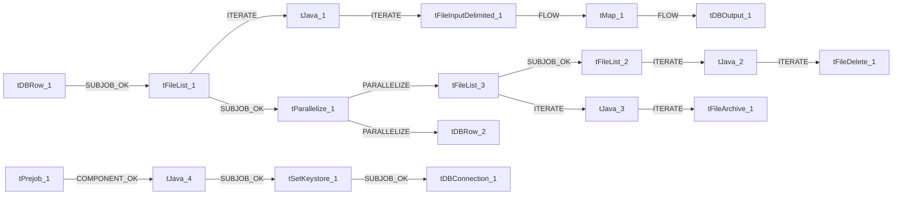

# Talend Job: Customer_Table_Text_Load

- **Project**: LATITUDE
- **Version**: 0.1
- **Job Type**: Standard

- **Author**: jmach@harriscollect.com
- **Created**: 2024-10-23T07:39:08.292-0700
- **Last Modified**: 2025-09-30T10:55:48.688-0700

## Components

| # | Component | Type | Key Parameters |
|---|-----------|------|----------------|
| 1 | tDBConnection_1 | `tSnowflakeConnection` | `CONNECTION_FORMAT`=row, `PROPERTIES`={"@id":2,"@type":"org.talend.components.snowflake. |
| 2 | tDBRow_1 | `tSnowflakeRow` | `CONNECTION_FORMAT`=row, `PROPERTIES`={"@id":3,"@type":"org.talend.components.snowflake. |
| 3 | tFileList_1 | `tFileList` | `DIRECTORY`=context.sourceDir, `LIST_MODE`=FILES, `INCLUDSUBDIR`=false, `CASE_SENSITIVE`=YES, `ERROR`=false |
| 4 | tJava_1 | `tJava` | `CODE`=context.filePath = ((String)globalMap.get("tFileLi, `IMPORT`=//import java.util.List;, `CONNECTION_FORMAT`=row |
| 5 | tFileInputDelimited_1 | `tFileInputDelimited` | `USE_EXISTING_DYNAMIC`=false, `FILENAMETEXT`="When the input source is a stream or a zip file,f, `FILENAME`=context.filePath, `CSV_OPTION`=false, `ROWSEPARATOR`="|$|" |
| 6 | tMap_1 | `tMap` | `LINK_STYLE`=AUTO, `DIE_ON_ERROR`=true, `LKUP_PARALLELIZE`=false, `LEVENSHTEIN`=0, `JACCARD`=0 |
| 7 | tDBOutput_1 | `tSnowflakeOutput` | `CONNECTION_FORMAT`=row, `PROPERTIES`={"@id":3,"@type":"org.talend.components.snowflake. |
| 8 | tDBRow_2 | `tSnowflakeRow` | `CONNECTION_FORMAT`=row, `PROPERTIES`={"@id":3,"@type":"org.talend.components.snowflake. |
| 9 | tPrejob_1 | `tPrejob` | `CONNECTION_FORMAT`=row |
| 10 | tFileList_2 | `tFileList` | `DIRECTORY`=context.sourceDir, `LIST_MODE`=FILES, `INCLUDSUBDIR`=false, `CASE_SENSITIVE`=YES, `ERROR`=false |
| 11 | tJava_2 | `tJava` | `CODE`=context.filePath = ((String)globalMap.get("tFileLi, `IMPORT`=//import java.util.List;, `CONNECTION_FORMAT`=row |
| 12 | tFileDelete_1 | `tFileDelete` | `FILENAME`=context.filePath, `DIRECTORY`="C:/Talend-Studio-20211109_1610-V8.0.1/workspace/d, `PATH`="C:/Talend-Studio-20211109_1610-V8.0.1/workspace/d, `FAILON`=true, `FOLDER`=false |
| 13 | tFileList_3 | `tFileList` | `DIRECTORY`=context.sourceDir, `LIST_MODE`=FILES, `INCLUDSUBDIR`=false, `CASE_SENSITIVE`=YES, `ERROR`=false |
| 14 | tJava_3 | `tJava` | `CODE`=context.filePath = ((String)globalMap.get("tFileLi, `IMPORT`=//import java.util.List;, `CONNECTION_FORMAT`=row |
| 15 | tFileArchive_1 | `tFileArchive` | `SOURCE`=context.sourceDir, `SOURCE_FILE`="C:/Talend-Studio-20211109_1610-V8.0.1/workspace/s, `SUB_DIRECTROY`=false, `TARGET`=context.archiveDir + context.fileName+".zip", `MKDIR`=true |
| 16 | tParallelize_1 | `tParallelize` | `WAIT_FOR`=All, `SLEEPTIME`=100, `DIE_ON_ERROR`=false, `CONNECTION_FORMAT`=row |
| 17 | tJava_4 | `tJava` | `CODE`=context.archiveDir = context.archiveDir + TalendDa, `IMPORT`=//import java.util.List;, `CONNECTION_FORMAT`=row |
| 18 | tSetKeystore_1 | `tSetKeystore` | `SET_TRUSTSTORE`=false, `SET_TRUSTSTORE_KEYSTORE`=false, `TRUSTSTORE_TYPE`=JKS, `SSL_TRUSTSERVER_TRUSTSTORE`="C:/clientTrustStore.trustStore", `KEYSTORE_TYPE`=PKCS12 |

## Schemas

### tDBRow_1

| Column | Type | Nullable | Length |
|--------|------|----------|--------|
| errorCode | id_String | No | 255 |
| errorMessage | id_String | No | 255 |

### tFileInputDelimited_1

| Column | Type | Nullable | Length |
|--------|------|----------|--------|
| customer | id_String | Yes | 7 |
| status | id_String | Yes | 8 |
| SelectedFlag | id_String | Yes | 1 |
| Name | id_String | Yes | 100 |
| Street1 | id_String | Yes | 30 |
| Street2 | id_String | Yes | 30 |
| City | id_String | Yes | 20 |
| State | id_String | Yes | 3 |
| Zipcode | id_String | Yes | 10 |
| Contact | id_String | Yes | 30 |
| phone | id_String | Yes | 20 |
| lettercode | id_String | Yes | 75 |
| penalty | id_String | Yes | 20 |
| badcheck | id_String | Yes | 20 |
| ctl | id_String | Yes | 3 |
| fees | id_String | Yes | 20 |
| collections | id_String | Yes | 20 |
| mtdnumberplaced | id_Integer | Yes | -1 |
| mtddollarsplaced | id_String | Yes | 20 |
| ytdnumberplaced | id_Integer | Yes | -1 |
| ytddollarsplaced | id_String | Yes | 20 |
| mtdpdcfees | id_String | Yes | 20 |
| mtdpdccollections | id_String | Yes | 20 |
| mtdfees | id_String | Yes | 20 |
| mtdcollections | id_String | Yes | 20 |
| ytdfees | id_String | Yes | 20 |
| ytdcollections | id_String | Yes | 20 |
| bankcode | id_String | Yes | 100 |
| attorneycode | id_String | Yes | 30 |
| salesmancode | id_String | Yes | 30 |
| sifinfo | id_String | Yes | -1 |
| workinfo | id_String | Yes | -1 |
| miscinfo | id_String | Yes | -1 |
| invoicetype | id_String | Yes | 20 |
| invoicefreq | id_String | Yes | 20 |
| invoicesort | id_String | Yes | 20 |
| invoicemethod | id_String | Yes | 20 |
| options | id_String | Yes | 50 |
| option1 | id_String | Yes | 50 |
| fax | id_String | Yes | 10 |
| Half | id_String | Yes | 15 |
| Close_ | id_String | Yes | 20 |
| FaxNumber | id_String | Yes | 30 |
| AutoRecallStatus | id_String | Yes | 60 |
| AutoRecallDays | id_Integer | Yes | -1 |
| AutoRecallFlag | id_String | Yes | -1 |
| locate | id_String | Yes | 20 |
| SpecialCode | id_String | Yes | 20 |
| CustomerGroup | id_String | Yes | 10 |
| Full0 | id_String | Yes | 20 |
| AmtDueClient | id_String | Yes | 20 |
| feecode2 | id_String | Yes | 30 |
| feedays | id_Integer | Yes | -1 |
| cob | id_String | Yes | 50 |
| company | id_String | Yes | 40 |
| LastInvoiceAttempt | id_String | Yes | 30 |
| RemitMethod | id_String | Yes | 5 |
| ABARoutingNum | id_String | Yes | 9 |
| BankAcctNum | id_String | Yes | 20 |
| CustGroup | id_String | Yes | 7 |
| CheckHoldDays | id_Integer | Yes | -1 |
| InvShowRcvd | id_Integer | Yes | -1 |
| InvShowBal | id_Integer | Yes | -1 |
| CCostPct | id_String | Yes | 20 |
| CCostBucket | id_Integer | Yes | -1 |
| FeeSchedule | id_String | Yes | 5 |
| IsPODCust | id_Integer | Yes | -1 |
| CBRRptType | id_String | Yes | 50 |
| CBRMinBal | id_String | Yes | 20 |
| CBRWaitDays | id_Integer | Yes | -1 |
| UseEquifax | id_Integer | Yes | -1 |
| UseTransUnion | id_Integer | Yes | -1 |
| UseExperian | id_Integer | Yes | -1 |
| UseInnovis | id_Integer | Yes | -1 |
| eMail | id_String | Yes | 100 |
| CBRClass | id_String | Yes | 40 |
| ShowReverseOfDate | id_Integer | Yes | -1 |
| OnlineCheckFee | id_String | Yes | 20 |
| AlphaCode | id_String | Yes | 50 |
| Sweep | id_Integer | Yes | -1 |
| SweepDays | id_Integer | Yes | -1 |
| SweepDaysPaid | id_Integer | Yes | -1 |
| SweepMinBalance | id_String | Yes | 20 |
| SweepDesk | id_String | Yes | 10 |
| DefaultDesk | id_String | Yes | 10 |
| FaxID | id_String | Yes | 50 |
| CbrAcctRtnSendDel | id_Integer | Yes | -1 |
| CustomDate1 | id_String | Yes | 30 |
| CustomDate2 | id_String | Yes | 30 |
| CustomDate3 | id_String | Yes | 30 |
| CustomDate4 | id_String | Yes | 30 |
| CustomDate5 | id_String | Yes | 30 |
| CustomDate6 | id_String | Yes | 30 |
| CustomDate7 | id_String | Yes | 30 |
| CustomDate8 | id_String | Yes | 30 |
| CustomDate9 | id_String | Yes | 30 |
| CustomOption1 | id_Integer | Yes | -1 |
| CustomOption2 | id_Integer | Yes | -1 |
| CustomOption3 | id_Integer | Yes | -1 |
| CustomOption4 | id_Integer | Yes | -1 |
| CustomOption5 | id_Integer | Yes | -1 |
| CustomOption6 | id_Integer | Yes | -1 |
| CustomOption7 | id_Integer | Yes | -1 |
| CustomOption8 | id_Integer | Yes | -1 |
| CustomOption9 | id_Integer | Yes | -1 |
| CustomValue1 | id_Integer | Yes | -1 |
| CustomValue2 | id_Integer | Yes | -1 |
| CustomValue3 | id_Integer | Yes | -1 |
| CustomValue4 | id_Integer | Yes | -1 |
| CustomValue5 | id_Integer | Yes | -1 |
| CustomValue6 | id_Integer | Yes | -1 |
| CustomValue7 | id_Integer | Yes | -1 |
| CustomValue8 | id_Integer | Yes | -1 |
| CustomValue9 | id_Integer | Yes | -1 |
| LegalFeeSchedule | id_String | Yes | 5 |
| CCustomerID | id_Integer | Yes | -1 |
| LetterDeliveryMethod | id_Integer | Yes | -1 |
| DateCreated | id_String | Yes | 30 |
| DateUpdated | id_String | Yes | 30 |
| FeeCode | id_String | Yes | 30 |
| BlanketSif | id_String | Yes | 20 |
| IsPrincipleCust | id_Integer | Yes | -1 |
| CustomText1 | id_String | Yes | 500 |
| CustomText2 | id_String | Yes | 500 |
| CustomText3 | id_String | Yes | -1 |
| CustomText4 | id_String | Yes | 500 |
| CustomText5 | id_String | Yes | -1 |
| BankID | id_Integer | Yes | -1 |
| DefaultInterest | id_String | Yes | 20 |
| InvShowOther | id_Integer | Yes | -1 |
| AcknowledgeNewBiz | id_Integer | Yes | -1 |
| Salesman1ID | id_Integer | Yes | -1 |
| CollectorFeeSchedule | id_String | Yes | 5 |
| Salesman2ID | id_Integer | Yes | -1 |
| Salesman3ID | id_Integer | Yes | -1 |
| CbrOriginalCreditor | id_String | Yes | 30 |
| CbrAccountType | id_String | Yes | 2 |
| CbrCreditorClass | id_String | Yes | 2 |
| FeeCapAmount | id_String | Yes | 20 |
| FeeCapPercent | id_Integer | Yes | -1 |
| InvoiceReport | id_String | Yes | 120 |
| CreatedBy | id_String | Yes | 256 |
| UpdatedBy | id_String | Yes | 256 |
| FreeDemandDays | id_Integer | Yes | -1 |
| FreeDemandBatchTypes | id_Integer | Yes | -1 |
| CultureCode | id_String | Yes | 10 |
| InterestBuckets | id_Integer | Yes | -1 |
| Priority | id_Integer | Yes | -1 |
| PermitSurcharges | id_Integer | Yes | -1 |
| AllowAWG | id_Integer | Yes | -1 |
| AWGWaitDays | id_Integer | Yes | -1 |
| AWGMaxDays | id_Integer | Yes | -1 |
| AWGMaxDaysPriorSellBack | id_Integer | Yes | -1 |
| AWGMinCurrentBalanceRequired | id_String | Yes | 20 |
| AllowRehab | id_Integer | Yes | -1 |
| RehabAllowSkipMonth | id_Integer | Yes | -1 |
| RehabSkipMonth | id_Integer | Yes | -1 |
| RehabEligibilityCutoffDate | id_String | Yes | 30 |
| RehabAllowedDownPaymentSplit | id_Integer | Yes | -1 |
| RehabDownPaymentSplitMaxDays | id_Integer | Yes | -1 |
| RehabDownPaymentCountsAsSinglePayment | id_Integer | Yes | -1 |
| RehabAllowIfPriorToIncorporation | id_Integer | Yes | -1 |
| RehabReqMinBalanceAtFunding | id_String | Yes | 20 |
| RehabPrePaymentGracePeriod | id_Integer | Yes | -1 |
| RehabPostPaymentGracePeriod | id_Integer | Yes | -1 |
| RehabNumDaysBetweenPayments | id_Integer | Yes | -1 |
| RehabMinPaymentsReq | id_Integer | Yes | -1 |
| RehabAllowReferencePobox | id_Integer | Yes | -1 |
| RehabTypeFeeSchedule | id_String | Yes | 5 |
| RehabReqMinBalanceForEligibility | id_String | Yes | 20 |
| RehabAllowAWGApplyAsRehabPayments | id_Integer | Yes | -1 |
| RehabMonthsNotSkippable | id_Integer | Yes | -1 |
| RehabDoNotAllowLastMonthSkip | id_Integer | Yes | -1 |
| AllowConsolidation | id_Integer | Yes | -1 |
| ConsolidationMinReqCurrentBalance | id_String | Yes | 20 |
| ConsolidationMinReqpaymentAmountPayArrangement | id_String | Yes | 20 |
| ConsolidationMinNumReqPaymentsPayArrangement | id_Integer | Yes | -1 |
| ConsolidationMinNumDaysPayArrangement | id_Integer | Yes | -1 |
| ConsolidationMaxNumDaysPayArrangement | id_Integer | Yes | -1 |
| ConsolidationPreGracePeriod | id_Integer | Yes | -1 |
| ConsolidationPostGracePeriod | id_Integer | Yes | -1 |
| ConsolidationMinNumberReqPrevPostedPayments | id_Integer | Yes | -1 |
| ConsolidationFeeSchedule | id_String | Yes | 5 |
| ConsolidationStoreNumBlindApp | id_Integer | Yes | -1 |
| AWGMinBalanceBuckets | id_Integer | Yes | -1 |
| ConsolidationMinBalanceBuckets | id_Integer | Yes | -1 |
| RehabMinBalanceBuckets | id_Integer | Yes | -1 |
| CCostMode | id_Integer | Yes | -1 |
| CCostBuckets | id_Integer | Yes | -1 |
| CCostDays | id_Integer | Yes | -1 |
| RehabAvgPmtsForQualification | id_Integer | Yes | -1 |
| Country | id_String | Yes | 128 |
| County | id_String | Yes | 128 |
| MaxAllowedSurcharge | id_String | Yes | 20 |
| RegisteredState | id_String | Yes | 3 |
| DefaultContractType | id_String | Yes | 30 |
| customer | id_String | Yes | 7 |
| status | id_String | Yes | 8 |
| SelectedFlag | id_String | Yes | 1 |
| Name | id_String | Yes | 100 |
| Street1 | id_String | Yes | 30 |
| Street2 | id_String | Yes | 30 |
| City | id_String | Yes | 20 |
| State | id_String | Yes | 3 |
| Zipcode | id_String | Yes | 10 |
| Contact | id_String | Yes | 30 |
| phone | id_String | Yes | 20 |
| lettercode | id_String | Yes | 75 |
| penalty | id_String | Yes | 20 |
| badcheck | id_String | Yes | 20 |
| ctl | id_String | Yes | 3 |
| fees | id_String | Yes | 20 |
| collections | id_String | Yes | 20 |
| mtdnumberplaced | id_Integer | Yes | -1 |
| mtddollarsplaced | id_String | Yes | 20 |
| ytdnumberplaced | id_Integer | Yes | -1 |
| ytddollarsplaced | id_String | Yes | 20 |
| mtdpdcfees | id_String | Yes | 20 |
| mtdpdccollections | id_String | Yes | 20 |
| mtdfees | id_String | Yes | 20 |
| mtdcollections | id_String | Yes | 20 |
| ytdfees | id_String | Yes | 20 |
| ytdcollections | id_String | Yes | 20 |
| bankcode | id_String | Yes | 100 |
| attorneycode | id_String | Yes | 30 |
| salesmancode | id_String | Yes | 30 |
| sifinfo | id_String | Yes | -1 |
| workinfo | id_String | Yes | -1 |
| miscinfo | id_String | Yes | -1 |
| invoicetype | id_String | Yes | 20 |
| invoicefreq | id_String | Yes | 20 |
| invoicesort | id_String | Yes | 20 |
| invoicemethod | id_String | Yes | 20 |
| options | id_String | Yes | 50 |
| option1 | id_String | Yes | 50 |
| fax | id_String | Yes | 10 |
| Half | id_String | Yes | 15 |
| Close_ | id_String | Yes | 20 |
| FaxNumber | id_String | Yes | 30 |
| AutoRecallStatus | id_String | Yes | 60 |
| AutoRecallDays | id_Integer | Yes | -1 |
| AutoRecallFlag | id_String | Yes | -1 |
| locate | id_String | Yes | 20 |
| SpecialCode | id_String | Yes | 20 |
| CustomerGroup | id_String | Yes | 10 |
| Full0 | id_String | Yes | 20 |
| AmtDueClient | id_String | Yes | 20 |
| feecode2 | id_String | Yes | 30 |
| feedays | id_Integer | Yes | -1 |
| cob | id_String | Yes | 50 |
| company | id_String | Yes | 40 |
| LastInvoiceAttempt | id_String | Yes | 30 |
| RemitMethod | id_String | Yes | 5 |
| ABARoutingNum | id_String | Yes | 9 |
| BankAcctNum | id_String | Yes | 20 |
| CustGroup | id_String | Yes | 7 |
| CheckHoldDays | id_Integer | Yes | -1 |
| InvShowRcvd | id_Integer | Yes | -1 |
| InvShowBal | id_Integer | Yes | -1 |
| CCostPct | id_String | Yes | 20 |
| CCostBucket | id_Integer | Yes | -1 |
| FeeSchedule | id_String | Yes | 5 |
| IsPODCust | id_Integer | Yes | -1 |
| CBRRptType | id_String | Yes | 50 |
| CBRMinBal | id_String | Yes | 20 |
| CBRWaitDays | id_Integer | Yes | -1 |
| UseEquifax | id_Integer | Yes | -1 |
| UseTransUnion | id_Integer | Yes | -1 |
| UseExperian | id_Integer | Yes | -1 |
| UseInnovis | id_Integer | Yes | -1 |
| eMail | id_String | Yes | 100 |
| CBRClass | id_String | Yes | 40 |
| ShowReverseOfDate | id_Integer | Yes | -1 |
| OnlineCheckFee | id_String | Yes | 20 |
| AlphaCode | id_String | Yes | 50 |
| Sweep | id_Integer | Yes | -1 |
| SweepDays | id_Integer | Yes | -1 |
| SweepDaysPaid | id_Integer | Yes | -1 |
| SweepMinBalance | id_String | Yes | 20 |
| SweepDesk | id_String | Yes | 10 |
| DefaultDesk | id_String | Yes | 10 |
| FaxID | id_String | Yes | 50 |
| CbrAcctRtnSendDel | id_Integer | Yes | -1 |
| CustomDate1 | id_String | Yes | 30 |
| CustomDate2 | id_String | Yes | 30 |
| CustomDate3 | id_String | Yes | 30 |
| CustomDate4 | id_String | Yes | 30 |
| CustomDate5 | id_String | Yes | 30 |
| CustomDate6 | id_String | Yes | 30 |
| CustomDate7 | id_String | Yes | 30 |
| CustomDate8 | id_String | Yes | 30 |
| CustomDate9 | id_String | Yes | 30 |
| CustomOption1 | id_Integer | Yes | -1 |
| CustomOption2 | id_Integer | Yes | -1 |
| CustomOption3 | id_Integer | Yes | -1 |
| CustomOption4 | id_Integer | Yes | -1 |
| CustomOption5 | id_Integer | Yes | -1 |
| CustomOption6 | id_Integer | Yes | -1 |
| CustomOption7 | id_Integer | Yes | -1 |
| CustomOption8 | id_Integer | Yes | -1 |
| CustomOption9 | id_Integer | Yes | -1 |
| CustomValue1 | id_Integer | Yes | -1 |
| CustomValue2 | id_Integer | Yes | -1 |
| CustomValue3 | id_Integer | Yes | -1 |
| CustomValue4 | id_Integer | Yes | -1 |
| CustomValue5 | id_Integer | Yes | -1 |
| CustomValue6 | id_Integer | Yes | -1 |
| CustomValue7 | id_Integer | Yes | -1 |
| CustomValue8 | id_Integer | Yes | -1 |
| CustomValue9 | id_Integer | Yes | -1 |
| LegalFeeSchedule | id_String | Yes | 5 |
| CCustomerID | id_Integer | Yes | -1 |
| LetterDeliveryMethod | id_Integer | Yes | -1 |
| DateCreated | id_String | Yes | 30 |
| DateUpdated | id_String | Yes | 30 |
| FeeCode | id_String | Yes | 30 |
| BlanketSif | id_String | Yes | 20 |
| IsPrincipleCust | id_Integer | Yes | -1 |
| CustomText1 | id_String | Yes | 500 |
| CustomText2 | id_String | Yes | 500 |
| CustomText3 | id_String | Yes | -1 |
| CustomText4 | id_String | Yes | 500 |
| CustomText5 | id_String | Yes | -1 |
| BankID | id_Integer | Yes | -1 |
| DefaultInterest | id_String | Yes | 20 |
| InvShowOther | id_Integer | Yes | -1 |
| AcknowledgeNewBiz | id_Integer | Yes | -1 |
| Salesman1ID | id_Integer | Yes | -1 |
| CollectorFeeSchedule | id_String | Yes | 5 |
| Salesman2ID | id_Integer | Yes | -1 |
| Salesman3ID | id_Integer | Yes | -1 |
| CbrOriginalCreditor | id_String | Yes | 30 |
| CbrAccountType | id_String | Yes | 2 |
| CbrCreditorClass | id_String | Yes | 2 |
| FeeCapAmount | id_String | Yes | 20 |
| FeeCapPercent | id_Integer | Yes | -1 |
| InvoiceReport | id_String | Yes | 120 |
| CreatedBy | id_String | Yes | 256 |
| UpdatedBy | id_String | Yes | 256 |
| FreeDemandDays | id_Integer | Yes | -1 |
| FreeDemandBatchTypes | id_Integer | Yes | -1 |
| CultureCode | id_String | Yes | 10 |
| InterestBuckets | id_Integer | Yes | -1 |
| Priority | id_Integer | Yes | -1 |
| PermitSurcharges | id_Integer | Yes | -1 |
| AllowAWG | id_Integer | Yes | -1 |
| AWGWaitDays | id_Integer | Yes | -1 |
| AWGMaxDays | id_Integer | Yes | -1 |
| AWGMaxDaysPriorSellBack | id_Integer | Yes | -1 |
| AWGMinCurrentBalanceRequired | id_String | Yes | 20 |
| AllowRehab | id_Integer | Yes | -1 |
| RehabAllowSkipMonth | id_Integer | Yes | -1 |
| RehabSkipMonth | id_Integer | Yes | -1 |
| RehabEligibilityCutoffDate | id_String | Yes | 30 |
| RehabAllowedDownPaymentSplit | id_Integer | Yes | -1 |
| RehabDownPaymentSplitMaxDays | id_Integer | Yes | -1 |
| RehabDownPaymentCountsAsSinglePayment | id_Integer | Yes | -1 |
| RehabAllowIfPriorToIncorporation | id_Integer | Yes | -1 |
| RehabReqMinBalanceAtFunding | id_String | Yes | 20 |
| RehabPrePaymentGracePeriod | id_Integer | Yes | -1 |
| RehabPostPaymentGracePeriod | id_Integer | Yes | -1 |
| RehabNumDaysBetweenPayments | id_Integer | Yes | -1 |
| RehabMinPaymentsReq | id_Integer | Yes | -1 |
| RehabAllowReferencePobox | id_Integer | Yes | -1 |
| RehabTypeFeeSchedule | id_String | Yes | 5 |
| RehabReqMinBalanceForEligibility | id_String | Yes | 20 |
| RehabAllowAWGApplyAsRehabPayments | id_Integer | Yes | -1 |
| RehabMonthsNotSkippable | id_Integer | Yes | -1 |
| RehabDoNotAllowLastMonthSkip | id_Integer | Yes | -1 |
| AllowConsolidation | id_Integer | Yes | -1 |
| ConsolidationMinReqCurrentBalance | id_String | Yes | 20 |
| ConsolidationMinReqpaymentAmountPayArrangement | id_String | Yes | 20 |
| ConsolidationMinNumReqPaymentsPayArrangement | id_Integer | Yes | -1 |
| ConsolidationMinNumDaysPayArrangement | id_Integer | Yes | -1 |
| ConsolidationMaxNumDaysPayArrangement | id_Integer | Yes | -1 |
| ConsolidationPreGracePeriod | id_Integer | Yes | -1 |
| ConsolidationPostGracePeriod | id_Integer | Yes | -1 |
| ConsolidationMinNumberReqPrevPostedPayments | id_Integer | Yes | -1 |
| ConsolidationFeeSchedule | id_String | Yes | 5 |
| ConsolidationStoreNumBlindApp | id_Integer | Yes | -1 |
| AWGMinBalanceBuckets | id_Integer | Yes | -1 |
| ConsolidationMinBalanceBuckets | id_Integer | Yes | -1 |
| RehabMinBalanceBuckets | id_Integer | Yes | -1 |
| CCostMode | id_Integer | Yes | -1 |
| CCostBuckets | id_Integer | Yes | -1 |
| CCostDays | id_Integer | Yes | -1 |
| RehabAvgPmtsForQualification | id_Integer | Yes | -1 |
| Country | id_String | Yes | 128 |
| County | id_String | Yes | 128 |
| MaxAllowedSurcharge | id_String | Yes | 20 |
| RegisteredState | id_String | Yes | 3 |
| DefaultContractType | id_String | Yes | 30 |
| errorCode | id_String | Yes | 255 |
| errorMessage | id_String | Yes | 255 |

### tMap_1

| Column | Type | Nullable | Length |
|--------|------|----------|--------|
| LOAD_DT | id_Date | Yes | -1 |
| customer | id_String | Yes | -1 |
| status | id_String | Yes | -1 |
| SelectedFlag | id_String | Yes | -1 |
| Name | id_String | Yes | -1 |
| Street1 | id_String | Yes | -1 |
| Street2 | id_String | Yes | -1 |
| City | id_String | Yes | -1 |
| State | id_String | Yes | -1 |
| Zipcode | id_String | Yes | -1 |
| Contact | id_String | Yes | -1 |
| phone | id_String | Yes | -1 |
| lettercode | id_String | Yes | -1 |
| penalty | id_String | Yes | -1 |
| badcheck | id_String | Yes | -1 |
| ctl | id_String | Yes | -1 |
| fees | id_String | Yes | -1 |
| collections | id_String | Yes | -1 |
| mtdnumberplaced | id_Integer | Yes | -1 |
| mtddollarsplaced | id_String | Yes | -1 |
| ytdnumberplaced | id_Integer | Yes | -1 |
| ytddollarsplaced | id_String | Yes | -1 |
| mtdpdcfees | id_String | Yes | -1 |
| mtdpdccollections | id_String | Yes | -1 |
| mtdfees | id_String | Yes | -1 |
| mtdcollections | id_String | Yes | -1 |
| ytdfees | id_String | Yes | -1 |
| ytdcollections | id_String | Yes | -1 |
| bankcode | id_String | Yes | -1 |
| attorneycode | id_String | Yes | -1 |
| salesmancode | id_String | Yes | -1 |
| sifinfo | id_String | Yes | -1 |
| workinfo | id_String | Yes | -1 |
| miscinfo | id_String | Yes | -1 |
| invoicetype | id_String | Yes | -1 |
| invoicefreq | id_String | Yes | -1 |
| invoicesort | id_String | Yes | -1 |
| invoicemethod | id_String | Yes | -1 |
| options | id_String | Yes | -1 |
| option1 | id_String | Yes | -1 |
| fax | id_String | Yes | -1 |
| Half | id_String | Yes | -1 |
| Close_ | id_String | Yes | -1 |
| FaxNumber | id_String | Yes | -1 |
| AutoRecallStatus | id_String | Yes | -1 |
| AutoRecallDays | id_Integer | Yes | -1 |
| AutoRecallFlag | id_String | Yes | -1 |
| locate | id_String | Yes | -1 |
| SpecialCode | id_String | Yes | -1 |
| CustomerGroup | id_String | Yes | -1 |
| Full0 | id_String | Yes | -1 |
| AmtDueClient | id_String | Yes | -1 |
| feecode2 | id_String | Yes | -1 |
| feedays | id_Integer | Yes | -1 |
| cob | id_String | Yes | -1 |
| company | id_String | Yes | -1 |
| LastInvoiceAttempt | id_String | Yes | -1 |
| RemitMethod | id_String | Yes | -1 |
| ABARoutingNum | id_String | Yes | -1 |
| BankAcctNum | id_String | Yes | -1 |
| CustGroup | id_String | Yes | -1 |
| CheckHoldDays | id_Integer | Yes | -1 |
| InvShowRcvd | id_Integer | Yes | -1 |
| InvShowBal | id_Integer | Yes | -1 |
| CCostPct | id_String | Yes | -1 |
| CCostBucket | id_Integer | Yes | -1 |
| FeeSchedule | id_String | Yes | -1 |
| IsPODCust | id_Integer | Yes | -1 |
| CBRRptType | id_String | Yes | -1 |
| CBRMinBal | id_String | Yes | -1 |
| CBRWaitDays | id_Integer | Yes | -1 |
| UseEquifax | id_Integer | Yes | -1 |
| UseTransUnion | id_Integer | Yes | -1 |
| UseExperian | id_Integer | Yes | -1 |
| UseInnovis | id_Integer | Yes | -1 |
| eMail | id_String | Yes | -1 |
| CBRClass | id_String | Yes | -1 |
| ShowReverseOfDate | id_Integer | Yes | -1 |
| OnlineCheckFee | id_String | Yes | -1 |
| AlphaCode | id_String | Yes | -1 |
| Sweep | id_Integer | Yes | -1 |
| SweepDays | id_Integer | Yes | -1 |
| SweepDaysPaid | id_Integer | Yes | -1 |
| SweepMinBalance | id_String | Yes | -1 |
| SweepDesk | id_String | Yes | -1 |
| DefaultDesk | id_String | Yes | -1 |
| FaxID | id_String | Yes | -1 |
| CbrAcctRtnSendDel | id_Integer | Yes | -1 |
| CustomDate1 | id_String | Yes | -1 |
| CustomDate2 | id_String | Yes | -1 |
| CustomDate3 | id_String | Yes | -1 |
| CustomDate4 | id_String | Yes | -1 |
| CustomDate5 | id_String | Yes | -1 |
| CustomDate6 | id_String | Yes | -1 |
| CustomDate7 | id_String | Yes | -1 |
| CustomDate8 | id_String | Yes | -1 |
| CustomDate9 | id_String | Yes | -1 |
| CustomOption1 | id_Integer | Yes | -1 |
| CustomOption2 | id_Integer | Yes | -1 |
| CustomOption3 | id_Integer | Yes | -1 |
| CustomOption4 | id_Integer | Yes | -1 |
| CustomOption5 | id_Integer | Yes | -1 |
| CustomOption6 | id_Integer | Yes | -1 |
| CustomOption7 | id_Integer | Yes | -1 |
| CustomOption8 | id_Integer | Yes | -1 |
| CustomOption9 | id_Integer | Yes | -1 |
| CustomValue1 | id_Integer | Yes | -1 |
| CustomValue2 | id_Integer | Yes | -1 |
| CustomValue3 | id_Integer | Yes | -1 |
| CustomValue4 | id_Integer | Yes | -1 |
| CustomValue5 | id_Integer | Yes | -1 |
| CustomValue6 | id_Integer | Yes | -1 |
| CustomValue7 | id_Integer | Yes | -1 |
| CustomValue8 | id_Integer | Yes | -1 |
| CustomValue9 | id_Integer | Yes | -1 |
| LegalFeeSchedule | id_String | Yes | -1 |
| CCustomerID | id_Integer | Yes | -1 |
| LetterDeliveryMethod | id_Integer | Yes | -1 |
| DateCreated | id_String | Yes | -1 |
| DateUpdated | id_String | Yes | -1 |
| FeeCode | id_String | Yes | -1 |
| BlanketSif | id_String | Yes | -1 |
| IsPrincipleCust | id_Integer | Yes | -1 |
| CustomText1 | id_String | Yes | -1 |
| CustomText2 | id_String | Yes | -1 |
| CustomText3 | id_String | Yes | -1 |
| CustomText4 | id_String | Yes | -1 |
| CustomText5 | id_String | Yes | -1 |
| BankID | id_Integer | Yes | -1 |
| DefaultInterest | id_String | Yes | -1 |
| InvShowOther | id_Integer | Yes | -1 |
| AcknowledgeNewBiz | id_Integer | Yes | -1 |
| Salesman1ID | id_Integer | Yes | -1 |
| CollectorFeeSchedule | id_String | Yes | -1 |
| Salesman2ID | id_Integer | Yes | -1 |
| Salesman3ID | id_Integer | Yes | -1 |
| CbrOriginalCreditor | id_String | Yes | -1 |
| CbrAccountType | id_String | Yes | -1 |
| CbrCreditorClass | id_String | Yes | -1 |
| FeeCapAmount | id_String | Yes | -1 |
| FeeCapPercent | id_Integer | Yes | -1 |
| InvoiceReport | id_String | Yes | -1 |
| CreatedBy | id_String | Yes | -1 |
| UpdatedBy | id_String | Yes | -1 |
| FreeDemandDays | id_Integer | Yes | -1 |
| FreeDemandBatchTypes | id_Integer | Yes | -1 |
| CultureCode | id_String | Yes | -1 |
| InterestBuckets | id_Integer | Yes | -1 |
| Priority | id_Integer | Yes | -1 |
| PermitSurcharges | id_Integer | Yes | -1 |
| ALLOWAWG | id_Integer | Yes | 38 |
| AWGWAITDAYS | id_Integer | Yes | 38 |
| AWGMAXDAYS | id_Integer | Yes | 38 |
| AWGMAXDAYSPRIORSELLBACK | id_Integer | Yes | 38 |
| AWGMINCURRENTBALANCEREQUIRED | id_String | Yes | 16777216 |
| ALLOWREHAB | id_Integer | Yes | 38 |
| REHABALLOWSKIPMONTH | id_Integer | Yes | 38 |
| REHABSKIPMONTH | id_Integer | Yes | 38 |
| REHABELIGIBILITYCUTOFFDATE | id_String | Yes | 16777216 |
| REHABALLOWEDDOWNPAYMENTSPLIT | id_Integer | Yes | 38 |
| REHABDOWNPAYMENTSPLITMAXDAYS | id_Integer | Yes | 38 |
| REHABDOWNPAYMENTCOUNTSASSINGLEPAYMENT | id_Integer | Yes | 38 |
| REHABALLOWIFPRIORTOINCORPORATION | id_Integer | Yes | 38 |
| REHABREQMINBALANCEATFUNDING | id_String | Yes | 16777216 |
| REHABPREPAYMENTGRACEPERIOD | id_Integer | Yes | 38 |
| REHABPOSTPAYMENTGRACEPERIOD | id_Integer | Yes | 38 |
| REHABNUMDAYSBETWEENPAYMENTS | id_Integer | Yes | 38 |
| REHABMINPAYMENTSREQ | id_Integer | Yes | 38 |
| REHABALLOWREFERENCEPOBOX | id_Integer | Yes | 38 |
| REHABTYPEFEESCHEDULE | id_String | Yes | 5 |
| REHABREQMINBALANCEFORELIGIBILITY | id_String | Yes | 16777216 |
| REHABALLOWAWGAPPLYASREHABPAYMENTS | id_Integer | Yes | 38 |
| REHABMONTHSNOTSKIPPABLE | id_Integer | Yes | 38 |
| REHABDONOTALLOWLASTMONTHSKIP | id_Integer | Yes | 38 |
| ALLOWCONSOLIDATION | id_Integer | Yes | 38 |
| CONSOLIDATIONMINREQCURRENTBALANCE | id_String | Yes | 16777216 |
| CONSOLIDATIONMINREQPAYMENTAMOUNTPAYARRANGEMENT | id_String | Yes | 16777216 |
| CONSOLIDATIONMINNUMREQPAYMENTSPAYARRANGEMENT | id_Integer | Yes | 38 |
| CONSOLIDATIONMINNUMDAYSPAYARRANGEMENT | id_Integer | Yes | 38 |
| CONSOLIDATIONMAXNUMDAYSPAYARRANGEMENT | id_Integer | Yes | 38 |
| CONSOLIDATIONPREGRACEPERIOD | id_Integer | Yes | 38 |
| CONSOLIDATIONPOSTGRACEPERIOD | id_Integer | Yes | 38 |
| CONSOLIDATIONMINNUMBERREQPREVPOSTEDPAYMENTS | id_Integer | Yes | 38 |
| CONSOLIDATIONFEESCHEDULE | id_String | Yes | 5 |
| CONSOLIDATIONSTORENUMBLINDAPP | id_Integer | Yes | 38 |
| AWGMINBALANCEBUCKETS | id_Integer | Yes | 38 |
| CONSOLIDATIONMINBALANCEBUCKETS | id_Integer | Yes | 38 |
| REHABMINBALANCEBUCKETS | id_Integer | Yes | 38 |
| CCOSTMODE | id_Integer | No | 38 |
| CCOSTBUCKETS | id_Integer | No | 38 |
| CCOSTDAYS | id_Integer | No | 38 |
| REHABAVGPMTSFORQUALIFICATION | id_Integer | No | 38 |
| COUNTRY | id_String | Yes | 128 |
| COUNTY | id_String | Yes | 128 |
| MAXALLOWEDSURCHARGE | id_String | Yes | 16777216 |
| REGISTEREDSTATE | id_String | Yes | 3 |
| DEFAULTCONTRACTTYPE | id_String | Yes | 30 |

### tDBOutput_1

| Column | Type | Nullable | Length |
|--------|------|----------|--------|
| LOAD_DT | id_Date | Yes | -1 |
| customer | id_String | Yes | -1 |
| status | id_String | Yes | -1 |
| SelectedFlag | id_String | Yes | -1 |
| Name | id_String | Yes | -1 |
| Street1 | id_String | Yes | -1 |
| Street2 | id_String | Yes | -1 |
| City | id_String | Yes | -1 |
| State | id_String | Yes | -1 |
| Zipcode | id_String | Yes | -1 |
| Contact | id_String | Yes | -1 |
| phone | id_String | Yes | -1 |
| lettercode | id_String | Yes | -1 |
| penalty | id_String | Yes | -1 |
| badcheck | id_String | Yes | -1 |
| ctl | id_String | Yes | -1 |
| fees | id_String | Yes | -1 |
| collections | id_String | Yes | -1 |
| mtdnumberplaced | id_Integer | Yes | -1 |
| mtddollarsplaced | id_String | Yes | -1 |
| ytdnumberplaced | id_Integer | Yes | -1 |
| ytddollarsplaced | id_String | Yes | -1 |
| mtdpdcfees | id_String | Yes | -1 |
| mtdpdccollections | id_String | Yes | -1 |
| mtdfees | id_String | Yes | -1 |
| mtdcollections | id_String | Yes | -1 |
| ytdfees | id_String | Yes | -1 |
| ytdcollections | id_String | Yes | -1 |
| bankcode | id_String | Yes | -1 |
| attorneycode | id_String | Yes | -1 |
| salesmancode | id_String | Yes | -1 |
| sifinfo | id_String | Yes | -1 |
| workinfo | id_String | Yes | -1 |
| miscinfo | id_String | Yes | -1 |
| invoicetype | id_String | Yes | -1 |
| invoicefreq | id_String | Yes | -1 |
| invoicesort | id_String | Yes | -1 |
| invoicemethod | id_String | Yes | -1 |
| options | id_String | Yes | -1 |
| option1 | id_String | Yes | -1 |
| fax | id_String | Yes | -1 |
| Half | id_String | Yes | -1 |
| Close_ | id_String | Yes | -1 |
| FaxNumber | id_String | Yes | -1 |
| AutoRecallStatus | id_String | Yes | -1 |
| AutoRecallDays | id_Integer | Yes | -1 |
| AutoRecallFlag | id_String | Yes | -1 |
| locate | id_String | Yes | -1 |
| SpecialCode | id_String | Yes | -1 |
| CustomerGroup | id_String | Yes | -1 |
| Full0 | id_String | Yes | -1 |
| AmtDueClient | id_String | Yes | -1 |
| feecode2 | id_String | Yes | -1 |
| feedays | id_Integer | Yes | -1 |
| cob | id_String | Yes | -1 |
| company | id_String | Yes | -1 |
| LastInvoiceAttempt | id_String | Yes | -1 |
| RemitMethod | id_String | Yes | -1 |
| ABARoutingNum | id_String | Yes | -1 |
| BankAcctNum | id_String | Yes | -1 |
| CustGroup | id_String | Yes | -1 |
| CheckHoldDays | id_Integer | Yes | -1 |
| InvShowRcvd | id_Integer | Yes | -1 |
| InvShowBal | id_Integer | Yes | -1 |
| CCostPct | id_String | Yes | -1 |
| CCostBucket | id_Integer | Yes | -1 |
| FeeSchedule | id_String | Yes | -1 |
| IsPODCust | id_Integer | Yes | -1 |
| CBRRptType | id_String | Yes | -1 |
| CBRMinBal | id_String | Yes | -1 |
| CBRWaitDays | id_Integer | Yes | -1 |
| UseEquifax | id_Integer | Yes | -1 |
| UseTransUnion | id_Integer | Yes | -1 |
| UseExperian | id_Integer | Yes | -1 |
| UseInnovis | id_Integer | Yes | -1 |
| eMail | id_String | Yes | -1 |
| CBRClass | id_String | Yes | -1 |
| ShowReverseOfDate | id_Integer | Yes | -1 |
| OnlineCheckFee | id_String | Yes | -1 |
| AlphaCode | id_String | Yes | -1 |
| Sweep | id_Integer | Yes | -1 |
| SweepDays | id_Integer | Yes | -1 |
| SweepDaysPaid | id_Integer | Yes | -1 |
| SweepMinBalance | id_String | Yes | -1 |
| SweepDesk | id_String | Yes | -1 |
| DefaultDesk | id_String | Yes | -1 |
| FaxID | id_String | Yes | -1 |
| CbrAcctRtnSendDel | id_Integer | Yes | -1 |
| CustomDate1 | id_String | Yes | -1 |
| CustomDate2 | id_String | Yes | -1 |
| CustomDate3 | id_String | Yes | -1 |
| CustomDate4 | id_String | Yes | -1 |
| CustomDate5 | id_String | Yes | -1 |
| CustomDate6 | id_String | Yes | -1 |
| CustomDate7 | id_String | Yes | -1 |
| CustomDate8 | id_String | Yes | -1 |
| CustomDate9 | id_String | Yes | -1 |
| CustomOption1 | id_Integer | Yes | -1 |
| CustomOption2 | id_Integer | Yes | -1 |
| CustomOption3 | id_Integer | Yes | -1 |
| CustomOption4 | id_Integer | Yes | -1 |
| CustomOption5 | id_Integer | Yes | -1 |
| CustomOption6 | id_Integer | Yes | -1 |
| CustomOption7 | id_Integer | Yes | -1 |
| CustomOption8 | id_Integer | Yes | -1 |
| CustomOption9 | id_Integer | Yes | -1 |
| CustomValue1 | id_Integer | Yes | -1 |
| CustomValue2 | id_Integer | Yes | -1 |
| CustomValue3 | id_Integer | Yes | -1 |
| CustomValue4 | id_Integer | Yes | -1 |
| CustomValue5 | id_Integer | Yes | -1 |
| CustomValue6 | id_Integer | Yes | -1 |
| CustomValue7 | id_Integer | Yes | -1 |
| CustomValue8 | id_Integer | Yes | -1 |
| CustomValue9 | id_Integer | Yes | -1 |
| LegalFeeSchedule | id_String | Yes | -1 |
| CCustomerID | id_Integer | Yes | -1 |
| LetterDeliveryMethod | id_Integer | Yes | -1 |
| DateCreated | id_String | Yes | -1 |
| DateUpdated | id_String | Yes | -1 |
| FeeCode | id_String | Yes | -1 |
| BlanketSif | id_String | Yes | -1 |
| IsPrincipleCust | id_Integer | Yes | -1 |
| CustomText1 | id_String | Yes | -1 |
| CustomText2 | id_String | Yes | -1 |
| CustomText3 | id_String | Yes | -1 |
| CustomText4 | id_String | Yes | -1 |
| CustomText5 | id_String | Yes | -1 |
| BankID | id_Integer | Yes | -1 |
| DefaultInterest | id_String | Yes | -1 |
| InvShowOther | id_Integer | Yes | -1 |
| AcknowledgeNewBiz | id_Integer | Yes | -1 |
| Salesman1ID | id_Integer | Yes | -1 |
| CollectorFeeSchedule | id_String | Yes | -1 |
| Salesman2ID | id_Integer | Yes | -1 |
| Salesman3ID | id_Integer | Yes | -1 |
| CbrOriginalCreditor | id_String | Yes | -1 |
| CbrAccountType | id_String | Yes | -1 |
| CbrCreditorClass | id_String | Yes | -1 |
| FeeCapAmount | id_String | Yes | -1 |
| FeeCapPercent | id_Integer | Yes | -1 |
| InvoiceReport | id_String | Yes | -1 |
| CreatedBy | id_String | Yes | -1 |
| UpdatedBy | id_String | Yes | -1 |
| FreeDemandDays | id_Integer | Yes | -1 |
| FreeDemandBatchTypes | id_Integer | Yes | -1 |
| CultureCode | id_String | Yes | -1 |
| InterestBuckets | id_Integer | Yes | -1 |
| Priority | id_Integer | Yes | -1 |
| PermitSurcharges | id_Integer | Yes | -1 |
| ALLOWAWG | id_Integer | Yes | 38 |
| AWGWAITDAYS | id_Integer | Yes | 38 |
| AWGMAXDAYS | id_Integer | Yes | 38 |
| AWGMAXDAYSPRIORSELLBACK | id_Integer | Yes | 38 |
| AWGMINCURRENTBALANCEREQUIRED | id_String | Yes | 16777216 |
| ALLOWREHAB | id_Integer | Yes | 38 |
| REHABALLOWSKIPMONTH | id_Integer | Yes | 38 |
| REHABSKIPMONTH | id_Integer | Yes | 38 |
| REHABELIGIBILITYCUTOFFDATE | id_String | Yes | 16777216 |
| REHABALLOWEDDOWNPAYMENTSPLIT | id_Integer | Yes | 38 |
| REHABDOWNPAYMENTSPLITMAXDAYS | id_Integer | Yes | 38 |
| REHABDOWNPAYMENTCOUNTSASSINGLEPAYMENT | id_Integer | Yes | 38 |
| REHABALLOWIFPRIORTOINCORPORATION | id_Integer | Yes | 38 |
| REHABREQMINBALANCEATFUNDING | id_String | Yes | 16777216 |
| REHABPREPAYMENTGRACEPERIOD | id_Integer | Yes | 38 |
| REHABPOSTPAYMENTGRACEPERIOD | id_Integer | Yes | 38 |
| REHABNUMDAYSBETWEENPAYMENTS | id_Integer | Yes | 38 |
| REHABMINPAYMENTSREQ | id_Integer | Yes | 38 |
| REHABALLOWREFERENCEPOBOX | id_Integer | Yes | 38 |
| REHABTYPEFEESCHEDULE | id_String | Yes | 5 |
| REHABREQMINBALANCEFORELIGIBILITY | id_String | Yes | 16777216 |
| REHABALLOWAWGAPPLYASREHABPAYMENTS | id_Integer | Yes | 38 |
| REHABMONTHSNOTSKIPPABLE | id_Integer | Yes | 38 |
| REHABDONOTALLOWLASTMONTHSKIP | id_Integer | Yes | 38 |
| ALLOWCONSOLIDATION | id_Integer | Yes | 38 |
| CONSOLIDATIONMINREQCURRENTBALANCE | id_String | Yes | 16777216 |
| CONSOLIDATIONMINREQPAYMENTAMOUNTPAYARRANGEMENT | id_String | Yes | 16777216 |
| CONSOLIDATIONMINNUMREQPAYMENTSPAYARRANGEMENT | id_Integer | Yes | 38 |
| CONSOLIDATIONMINNUMDAYSPAYARRANGEMENT | id_Integer | Yes | 38 |
| CONSOLIDATIONMAXNUMDAYSPAYARRANGEMENT | id_Integer | Yes | 38 |
| CONSOLIDATIONPREGRACEPERIOD | id_Integer | Yes | 38 |
| CONSOLIDATIONPOSTGRACEPERIOD | id_Integer | Yes | 38 |
| CONSOLIDATIONMINNUMBERREQPREVPOSTEDPAYMENTS | id_Integer | Yes | 38 |
| CONSOLIDATIONFEESCHEDULE | id_String | Yes | 5 |
| CONSOLIDATIONSTORENUMBLINDAPP | id_Integer | Yes | 38 |
| AWGMINBALANCEBUCKETS | id_Integer | Yes | 38 |
| CONSOLIDATIONMINBALANCEBUCKETS | id_Integer | Yes | 38 |
| REHABMINBALANCEBUCKETS | id_Integer | Yes | 38 |
| CCOSTMODE | id_Integer | No | 38 |
| CCOSTBUCKETS | id_Integer | No | 38 |
| CCOSTDAYS | id_Integer | No | 38 |
| REHABAVGPMTSFORQUALIFICATION | id_Integer | No | 38 |
| COUNTRY | id_String | Yes | 128 |
| COUNTY | id_String | Yes | 128 |
| MAXALLOWEDSURCHARGE | id_String | Yes | 16777216 |
| REGISTEREDSTATE | id_String | Yes | 3 |
| DEFAULTCONTRACTTYPE | id_String | Yes | 30 |
| columnName | id_String | No | 255 |
| rowNumber | id_String | No | 255 |
| category | id_String | No | 255 |
| character | id_String | No | 255 |
| errorMessage | id_String | No | 255 |
| byteOffset | id_String | No | 255 |
| line | id_String | No | 255 |
| sqlState | id_String | No | 255 |
| code | id_String | No | 255 |

### tDBRow_2

| Column | Type | Nullable | Length |
|--------|------|----------|--------|
| errorCode | id_String | No | 255 |
| errorMessage | id_String | No | 255 |

## Data Flow

