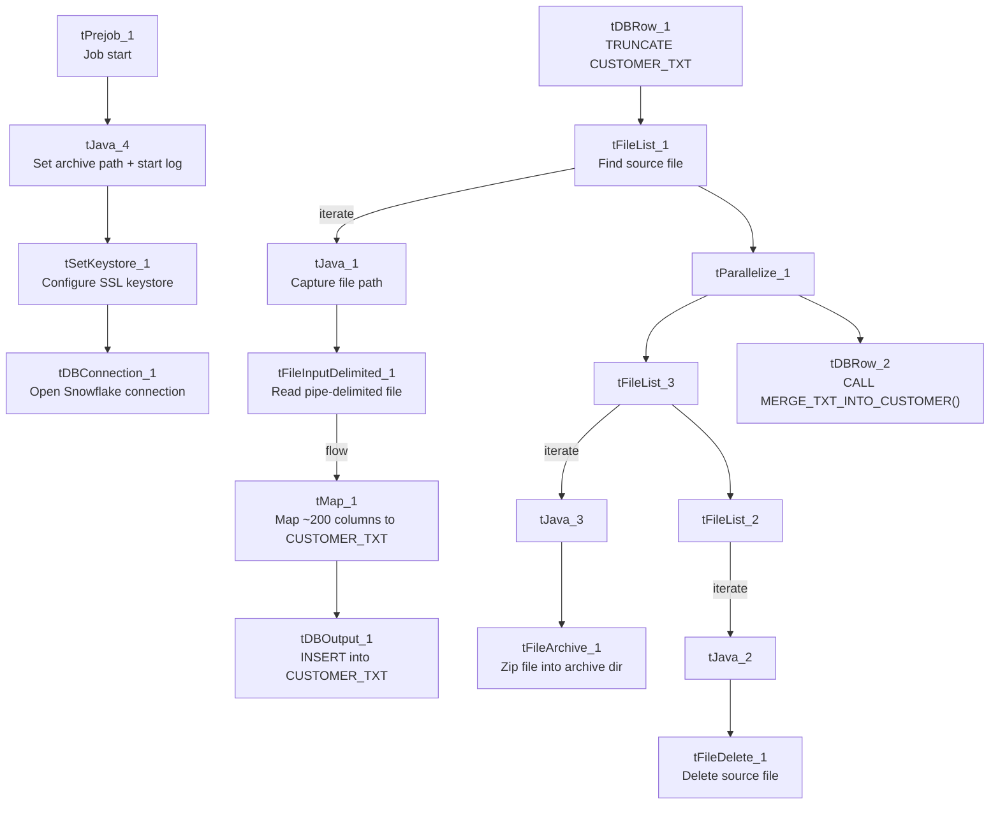

# Talend Job: Customer_Table_Text_Load

## Overview

This job follows the standard LATITUDE "text load" pattern: it watches a shared folder for a new customer-data file, loads its rows into a Snowflake staging table (`CUSTOMER_TXT`), merges the staged rows into the permanent `CUSTOMER` table via a Snowflake stored procedure, and then archives and deletes the source file. Its source schema is unusually wide — roughly 200 columns covering billing, fee schedules, rehab/AWG/consolidation eligibility rules, and CBR (credit bureau reporting) settings for a customer — reflecting that "customer" here means a client agency/creditor configuration record, not an individual consumer.

## Detail table

| Field | Value |
|---|---|
| Job name | Customer_Table_Text_Load |
| Version | 0.1 |
| Project | LATITUDE |
| Author | jmach@harriscollect.com |
| Created | 2024-10-23T07:39:08.292-0700 |
| Last Modified | 2025-09-30T10:55:48.688-0700 |

## Step-by-step data flow

1. **Set up.** `tPrejob_1` triggers `tJava_4`, which appends today's date to `context.archiveDir` and opens a log file for this run; this then chains into `tSetKeystore_1` (SSL keystore) and `tDBConnection_1` (opens the Snowflake connection).
2. **Empty the staging table.** `tDBRow_1` runs `TRUNCATE TABLE CUSTOMER_TXT;` — note this statement has no explicit schema prefix, unlike most peer jobs that write `TRUNCATE TABLE LIQUID_STAGING.<table>;` (see Issues observed).
3. **Find the file.** `tFileList_1` lists files in `context.sourceDir` (skipping `*.txt`), with no explicit sort order configured (`ORDER_BY_NOTHING: true`), so the first file returned is whatever order the underlying file system reports. Its path is captured into `context.filePath` by `tJava_1`.
4. **Read and reshape the file.** `tFileInputDelimited_1` reads the file as pipe-delimited (`|~|` fields, `|$|` rows, header row present, US-ASCII encoding). `tMap_1` maps the roughly 200 source columns onto the `CUSTOMER_TXT` staging schema, adding a `LOAD_DT` column.
5. **Load staging.** The mapped rows flow directly into `tDBOutput_1`, which inserts them into `CUSTOMER_TXT` (action: `INSERT`, no table-structure changes). Unlike several peer jobs, there is no `tFlowMeter` row counter on this flow.
6. **Merge into the permanent table — in parallel with archiving.** Once the file listing subjob finishes, `tParallelize_1` splits into two branches that run at the same time: `tDBRow_2` calls `CALL MERGE_TXT_INTO_CUSTOMER();`, while a separate pair of file listings drives archiving and deletion.
7. **Archive and clean up.** `tFileList_3` lists the source folder again; its match is zipped into `context.archiveDir` by `tFileArchive_1`. Once that subjob completes, `tFileList_2` re-lists the folder and `tFileDelete_1` deletes the matched file.

## Settings tables

### Source: `tFileInputDelimited_1`

| Setting | Value | What it means |
|---|---|---|
| FILENAME | `context.filePath` | Reads whichever file `tFileList_1` just found. |
| FIELDSEPARATOR / ROWSEPARATOR | `\|~\|` / `\|$\|` | The project's standard custom pipe-delimited format. |
| HEADER | 1 | First line is a header, not data. |
| ENCODING | US-ASCII | Read as plain ASCII text. |
| EXCLUDEFILEMASK (on `tFileList_1`) | `*.txt` | `.txt` files are skipped — the expected input has a different extension. |

### Target: `tDBOutput_1` (loads the Snowflake staging table)

| Setting | Value | What it means |
|---|---|---|
| Table | CUSTOMER_TXT | Writes into the `CUSTOMER_TXT` staging table. |
| Output action | INSERT | Adds rows only — the merge step handles updates. |
| Table action | NONE | Does not create/drop/truncate the table (that's `tDBRow_1`'s job). |

### Merge step: `tDBRow_2`

| Setting | Value | What it means |
|---|---|---|
| Query | `CALL MERGE_TXT_INTO_CUSTOMER();` | Snowflake stored procedure that folds the staged rows into the permanent `CUSTOMER` table. |

### Truncate step: `tDBRow_1`

| Setting | Value | What it means |
|---|---|---|
| Query | `TRUNCATE TABLE CUSTOMER_TXT;` | Empties the staging table before the new file loads. No schema qualifier is present in the statement itself — see Issues observed. |

## Dependencies & configuration

- **Triggers/depends on other jobs:** none found — no `tRunJob` links to or from any other job.
- **Context variables used:** `context.sourceDir`, `context.archiveDir`, `context.filePath`, `context.fileName`, `context.logDir`, `context.keystorePath` (all from `Directories_0.1`). It does not reference `LEGACY_DW_0.1` variables directly — it uses the shared, repository-linked Snowflake connection object.
- **Hardcoded values found:** `tFileInputDelimited_1.TEMP_DIR`, `tFileDelete_1.DIRECTORY`/`PATH`, `tFileArchive_1.SOURCE_FILE`, and `tSetKeystore_1.SSL_TRUSTSERVER_TRUSTSTORE` are fixed `C:/Talend-Studio-20211109_1610-V8.0.1/...` or `C:/clientTrustStore.trustStore` paths rather than context variables — the same pattern flagged project-wide.

## Glossary

| Component type | Plain-English meaning |
|---|---|
| `tPrejob` / `tParallelize` | Job-flow control: setup-before-main-start, and running branches concurrently (see job_Address_Text_Load.md). |
| `tFileList` | Lists files in a folder so the job can loop over them (see job_Address_Text_Load.md). |
| `tFileInputDelimited` | Reads a delimited text file row by row (see job_Address_Text_Load.md). |
| `tMap` | Maps and transforms columns from input to output format (see job_Address_Text_Load.md). |
| `tDBOutput` / `tSnowflakeOutput` | Writes rows into a Snowflake table (see job_Address_Text_Load.md). |
| `tDBRow` / `tSnowflakeRow` | Runs a single SQL statement against the database — here, `TRUNCATE` and `CALL <procedure>` (see job_Address_Text_Load.md). |
| `tJava` | A small block of custom Java code for string/date manipulation (see job_Address_Text_Load.md). |
| `tFileArchive` | Compresses a file into a `.zip` and moves it to an archive location (see job_Address_Text_Load.md). |
| `tFileDelete` | Deletes a file from disk (see job_Address_Text_Load.md). |
| `tSetKeystore` | Configures the SSL certificate/keystore for the Snowflake connection (see job_Address_Text_Load.md). |

## Issues observed

- **The staging truncate doesn't qualify its schema.** `tDBRow_1` runs `TRUNCATE TABLE CUSTOMER_TXT;` with no `LIQUID_STAGING.` prefix, unlike most peer jobs (e.g. `Address_Text_Load`'s `TRUNCATE TABLE LIQUID_STAGING.ADDRESS;`). This likely relies on the Snowflake session's default schema being `LIQUID_STAGING`, but that's an assumption outside what this metadata can confirm — worth verifying with whoever owns the Snowflake connection profile.
- **No row-count logging.** Unlike several peer jobs (e.g. `ScheduledPayment_Text_Load`, `Dialer_CallTracking_Load`), this job has no `tFlowMeter` between `tMap_1` and `tDBOutput_1`, so there's no per-run row count logged for this load.
- **Several hardcoded, machine-specific paths** exist alongside the parameterized ones (`sourceDir`, `archiveDir`, `keystorePath`) — see Dependencies & configuration.
- **The merge procedure's own logic is outside Talend** — `MERGE_TXT_INTO_CUSTOMER`'s body (join keys, update logic) isn't visible in this metadata; confirm with the Snowflake procedure owner.
