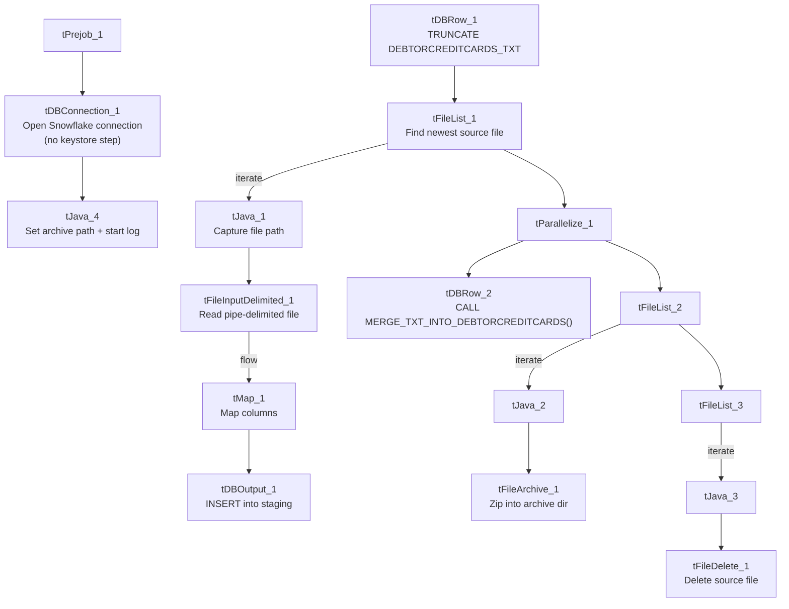

# Talend Job: DebtorCC_Table_Text_Load

## Overview

This job loads debtor credit-card records — including card number, expiration, CVV2, and authorization details — from a shared folder into Snowflake. It follows the project's standard truncate-load-merge-archive pattern (see `job_Address_Text_Load.md`), but it is missing two components that most of its peers have: there is no `tSetKeystore` component configuring the SSL keystore for the Snowflake connection, and no `tFlowMeter` counting rows loaded. It has no scheduling information in this metadata — something outside Talend decides when it runs.

## Detail table

| Field | Value |
|---|---|
| Job name | DebtorCC_Table_Text_Load |
| Version | 0.1 |
| Project | LATITUDE |
| Author | jmach@harriscollect.com |
| Created | 2024-10-23T10:14:39.844-0700 |
| Last Modified | 2025-09-25T08:24:19.885-0700 |

## Step-by-step data flow

1. **Set up.** `tPrejob_1` starts the job; `tDBConnection_1` opens the Snowflake connection directly (there is no `tSetKeystore` step in between, unlike every other job documented so far — see Issues observed). Once connected, `tJava_4` appends today's date to `context.archiveDir` and opens a log file in `context.logDir`.
2. **Empty the staging table.** In a separate, parallel start point, `tDBRow_1` runs `TRUNCATE TABLE DEBTORCREDITCARDS_TXT;` (note: no `LIQUID_STAGING.` schema prefix, unlike some peer jobs — see Issues observed).
3. **Find and read the file.** `tFileList_1` lists files in `context.sourceDir` (skipping `.txt`); `tJava_1` captures the found path into `context.filePath`; `tFileInputDelimited_1` reads it as a pipe-delimited, US-ASCII-encoded file (using the repository schema named `dbtrcc`) with a header row.
4. **Transform and load.** `tMap_1` maps the file's ~55 columns (name, address, card number, expiration month/year, CVV2/AVS/auth fields, amounts, dates, etc.) onto the `DEBTORCREDITCARDS_TXT` schema, adding a `LOAD_DT` column. The mapped rows flow directly into `tDBOutput_1`, which inserts them into Snowflake (no row counter in between, unlike most peer jobs).
5. **Merge and clean up — in parallel.** `tParallelize_1` splits into two branches once the file has been listed:
   - **Merge branch:** `tDBRow_2` calls `CALL MERGE_TXT_INTO_DEBTORCREDITCARDS();`, the Snowflake stored procedure that folds the staged rows into the real, permanent table.
   - **Cleanup branch:** the source file is listed again and archived (`tFileArchive_1`, zipped into `context.archiveDir`), and listed a third time and deleted (`tFileDelete_1`).

## Settings tables

### Source: `tFileInputDelimited_1`

| Setting | Value | What it means |
|---|---|---|
| FILENAME | `context.filePath` | Reads whichever file `tFileList_1` just found. |
| FIELDSEPARATOR / ROWSEPARATOR | `\|~\|` / `\|$\|` | The project's standard pipe-delimited format. |
| HEADER | 1 | First line is a header, not data. |
| ENCODING | US-ASCII | Plain ASCII, not ISO-8859-15 — same caveat as `cmi_Hermes_Recommendations_Load`: confirm this is fine if names/addresses can contain accented characters. |
| SCHEMA:REPOSITORY_SCHEMA_TYPE | `dbtrcc` (repository schema) | Uses a centrally-defined column layout rather than an ad-hoc one. |
| EXCLUDEFILEMASK (on `tFileList_1`) | `*.txt` | `.txt` files are skipped. |

### Target: `tDBOutput_1`

| Setting | Value | What it means |
|---|---|---|
| Table | DEBTORCREDITCARDS_TXT | Loads the staging copy of this table. |
| Output action | INSERT | Adds rows only. |
| Table action | NONE | Table structure isn't touched here; truncation happens separately in `tDBRow_1`. |

### Merge step: `tDBRow_2`

| Setting | Value | What it means |
|---|---|---|
| Query | `CALL MERGE_TXT_INTO_DEBTORCREDITCARDS();` | Folds staged rows into the permanent table; the procedure's own logic lives in Snowflake, not in this metadata. |

### Truncate step: `tDBRow_1`

| Setting | Value | What it means |
|---|---|---|
| Query | `TRUNCATE TABLE DEBTORCREDITCARDS_TXT;` | Clears the staging table before the new file is loaded. Unlike `Email_Text_Load`'s `TRUNCATE TABLE LIQUID_STAGING.EMAIL_TXT;`, this statement has no explicit schema prefix — it relies on whatever schema is set as the connection's default. |

## Dependencies & configuration

- **Triggers/depends on other jobs:** none found — no `tRunJob` links in either direction.
- **Context variables used:** `context.sourceDir`, `context.archiveDir`, `context.filePath`, `context.fileName`, `context.logDir` (all `Directories_0.1`). Notably, `context.keystorePath` is **not** referenced — consistent with this job having no `tSetKeystore` component (see Issues observed).
- **LEGACY_DW usage:** this job does not reference `LEGACY_DW_0.1` variables directly — it uses the shared, repository-linked Snowflake connection object, same as the majority of jobs in the project.

## Glossary

| Component type | Plain-English meaning |
|---|---|
| `tPrejob` / `tParallelize` | Job-flow control: `tPrejob` marks setup that must finish first; `tParallelize` runs branches at the same time. (see `job_Address_Text_Load.md`) |
| `tFileList` | Lists files in a folder so the job can loop over them. (see `job_Address_Text_Load.md`) |
| `tFileInputDelimited` | Reads a delimited text file row by row. (see `job_Address_Text_Load.md`) |
| `tMap` | Maps/transforms columns from input to output. (see `job_Address_Text_Load.md`) |
| `tDBOutput` / `tSnowflakeOutput` | Writes rows into a Snowflake table. (see `job_Address_Text_Load.md`) |
| `tDBRow` / `tSnowflakeRow` | Runs a single SQL statement (not a row-by-row flow) — used here for `TRUNCATE` and `CALL <procedure>`. (see `job_Address_Text_Load.md`) |
| `tJava` | A small block of custom Java code for string/date manipulation. (see `job_Address_Text_Load.md`) |
| `tFileArchive` | Compresses a file into a `.zip` and moves it to an archive location. (see `job_Address_Text_Load.md`) |
| `tFileDelete` | Deletes a file from disk. (see `job_Address_Text_Load.md`) |
| `tSnowflakeConnection` (`tDBConnection_1`) | Opens the shared connection to Snowflake used by every read/write step downstream. |

## Issues observed

- **No `tSetKeystore` component.** Every other "Text Load" job reviewed so far (`Address_Text_Load`, `Email_Text_Load`, `LetterType_Text_Load`, `Phones_Master_Table_Text_Load`, `ServiceHistory_Text_Load`, `cmi_CapioSellerContracts_Table_Text_Load`, `cmi_VoApp_Results_Load`, `Master_Table_Text_Load_HC15`) explicitly configures the SSL client keystore (`tSetKeystore`) before opening the Snowflake connection. This job connects to Snowflake directly with no such step and no `context.keystorePath` reference at all — worth confirming with the team whether this connection genuinely doesn't need client-cert auth, or whether the component was simply never added.
- **No row counter (`tFlowMeter`).** Most peer jobs run loaded rows through a `tFlowMeter` for logging/monitoring before the Snowflake insert; this job's `tMap_1` feeds `tDBOutput_1` directly, so there's no per-run row count recorded in the job log.
- **Sensitive card data with no visible masking or encryption.** This job's schema includes `CardNumber`, `EXPMonth`, `EXPYear`, `AuthCVV2`, and `AuthAVS` columns loaded as plain strings into Snowflake, with no `tDataEncrypt` (or similar) step in the flow — unlike `Master_Table_Text_Load_HC15`, which does encrypt at least one sensitive field before loading. This is worth flagging for a PCI/security review, since credit-card and CVV2 data appear to move through the pipeline unmasked.
- **Truncate statement lacks a schema prefix.** `TRUNCATE TABLE DEBTORCREDITCARDS_TXT;` has no `LIQUID_STAGING.` prefix, unlike `Email_Text_Load`'s equivalent statement — likely harmless if the connection's default schema is already `LIQUID_STAGING`, but inconsistent with peers and worth confirming.
- **Same general merge-procedure caveat as every other job**: `MERGE_TXT_INTO_DEBTORCREDITCARDS()`'s own logic lives in Snowflake and isn't visible in this metadata.
