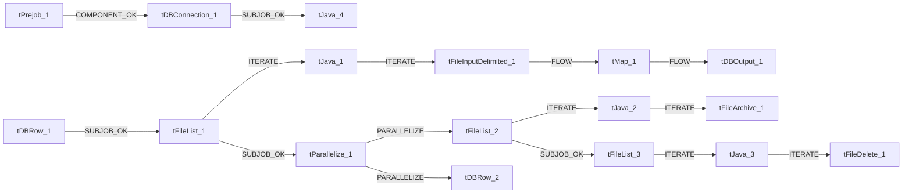

# Talend Job: DebtorCC_Table_Text_Load

- **Project**: LATITUDE
- **Version**: 0.1
- **Job Type**: Standard

- **Author**: jmach@harriscollect.com
- **Created**: 2024-10-23T10:14:39.844-0700
- **Last Modified**: 2025-09-25T08:24:19.885-0700

## Components

| # | Component | Type | Key Parameters |
|---|-----------|------|----------------|
| 1 | tDBConnection_1 | `tSnowflakeConnection` | `CONNECTION_FORMAT`=row, `PROPERTIES`={"@id":2,"@type":"org.talend.components.snowflake. |
| 2 | tDBRow_1 | `tSnowflakeRow` | `CONNECTION_FORMAT`=row, `PROPERTIES`={"@id":3,"@type":"org.talend.components.snowflake. |
| 3 | tFileList_1 | `tFileList` | `DIRECTORY`=context.sourceDir, `LIST_MODE`=FILES, `INCLUDSUBDIR`=false, `CASE_SENSITIVE`=YES, `ERROR`=false |
| 4 | tJava_1 | `tJava` | `CODE`=context.filePath= ((String)globalMap.get("tFileLis, `IMPORT`=//import java.util.List;, `CONNECTION_FORMAT`=row |
| 5 | tFileInputDelimited_1 | `tFileInputDelimited` | `USE_EXISTING_DYNAMIC`=false, `FILENAMETEXT`="When the input source is a stream or a zip file,f, `FILENAME`=context.filePath, `CSV_OPTION`=false, `ROWSEPARATOR`="|$|" |
| 6 | tMap_1 | `tMap` | `LINK_STYLE`=AUTO, `DIE_ON_ERROR`=true, `LKUP_PARALLELIZE`=false, `LEVENSHTEIN`=0, `JACCARD`=0 |
| 7 | tDBOutput_1 | `tSnowflakeOutput` | `CONNECTION_FORMAT`=row, `PROPERTIES`={"@id":3,"@type":"org.talend.components.snowflake. |
| 8 | tDBRow_2 | `tSnowflakeRow` | `CONNECTION_FORMAT`=row, `PROPERTIES`={"@id":3,"@type":"org.talend.components.snowflake. |
| 9 | tPrejob_1 | `tPrejob` | `CONNECTION_FORMAT`=row |
| 10 | tFileList_2 | `tFileList` | `DIRECTORY`=context.sourceDir, `LIST_MODE`=FILES, `INCLUDSUBDIR`=false, `CASE_SENSITIVE`=YES, `ERROR`=false |
| 11 | tJava_2 | `tJava` | `CODE`=context.filePath = ((String)globalMap.get("tFileLi, `IMPORT`=//import java.util.List;, `CONNECTION_FORMAT`=row |
| 12 | tFileArchive_1 | `tFileArchive` | `SOURCE`=context.sourceDir, `SOURCE_FILE`="C:/Talend-Studio-20211109_1610-V8.0.1/workspace/s, `SUB_DIRECTROY`=false, `TARGET`=context.archiveDir + context.fileName+".zip", `MKDIR`=true |
| 13 | tParallelize_1 | `tParallelize` | `WAIT_FOR`=All, `SLEEPTIME`=100, `DIE_ON_ERROR`=false, `CONNECTION_FORMAT`=row |
| 14 | tFileList_3 | `tFileList` | `DIRECTORY`=context.sourceDir, `LIST_MODE`=FILES, `INCLUDSUBDIR`=false, `CASE_SENSITIVE`=YES, `ERROR`=false |
| 15 | tJava_3 | `tJava` | `CODE`=context.filePath = ((String)globalMap.get("tFileLi, `IMPORT`=//import java.util.List;, `CONNECTION_FORMAT`=row |
| 16 | tFileDelete_1 | `tFileDelete` | `FILENAME`=context.filePath, `DIRECTORY`="C:/Talend-Studio-20211109_1610-V8.0.1/workspace/d, `PATH`="C:/Talend-Studio-20211109_1610-V8.0.1/workspace/d, `FAILON`=false, `FOLDER`=false |
| 17 | tJava_4 | `tJava` | `CODE`=context.archiveDir = context.archiveDir + TalendDa, `IMPORT`=//import java.util.List;, `CONNECTION_FORMAT`=row |

## Schemas

### tDBRow_1

| Column | Type | Nullable | Length |
|--------|------|----------|--------|
| errorCode | id_String | No | 255 |
| errorMessage | id_String | No | 255 |

### tFileInputDelimited_1

| Column | Type | Nullable | Length |
|--------|------|----------|--------|
| Number | id_Integer | No | -1 |
| Name | id_String | Yes | 30 |
| Street1 | id_String | Yes | 128 |
| Street2 | id_String | Yes | 128 |
| City | id_String | Yes | 25 |
| State | id_String | Yes | 3 |
| Zipcode | id_String | Yes | 10 |
| CardNumber | id_String | Yes | 30 |
| EXPMonth | id_String | Yes | 2 |
| EXPYear | id_String | Yes | 4 |
| CreditCard | id_String | Yes | 4 |
| Amount | id_String | Yes | 20 |
| Printed | id_String | Yes | 1 |
| ApprovedBy | id_String | Yes | 10 |
| Approved | id_String | Yes | 30 |
| Code | id_String | Yes | 10 |
| ID | id_Integer | No | -1 |
| CollectorFee | id_String | Yes | 20 |
| DebtorID | id_Integer | Yes | -1 |
| DateEntered | id_String | No | 30 |
| DepositDate | id_String | No | 30 |
| NITDSentDate | id_String | Yes | 30 |
| OnHoldDate | id_String | Yes | 30 |
| LetterCode | id_String | Yes | 5 |
| NITDSendDate | id_String | Yes | 30 |
| ProjectedFee | id_String | Yes | 20 |
| UseProjectedFee | id_Integer | No | -1 |
| Surcharge | id_String | No | 20 |
| IsActive | id_Integer | No | -1 |
| PromiseMode | id_Integer | Yes | -1 |
| AuthDate | id_String | Yes | 30 |
| AuthCode | id_String | Yes | 255 |
| AuthErrCode | id_Integer | Yes | -1 |
| AuthErrDesc | id_String | Yes | 255 |
| AuthAVS | id_String | Yes | 3 |
| AuthCVV2 | id_String | Yes | 3 |
| AuthSource | id_String | Yes | 16 |
| BatchNumber | id_Integer | Yes | -1 |
| DateCreated | id_String | Yes | 30 |
| DateUpdated | id_String | Yes | 30 |
| CreatedBy | id_String | Yes | 255 |
| CCImageId | id_String | Yes | -1 |
| AuthReferenceNumber | id_String | Yes | 50 |
| DepositToGeneralTrust | id_Integer | No | -1 |
| DepositSurchargeToOperatingTrust | id_Integer | No | -1 |
| ArrangementID | id_Integer | Yes | -1 |
| NSFCount | id_Integer | Yes | -1 |
| PrintedDate | id_String | Yes | 30 |
| ProcessStatus | id_String | Yes | 25 |
| PaymentVendorTokenId | id_Integer | Yes | -1 |
| PaymentLinkUID | id_Integer | Yes | -1 |
| IsBatched | id_Integer | Yes | -1 |
| IsExternallyManaged | id_Integer | Yes | -1 |
| DownpaymentInstallment | id_Integer | Yes | -1 |
| Country | id_String | Yes | 128 |
| County | id_String | Yes | 128 |
| Number | id_Integer | No | -1 |
| Name | id_String | Yes | 30 |
| Street1 | id_String | Yes | 128 |
| Street2 | id_String | Yes | 128 |
| City | id_String | Yes | 25 |
| State | id_String | Yes | 3 |
| Zipcode | id_String | Yes | 10 |
| CardNumber | id_String | Yes | 30 |
| EXPMonth | id_String | Yes | 2 |
| EXPYear | id_String | Yes | 4 |
| CreditCard | id_String | Yes | 4 |
| Amount | id_String | Yes | 20 |
| Printed | id_String | Yes | 1 |
| ApprovedBy | id_String | Yes | 10 |
| Approved | id_String | Yes | 30 |
| Code | id_String | Yes | 10 |
| ID | id_Integer | No | -1 |
| CollectorFee | id_String | Yes | 20 |
| DebtorID | id_Integer | Yes | -1 |
| DateEntered | id_String | No | 30 |
| DepositDate | id_String | No | 30 |
| NITDSentDate | id_String | Yes | 30 |
| OnHoldDate | id_String | Yes | 30 |
| LetterCode | id_String | Yes | 5 |
| NITDSendDate | id_String | Yes | 30 |
| ProjectedFee | id_String | Yes | 20 |
| UseProjectedFee | id_Integer | No | -1 |
| Surcharge | id_String | No | 20 |
| IsActive | id_Integer | No | -1 |
| PromiseMode | id_Integer | Yes | -1 |
| AuthDate | id_String | Yes | 30 |
| AuthCode | id_String | Yes | 255 |
| AuthErrCode | id_Integer | Yes | -1 |
| AuthErrDesc | id_String | Yes | 255 |
| AuthAVS | id_String | Yes | 3 |
| AuthCVV2 | id_String | Yes | 3 |
| AuthSource | id_String | Yes | 16 |
| BatchNumber | id_Integer | Yes | -1 |
| DateCreated | id_String | Yes | 30 |
| DateUpdated | id_String | Yes | 30 |
| CreatedBy | id_String | Yes | 255 |
| CCImageId | id_String | Yes | -1 |
| AuthReferenceNumber | id_String | Yes | 50 |
| DepositToGeneralTrust | id_Integer | No | -1 |
| DepositSurchargeToOperatingTrust | id_Integer | No | -1 |
| ArrangementID | id_Integer | Yes | -1 |
| NSFCount | id_Integer | Yes | -1 |
| PrintedDate | id_String | Yes | 30 |
| ProcessStatus | id_String | Yes | 25 |
| PaymentVendorTokenId | id_Integer | Yes | -1 |
| PaymentLinkUID | id_Integer | Yes | -1 |
| IsBatched | id_Integer | Yes | -1 |
| IsExternallyManaged | id_Integer | Yes | -1 |
| DownpaymentInstallment | id_Integer | Yes | -1 |
| Country | id_String | Yes | 128 |
| County | id_String | Yes | 128 |
| errorCode | id_String | Yes | 255 |
| errorMessage | id_String | Yes | 255 |

### tMap_1

| Column | Type | Nullable | Length |
|--------|------|----------|--------|
| LOAD_DT | id_Date | Yes | -1 |
| NUMBER | id_Integer | Yes | 38 |
| NAME | id_String | Yes | 30 |
| STREET1 | id_String | Yes | 128 |
| STREET2 | id_String | Yes | 128 |
| CITY | id_String | Yes | 25 |
| STATE | id_String | Yes | 3 |
| ZIPCODE | id_String | Yes | 10 |
| CARDNUMBER | id_String | Yes | 30 |
| EXPMONTH | id_String | Yes | 2 |
| EXPYEAR | id_String | Yes | 4 |
| CREDITCARD | id_String | Yes | 4 |
| AMOUNT | id_String | Yes | 20 |
| PRINTED | id_String | Yes | 1 |
| APPROVEDBY | id_String | Yes | 10 |
| APPROVED | id_String | Yes | 30 |
| CODE | id_String | Yes | 10 |
| ID | id_Integer | Yes | 38 |
| COLLECTORFEE | id_String | Yes | 20 |
| DEBTORID | id_Integer | Yes | 38 |
| DATEENTERED | id_String | Yes | 30 |
| DEPOSITDATE | id_String | Yes | 30 |
| NITDSENTDATE | id_String | Yes | 30 |
| ONHOLDDATE | id_String | Yes | 30 |
| LETTERCODE | id_String | Yes | 5 |
| NITDSENDDATE | id_String | Yes | 30 |
| PROJECTEDFEE | id_String | Yes | 20 |
| USEPROJECTEDFEE | id_Integer | Yes | 38 |
| SURCHARGE | id_String | Yes | 20 |
| ISACTIVE | id_Integer | Yes | 38 |
| PROMISEMODE | id_Integer | Yes | 38 |
| AUTHDATE | id_String | Yes | 30 |
| AUTHCODE | id_String | Yes | 255 |
| AUTHERRCODE | id_Integer | Yes | 38 |
| AUTHERRDESC | id_String | Yes | 255 |
| AUTHAVS | id_String | Yes | 3 |
| AUTHCVV2 | id_String | Yes | 3 |
| AUTHSOURCE | id_String | Yes | 16 |
| BATCHNUMBER | id_Integer | Yes | 38 |
| DATECREATED | id_String | Yes | 30 |
| DATEUPDATED | id_String | Yes | 30 |
| CREATEDBY | id_String | Yes | 255 |
| CCIMAGEID | id_String | Yes | 16777216 |
| AUTHREFERENCENUMBER | id_String | Yes | 50 |
| DEPOSITTOGENERALTRUST | id_Integer | Yes | 38 |
| DEPOSITSURCHARGETOOPERATINGTRUST | id_Integer | Yes | 38 |
| ARRANGEMENTID | id_Integer | Yes | 38 |
| NSFCOUNT | id_Integer | Yes | 38 |
| PRINTEDDATE | id_String | Yes | 30 |
| PROCESSSTATUS | id_String | Yes | 25 |
| PAYMENTVENDORTOKENID | id_Integer | Yes | 38 |
| PAYMENTLINKUID | id_Integer | Yes | 38 |
| ISBATCHED | id_Integer | Yes | 38 |
| ISEXTERNALLYMANAGED | id_Integer | Yes | 38 |
| DOWNPAYMENTINSTALLMENT | id_Integer | Yes | 38 |
| COUNTRY | id_String | Yes | 128 |
| COUNTY | id_String | Yes | 128 |

### tDBOutput_1

| Column | Type | Nullable | Length |
|--------|------|----------|--------|
| LOAD_DT | id_Date | Yes | -1 |
| NUMBER | id_Integer | Yes | 38 |
| NAME | id_String | Yes | 30 |
| STREET1 | id_String | Yes | 128 |
| STREET2 | id_String | Yes | 128 |
| CITY | id_String | Yes | 25 |
| STATE | id_String | Yes | 3 |
| ZIPCODE | id_String | Yes | 10 |
| CARDNUMBER | id_String | Yes | 30 |
| EXPMONTH | id_String | Yes | 2 |
| EXPYEAR | id_String | Yes | 4 |
| CREDITCARD | id_String | Yes | 4 |
| AMOUNT | id_String | Yes | 20 |
| PRINTED | id_String | Yes | 1 |
| APPROVEDBY | id_String | Yes | 10 |
| APPROVED | id_String | Yes | 30 |
| CODE | id_String | Yes | 10 |
| ID | id_Integer | Yes | 38 |
| COLLECTORFEE | id_String | Yes | 20 |
| DEBTORID | id_Integer | Yes | 38 |
| DATEENTERED | id_String | Yes | 30 |
| DEPOSITDATE | id_String | Yes | 30 |
| NITDSENTDATE | id_String | Yes | 30 |
| ONHOLDDATE | id_String | Yes | 30 |
| LETTERCODE | id_String | Yes | 5 |
| NITDSENDDATE | id_String | Yes | 30 |
| PROJECTEDFEE | id_String | Yes | 20 |
| USEPROJECTEDFEE | id_Integer | Yes | 38 |
| SURCHARGE | id_String | Yes | 20 |
| ISACTIVE | id_Integer | Yes | 38 |
| PROMISEMODE | id_Integer | Yes | 38 |
| AUTHDATE | id_String | Yes | 30 |
| AUTHCODE | id_String | Yes | 255 |
| AUTHERRCODE | id_Integer | Yes | 38 |
| AUTHERRDESC | id_String | Yes | 255 |
| AUTHAVS | id_String | Yes | 3 |
| AUTHCVV2 | id_String | Yes | 3 |
| AUTHSOURCE | id_String | Yes | 16 |
| BATCHNUMBER | id_Integer | Yes | 38 |
| DATECREATED | id_String | Yes | 30 |
| DATEUPDATED | id_String | Yes | 30 |
| CREATEDBY | id_String | Yes | 255 |
| CCIMAGEID | id_String | Yes | 16777216 |
| AUTHREFERENCENUMBER | id_String | Yes | 50 |
| DEPOSITTOGENERALTRUST | id_Integer | Yes | 38 |
| DEPOSITSURCHARGETOOPERATINGTRUST | id_Integer | Yes | 38 |
| ARRANGEMENTID | id_Integer | Yes | 38 |
| NSFCOUNT | id_Integer | Yes | 38 |
| PRINTEDDATE | id_String | Yes | 30 |
| PROCESSSTATUS | id_String | Yes | 25 |
| PAYMENTVENDORTOKENID | id_Integer | Yes | 38 |
| PAYMENTLINKUID | id_Integer | Yes | 38 |
| ISBATCHED | id_Integer | Yes | 38 |
| ISEXTERNALLYMANAGED | id_Integer | Yes | 38 |
| DOWNPAYMENTINSTALLMENT | id_Integer | Yes | 38 |
| COUNTRY | id_String | Yes | 128 |
| COUNTY | id_String | Yes | 128 |
| columnName | id_String | No | 255 |
| rowNumber | id_String | No | 255 |
| category | id_String | No | 255 |
| character | id_String | No | 255 |
| errorMessage | id_String | No | 255 |
| byteOffset | id_String | No | 255 |
| line | id_String | No | 255 |
| sqlState | id_String | No | 255 |
| code | id_String | No | 255 |

### tDBRow_2

| Column | Type | Nullable | Length |
|--------|------|----------|--------|
| errorCode | id_String | No | 255 |
| errorMessage | id_String | No | 255 |

## Data Flow

