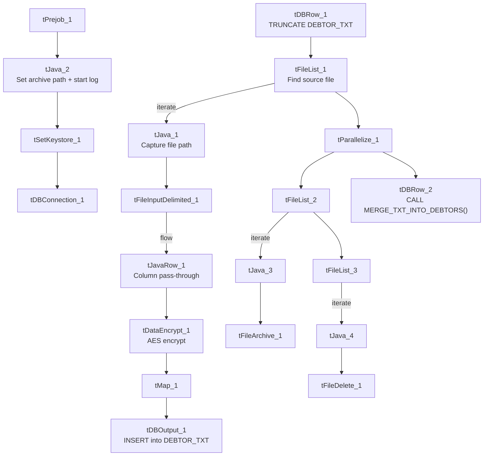

# Talend Job: Debtor_Table_Text_Load

## Overview

This job loads debtor (consumer/account-holder) records into Snowflake, following the project's standard truncate → load → merge → archive/delete pattern. It stands out among this project's "text load" jobs because it runs the data through an encryption step (`tDataEncrypt_1`) before loading it to staging — the only one of this batch of 9 jobs to do so — reflecting that the `DEBTOR_TXT` table carries sensitive personal data (SSN, date of birth, portal password/salt, etc.).

## Detail table

| Field | Value |
|---|---|
| Job name | Debtor_Table_Text_Load |
| Version | 0.1 |
| Project | LATITUDE |
| Author | jmach@harriscollect.com |
| Created | 2024-10-18T11:58:22.215-0700 |
| Last Modified | 2026-05-26T11:52:52.066-0700 |

## Step-by-step data flow

1. **Set up.** `tPrejob_1` → `tJava_2` (appends today's date to `context.archiveDir`, opens a log file) → `tSetKeystore_1` → `tDBConnection_1`.
2. **Empty the staging table.** `tDBRow_1` runs `TRUNCATE TABLE DEBTOR_TXT;` — notably without the `LIQUID_STAGING.` schema prefix that most peer jobs use.
3. **Find and read the file.** `tFileList_1` lists files in `context.sourceDir` (excluding `*.txt`); `tJava_1` captures the path into `context.filePath`; `tFileInputDelimited_1` reads it as a pipe-delimited file (`|~|` fields, `|$|` rows, quoted with `"`, header row, US-ASCII encoding, `DIE_ON_ERROR` set to **false** — unlike most peers).
4. **Copy, then encrypt, then map.** `tJavaRow_1` does a straight one-to-one copy of every input column to the output row (no transformation — likely just a schema pass-through step ahead of encryption). `tDataEncrypt_1` then encrypts the row using AES (algorithm version 2) via a job-specific key file at `context.cryptoPath`; the exact column(s) encrypted are not visible in this metadata (see Issues observed). `tMap_1` then adds `LOAD_DT` and maps everything onto the `DEBTOR_TXT` schema.
5. **Load staging.** The mapped rows flow straight into `tDBOutput_1`, which inserts them into the staging table (no `tFlowMeter` row counter in this branch, unlike most peers).
6. **Merge and clean up — in parallel.** `tParallelize_1` splits into:
   - **Merge branch:** `tDBRow_2` runs `CALL MERGE_TXT_INTO_DEBTORS();` — note the procedure name (`DEBTORS`, plural) doesn't match the staging table name (`DEBTOR_TXT`) or the job name (`Debtor_Table_Text_Load`).
   - **Cleanup branch:** `tFileList_2` → `tJava_3` (captures path + name) → `tFileArchive_1` (zips into `context.archiveDir`); and separately `tFileList_3` → `tJava_4` (captures path + name) → `tFileDelete_1` (deletes the source file).

## Settings tables

### Source: `tFileInputDelimited_1`

| Setting | Value | What it means |
|---|---|---|
| FILENAME | `context.filePath` | Reads whichever file `tFileList_1` just found. |
| FIELDSEPARATOR / ROWSEPARATOR | `\|~\|` / `\|$\|` | Standard project pipe-delimited format. |
| ESCAPE_CHAR / TEXT_ENCLOSURE | `"` | Values may be quoted with double quotes (useful for fields like names/addresses that could contain the delimiter). |
| ENCODING | US-ASCII | Plain ASCII. |
| DIE_ON_ERROR | false | A malformed row is skipped/logged rather than failing the whole job — unlike `Bankruptcy_Text_Load` and `cmi_CustomerGrouping_Text_Load`, which set this to `true`. |
| TEMP_DIR | `"C:/Talend-Studio-.../workspace"` | Hardcoded Windows path. |

### Encryption step: `tDataEncrypt_1`

| Setting | Value | What it means |
|---|---|---|
| CRYPTO_METHOD | AES | Symmetric encryption algorithm. |
| ALGO_VERSION | 2 | Talend's internal encryption-algorithm version. |
| CRYPTO_FILE_PATH | `context.cryptoPath` | Path to a key file used for encryption — this context variable does not appear in the `Directories_0.1` group captured in `_shared_context.json`, so its actual value/location is unknown from this metadata (see Issues observed). |
| SECRET_KEY / PASSWORD_M1 / SECRET_TYPE | *(redacted)* | Encryption key material — not visible in this metadata. |

### Target: `tDBOutput_1`

| Setting | Value | What it means |
|---|---|---|
| Table | DEBTOR_TXT | Loads into the staging copy of the debtor table. |
| Output action | INSERT | Adds rows only. |
| Table action | NONE | Table structure untouched. |

### Merge step: `tDBRow_2`

| Setting | Value | What it means |
|---|---|---|
| Query | `CALL MERGE_TXT_INTO_DEBTORS();` | Runs the Snowflake merge procedure — note the name mismatch with the table/job name (see Issues observed). |

## Dependencies & configuration

- **Triggers/depends on other jobs:** none found — no `tRunJob` links.
- **Context variables used:** `context.sourceDir`, `context.archiveDir`, `context.filePath`, `context.fileName`, `context.logDir`, `context.keystorePath` (all `Directories_0.1`), plus `context.cryptoPath`, which is **not** one of the variables captured in the `Directories_0.1` group in `_shared_context.json` — its value can't be confirmed from the provided metadata. Uses the shared Snowflake connection object, not `LEGACY_DW_0.1` variables directly.

## Glossary

| Component type | Plain-English meaning |
|---|---|
| `tPrejob` / `tParallelize` | Job-flow control (see job_Address_Text_Load.md). |
| `tSnowflakeConnection` (`tDBConnection`) | Opens the shared Snowflake connection (see job_Bankruptcy_Text_Load.md). |
| `tFileList` | Lists files for iteration (see job_Address_Text_Load.md). |
| `tFileInputDelimited` | Reads a delimited text file (see job_Address_Text_Load.md). |
| `tJavaRow` | Custom code that runs once per row (see job_cmi_Hermes_Recommendations_Load.md) — here used for a straight column-to-column copy ahead of encryption. |
| `tDataEncrypt` | **Not covered in the reference docs.** Encrypts the value of one or more columns in each row using a chosen algorithm (here AES) and a key sourced from an external file, before the row continues downstream. The specific column(s) it encrypts aren't visible in this metadata — the component's input and output schemas list the identical set of column names, so there's no way to tell from this extract which fields (most likely `SSN`, `DOB`, `PORTALPASSWORD`/`PORTALPASSWORDSALT`, or similar) are actually transformed versus passed through unchanged. |
| `tMap` | Maps/transforms columns (see job_Address_Text_Load.md). |
| `tDBOutput` / `tSnowflakeOutput` | Writes rows to Snowflake (see job_Address_Text_Load.md). |
| `tDBRow` / `tSnowflakeRow` | Runs a single SQL statement (see job_Address_Text_Load.md). |
| `tJava` | Custom Java code block (see job_Address_Text_Load.md). |
| `tFileArchive` | Zips a file into an archive location (see job_Address_Text_Load.md). |
| `tFileDelete` | Deletes a file (see job_Address_Text_Load.md). |
| `tSetKeystore` | Configures the SSL keystore (see job_Address_Text_Load.md). |

## Issues observed

- **Which columns `tDataEncrypt_1` actually encrypts cannot be determined from this metadata.** Given `DEBTOR_TXT`'s schema includes `SSN`, `DOB`, `PORTALPASSWORD`, and `PORTALPASSWORDSALT`, it is plausible one or more of these are the encryption target, but this is an inference, not a confirmed fact — verify with the team or in Talend Studio directly.
- **`context.cryptoPath` is referenced but not defined in the `Directories_0.1` context group** captured in `_shared_context.json` — unlike every other context variable this job uses. Its actual dev/prod values are unknown from the provided metadata.
- **Merge procedure name (`MERGE_TXT_INTO_DEBTORS`) doesn't match the staging table (`DEBTOR_TXT`) or the job name (`Debtor_Table_Text_Load`)** — a naming inconsistency compared to peers where the procedure name mirrors the table name closely (e.g. `MERGE_TXT_INTO_ADDRESS` for the `ADDRESS` table).
- **`TRUNCATE TABLE DEBTOR_TXT;` omits the `LIQUID_STAGING.` schema prefix** that most peer jobs use explicitly — likely resolves the same way if the connection's default schema is `LIQUID_STAGING`, but worth confirming.
- **No `tFlowMeter` row-count component** in the load path, unlike most other Text_Load jobs in this project.
- **Hardcoded, machine-specific paths** on `tSetKeystore_1`, `tFileInputDelimited_1.TEMP_DIR`, `tFileArchive_1.SOURCE_FILE`, and `tFileDelete_1.DIRECTORY`/`PATH` — the same project-wide pattern seen elsewhere.
