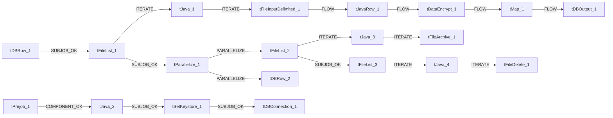

# Talend Job: Debtor_Table_Text_Load

- **Project**: LATITUDE
- **Version**: 0.1
- **Job Type**: Standard

- **Author**: jmach@harriscollect.com
- **Created**: 2024-10-18T11:58:22.215-0700
- **Last Modified**: 2026-05-26T11:52:52.066-0700

## Components

| # | Component | Type | Key Parameters |
|---|-----------|------|----------------|
| 1 | tDBConnection_1 | `tSnowflakeConnection` | `CONNECTION_FORMAT`=row, `PROPERTIES`={"@id":2,"@type":"org.talend.components.snowflake. |
| 2 | tDBRow_1 | `tSnowflakeRow` | `CONNECTION_FORMAT`=row, `PROPERTIES`={"@id":3,"@type":"org.talend.components.snowflake. |
| 3 | tFileList_1 | `tFileList` | `DIRECTORY`=context.sourceDir, `LIST_MODE`=FILES, `INCLUDSUBDIR`=false, `CASE_SENSITIVE`=YES, `ERROR`=false |
| 4 | tJava_1 | `tJava` | `CODE`=context.filePath= ((String)globalMap.get("tFileLis, `IMPORT`=//import java.util.List;, `CONNECTION_FORMAT`=row |
| 5 | tFileInputDelimited_1 | `tFileInputDelimited` | `USE_EXISTING_DYNAMIC`=false, `FILENAMETEXT`="When the input source is a stream or a zip file,f, `FILENAME`=context.filePath, `CSV_OPTION`=false, `ROWSEPARATOR`="|$|" |
| 6 | tJavaRow_1 | `tJavaRow` | `CODE`=//Code generated according to input schema and out, `IMPORT`=//import java.util.List;, `CONNECTION_FORMAT`=row |
| 7 | tDataEncrypt_1 | `tDataEncrypt` | `CRYPTO_METHOD`=AES, `CRYPTO_FILE_PATH`=context.cryptoPath, `GEN_CRYPTO_FILE_CONTROLLER`=false, `ALGO_VERSION`=2, `CONNECTION_FORMAT`=row |
| 8 | tMap_1 | `tMap` | `LINK_STYLE`=AUTO, `DIE_ON_ERROR`=true, `LKUP_PARALLELIZE`=false, `LEVENSHTEIN`=0, `JACCARD`=0 |
| 9 | tDBOutput_1 | `tSnowflakeOutput` | `CONNECTION_FORMAT`=row, `PROPERTIES`={"@id":4,"@type":"org.talend.components.snowflake. |
| 10 | tDBRow_2 | `tSnowflakeRow` | `CONNECTION_FORMAT`=row, `PROPERTIES`={"@id":3,"@type":"org.talend.components.snowflake. |
| 11 | tPrejob_1 | `tPrejob` | `CONNECTION_FORMAT`=row |
| 12 | tJava_2 | `tJava` | `CODE`=context.archiveDir = context.archiveDir + TalendDa, `IMPORT`=//import java.util.List;, `CONNECTION_FORMAT`=row |
| 13 | tFileList_2 | `tFileList` | `DIRECTORY`=context.sourceDir, `LIST_MODE`=FILES, `INCLUDSUBDIR`=false, `CASE_SENSITIVE`=YES, `ERROR`=false |
| 14 | tJava_3 | `tJava` | `CODE`=context.filePath = ((String)globalMap.get("tFileLi, `IMPORT`=//import java.util.List;, `CONNECTION_FORMAT`=row |
| 15 | tFileArchive_1 | `tFileArchive` | `SOURCE`=context.sourceDir, `SOURCE_FILE`="C:/Talend-Studio-20211109_1610-V8.0.1/workspace/s, `SUB_DIRECTROY`=false, `TARGET`=context.archiveDir + context.fileName+".zip", `MKDIR`=true |
| 16 | tParallelize_1 | `tParallelize` | `WAIT_FOR`=All, `SLEEPTIME`=100, `DIE_ON_ERROR`=false, `CONNECTION_FORMAT`=row |
| 17 | tFileList_3 | `tFileList` | `DIRECTORY`=context.sourceDir, `LIST_MODE`=FILES, `INCLUDSUBDIR`=false, `CASE_SENSITIVE`=YES, `ERROR`=false |
| 18 | tJava_4 | `tJava` | `CODE`=context.filePath = ((String)globalMap.get("tFileLi, `IMPORT`=//import java.util.List;, `CONNECTION_FORMAT`=row |
| 19 | tFileDelete_1 | `tFileDelete` | `FILENAME`=context.filePath, `DIRECTORY`="C:/Talend-Studio-20211109_1610-V8.0.1/workspace/d, `PATH`="C:/Talend-Studio-20211109_1610-V8.0.1/workspace/d, `FAILON`=false, `FOLDER`=false |
| 20 | tSetKeystore_1 | `tSetKeystore` | `SET_TRUSTSTORE`=false, `SET_TRUSTSTORE_KEYSTORE`=false, `TRUSTSTORE_TYPE`=JKS, `SSL_TRUSTSERVER_TRUSTSTORE`="C:/clientTrustStore.trustStore", `KEYSTORE_TYPE`=PKCS12 |

## Schemas

### tDBRow_1

| Column | Type | Nullable | Length |
|--------|------|----------|--------|
| errorCode | id_String | No | 255 |
| errorMessage | id_String | No | 255 |

### tFileInputDelimited_1

| Column | Type | Nullable | Length |
|--------|------|----------|--------|
| NUMBER | id_BigDecimal | Yes | 38 |
| SEQ | id_BigDecimal | Yes | 38 |
| NAME | id_String | Yes | 16777216 |
| STREET1 | id_String | Yes | 16777216 |
| STREET2 | id_String | Yes | 16777216 |
| CITY | id_String | Yes | 16777216 |
| STATE | id_String | Yes | 16777216 |
| ZIPCODE | id_String | Yes | 16777216 |
| HOMEPHONE | id_String | Yes | 16777216 |
| WORKPHONE | id_String | Yes | 16777216 |
| SSN | id_String | Yes | 16777216 |
| MR | id_String | Yes | 16777216 |
| OTHERNAME | id_String | Yes | 16777216 |
| DOB | id_String | Yes | 16777216 |
| JOBNAME | id_String | Yes | 16777216 |
| JOBADDR1 | id_String | Yes | 16777216 |
| JOBADDR2 | id_String | Yes | 16777216 |
| JOBCSZ | id_String | Yes | 16777216 |
| JOBMEMO | id_String | Yes | 16777216 |
| RELATIONSHIP | id_String | Yes | 16777216 |
| SPOUSE | id_String | Yes | 16777216 |
| SPOUSEJOBNAME | id_String | Yes | 16777216 |
| SPOUSEJOBADDR1 | id_String | Yes | 16777216 |
| SPOUSEJOBADDR2 | id_String | Yes | 16777216 |
| SPOUSEJOBCSZ | id_String | Yes | 16777216 |
| SPOUSEJOBMEMO | id_String | Yes | 16777216 |
| SPOUSEHOMEPHONE | id_String | Yes | 16777216 |
| SPOUSEWORKPHONE | id_String | Yes | 16777216 |
| SPOUSERESPONSIBLE | id_String | Yes | 16777216 |
| PAGER | id_String | Yes | 16777216 |
| OTHERPHONE1 | id_String | Yes | 16777216 |
| OTHERPHONETYPE | id_String | Yes | 16777216 |
| OTHERPHONE2 | id_String | Yes | 16777216 |
| OTHERPHONE2TYPE | id_String | Yes | 16777216 |
| OTHERPHONE3 | id_String | Yes | 16777216 |
| OTHERPHONE3TYPE | id_String | Yes | 16777216 |
| DEBTORMEMO | id_String | Yes | 16777216 |
| LANGUAGE | id_String | Yes | 16777216 |
| DLNUM | id_String | Yes | 16777216 |
| FAX | id_String | Yes | 16777216 |
| EMAIL | id_String | Yes | 16777216 |
| DEBTORID | id_String | Yes | 16777216 |
| DATECREATED | id_String | Yes | 16777216 |
| DATEUPDATED | id_String | Yes | 16777216 |
| COUNTRY | id_String | Yes | 16777216 |
| DATETIMEENTERED | id_String | Yes | 16777216 |
| RESPONSIBLE | id_String | Yes | 16777216 |
| FIRSTNAME | id_String | Yes | 16777216 |
| MIDDLENAME | id_String | Yes | 16777216 |
| LASTNAME | id_String | Yes | 16777216 |
| SUFFIX | id_String | Yes | 16777216 |
| ISBUSINESS | id_String | Yes | 16777216 |
| ISPARSED | id_String | Yes | 16777216 |
| CBREXCEPTION | id_String | Yes | 16777216 |
| CBREXCLUDE | id_String | Yes | 16777216 |
| USPSKEYLINE | id_String | Yes | 16777216 |
| EARLYTIMEZONE | id_String | Yes | 16777216 |
| LATETIMEZONE | id_String | Yes | 16777216 |
| BUSINESSNAME | id_String | Yes | 16777216 |
| PREFIX | id_String | Yes | 16777216 |
| GENDER | id_String | Yes | 16777216 |
| OBSERVESDST | id_String | Yes | 16777216 |
| REGIONCODE | id_String | Yes | 16777216 |
| COUNTY | id_String | Yes | 16777216 |
| TIMEZONEOVERRIDE | id_String | Yes | 16777216 |
| ISHOMEOWNER | id_String | Yes | 16777216 |
| PHONESYNCFLAG | id_String | Yes | 16777216 |
| ISAUTHORIZEDACCOUNTUSER | id_String | Yes | 16777216 |
| CBREXCEPTION32 | id_String | Yes | 16777216 |
| CBRECOACODE | id_String | Yes | 16777216 |
| CONTACTMETHOD | id_String | Yes | 16777216 |
| LASTCALLATTEMPTDATE | id_String | Yes | 16777216 |
| TOTALCALLATTEMPTS | id_String | Yes | 16777216 |
| NEXTALLOWABLECALLATTEMPTDATE | id_String | Yes | 16777216 |
| NEXTALLOWABLECALLREASON | id_String | Yes | 16777216 |
| JOBCITY | id_String | Yes | 50 |
| JOBSTATE | id_String | Yes | 3 |
| JOBZIPCODE | id_String | Yes | 10 |
| JOBCOUNTY | id_String | Yes | 50 |
| JOBCOUNTRY | id_String | Yes | 50 |
| SPOUSEJOBCITY | id_String | Yes | 50 |
| SPOUSEJOBSTATE | id_String | Yes | 3 |
| SPOUSEJOBZIPCODE | id_String | Yes | 10 |
| SPOUSEJOBCOUNTY | id_String | Yes | 50 |
| SPOUSEJOBCOUNTRY | id_String | Yes | 50 |
| JOINEDDEBTORID | id_Integer | Yes | 38 |
| REEVALUATEJOINS | id_Integer | Yes | 38 |
| DONOTJOIN | id_Integer | Yes | 38 |
| ID1 | id_String | Yes | 50 |
| ID2 | id_String | Yes | 50 |
| PURN | id_String | Yes | 50 |
| ISLIABLE | id_Integer | Yes | 38 |
| SHOULDQUEUE | id_Integer | Yes | 38 |
| WORKED | id_String | Yes | 16777216 |
| CONTACTED | id_String | Yes | 16777216 |
| AUTHORIZEDFORDEBTORID | id_Integer | Yes | 38 |
| JOBVERIFIED | id_Integer | Yes | 38 |
| JOBVERIFIEDBY | id_String | Yes | 255 |
| JOBVERIFIEDWHEN | id_String | Yes | 16777216 |
| PORTALUSERNAME | id_String | Yes | 50 |
| PORTALPASSWORD | id_String | Yes | 255 |
| PORTALPASSWORDSALT | id_String | Yes | 255 |
| PORTALVERIFYCODE | id_String | Yes | 10 |
| TIMEZONECODE | id_String | Yes | 50 |
| STATEATDEBTORIGINATION | id_String | Yes | 3 |
| NUMBER | id_BigDecimal | Yes | 38 |
| SEQ | id_BigDecimal | Yes | 38 |
| NAME | id_String | Yes | 16777216 |
| STREET1 | id_String | Yes | 16777216 |
| STREET2 | id_String | Yes | 16777216 |
| CITY | id_String | Yes | 16777216 |
| STATE | id_String | Yes | 16777216 |
| ZIPCODE | id_String | Yes | 16777216 |
| HOMEPHONE | id_String | Yes | 16777216 |
| WORKPHONE | id_String | Yes | 16777216 |
| SSN | id_String | Yes | 16777216 |
| MR | id_String | Yes | 16777216 |
| OTHERNAME | id_String | Yes | 16777216 |
| DOB | id_String | Yes | 16777216 |
| JOBNAME | id_String | Yes | 16777216 |
| JOBADDR1 | id_String | Yes | 16777216 |
| JOBADDR2 | id_String | Yes | 16777216 |
| JOBCSZ | id_String | Yes | 16777216 |
| JOBMEMO | id_String | Yes | 16777216 |
| RELATIONSHIP | id_String | Yes | 16777216 |
| SPOUSE | id_String | Yes | 16777216 |
| SPOUSEJOBNAME | id_String | Yes | 16777216 |
| SPOUSEJOBADDR1 | id_String | Yes | 16777216 |
| SPOUSEJOBADDR2 | id_String | Yes | 16777216 |
| SPOUSEJOBCSZ | id_String | Yes | 16777216 |
| SPOUSEJOBMEMO | id_String | Yes | 16777216 |
| SPOUSEHOMEPHONE | id_String | Yes | 16777216 |
| SPOUSEWORKPHONE | id_String | Yes | 16777216 |
| SPOUSERESPONSIBLE | id_String | Yes | 16777216 |
| PAGER | id_String | Yes | 16777216 |
| OTHERPHONE1 | id_String | Yes | 16777216 |
| OTHERPHONETYPE | id_String | Yes | 16777216 |
| OTHERPHONE2 | id_String | Yes | 16777216 |
| OTHERPHONE2TYPE | id_String | Yes | 16777216 |
| OTHERPHONE3 | id_String | Yes | 16777216 |
| OTHERPHONE3TYPE | id_String | Yes | 16777216 |
| DEBTORMEMO | id_String | Yes | 16777216 |
| LANGUAGE | id_String | Yes | 16777216 |
| DLNUM | id_String | Yes | 16777216 |
| FAX | id_String | Yes | 16777216 |
| EMAIL | id_String | Yes | 16777216 |
| DEBTORID | id_String | Yes | 16777216 |
| DATECREATED | id_String | Yes | 16777216 |
| DATEUPDATED | id_String | Yes | 16777216 |
| COUNTRY | id_String | Yes | 16777216 |
| DATETIMEENTERED | id_String | Yes | 16777216 |
| RESPONSIBLE | id_String | Yes | 16777216 |
| FIRSTNAME | id_String | Yes | 16777216 |
| MIDDLENAME | id_String | Yes | 16777216 |
| LASTNAME | id_String | Yes | 16777216 |
| SUFFIX | id_String | Yes | 16777216 |
| ISBUSINESS | id_String | Yes | 16777216 |
| ISPARSED | id_String | Yes | 16777216 |
| CBREXCEPTION | id_String | Yes | 16777216 |
| CBREXCLUDE | id_String | Yes | 16777216 |
| USPSKEYLINE | id_String | Yes | 16777216 |
| EARLYTIMEZONE | id_String | Yes | 16777216 |
| LATETIMEZONE | id_String | Yes | 16777216 |
| BUSINESSNAME | id_String | Yes | 16777216 |
| PREFIX | id_String | Yes | 16777216 |
| GENDER | id_String | Yes | 16777216 |
| OBSERVESDST | id_String | Yes | 16777216 |
| REGIONCODE | id_String | Yes | 16777216 |
| COUNTY | id_String | Yes | 16777216 |
| TIMEZONEOVERRIDE | id_String | Yes | 16777216 |
| ISHOMEOWNER | id_String | Yes | 16777216 |
| PHONESYNCFLAG | id_String | Yes | 16777216 |
| ISAUTHORIZEDACCOUNTUSER | id_String | Yes | 16777216 |
| CBREXCEPTION32 | id_String | Yes | 16777216 |
| CBRECOACODE | id_String | Yes | 16777216 |
| CONTACTMETHOD | id_String | Yes | 16777216 |
| LASTCALLATTEMPTDATE | id_String | Yes | 16777216 |
| TOTALCALLATTEMPTS | id_String | Yes | 16777216 |
| NEXTALLOWABLECALLATTEMPTDATE | id_String | Yes | 16777216 |
| NEXTALLOWABLECALLREASON | id_String | Yes | 16777216 |
| JOBCITY | id_String | Yes | 50 |
| JOBSTATE | id_String | Yes | 3 |
| JOBZIPCODE | id_String | Yes | 10 |
| JOBCOUNTY | id_String | Yes | 50 |
| JOBCOUNTRY | id_String | Yes | 50 |
| SPOUSEJOBCITY | id_String | Yes | 50 |
| SPOUSEJOBSTATE | id_String | Yes | 3 |
| SPOUSEJOBZIPCODE | id_String | Yes | 10 |
| SPOUSEJOBCOUNTY | id_String | Yes | 50 |
| SPOUSEJOBCOUNTRY | id_String | Yes | 50 |
| JOINEDDEBTORID | id_Integer | Yes | 38 |
| REEVALUATEJOINS | id_Integer | Yes | 38 |
| DONOTJOIN | id_Integer | Yes | 38 |
| ID1 | id_String | Yes | 50 |
| ID2 | id_String | Yes | 50 |
| PURN | id_String | Yes | 50 |
| ISLIABLE | id_Integer | Yes | 38 |
| SHOULDQUEUE | id_Integer | Yes | 38 |
| WORKED | id_String | Yes | 16777216 |
| CONTACTED | id_String | Yes | 16777216 |
| AUTHORIZEDFORDEBTORID | id_Integer | Yes | 38 |
| JOBVERIFIED | id_Integer | Yes | 38 |
| JOBVERIFIEDBY | id_String | Yes | 255 |
| JOBVERIFIEDWHEN | id_String | Yes | 16777216 |
| PORTALUSERNAME | id_String | Yes | 50 |
| PORTALPASSWORD | id_String | Yes | 255 |
| PORTALPASSWORDSALT | id_String | Yes | 255 |
| PORTALVERIFYCODE | id_String | Yes | 10 |
| TIMEZONECODE | id_String | Yes | 50 |
| STATEATDEBTORIGINATION | id_String | Yes | 3 |
| LAST4SSN | id_String | Yes | 4 |
| errorCode | id_String | Yes | 255 |
| errorMessage | id_String | Yes | 255 |

### tJavaRow_1

| Column | Type | Nullable | Length |
|--------|------|----------|--------|
| NUMBER | id_BigDecimal | Yes | 38 |
| SEQ | id_BigDecimal | Yes | 38 |
| NAME | id_String | Yes | 16777216 |
| STREET1 | id_String | Yes | 16777216 |
| STREET2 | id_String | Yes | 16777216 |
| CITY | id_String | Yes | 16777216 |
| STATE | id_String | Yes | 16777216 |
| ZIPCODE | id_String | Yes | 16777216 |
| HOMEPHONE | id_String | Yes | 16777216 |
| WORKPHONE | id_String | Yes | 16777216 |
| SSN | id_String | Yes | 16777216 |
| MR | id_String | Yes | 16777216 |
| OTHERNAME | id_String | Yes | 16777216 |
| DOB | id_String | Yes | 16777216 |
| JOBNAME | id_String | Yes | 16777216 |
| JOBADDR1 | id_String | Yes | 16777216 |
| JOBADDR2 | id_String | Yes | 16777216 |
| JOBCSZ | id_String | Yes | 16777216 |
| JOBMEMO | id_String | Yes | 16777216 |
| RELATIONSHIP | id_String | Yes | 16777216 |
| SPOUSE | id_String | Yes | 16777216 |
| SPOUSEJOBNAME | id_String | Yes | 16777216 |
| SPOUSEJOBADDR1 | id_String | Yes | 16777216 |
| SPOUSEJOBADDR2 | id_String | Yes | 16777216 |
| SPOUSEJOBCSZ | id_String | Yes | 16777216 |
| SPOUSEJOBMEMO | id_String | Yes | 16777216 |
| SPOUSEHOMEPHONE | id_String | Yes | 16777216 |
| SPOUSEWORKPHONE | id_String | Yes | 16777216 |
| SPOUSERESPONSIBLE | id_String | Yes | 16777216 |
| PAGER | id_String | Yes | 16777216 |
| OTHERPHONE1 | id_String | Yes | 16777216 |
| OTHERPHONETYPE | id_String | Yes | 16777216 |
| OTHERPHONE2 | id_String | Yes | 16777216 |
| OTHERPHONE2TYPE | id_String | Yes | 16777216 |
| OTHERPHONE3 | id_String | Yes | 16777216 |
| OTHERPHONE3TYPE | id_String | Yes | 16777216 |
| DEBTORMEMO | id_String | Yes | 16777216 |
| LANGUAGE | id_String | Yes | 16777216 |
| DLNUM | id_String | Yes | 16777216 |
| FAX | id_String | Yes | 16777216 |
| EMAIL | id_String | Yes | 16777216 |
| DEBTORID | id_String | Yes | 16777216 |
| DATECREATED | id_String | Yes | 16777216 |
| DATEUPDATED | id_String | Yes | 16777216 |
| COUNTRY | id_String | Yes | 16777216 |
| DATETIMEENTERED | id_String | Yes | 16777216 |
| RESPONSIBLE | id_String | Yes | 16777216 |
| FIRSTNAME | id_String | Yes | 16777216 |
| MIDDLENAME | id_String | Yes | 16777216 |
| LASTNAME | id_String | Yes | 16777216 |
| SUFFIX | id_String | Yes | 16777216 |
| ISBUSINESS | id_String | Yes | 16777216 |
| ISPARSED | id_String | Yes | 16777216 |
| CBREXCEPTION | id_String | Yes | 16777216 |
| CBREXCLUDE | id_String | Yes | 16777216 |
| USPSKEYLINE | id_String | Yes | 16777216 |
| EARLYTIMEZONE | id_String | Yes | 16777216 |
| LATETIMEZONE | id_String | Yes | 16777216 |
| BUSINESSNAME | id_String | Yes | 16777216 |
| PREFIX | id_String | Yes | 16777216 |
| GENDER | id_String | Yes | 16777216 |
| OBSERVESDST | id_String | Yes | 16777216 |
| REGIONCODE | id_String | Yes | 16777216 |
| COUNTY | id_String | Yes | 16777216 |
| TIMEZONEOVERRIDE | id_String | Yes | 16777216 |
| ISHOMEOWNER | id_String | Yes | 16777216 |
| PHONESYNCFLAG | id_String | Yes | 16777216 |
| ISAUTHORIZEDACCOUNTUSER | id_String | Yes | 16777216 |
| CBREXCEPTION32 | id_String | Yes | 16777216 |
| CBRECOACODE | id_String | Yes | 16777216 |
| CONTACTMETHOD | id_String | Yes | 16777216 |
| LASTCALLATTEMPTDATE | id_String | Yes | 16777216 |
| TOTALCALLATTEMPTS | id_String | Yes | 16777216 |
| NEXTALLOWABLECALLATTEMPTDATE | id_String | Yes | 16777216 |
| NEXTALLOWABLECALLREASON | id_String | Yes | 16777216 |
| JOBCITY | id_String | Yes | 50 |
| JOBSTATE | id_String | Yes | 3 |
| JOBZIPCODE | id_String | Yes | 10 |
| JOBCOUNTY | id_String | Yes | 50 |
| JOBCOUNTRY | id_String | Yes | 50 |
| SPOUSEJOBCITY | id_String | Yes | 50 |
| SPOUSEJOBSTATE | id_String | Yes | 3 |
| SPOUSEJOBZIPCODE | id_String | Yes | 10 |
| SPOUSEJOBCOUNTY | id_String | Yes | 50 |
| SPOUSEJOBCOUNTRY | id_String | Yes | 50 |
| JOINEDDEBTORID | id_Integer | Yes | 38 |
| REEVALUATEJOINS | id_Integer | Yes | 38 |
| DONOTJOIN | id_Integer | Yes | 38 |
| ID1 | id_String | Yes | 50 |
| ID2 | id_String | Yes | 50 |
| PURN | id_String | Yes | 50 |
| ISLIABLE | id_Integer | Yes | 38 |
| SHOULDQUEUE | id_Integer | Yes | 38 |
| WORKED | id_String | Yes | 16777216 |
| CONTACTED | id_String | Yes | 16777216 |
| AUTHORIZEDFORDEBTORID | id_Integer | Yes | 38 |
| JOBVERIFIED | id_Integer | Yes | 38 |
| JOBVERIFIEDBY | id_String | Yes | 255 |
| JOBVERIFIEDWHEN | id_String | Yes | 16777216 |
| PORTALUSERNAME | id_String | Yes | 50 |
| PORTALPASSWORD | id_String | Yes | 255 |
| PORTALPASSWORDSALT | id_String | Yes | 255 |
| PORTALVERIFYCODE | id_String | Yes | 10 |
| TIMEZONECODE | id_String | Yes | 50 |
| STATEATDEBTORIGINATION | id_String | Yes | 3 |
| LAST4SSN | id_String | Yes | 4 |

### tDataEncrypt_1

| Column | Type | Nullable | Length |
|--------|------|----------|--------|
| NUMBER | id_BigDecimal | Yes | 38 |
| SEQ | id_BigDecimal | Yes | 38 |
| NAME | id_String | Yes | 16777216 |
| STREET1 | id_String | Yes | 16777216 |
| STREET2 | id_String | Yes | 16777216 |
| CITY | id_String | Yes | 16777216 |
| STATE | id_String | Yes | 16777216 |
| ZIPCODE | id_String | Yes | 16777216 |
| HOMEPHONE | id_String | Yes | 16777216 |
| WORKPHONE | id_String | Yes | 16777216 |
| SSN | id_String | Yes | 16777216 |
| MR | id_String | Yes | 16777216 |
| OTHERNAME | id_String | Yes | 16777216 |
| DOB | id_String | Yes | 16777216 |
| JOBNAME | id_String | Yes | 16777216 |
| JOBADDR1 | id_String | Yes | 16777216 |
| JOBADDR2 | id_String | Yes | 16777216 |
| JOBCSZ | id_String | Yes | 16777216 |
| JOBMEMO | id_String | Yes | 16777216 |
| RELATIONSHIP | id_String | Yes | 16777216 |
| SPOUSE | id_String | Yes | 16777216 |
| SPOUSEJOBNAME | id_String | Yes | 16777216 |
| SPOUSEJOBADDR1 | id_String | Yes | 16777216 |
| SPOUSEJOBADDR2 | id_String | Yes | 16777216 |
| SPOUSEJOBCSZ | id_String | Yes | 16777216 |
| SPOUSEJOBMEMO | id_String | Yes | 16777216 |
| SPOUSEHOMEPHONE | id_String | Yes | 16777216 |
| SPOUSEWORKPHONE | id_String | Yes | 16777216 |
| SPOUSERESPONSIBLE | id_String | Yes | 16777216 |
| PAGER | id_String | Yes | 16777216 |
| OTHERPHONE1 | id_String | Yes | 16777216 |
| OTHERPHONETYPE | id_String | Yes | 16777216 |
| OTHERPHONE2 | id_String | Yes | 16777216 |
| OTHERPHONE2TYPE | id_String | Yes | 16777216 |
| OTHERPHONE3 | id_String | Yes | 16777216 |
| OTHERPHONE3TYPE | id_String | Yes | 16777216 |
| DEBTORMEMO | id_String | Yes | 16777216 |
| LANGUAGE | id_String | Yes | 16777216 |
| DLNUM | id_String | Yes | 16777216 |
| FAX | id_String | Yes | 16777216 |
| EMAIL | id_String | Yes | 16777216 |
| DEBTORID | id_String | Yes | 16777216 |
| DATECREATED | id_String | Yes | 16777216 |
| DATEUPDATED | id_String | Yes | 16777216 |
| COUNTRY | id_String | Yes | 16777216 |
| DATETIMEENTERED | id_String | Yes | 16777216 |
| RESPONSIBLE | id_String | Yes | 16777216 |
| FIRSTNAME | id_String | Yes | 16777216 |
| MIDDLENAME | id_String | Yes | 16777216 |
| LASTNAME | id_String | Yes | 16777216 |
| SUFFIX | id_String | Yes | 16777216 |
| ISBUSINESS | id_String | Yes | 16777216 |
| ISPARSED | id_String | Yes | 16777216 |
| CBREXCEPTION | id_String | Yes | 16777216 |
| CBREXCLUDE | id_String | Yes | 16777216 |
| USPSKEYLINE | id_String | Yes | 16777216 |
| EARLYTIMEZONE | id_String | Yes | 16777216 |
| LATETIMEZONE | id_String | Yes | 16777216 |
| BUSINESSNAME | id_String | Yes | 16777216 |
| PREFIX | id_String | Yes | 16777216 |
| GENDER | id_String | Yes | 16777216 |
| OBSERVESDST | id_String | Yes | 16777216 |
| REGIONCODE | id_String | Yes | 16777216 |
| COUNTY | id_String | Yes | 16777216 |
| TIMEZONEOVERRIDE | id_String | Yes | 16777216 |
| ISHOMEOWNER | id_String | Yes | 16777216 |
| PHONESYNCFLAG | id_String | Yes | 16777216 |
| ISAUTHORIZEDACCOUNTUSER | id_String | Yes | 16777216 |
| CBREXCEPTION32 | id_String | Yes | 16777216 |
| CBRECOACODE | id_String | Yes | 16777216 |
| CONTACTMETHOD | id_String | Yes | 16777216 |
| LASTCALLATTEMPTDATE | id_String | Yes | 16777216 |
| TOTALCALLATTEMPTS | id_String | Yes | 16777216 |
| NEXTALLOWABLECALLATTEMPTDATE | id_String | Yes | 16777216 |
| NEXTALLOWABLECALLREASON | id_String | Yes | 16777216 |
| JOBCITY | id_String | Yes | 50 |
| JOBSTATE | id_String | Yes | 3 |
| JOBZIPCODE | id_String | Yes | 10 |
| JOBCOUNTY | id_String | Yes | 50 |
| JOBCOUNTRY | id_String | Yes | 50 |
| SPOUSEJOBCITY | id_String | Yes | 50 |
| SPOUSEJOBSTATE | id_String | Yes | 3 |
| SPOUSEJOBZIPCODE | id_String | Yes | 10 |
| SPOUSEJOBCOUNTY | id_String | Yes | 50 |
| SPOUSEJOBCOUNTRY | id_String | Yes | 50 |
| JOINEDDEBTORID | id_Integer | Yes | 38 |
| REEVALUATEJOINS | id_Integer | Yes | 38 |
| DONOTJOIN | id_Integer | Yes | 38 |
| ID1 | id_String | Yes | 50 |
| ID2 | id_String | Yes | 50 |
| PURN | id_String | Yes | 50 |
| ISLIABLE | id_Integer | Yes | 38 |
| SHOULDQUEUE | id_Integer | Yes | 38 |
| WORKED | id_String | Yes | 16777216 |
| CONTACTED | id_String | Yes | 16777216 |
| AUTHORIZEDFORDEBTORID | id_Integer | Yes | 38 |
| JOBVERIFIED | id_Integer | Yes | 38 |
| JOBVERIFIEDBY | id_String | Yes | 255 |
| JOBVERIFIEDWHEN | id_String | Yes | 16777216 |
| PORTALUSERNAME | id_String | Yes | 50 |
| PORTALPASSWORD | id_String | Yes | 255 |
| PORTALPASSWORDSALT | id_String | Yes | 255 |
| PORTALVERIFYCODE | id_String | Yes | 10 |
| TIMEZONECODE | id_String | Yes | 50 |
| STATEATDEBTORIGINATION | id_String | Yes | 3 |
| LAST4SSN | id_String | Yes | 4 |

### tMap_1

| Column | Type | Nullable | Length |
|--------|------|----------|--------|
| LOAD_DT | id_Date | Yes | -1 |
| NUMBER | id_BigDecimal | Yes | 38 |
| SEQ | id_BigDecimal | Yes | 38 |
| NAME | id_String | Yes | 16777216 |
| STREET1 | id_String | Yes | 16777216 |
| STREET2 | id_String | Yes | 16777216 |
| CITY | id_String | Yes | 16777216 |
| STATE | id_String | Yes | 16777216 |
| ZIPCODE | id_String | Yes | 16777216 |
| HOMEPHONE | id_String | Yes | 16777216 |
| WORKPHONE | id_String | Yes | 16777216 |
| SSN | id_String | Yes | 16777216 |
| MR | id_String | Yes | 16777216 |
| OTHERNAME | id_String | Yes | 16777216 |
| DOB | id_String | Yes | 16777216 |
| JOBNAME | id_String | Yes | 16777216 |
| JOBADDR1 | id_String | Yes | 16777216 |
| JOBADDR2 | id_String | Yes | 16777216 |
| JOBCSZ | id_String | Yes | 16777216 |
| JOBMEMO | id_String | Yes | 16777216 |
| RELATIONSHIP | id_String | Yes | 16777216 |
| SPOUSE | id_String | Yes | 16777216 |
| SPOUSEJOBNAME | id_String | Yes | 16777216 |
| SPOUSEJOBADDR1 | id_String | Yes | 16777216 |
| SPOUSEJOBADDR2 | id_String | Yes | 16777216 |
| SPOUSEJOBCSZ | id_String | Yes | 16777216 |
| SPOUSEJOBMEMO | id_String | Yes | 16777216 |
| SPOUSEHOMEPHONE | id_String | Yes | 16777216 |
| SPOUSEWORKPHONE | id_String | Yes | 16777216 |
| SPOUSERESPONSIBLE | id_String | Yes | 16777216 |
| PAGER | id_String | Yes | 16777216 |
| OTHERPHONE1 | id_String | Yes | 16777216 |
| OTHERPHONETYPE | id_String | Yes | 16777216 |
| OTHERPHONE2 | id_String | Yes | 16777216 |
| OTHERPHONE2TYPE | id_String | Yes | 16777216 |
| OTHERPHONE3 | id_String | Yes | 16777216 |
| OTHERPHONE3TYPE | id_String | Yes | 16777216 |
| DEBTORMEMO | id_String | Yes | 16777216 |
| LANGUAGE | id_String | Yes | 16777216 |
| DLNUM | id_String | Yes | 16777216 |
| FAX | id_String | Yes | 16777216 |
| EMAIL | id_String | Yes | 16777216 |
| DEBTORID | id_String | Yes | 16777216 |
| DATECREATED | id_String | Yes | 16777216 |
| DATEUPDATED | id_String | Yes | 16777216 |
| COUNTRY | id_String | Yes | 16777216 |
| DATETIMEENTERED | id_String | Yes | 16777216 |
| RESPONSIBLE | id_String | Yes | 16777216 |
| FIRSTNAME | id_String | Yes | 16777216 |
| MIDDLENAME | id_String | Yes | 16777216 |
| LASTNAME | id_String | Yes | 16777216 |
| SUFFIX | id_String | Yes | 16777216 |
| ISBUSINESS | id_String | Yes | 16777216 |
| ISPARSED | id_String | Yes | 16777216 |
| CBREXCEPTION | id_String | Yes | 16777216 |
| CBREXCLUDE | id_String | Yes | 16777216 |
| USPSKEYLINE | id_String | Yes | 16777216 |
| EARLYTIMEZONE | id_String | Yes | 16777216 |
| LATETIMEZONE | id_String | Yes | 16777216 |
| BUSINESSNAME | id_String | Yes | 16777216 |
| PREFIX | id_String | Yes | 16777216 |
| GENDER | id_String | Yes | 16777216 |
| OBSERVESDST | id_String | Yes | 16777216 |
| REGIONCODE | id_String | Yes | 16777216 |
| COUNTY | id_String | Yes | 16777216 |
| TIMEZONEOVERRIDE | id_String | Yes | 16777216 |
| ISHOMEOWNER | id_String | Yes | 16777216 |
| PHONESYNCFLAG | id_String | Yes | 16777216 |
| ISAUTHORIZEDACCOUNTUSER | id_String | Yes | 16777216 |
| CBREXCEPTION32 | id_String | Yes | 16777216 |
| CBRECOACODE | id_String | Yes | 16777216 |
| CONTACTMETHOD | id_String | Yes | 16777216 |
| LASTCALLATTEMPTDATE | id_String | Yes | 16777216 |
| TOTALCALLATTEMPTS | id_String | Yes | 16777216 |
| NEXTALLOWABLECALLATTEMPTDATE | id_String | Yes | 16777216 |
| NEXTALLOWABLECALLREASON | id_String | Yes | 16777216 |
| JOBCITY | id_String | Yes | 50 |
| JOBSTATE | id_String | Yes | 3 |
| JOBZIPCODE | id_String | Yes | 10 |
| JOBCOUNTY | id_String | Yes | 50 |
| JOBCOUNTRY | id_String | Yes | 50 |
| SPOUSEJOBCITY | id_String | Yes | 50 |
| SPOUSEJOBSTATE | id_String | Yes | 3 |
| SPOUSEJOBZIPCODE | id_String | Yes | 10 |
| SPOUSEJOBCOUNTY | id_String | Yes | 50 |
| SPOUSEJOBCOUNTRY | id_String | Yes | 50 |
| JOINEDDEBTORID | id_Integer | Yes | 38 |
| REEVALUATEJOINS | id_Integer | Yes | 38 |
| DONOTJOIN | id_Integer | Yes | 38 |
| ID1 | id_String | Yes | 50 |
| ID2 | id_String | Yes | 50 |
| PURN | id_String | Yes | 50 |
| ISLIABLE | id_Integer | Yes | 38 |
| SHOULDQUEUE | id_Integer | Yes | 38 |
| WORKED | id_String | Yes | 16777216 |
| CONTACTED | id_String | Yes | 16777216 |
| AUTHORIZEDFORDEBTORID | id_Integer | Yes | 38 |
| JOBVERIFIED | id_Integer | Yes | 38 |
| JOBVERIFIEDBY | id_String | Yes | 255 |
| JOBVERIFIEDWHEN | id_String | Yes | 16777216 |
| PORTALUSERNAME | id_String | Yes | 50 |
| PORTALPASSWORD | id_String | Yes | 255 |
| PORTALPASSWORDSALT | id_String | Yes | 255 |
| PORTALVERIFYCODE | id_String | Yes | 10 |
| TIMEZONECODE | id_String | Yes | 50 |
| STATEATDEBTORIGINATION | id_String | Yes | 3 |
| LAST4SSN | id_String | Yes | 4 |

### tDBOutput_1

| Column | Type | Nullable | Length |
|--------|------|----------|--------|
| LOAD_DT | id_Date | Yes | -1 |
| NUMBER | id_BigDecimal | Yes | 38 |
| SEQ | id_BigDecimal | Yes | 38 |
| NAME | id_String | Yes | 16777216 |
| STREET1 | id_String | Yes | 16777216 |
| STREET2 | id_String | Yes | 16777216 |
| CITY | id_String | Yes | 16777216 |
| STATE | id_String | Yes | 16777216 |
| ZIPCODE | id_String | Yes | 16777216 |
| HOMEPHONE | id_String | Yes | 16777216 |
| WORKPHONE | id_String | Yes | 16777216 |
| SSN | id_String | Yes | 16777216 |
| MR | id_String | Yes | 16777216 |
| OTHERNAME | id_String | Yes | 16777216 |
| DOB | id_String | Yes | 16777216 |
| JOBNAME | id_String | Yes | 16777216 |
| JOBADDR1 | id_String | Yes | 16777216 |
| JOBADDR2 | id_String | Yes | 16777216 |
| JOBCSZ | id_String | Yes | 16777216 |
| JOBMEMO | id_String | Yes | 16777216 |
| RELATIONSHIP | id_String | Yes | 16777216 |
| SPOUSE | id_String | Yes | 16777216 |
| SPOUSEJOBNAME | id_String | Yes | 16777216 |
| SPOUSEJOBADDR1 | id_String | Yes | 16777216 |
| SPOUSEJOBADDR2 | id_String | Yes | 16777216 |
| SPOUSEJOBCSZ | id_String | Yes | 16777216 |
| SPOUSEJOBMEMO | id_String | Yes | 16777216 |
| SPOUSEHOMEPHONE | id_String | Yes | 16777216 |
| SPOUSEWORKPHONE | id_String | Yes | 16777216 |
| SPOUSERESPONSIBLE | id_String | Yes | 16777216 |
| PAGER | id_String | Yes | 16777216 |
| OTHERPHONE1 | id_String | Yes | 16777216 |
| OTHERPHONETYPE | id_String | Yes | 16777216 |
| OTHERPHONE2 | id_String | Yes | 16777216 |
| OTHERPHONE2TYPE | id_String | Yes | 16777216 |
| OTHERPHONE3 | id_String | Yes | 16777216 |
| OTHERPHONE3TYPE | id_String | Yes | 16777216 |
| DEBTORMEMO | id_String | Yes | 16777216 |
| LANGUAGE | id_String | Yes | 16777216 |
| DLNUM | id_String | Yes | 16777216 |
| FAX | id_String | Yes | 16777216 |
| EMAIL | id_String | Yes | 16777216 |
| DEBTORID | id_String | Yes | 16777216 |
| DATECREATED | id_String | Yes | 16777216 |
| DATEUPDATED | id_String | Yes | 16777216 |
| COUNTRY | id_String | Yes | 16777216 |
| DATETIMEENTERED | id_String | Yes | 16777216 |
| RESPONSIBLE | id_String | Yes | 16777216 |
| FIRSTNAME | id_String | Yes | 16777216 |
| MIDDLENAME | id_String | Yes | 16777216 |
| LASTNAME | id_String | Yes | 16777216 |
| SUFFIX | id_String | Yes | 16777216 |
| ISBUSINESS | id_String | Yes | 16777216 |
| ISPARSED | id_String | Yes | 16777216 |
| CBREXCEPTION | id_String | Yes | 16777216 |
| CBREXCLUDE | id_String | Yes | 16777216 |
| USPSKEYLINE | id_String | Yes | 16777216 |
| EARLYTIMEZONE | id_String | Yes | 16777216 |
| LATETIMEZONE | id_String | Yes | 16777216 |
| BUSINESSNAME | id_String | Yes | 16777216 |
| PREFIX | id_String | Yes | 16777216 |
| GENDER | id_String | Yes | 16777216 |
| OBSERVESDST | id_String | Yes | 16777216 |
| REGIONCODE | id_String | Yes | 16777216 |
| COUNTY | id_String | Yes | 16777216 |
| TIMEZONEOVERRIDE | id_String | Yes | 16777216 |
| ISHOMEOWNER | id_String | Yes | 16777216 |
| PHONESYNCFLAG | id_String | Yes | 16777216 |
| ISAUTHORIZEDACCOUNTUSER | id_String | Yes | 16777216 |
| CBREXCEPTION32 | id_String | Yes | 16777216 |
| CBRECOACODE | id_String | Yes | 16777216 |
| CONTACTMETHOD | id_String | Yes | 16777216 |
| LASTCALLATTEMPTDATE | id_String | Yes | 16777216 |
| TOTALCALLATTEMPTS | id_String | Yes | 16777216 |
| NEXTALLOWABLECALLATTEMPTDATE | id_String | Yes | 16777216 |
| NEXTALLOWABLECALLREASON | id_String | Yes | 16777216 |
| JOBCITY | id_String | Yes | 50 |
| JOBSTATE | id_String | Yes | 3 |
| JOBZIPCODE | id_String | Yes | 10 |
| JOBCOUNTY | id_String | Yes | 50 |
| JOBCOUNTRY | id_String | Yes | 50 |
| SPOUSEJOBCITY | id_String | Yes | 50 |
| SPOUSEJOBSTATE | id_String | Yes | 3 |
| SPOUSEJOBZIPCODE | id_String | Yes | 10 |
| SPOUSEJOBCOUNTY | id_String | Yes | 50 |
| SPOUSEJOBCOUNTRY | id_String | Yes | 50 |
| JOINEDDEBTORID | id_Integer | Yes | 38 |
| REEVALUATEJOINS | id_Integer | Yes | 38 |
| DONOTJOIN | id_Integer | Yes | 38 |
| ID1 | id_String | Yes | 50 |
| ID2 | id_String | Yes | 50 |
| PURN | id_String | Yes | 50 |
| ISLIABLE | id_Integer | Yes | 38 |
| SHOULDQUEUE | id_Integer | Yes | 38 |
| WORKED | id_String | Yes | 16777216 |
| CONTACTED | id_String | Yes | 16777216 |
| AUTHORIZEDFORDEBTORID | id_Integer | Yes | 38 |
| JOBVERIFIED | id_Integer | Yes | 38 |
| JOBVERIFIEDBY | id_String | Yes | 255 |
| JOBVERIFIEDWHEN | id_String | Yes | 16777216 |
| PORTALUSERNAME | id_String | Yes | 50 |
| PORTALPASSWORD | id_String | Yes | 255 |
| PORTALPASSWORDSALT | id_String | Yes | 255 |
| PORTALVERIFYCODE | id_String | Yes | 10 |
| TIMEZONECODE | id_String | Yes | 50 |
| STATEATDEBTORIGINATION | id_String | Yes | 3 |
| LAST4SSN | id_String | Yes | 4 |
| columnName | id_String | No | 255 |
| rowNumber | id_String | No | 255 |
| category | id_String | No | 255 |
| character | id_String | No | 255 |
| errorMessage | id_String | No | 255 |
| byteOffset | id_String | No | 255 |
| line | id_String | No | 255 |
| sqlState | id_String | No | 255 |
| code | id_String | No | 255 |

### tDBRow_2

| Column | Type | Nullable | Length |
|--------|------|----------|--------|
| errorCode | id_String | No | 255 |
| errorMessage | id_String | No | 255 |

## Data Flow

