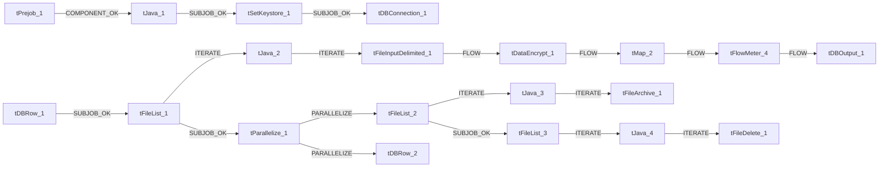

# Talend Job: Deceased_Text_Load

- **Project**: LATITUDE
- **Version**: 0.1
- **Job Type**: Standard

- **Created**: 2026-06-25T16:01:26.740-0700
- **Last Modified**: 2026-06-25T16:25:55.828-0700

## Components

| # | Component | Type | Key Parameters |
|---|-----------|------|----------------|
| 1 | tPrejob_1 | `tPrejob` | `CONNECTION_FORMAT`=row |
| 2 | tJava_1 | `tJava` | `CODE`=context.archiveDir = context.archiveDir + TalendDa, `IMPORT`=//import java.util.List;, `CONNECTION_FORMAT`=row |
| 3 | tSetKeystore_1 | `tSetKeystore` | `SET_TRUSTSTORE`=false, `SET_TRUSTSTORE_KEYSTORE`=false, `TRUSTSTORE_TYPE`=JKS, `SSL_TRUSTSERVER_TRUSTSTORE`="C:/clientTrustStore.trustStore", `KEYSTORE_TYPE`=PKCS12 |
| 4 | tDBConnection_1 | `tSnowflakeConnection` | `CONNECTION_FORMAT`=row, `PROPERTIES`={"@id":2,"@type":"org.talend.components.snowflake. |
| 5 | tFileList_1 | `tFileList` | `DIRECTORY`=context.sourceDir, `LIST_MODE`=FILES, `INCLUDSUBDIR`=false, `CASE_SENSITIVE`=YES, `ERROR`=false |
| 6 | tJava_2 | `tJava` | `CODE`=context.filePath=((String)globalMap.get("tFileList, `IMPORT`=//import java.util.List;, `CONNECTION_FORMAT`=row |
| 7 | tFileInputDelimited_1 | `tFileInputDelimited` | `USE_EXISTING_DYNAMIC`=false, `FILENAMETEXT`="When the input source is a stream or a zip file,f, `FILENAME`=context.filePath, `CSV_OPTION`=false, `ROWSEPARATOR`="|$|" |
| 8 | tDataEncrypt_1 | `tDataEncrypt` | `CRYPTO_METHOD`=AES, `CRYPTO_FILE_PATH`=context.cryptoPath, `GEN_CRYPTO_FILE_CONTROLLER`=false, `ALGO_VERSION`=2, `CONNECTION_FORMAT`=row |
| 9 | tMap_2 | `tMap` | `LINK_STYLE`=AUTO, `DIE_ON_ERROR`=true, `LKUP_PARALLELIZE`=false, `LEVENSHTEIN`=0, `JACCARD`=0 |
| 10 | tFlowMeter_4 | `tFlowMeter` | `USEROWLABEL`=true, `METTERLABEL`="MyLabel", `ABSOLUTE`=Absolute, `CONNECTION_FORMAT`=row |
| 11 | tDBOutput_1 | `tSnowflakeOutput` | `CONNECTION_FORMAT`=row, `PROPERTIES`={"@id":4,"@type":"org.talend.components.snowflake. |
| 12 | tDBRow_1 | `tSnowflakeRow` | `CONNECTION_FORMAT`=row, `PROPERTIES`={"@id":3,"@type":"org.talend.components.snowflake. |
| 13 | tFileList_2 | `tFileList` | `DIRECTORY`=context.sourceDir, `LIST_MODE`=FILES, `INCLUDSUBDIR`=false, `CASE_SENSITIVE`=YES, `ERROR`=false |
| 14 | tJava_3 | `tJava` | `CODE`=context.filePath=((String)globalMap.get("tFileList, `IMPORT`=//import java.util.List;, `CONNECTION_FORMAT`=row |
| 15 | tFileArchive_1 | `tFileArchive` | `SOURCE`=context.sourceDir, `SOURCE_FILE`="C:/Talend-Studio-20211109_1610-V8.0.1/workspace/s, `SUB_DIRECTROY`=false, `TARGET`=context.archiveDir + context.fileName+".zip", `MKDIR`=true |
| 16 | tFileList_3 | `tFileList` | `DIRECTORY`=context.sourceDir, `LIST_MODE`=FILES, `INCLUDSUBDIR`=false, `CASE_SENSITIVE`=YES, `ERROR`=false |
| 17 | tJava_4 | `tJava` | `CODE`=context.filePath=((String)globalMap.get("tFileList, `IMPORT`=//import java.util.List;, `CONNECTION_FORMAT`=row |
| 18 | tFileDelete_1 | `tFileDelete` | `FILENAME`=context.filePath, `DIRECTORY`="C:/Talend-Studio-20211109_1610-V8.0.1/workspace/d, `PATH`="C:/Talend-Studio-20211109_1610-V8.0.1/workspace/d, `FAILON`=false, `FOLDER`=false |
| 19 | tParallelize_1 | `tParallelize` | `WAIT_FOR`=All, `SLEEPTIME`=100, `DIE_ON_ERROR`=false, `CONNECTION_FORMAT`=row |
| 20 | tDBRow_2 | `tSnowflakeRow` | `CONNECTION_FORMAT`=row, `PROPERTIES`={"@id":3,"@type":"org.talend.components.snowflake. |

## Schemas

### tFileInputDelimited_1

| Column | Type | Nullable | Length |
|--------|------|----------|--------|
| ID | id_BigDecimal | Yes | -1 |
| AccountID | id_BigDecimal | Yes | -1 |
| DebtorID | id_BigDecimal | Yes | -1 |
| SSN | id_String | Yes | 255 |
| FirstName | id_String | Yes | 30 |
| LastName | id_String | Yes | 30 |
| State | id_String | Yes | 3 |
| PostalCode | id_String | Yes | 10 |
| DOB | id_String | Yes | 30 |
| DOD | id_String | Yes | 30 |
| MatchCode | id_String | Yes | 5 |
| TransmittedDate | id_String | Yes | 30 |
| ClaimDeadline | id_String | Yes | 30 |
| DateFiled | id_String | Yes | 30 |
| CaseNumber | id_String | Yes | 20 |
| Executor | id_String | Yes | 50 |
| ExecutorPhone | id_String | Yes | 50 |
| ExecutorFax | id_String | Yes | 50 |
| ExecutorStreet1 | id_String | Yes | 128 |
| ExecutorStreet2 | id_String | Yes | 128 |
| ExecutorState | id_String | Yes | 3 |
| ExecutorCity | id_String | Yes | 100 |
| ExecutorZipcode | id_String | Yes | 10 |
| CourtCity | id_String | Yes | 50 |
| CourtDistrict | id_String | Yes | 200 |
| CourtDivision | id_String | Yes | 100 |
| CourtPhone | id_String | Yes | 50 |
| CourtStreet1 | id_String | Yes | 128 |
| CourtStreet2 | id_String | Yes | 128 |
| CourtState | id_String | Yes | 3 |
| CourtZipcode | id_String | Yes | 15 |
| ctl | id_String | Yes | 3 |
| ExecutorCounty | id_String | Yes | 128 |
| ExecutorCountry | id_String | Yes | 128 |
| CourtCounty | id_String | Yes | 128 |
| CourtCountry | id_String | Yes | 128 |
| Country | id_String | Yes | 128 |
| County | id_String | Yes | 128 |
| ID | id_BigDecimal | Yes | -1 |
| AccountID | id_BigDecimal | Yes | -1 |
| DebtorID | id_BigDecimal | Yes | -1 |
| SSN | id_String | Yes | 255 |
| FirstName | id_String | Yes | 30 |
| LastName | id_String | Yes | 30 |
| State | id_String | Yes | 3 |
| PostalCode | id_String | Yes | 10 |
| DOB | id_String | Yes | 30 |
| DOD | id_String | Yes | 30 |
| MatchCode | id_String | Yes | 5 |
| TransmittedDate | id_String | Yes | 30 |
| ClaimDeadline | id_String | Yes | 30 |
| DateFiled | id_String | Yes | 30 |
| CaseNumber | id_String | Yes | 20 |
| Executor | id_String | Yes | 50 |
| ExecutorPhone | id_String | Yes | 50 |
| ExecutorFax | id_String | Yes | 50 |
| ExecutorStreet1 | id_String | Yes | 128 |
| ExecutorStreet2 | id_String | Yes | 128 |
| ExecutorState | id_String | Yes | 3 |
| ExecutorCity | id_String | Yes | 100 |
| ExecutorZipcode | id_String | Yes | 10 |
| CourtCity | id_String | Yes | 50 |
| CourtDistrict | id_String | Yes | 200 |
| CourtDivision | id_String | Yes | 100 |
| CourtPhone | id_String | Yes | 50 |
| CourtStreet1 | id_String | Yes | 128 |
| CourtStreet2 | id_String | Yes | 128 |
| CourtState | id_String | Yes | 3 |
| CourtZipcode | id_String | Yes | 15 |
| ctl | id_String | Yes | 3 |
| ExecutorCounty | id_String | Yes | 128 |
| ExecutorCountry | id_String | Yes | 128 |
| CourtCounty | id_String | Yes | 128 |
| CourtCountry | id_String | Yes | 128 |
| Country | id_String | Yes | 128 |
| County | id_String | Yes | 128 |
| errorCode | id_String | Yes | 255 |
| errorMessage | id_String | Yes | 255 |

### tDataEncrypt_1

| Column | Type | Nullable | Length |
|--------|------|----------|--------|
| ID | id_BigDecimal | Yes | -1 |
| AccountID | id_BigDecimal | Yes | -1 |
| DebtorID | id_BigDecimal | Yes | -1 |
| SSN | id_String | Yes | 255 |
| FirstName | id_String | Yes | 30 |
| LastName | id_String | Yes | 30 |
| State | id_String | Yes | 3 |
| PostalCode | id_String | Yes | 10 |
| DOB | id_String | Yes | 30 |
| DOD | id_String | Yes | 30 |
| MatchCode | id_String | Yes | 5 |
| TransmittedDate | id_String | Yes | 30 |
| ClaimDeadline | id_String | Yes | 30 |
| DateFiled | id_String | Yes | 30 |
| CaseNumber | id_String | Yes | 20 |
| Executor | id_String | Yes | 50 |
| ExecutorPhone | id_String | Yes | 50 |
| ExecutorFax | id_String | Yes | 50 |
| ExecutorStreet1 | id_String | Yes | 128 |
| ExecutorStreet2 | id_String | Yes | 128 |
| ExecutorState | id_String | Yes | 3 |
| ExecutorCity | id_String | Yes | 100 |
| ExecutorZipcode | id_String | Yes | 10 |
| CourtCity | id_String | Yes | 50 |
| CourtDistrict | id_String | Yes | 200 |
| CourtDivision | id_String | Yes | 100 |
| CourtPhone | id_String | Yes | 50 |
| CourtStreet1 | id_String | Yes | 128 |
| CourtStreet2 | id_String | Yes | 128 |
| CourtState | id_String | Yes | 3 |
| CourtZipcode | id_String | Yes | 15 |
| ctl | id_String | Yes | 3 |
| ExecutorCounty | id_String | Yes | 128 |
| ExecutorCountry | id_String | Yes | 128 |
| CourtCounty | id_String | Yes | 128 |
| CourtCountry | id_String | Yes | 128 |
| Country | id_String | Yes | 128 |
| County | id_String | Yes | 128 |

### tMap_2

| Column | Type | Nullable | Length |
|--------|------|----------|--------|
| LOAD_DT | id_Date | Yes | -1 |
| ID | id_BigDecimal | No | 38 |
| ACCOUNTID | id_BigDecimal | No | 38 |
| DEBTORID | id_BigDecimal | No | 38 |
| SSN | id_String | Yes | 255 |
| FIRSTNAME | id_String | Yes | 30 |
| LASTNAME | id_String | Yes | 30 |
| STATE | id_String | Yes | 3 |
| POSTALCODE | id_String | Yes | 10 |
| DOB | id_String | Yes | 30 |
| DOD | id_String | Yes | 30 |
| MATCHCODE | id_String | Yes | 5 |
| TRANSMITTEDDATE | id_String | Yes | 30 |
| CLAIMDEADLINE | id_String | Yes | 30 |
| DATEFILED | id_String | Yes | 30 |
| CASENUMBER | id_String | Yes | 20 |
| EXECUTOR | id_String | Yes | 50 |
| EXECUTORPHONE | id_String | Yes | 50 |
| EXECUTORFAX | id_String | Yes | 50 |
| EXECUTORSTREET1 | id_String | Yes | 128 |
| EXECUTORSTREET2 | id_String | Yes | 128 |
| EXECUTORSTATE | id_String | Yes | 3 |
| EXECUTORCITY | id_String | Yes | 100 |
| EXECUTORZIPCODE | id_String | Yes | 10 |
| EXECUTORCOUNTY | id_String | Yes | 128 |
| EXECUTORCOUNTRY | id_String | Yes | 128 |
| COURTCITY | id_String | Yes | 50 |
| COURTDISTRICT | id_String | Yes | 200 |
| COURTDIVISION | id_String | Yes | 100 |
| COURTPHONE | id_String | Yes | 50 |
| COURTSTREET1 | id_String | Yes | 128 |
| COURTSTREET2 | id_String | Yes | 128 |
| COURTSTATE | id_String | Yes | 3 |
| COURTZIPCODE | id_String | Yes | 15 |
| COURTCOUNTY | id_String | Yes | 128 |
| COURTCOUNTRY | id_String | Yes | 128 |
| CTL | id_String | Yes | 3 |
| COUNTRY | id_String | Yes | 128 |
| COUNTY | id_String | Yes | 128 |

### tFlowMeter_4

| Column | Type | Nullable | Length |
|--------|------|----------|--------|
| LOAD_DT | id_Date | Yes | -1 |
| ID | id_BigDecimal | No | 38 |
| ACCOUNTID | id_BigDecimal | No | 38 |
| DEBTORID | id_BigDecimal | No | 38 |
| SSN | id_String | Yes | 255 |
| FIRSTNAME | id_String | Yes | 30 |
| LASTNAME | id_String | Yes | 30 |
| STATE | id_String | Yes | 3 |
| POSTALCODE | id_String | Yes | 10 |
| DOB | id_String | Yes | 30 |
| DOD | id_String | Yes | 30 |
| MATCHCODE | id_String | Yes | 5 |
| TRANSMITTEDDATE | id_String | Yes | 30 |
| CLAIMDEADLINE | id_String | Yes | 30 |
| DATEFILED | id_String | Yes | 30 |
| CASENUMBER | id_String | Yes | 20 |
| EXECUTOR | id_String | Yes | 50 |
| EXECUTORPHONE | id_String | Yes | 50 |
| EXECUTORFAX | id_String | Yes | 50 |
| EXECUTORSTREET1 | id_String | Yes | 128 |
| EXECUTORSTREET2 | id_String | Yes | 128 |
| EXECUTORSTATE | id_String | Yes | 3 |
| EXECUTORCITY | id_String | Yes | 100 |
| EXECUTORZIPCODE | id_String | Yes | 10 |
| EXECUTORCOUNTY | id_String | Yes | 128 |
| EXECUTORCOUNTRY | id_String | Yes | 128 |
| COURTCITY | id_String | Yes | 50 |
| COURTDISTRICT | id_String | Yes | 200 |
| COURTDIVISION | id_String | Yes | 100 |
| COURTPHONE | id_String | Yes | 50 |
| COURTSTREET1 | id_String | Yes | 128 |
| COURTSTREET2 | id_String | Yes | 128 |
| COURTSTATE | id_String | Yes | 3 |
| COURTZIPCODE | id_String | Yes | 15 |
| COURTCOUNTY | id_String | Yes | 128 |
| COURTCOUNTRY | id_String | Yes | 128 |
| CTL | id_String | Yes | 3 |
| COUNTRY | id_String | Yes | 128 |
| COUNTY | id_String | Yes | 128 |

### tDBOutput_1

| Column | Type | Nullable | Length |
|--------|------|----------|--------|
| LOAD_DT | id_Date | Yes | -1 |
| ID | id_BigDecimal | No | 38 |
| ACCOUNTID | id_BigDecimal | No | 38 |
| DEBTORID | id_BigDecimal | No | 38 |
| SSN | id_String | Yes | 255 |
| FIRSTNAME | id_String | Yes | 30 |
| LASTNAME | id_String | Yes | 30 |
| STATE | id_String | Yes | 3 |
| POSTALCODE | id_String | Yes | 10 |
| DOB | id_String | Yes | 30 |
| DOD | id_String | Yes | 30 |
| MATCHCODE | id_String | Yes | 5 |
| TRANSMITTEDDATE | id_String | Yes | 30 |
| CLAIMDEADLINE | id_String | Yes | 30 |
| DATEFILED | id_String | Yes | 30 |
| CASENUMBER | id_String | Yes | 20 |
| EXECUTOR | id_String | Yes | 50 |
| EXECUTORPHONE | id_String | Yes | 50 |
| EXECUTORFAX | id_String | Yes | 50 |
| EXECUTORSTREET1 | id_String | Yes | 128 |
| EXECUTORSTREET2 | id_String | Yes | 128 |
| EXECUTORSTATE | id_String | Yes | 3 |
| EXECUTORCITY | id_String | Yes | 100 |
| EXECUTORZIPCODE | id_String | Yes | 10 |
| EXECUTORCOUNTY | id_String | Yes | 128 |
| EXECUTORCOUNTRY | id_String | Yes | 128 |
| COURTCITY | id_String | Yes | 50 |
| COURTDISTRICT | id_String | Yes | 200 |
| COURTDIVISION | id_String | Yes | 100 |
| COURTPHONE | id_String | Yes | 50 |
| COURTSTREET1 | id_String | Yes | 128 |
| COURTSTREET2 | id_String | Yes | 128 |
| COURTSTATE | id_String | Yes | 3 |
| COURTZIPCODE | id_String | Yes | 15 |
| COURTCOUNTY | id_String | Yes | 128 |
| COURTCOUNTRY | id_String | Yes | 128 |
| CTL | id_String | Yes | 3 |
| COUNTRY | id_String | Yes | 128 |
| COUNTY | id_String | Yes | 128 |
| columnName | id_String | No | 255 |
| rowNumber | id_String | No | 255 |
| category | id_String | No | 255 |
| character | id_String | No | 255 |
| errorMessage | id_String | No | 255 |
| byteOffset | id_String | No | 255 |
| line | id_String | No | 255 |
| sqlState | id_String | No | 255 |
| code | id_String | No | 255 |

### tDBRow_1

| Column | Type | Nullable | Length |
|--------|------|----------|--------|
| errorCode | id_String | No | 255 |
| errorMessage | id_String | No | 255 |

### tDBRow_2

| Column | Type | Nullable | Length |
|--------|------|----------|--------|
| errorCode | id_String | No | 255 |
| errorMessage | id_String | No | 255 |

## Data Flow

