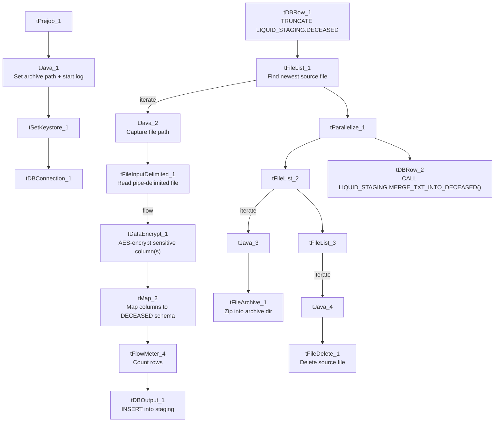

# Talend Job: Deceased_Text_Load

## Overview

This job loads deceased-debtor records (SSNs, dates of death, executor/court/probate details) from a shared folder into Snowflake, following the project's standard truncate-load-merge-archive-delete pattern. It differs from most peers in one important way: before the rows reach Snowflake, they pass through an encryption step (`tDataEncrypt_1`) — appropriate given the sensitive SSN and probate data involved. It has no `tDie`/`tWarn` reacting to the merge outcome.

## Detail table

| Field | Value |
|---|---|
| Job name | Deceased_Text_Load |
| Version | 0.1 |
| Project | LATITUDE |
| Author | *(blank in metadata — not recorded)* |
| Created | 2026-06-25T16:01:26.740-0700 |
| Last Modified | 2026-06-25T16:25:55.828-0700 |

## Step-by-step data flow

1. **Set up.** `tJava_1` appends today's date to `context.archiveDir` and starts a log file; `tSetKeystore_1` configures the SSL keystore; `tDBConnection_1` opens the Snowflake connection.
2. **Empty the staging table.** `tDBRow_1` runs `TRUNCATE TABLE LIQUID_STAGING.DECEASED;`.
3. **Find and read the file.** `tFileList_1` finds the newest matching file in `context.sourceDir` (skipping `.txt` files); `tFileInputDelimited_1` reads it as a pipe-delimited (`|~|`/`|$|`), US-ASCII-encoded file with a header row. Unlike some peers, `DIE_ON_ERROR` is set to `true` here — a malformed row fails the job immediately rather than being routed to a reject flow.
4. **Encrypt.** `tDataEncrypt_1` runs the row set through an AES encryption step (`CRYPTO_METHOD=AES`, `ALGO_VERSION=2`) using a key file at `context.cryptoPath`. Its own secret-key and password settings are redacted in this metadata, and the extractor did not capture which specific column(s) it targets — see Issues observed.
5. **Transform.** `tMap_2` maps the (now partly encrypted) columns — SSN, name, DOB/DOD, executor and court/probate details — onto the target schema, adding `LOAD_DT`.
6. **Load staging.** Mapped rows pass through a row counter (`tFlowMeter_4`) into `tDBOutput_1`, which inserts them into `DECEASED` in Snowflake (`INSERT`, no table-structure changes).
7. **Merge and clean up — in parallel.** `tParallelize_1` splits into two branches:
   - **Merge branch:** `tDBRow_2` runs `CALL LIQUID_STAGING.MERGE_TXT_INTO_DECEASED();` (schema-qualified, unlike some peer jobs' unqualified merge calls). No `tDie`/`tWarn` reacts to the result.
   - **Cleanup branch:** the source file is listed again, archived (`tFileArchive_1`, zipped into `context.archiveDir`), and — via a separate file-list/capture — deleted (`tFileDelete_1`).

## Settings tables

### Source: `tFileInputDelimited_1`

| Setting | Value | What it means |
|---|---|---|
| FILENAME | `context.filePath` | Reads whichever file `tFileList_1` just found. |
| FIELDSEPARATOR / ROWSEPARATOR | `\|~\|` / `\|$\|` | Standard custom-delimited format used across the project. |
| HEADER | 1 | First line is a header row. |
| ENCODING | US-ASCII | Same as several peer jobs; not ISO-8859-15. |
| DIE_ON_ERROR | true | A malformed row fails the whole job rather than routing to a reject output. |

### Encryption: `tDataEncrypt_1`

| Setting | Value | What it means |
|---|---|---|
| CRYPTO_METHOD | AES | Data is encrypted using AES. |
| ALGO_VERSION | 2 | Talend's internal encryption-algorithm version tag. |
| CRYPTO_FILE_PATH | `context.cryptoPath` | Path to the key/config file used for the encryption; this context variable does not appear in the `Directories_0.1` group listed in `_shared_context.json` — see Issues observed. |
| SECRET_TYPE / SECRET_KEY / PASSWORD_M1 | `***REDACTED***` | The actual key material and password are redacted in this metadata extract and not available for documentation. |

### Target: `tDBOutput_1`

| Setting | Value | What it means |
|---|---|---|
| Table | DECEASED | Staging copy of the deceased-debtor table (schema `LIQUID_STAGING`, per the preceding `TRUNCATE`). |
| Output action | INSERT | Adds rows only. |
| Table action | NONE | No table-structure changes; truncation handled separately. |

### Merge step: `tDBRow_2`

| Setting | Value | What it means |
|---|---|---|
| Query | `CALL LIQUID_STAGING.MERGE_TXT_INTO_DECEASED();` | Snowflake stored procedure that folds staged rows into the permanent table; its own logic is outside Talend. |

## Dependencies & configuration

- **Triggers/depends on other jobs:** none — no `tRunJob` links found.
- **Context variables used:** `context.sourceDir`, `context.archiveDir`, `context.filePath`, `context.fileName`, `context.logDir`, `context.keystorePath` (all `Directories_0.1`), plus `context.cryptoPath` — this last one is referenced by `tDataEncrypt_1` but is **not** part of the `Directories_0.1` group provided in `_shared_context.json`; its actual value/location could not be confirmed from the metadata given.
- It uses the shared Snowflake connection object (`tDBConnection_1`), not `LEGACY_DW_0.1` variables directly — `context_vars_referenced` contains no `LEGACY_DW_` entries.

## Glossary

| Component type | Plain-English meaning |
|---|---|
| `tPrejob` / `tParallelize` | Job-flow control (see `job_Address_Text_Load.md`). |
| `tFileList` | Lists files in a folder to loop over (see `job_Address_Text_Load.md`). |
| `tFileInputDelimited` | Reads a delimited text file row by row (see `job_Address_Text_Load.md`). |
| `tMap` | Maps/transforms input columns to output columns (see `job_Address_Text_Load.md`). |
| `tFlowMeter` | Counts rows passing through, for logging (see `job_Address_Text_Load.md`). |
| `tDBOutput` / `tSnowflakeOutput` | Writes rows into a Snowflake table (see `job_Address_Text_Load.md`). |
| `tDBRow` / `tSnowflakeRow` | Runs a single SQL statement against Snowflake (see `job_Address_Text_Load.md`). |
| `tJava` / `tJavaRow` | Custom Java code snippets (see `job_Address_Text_Load.md`). |
| `tFileArchive` | Zips a file into an archive location (see `job_Address_Text_Load.md`). |
| `tFileDelete` | Deletes a file from disk (see `job_Address_Text_Load.md`). |
| `tSetKeystore` | Configures the SSL keystore for the Snowflake connection (see `job_Address_Text_Load.md`). |
| `tDataEncrypt` | Encrypts one or more fields in the row flow using a configured algorithm and key file, before the data reaches its destination — the counterpart to Talend's `tDataDecrypt`. Not used in any of the 3 reference docs; this is the first job in this set to include it. |

## Issues observed

- **Author field is blank.** Unlike every other job documented in this batch, `Deceased_Text_Load`'s metadata has no author recorded — worth checking whether this reflects a different creation process (e.g., copied from a template) or simply a missed field.
- **`context.cryptoPath` is used but undocumented.** `tDataEncrypt_1` depends on `context.cryptoPath` for its key file, but this variable is not part of the `Directories_0.1` context group provided in `_shared_context.json` (which only lists `sourceDir`, `filePath`, `archiveDir`, `fileName`, `logDir`, `keystorePath`). Its actual dev/prod values are unknown from this metadata — verify with the team.
- **Which column(s) get encrypted isn't captured in this metadata.** `tDataEncrypt_1`'s schema carries the full row (SSN, names, dates, court/executor fields), but the component's own field-level encryption targeting isn't visible in the extracted parameters — most likely `SSN` given the sensitivity of the data, but this should be confirmed directly in Talend Studio before relying on it.
- **Same standard hardcoded paths** as most peer jobs (`tFileInputDelimited_1.TEMP_DIR`, `tFileArchive_1.SOURCE_FILE`, `tFileDelete_1.DIRECTORY`/`PATH`, `tSetKeystore_1.SSL_TRUSTSERVER_TRUSTSTORE`).
- **No `tDie`/`tWarn` on the merge step** — a failed merge surfaces only as a generic Talend error.
