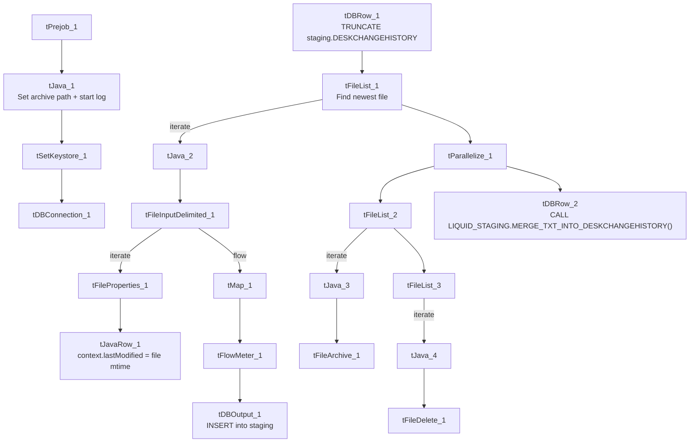

# Talend Job: DeskChangeHistory_Text_Load

## Overview

This job loads records of "desk" reassignment history (which collections desk/queue-level an account moved between, and when) into Snowflake. It follows the standard text-load pattern: watch a shared folder for a new file, truncate a staging table, load the file, merge into the permanent `DESKCHANGEHISTORY` table via a Snowflake stored procedure, and archive/delete the source file.

## Detail table

| Field | Value |
|---|---|
| Job name | DeskChangeHistory_Text_Load |
| Version | 0.1 |
| Project | LATITUDE |
| Author | jmach@harriscollect.com |
| Created | 2025-08-05T06:44:11.665-0700 |
| Last Modified | 2026-04-30T09:32:10.950-0700 |

## Step-by-step data flow

1. **Set up.** `tPrejob_1` starts the job; `tJava_1` appends today's date to the archive path and opens a log file, then `tSetKeystore_1` configures the SSL keystore and `tDBConnection_1` opens the Snowflake connection.
2. **Empty the staging table.** `tDBRow_1` runs `TRUNCATE TABLE LIQUID_STAGING.DESKCHANGEHISTORY;`.
3. **Find the file.** `tFileList_1` lists files in `context.sourceDir` (skipping `.txt`), sorted by last-modified date. The match becomes `context.filePath` (`tJava_2`).
4. **Read and reshape.** `tFileInputDelimited_1` reads the file as pipe-delimited (`|~|` fields, `|$|` rows), UTF-8 encoded, with a header row. It also feeds `tFileProperties_1`, which reads the file's last-modified timestamp; `tJavaRow_1` copies that timestamp into `context.lastModified`. `tMap_1` maps the file's columns (plus `LOAD_DT` and `LASTMODIFIED`) onto the `DESKCHANGEHISTORY` schema.
5. **Load staging.** Mapped rows pass through a row counter (`tFlowMeter_1`) into `tDBOutput_1`, which inserts them into the staging table.
6. **Merge and cleanup — in parallel.** `tParallelize_1` splits into two branches:
   - **Merge branch:** `tDBRow_2` runs `CALL LIQUID_STAGING.MERGE_TXT_INTO_DESKCHANGEHISTORY();` — note the procedure call is schema-qualified (`LIQUID_STAGING.`) here, unlike most peer jobs' unqualified `CALL MERGE_TXT_INTO_...()` (see Issues observed). No `tDie`/`tWarn` reacts to its result.
   - **Cleanup branch:** the file is listed again (`tFileList_2`/`tFileList_3`), archived as a `.zip` into `context.archiveDir` (`tFileArchive_1`), and deleted (`tFileDelete_1`, with `FAILON`=true — see Issues observed).

## Settings tables

### Source: `tFileInputDelimited_1`

| Setting | Value | What it means |
|---|---|---|
| FILENAME | `context.filePath` | Reads whichever file `tFileList_1` just found. |
| FIELDSEPARATOR / ROWSEPARATOR | `\|~\|` / `\|$\|` | Standard pipe-delimited format used across the project. |
| ENCODING | UTF-8 | Differs from `Address_Text_Load` (ISO-8859-15) and `Carrier_Text_Load`/`cmi_Hermes_Recommendations_Load` (US-ASCII) — three different encodings across otherwise similar jobs. |
| DIE_ON_ERROR | true | The file read step fails the job outright on a parse error (many peer jobs set this false). |
| EXCLUDEFILEMASK (on `tFileList_1`) | `*.txt` | `.txt` files are skipped. |

### Target: `tDBOutput_1`

| Setting | Value | What it means |
|---|---|---|
| Table | DESKCHANGEHISTORY | Loads into the staging copy of this table. |
| Output action | INSERT | Adds rows only. |
| Table action | NONE | No table create/drop/truncate here — done separately by `tDBRow_1`. |

### Truncate & merge: `tDBRow_1` / `tDBRow_2`

| Setting | Value | What it means |
|---|---|---|
| Query (`tDBRow_1`) | `TRUNCATE TABLE LIQUID_STAGING.DESKCHANGEHISTORY;` | Empties staging before load. |
| Query (`tDBRow_2`) | `CALL LIQUID_STAGING.MERGE_TXT_INTO_DESKCHANGEHISTORY();` | Runs the Snowflake merge procedure, schema-qualified — see Issues observed. |

### Cleanup: `tFileDelete_1`

| Setting | Value | What it means |
|---|---|---|
| FAILON | true | If the delete fails, the job fails — unlike `Carrier_Text_Load`/`Insurance_Text_Load`/`Result_Table_Text_Load`/`cmi_Dialer_Plan_History_Table_Text_Load`, which set this to `false`. |

## Dependencies & configuration

- **Triggers/depends on other jobs:** none found — no `tRunJob` links.
- **Context variables used:** `context.sourceDir`, `context.archiveDir`, `context.filePath`, `context.fileName`, `context.logDir`, `context.keystorePath`, plus the job-local `context.lastModified` (all `Directories_0.1`). Uses the shared Snowflake connection object, not `LEGACY_DW_0.1` directly.
- **Hardcoded values found:** `tFileInputDelimited_1.TEMP_DIR`, `tFileArchive_1.SOURCE_FILE`, `tFileDelete_1.DIRECTORY`/`PATH`, and `tSetKeystore_1.SSL_TRUSTSERVER_TRUSTSTORE` — same fixed Windows paths seen project-wide.

## Glossary

| Component type | Plain-English meaning |
|---|---|
| `tPrejob` / `tParallelize` | Job-flow control (see `job_Address_Text_Load.md`). |
| `tFileList` | Lists files in a folder to loop over (see `job_Address_Text_Load.md`). |
| `tFileInputDelimited` | Reads a delimited text file (see `job_Address_Text_Load.md`). |
| `tFileProperties` | Reads file-system metadata like last-modified time (see `job_Address_Text_Load.md`). |
| `tJavaRow` | Custom code that runs per row/once to compute a value — here, copying the file's mtime into `context.lastModified` (see `job_cmi_Hermes_Recommendations_Load.md`). |
| `tMap` | Maps/transforms columns (see `job_Address_Text_Load.md`). |
| `tFlowMeter` | Counts rows passing a point in the flow (see `job_Address_Text_Load.md`). |
| `tDBOutput` / `tSnowflakeOutput` | Writes rows to Snowflake (see `job_Address_Text_Load.md`). |
| `tDBRow` / `tSnowflakeRow` | Runs a single SQL statement (see `job_Address_Text_Load.md`). |
| `tJava` | Custom Java code blocks (see `job_Address_Text_Load.md`). |
| `tFileArchive` | Zips a file into an archive location (see `job_Address_Text_Load.md`). |
| `tFileDelete` | Deletes a file from disk (see `job_Address_Text_Load.md`). |
| `tSetKeystore` | Configures the SSL keystore for Snowflake (see `job_Address_Text_Load.md`). |

## Issues observed

- **The merge call is schema-qualified here** (`CALL LIQUID_STAGING.MERGE_TXT_INTO_DESKCHANGEHISTORY();`) while nearly every other job in the project calls the equivalent procedure unqualified (`CALL MERGE_TXT_INTO_<TABLE>();`). This likely still works if the default schema is the same, but it's an inconsistency worth normalizing if these procedures are ever moved between schemas.
- **File encoding is UTF-8**, a third distinct encoding compared to ISO-8859-15 (`Address_Text_Load`) and US-ASCII (`Carrier_Text_Load`, `cmi_Hermes_Recommendations_Load`) — confirm this is intentional for this specific feed.
- **`tFileDelete_1.FAILON` is `true`** here, meaning a failed delete fails the whole job — a stricter setting than several peer jobs that tolerate a failed delete (`FAILON`=false).
- **No merge-result checking** — no `tDie`/`tWarn` reacts to whether the merge succeeded, unlike `PatientInfo_Text_Load` and `cmi_Hermes_Recommendations_Load`.
- **Hardcoded, machine-specific paths** exist alongside the parameterized ones (see Dependencies & configuration) — the same project-wide pattern.
