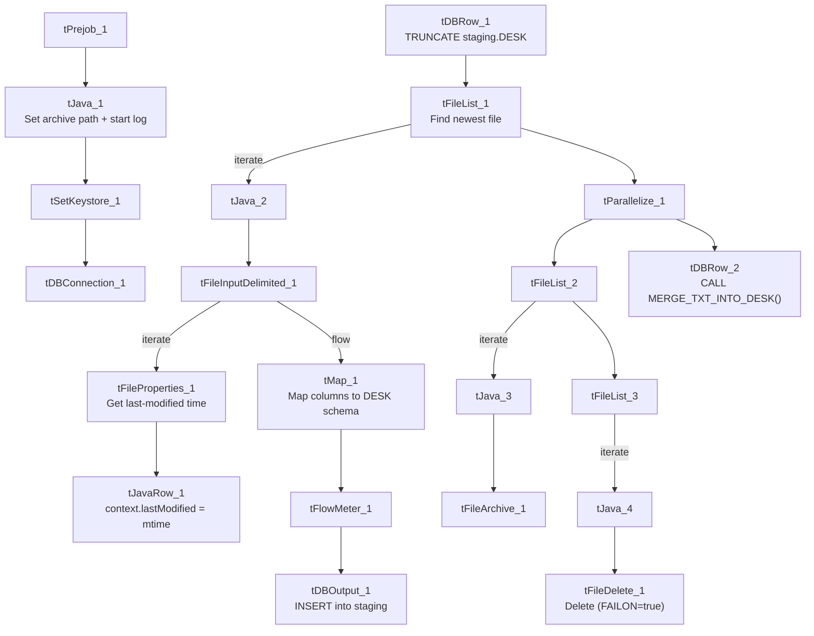

# Talend Job: Desk_Text_Load

## Overview

This job loads "Desk" reference data (collector/desk configuration — fee schedules, goals, phone numbers, limits, etc.) from a shared folder into Snowflake. It follows the project's standard load pattern: truncate the staging table, read the newest matching source file, stamp each row with the source file's last-modified time, load into staging, merge into the permanent `DESK` table via a stored procedure, then archive and delete the source file.

## Detail table

| Field | Value |
|---|---|
| Job name | Desk_Text_Load |
| Version | 0.1 |
| Project | LATITUDE |
| Author | jmach@harriscollect.com |
| Created | 2025-07-17T21:38:26.788-0700 |
| Last Modified | 2025-09-30T19:32:28.776-0700 |

## Step-by-step data flow

1. **Set up.** `tPrejob_1` starts the job; `tJava_1` appends today's date to `context.archiveDir` and opens a log file; `tSetKeystore_1` configures the SSL client keystore; `tDBConnection_1` opens the Snowflake connection.
2. **Empty the staging table.** `tDBRow_1` runs `TRUNCATE TABLE LIQUID_STAGING.DESK;`, then triggers the file-processing chain.
3. **Find the file.** `tFileList_1` lists files in `context.sourceDir`, ordered by modified date (skipping `.txt` files); the match becomes `context.filePath` (`tJava_2`).
4. **Read, timestamp, and reshape.** `tFileInputDelimited_1` reads the pipe-delimited file (`|~|`/`|$|`, ISO-8859-15 encoding, header row, `DIE_ON_ERROR` true). `tFileProperties_1` reads the file's last-modified time, and `tJavaRow_1` copies it into `context.lastModified`. `tMap_1` maps the file's columns (CODE, CTL, PRIV, NAME, DESKTYPE, PASSWORD, FEES, COLLECTIONS, and many more desk/queue settings) onto the target schema, adding `LOAD_DT` and `LASTMODIFIED`.
5. **Load staging.** Rows pass through `tFlowMeter_1` (row counter) into `tDBOutput_1`, which inserts them into `DESK` (schema `LIQUID_STAGING`, per the truncate).
6. **Merge and clean up — in parallel.** `tParallelize_1` splits into:
   - **Merge branch:** `tDBRow_2` runs `CALL MERGE_TXT_INTO_DESK();`. No `tDie`/`tWarn` check follows it.
   - **Cleanup branch:** the source file is listed again, archived (`tFileArchive_1`, zipped into `context.archiveDir`), then separately listed and deleted (`tFileDelete_1`, with `FAILON` set to `true` — unlike most peer jobs, a failed delete here fails the job).

## Settings tables

### Source: `tFileInputDelimited_1`

| Setting | Value | What it means |
|---|---|---|
| FILENAME | `context.filePath` | Reads whichever file `tFileList_1` found. |
| FIELDSEPARATOR / ROWSEPARATOR | `\|~\|` / `\|$\|` | The project's standard pipe-delimited format. |
| ESCAPE_CHAR / TEXT_ENCLOSURE | `"` | Fields can be quoted with `"` and that character escapes itself — unlike some peer jobs that leave these blank. |
| ENCODING | ISO-8859-15 | Western European text encoding, matching `Address_Text_Load`. |
| DIE_ON_ERROR | true | A malformed row fails the whole job rather than being skipped. |
| REMOVE_EMPTY_ROW | true | Blank lines in the file are dropped rather than loaded as empty rows. |

### Target: `tDBOutput_1`

| Setting | Value | What it means |
|---|---|---|
| Table | DESK | Loads into the staging copy (schema `LIQUID_STAGING`, per the preceding `TRUNCATE`). |
| Output action | INSERT | Adds rows only. |
| Table action | NONE | Structure untouched — truncation handled separately. |

### Merge step: `tDBRow_2`

| Setting | Value | What it means |
|---|---|---|
| Query | `CALL MERGE_TXT_INTO_DESK();` | Snowflake stored procedure that folds staged rows into the permanent `DESK` table. Body not visible in this metadata. |

## Dependencies & configuration

- **Triggers/depends on other jobs:** none — no `tRunJob` links found.
- **Context variables used:** `context.sourceDir`, `context.archiveDir`, `context.filePath`, `context.fileName`, `context.logDir`, `context.keystorePath`, plus the job-local `lastModified` variable set at runtime (all `Directories_0.1`).
- **Snowflake connection:** uses the shared connection object, not `LEGACY_DW_*` context variables directly.

## Glossary

| Component type | Plain-English meaning |
|---|---|
| `tPrejob` / `tParallelize` | Setup-before-main-flow, and concurrent branches (see `job_Address_Text_Load.md`). |
| `tFileList` | Lists files in a folder to loop over (see `job_Address_Text_Load.md`). |
| `tFileInputDelimited` | Reads a delimited text file row by row (see `job_Address_Text_Load.md`). |
| `tFileProperties` | Reads file-system metadata (like last-modified time) about a file (see `job_Address_Text_Load.md`). |
| `tMap` | Maps/transforms columns (see `job_Address_Text_Load.md`). |
| `tFlowMeter` | Counts rows passing through a point in the job (see `job_Address_Text_Load.md`). |
| `tSnowflakeOutput` (`tDBOutput`) | Writes rows into Snowflake (see `job_Address_Text_Load.md`). |
| `tSnowflakeRow` (`tDBRow`) | Runs a single SQL statement — `TRUNCATE` and `CALL <procedure>` here (see `job_Address_Text_Load.md`). |
| `tJava` / `tJavaRow` | Custom Java code, per-job or per-row (see `job_Address_Text_Load.md`). |
| `tFileArchive` | Zips a file into an archive location (see `job_Address_Text_Load.md`). |
| `tFileDelete` | Deletes a file from disk (see `job_Address_Text_Load.md`). |
| `tSetKeystore` | Configures the SSL keystore for the Snowflake connection (see `job_Address_Text_Load.md`). |

## Issues observed

- **`tFileDelete_1.FAILON` is `true`** here (and in `Roles_Text_Load`), whereas most peer jobs in this batch set it to `false` — meaning a failed file deletion will fail this job outright rather than just logging the outcome. Worth confirming this is deliberate.
- **Hardcoded machine-specific paths**: `tFileInputDelimited_1.TEMP_DIR`, `tFileArchive_1.SOURCE_FILE`, `tFileDelete_1.DIRECTORY`/`PATH`, and `tSetKeystore_1.SSL_TRUSTSERVER_TRUSTSTORE` are all fixed `C:/Talend-Studio-20211109_1610-V8.0.1/...` or `C:/clientTrustStore.trustStore` paths rather than context variables — the same pattern flagged project-wide.
- **No explicit error handling on the merge step** — unlike `cmi_Hermes_Recommendations_Load`, there's no `tDie`/`tWarn` reacting to whether `MERGE_TXT_INTO_DESK()` succeeded.
- **The merge procedure's own logic is outside Talend** — its body isn't part of this metadata.
