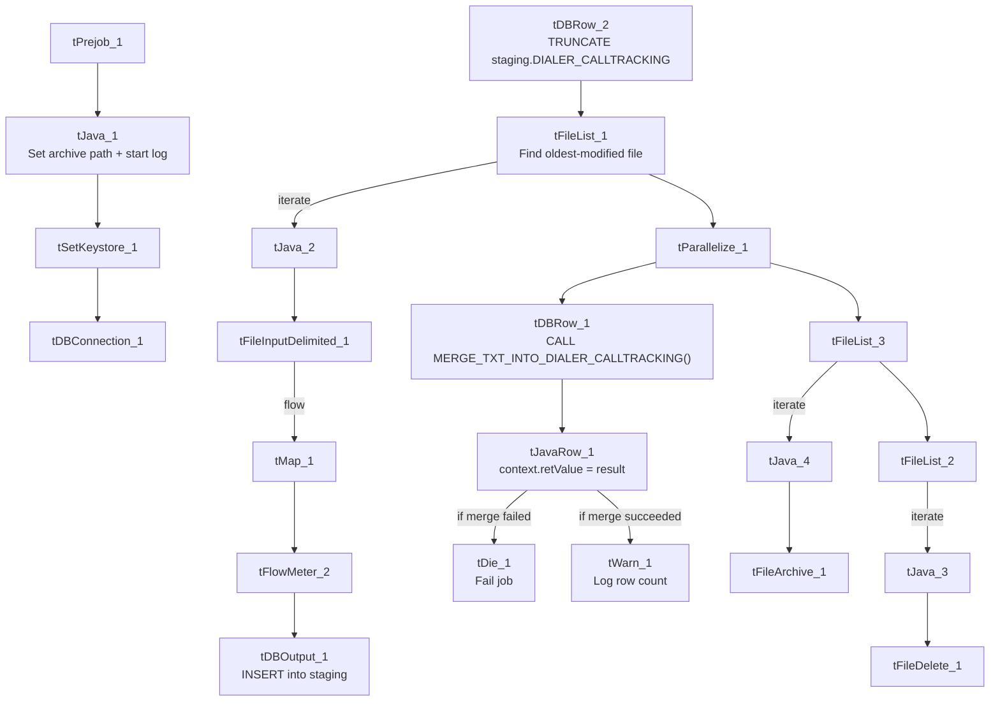

# Talend Job: Dialer_CallTracking_Load

## Overview

This job loads call-tracking records from the outbound dialer platform (call timing, disposition, campaign, and payment/RPC outcome per call) into Snowflake. It follows the standard truncate → load → merge → archive/delete pattern, but — like `cmi_Hermes_Recommendations_Load` — it is one of only 8 jobs in the project that explicitly checks whether the Snowflake merge succeeded and reacts differently depending on the outcome (fail the job vs. log a row count), confirming the note that this job carries the `tDie`/`tWarn` merge-result-checking pattern.

## Detail table

| Field | Value |
|---|---|
| Job name | Dialer_CallTracking_Load |
| Version | 0.1 |
| Project | LATITUDE |
| Author | jmach@harriscollect.com |
| Created | 2026-03-05T10:28:05.662-0800 |
| Last Modified | 2026-03-09T10:09:51.964-0700 |

## Step-by-step data flow

1. **Set up.** `tPrejob_1` triggers `tJava_1`, which appends today's date to `context.archiveDir` and opens a log file; this chains into `tSetKeystore_1` (SSL keystore) and `tDBConnection_1` (Snowflake connection).
2. **Empty the staging table.** `tDBRow_2` runs `TRUNCATE TABLE LIQUID_STAGING.DIALER_CALLTRACKING;` (note the component is named `tDBRow_2`, not `_1` — see Issues observed for the numbering quirk).
3. **Find the file.** `tFileList_1` lists files in `context.sourceDir` (skipping `*.txt`), explicitly sorted by modified date, ascending (`ORDER_BY_MODIFIEDDATE: true`, `ORDER_ACTION_ASC: true`) — meaning it picks up the **oldest**-modified matching file first. This is a deliberate, explicit ordering, unlike most peer jobs which leave `ORDER_BY_NOTHING: true` (no guaranteed order).
4. **Read and reshape the file.** `tFileInputDelimited_1` reads the file as pipe-delimited (`|~|`/`|$|`), US-ASCII encoded, with a header row, covering call ID, timestamps, disposition, campaign, phone number, account/debtor linkage, and recording ID. `tMap_1` maps these onto the `DIALER_CALLTRACKING` schema.
5. **Load staging.** Mapped rows pass through a row counter (`tFlowMeter_2`) into `tDBOutput_1`, which inserts them into the staging table.
6. **Merge and check the result — in parallel with cleanup.** After the file list subjob completes, `tParallelize_1` splits into two branches:
   - **Merge branch:** `tDBRow_1` calls `CALL MERGE_TXT_INTO_DIALER_CALLTRACKING();`. `tJavaRow_1` copies the returned value into `context.retValue`. Depending on that value, the job runs `tDie_1` (fails the job: `"MERGE failed - error code " + context.retValue`, exit code 4) or `tWarn_1` (logs `"<count> rows inserted or updated"`, severity 42, without failing). As with `cmi_Hermes_Recommendations_Load`, the exact condition that routes to one branch versus the other isn't captured in this metadata — only that both `RUN_IF` branches exist.
   - **Cleanup branch:** the source file is listed again (`tFileList_3`), archived (`tFileArchive_1`) into `context.archiveDir`, and — through a second, separate listing (`tFileList_2`) — deleted (`tFileDelete_1`).

## Settings tables

### Source: `tFileInputDelimited_1`

| Setting | Value | What it means |
|---|---|---|
| FILENAME | `context.filePath` | Reads whichever file `tFileList_1` just found. |
| FIELDSEPARATOR / ROWSEPARATOR | `\|~\|` / `\|$\|` | Standard project pipe-delimited format. |
| ENCODING | US-ASCII | Plain ASCII, not ISO-8859-15. |
| DIRECTORY ordering (`tFileList_1`) | `ORDER_BY_MODIFIEDDATE=true`, ascending | Explicitly processes the oldest untouched file first, rather than relying on directory order. |

### Target: `tDBOutput_1`

| Setting | Value | What it means |
|---|---|---|
| Table | DIALER_CALLTRACKING | Loads into the staging copy (schema `LIQUID_STAGING`, per the preceding `TRUNCATE`). |
| Output action | INSERT | Adds rows only. |

### Merge & result check: `tDBRow_1` → `tJavaRow_1` → `tDie_1` / `tWarn_1`

| Setting | Value | What it means |
|---|---|---|
| Query (`tDBRow_1`) | `CALL MERGE_TXT_INTO_DIALER_CALLTRACKING();` | Runs the Snowflake procedure that merges staged rows into the permanent table and returns a value. |
| `tDie_1` message | `"MERGE failed - error code " + context.retValue` (exit code 4) | Fails the job outright if the merge reports an error. |
| `tWarn_1` message | `context.retValue + " rows inserted or updated"` (severity 42) | Logs a row count and continues if the merge succeeded. |

## Dependencies & configuration

- **Triggers/depends on other jobs:** none — no `tRunJob` links found.
- **Context variables used:** `context.sourceDir`, `context.archiveDir`, `context.filePath`, `context.fileName`, `context.logDir`, `context.keystorePath`, `context.retValue` (all `Directories_0.1` plus the job-local `retValue`). It uses the shared Snowflake connection object, not `LEGACY_DW_*` variables directly.
- **Related jobs:** shares the truncate → load → merge → die/warn pattern with `cmi_Hermes_Recommendations_Load`, `cmi_VoApp_Results_Load`, `master_prediction_proposal_Load`, and `PatientInfo_Text_Load`.

## Glossary

| Component type | Plain-English meaning |
|---|---|
| `tPrejob` / `tParallelize` | Setup-before-main-start, and concurrent branches (see job_Address_Text_Load.md). |
| `tFileList` | Lists files for the job to loop over (see job_Address_Text_Load.md). |
| `tFileInputDelimited` | Reads a delimited text file (see job_Address_Text_Load.md). |
| `tMap` | Maps/transforms columns (see job_Address_Text_Load.md). |
| `tFlowMeter` | Counts rows passing a point, for logging (see job_Address_Text_Load.md). |
| `tDBOutput` / `tSnowflakeOutput` | Writes rows into Snowflake (see job_Address_Text_Load.md). |
| `tDBRow` / `tSnowflakeRow` | Runs a single SQL statement (see job_Address_Text_Load.md). |
| `tJava` / `tJavaRow` | Custom code blocks; `tJavaRow` here captures the merge procedure's return value (see job_cmi_Hermes_Recommendations_Load.md). |
| `tDie` | Fails the job immediately with a message and exit code (see job_cmi_Hermes_Recommendations_Load.md). |
| `tWarn` | Logs a warning without failing the job (see job_cmi_Hermes_Recommendations_Load.md). |
| `tFileArchive` | Zips a file into an archive location (see job_Address_Text_Load.md). |
| `tFileDelete` | Deletes a file from disk (see job_Address_Text_Load.md). |
| `tSetKeystore` | Configures the SSL keystore for the Snowflake connection (see job_Address_Text_Load.md). |

## Issues observed

- **Component numbering is reversed from the usual convention.** In most peer jobs, `tDBRow_1` is the truncate and `tDBRow_2` is the merge call; here it's the opposite (`tDBRow_1` = merge, `tDBRow_2` = truncate). Purely cosmetic, but worth knowing when comparing jobs side by side or troubleshooting from a stack trace.
- **File pickup order deviates from the norm.** Unlike most peer jobs (`ORDER_BY_NOTHING: true`, no guaranteed order), this job explicitly sorts by modified date ascending, so it processes the oldest file in the folder first. If multiple files can accumulate in `sourceDir` between runs, this is a meaningful behavioral difference worth confirming is intentional.
- **The pass/fail threshold on `context.retValue` isn't in the metadata** — same caveat as `cmi_Hermes_Recommendations_Load`; confirm the actual success/failure condition with the job's author or in Talend Studio.
- **The merge procedure's own logic is outside Talend** — not visible in this metadata.
- **Hardcoded, machine-specific paths**: `tSetKeystore_1.SSL_TRUSTSERVER_TRUSTSTORE`, `tFileInputDelimited_1.TEMP_DIR`, `tFileDelete_1.DIRECTORY`/`PATH`, and `tFileArchive_1.SOURCE_FILE` are all fixed paths rather than context variables.
