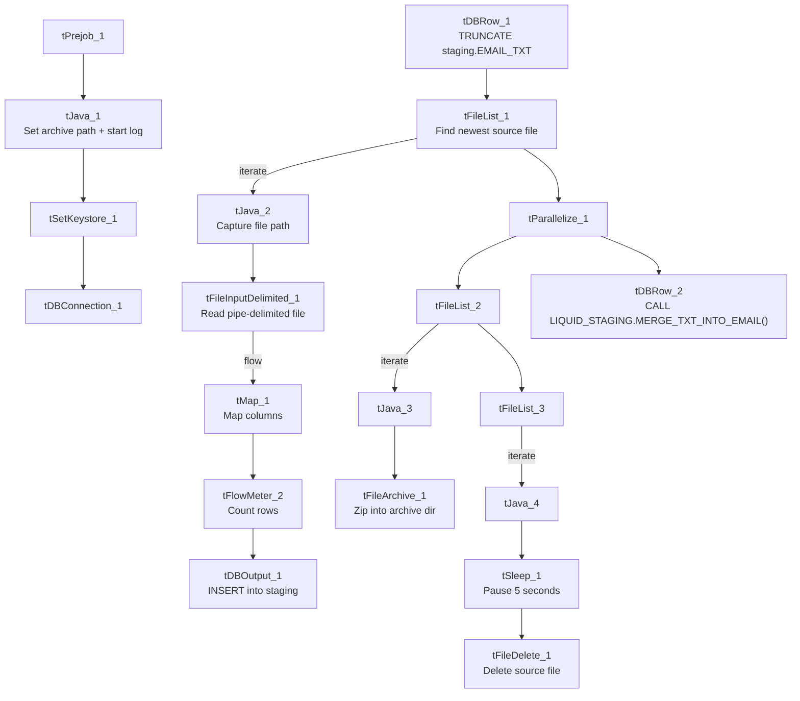

# Talend Job: Email_Text_Load

## Overview

This job loads debtor email-address records — including consent and correspondence flags — from a shared folder into Snowflake, following the project's standard truncate-load-merge-archive pattern (see `job_Address_Text_Load.md`). It has one small deviation from most peers: it pauses for 5 seconds (`tSleep_1`) between finding the file to delete and actually deleting it. It has no scheduling information in this metadata — something outside Talend decides when it runs.

## Detail table

| Field | Value |
|---|---|
| Job name | Email_Text_Load |
| Version | 0.1 |
| Project | LATITUDE |
| Author | jmach@harriscollect.com |
| Created | 2025-06-30T10:48:05.117-0700 |
| Last Modified | 2025-09-30T19:46:19.037-0700 |

## Step-by-step data flow

1. **Set up.** `tPrejob_1` starts the job; `tJava_1` appends today's date to `context.archiveDir` and opens a log file; `tSetKeystore_1` configures the SSL client keystore; `tDBConnection_1` opens the Snowflake connection.
2. **Empty the staging table.** In a separate, parallel start point, `tDBRow_1` runs `TRUNCATE TABLE LIQUID_STAGING.EMAIL_TXT;`.
3. **Find and read the file.** `tFileList_1` lists files in `context.sourceDir` (ordered by modified date, skipping `.txt`); `tJava_2` captures the found path into `context.filePath`; `tFileInputDelimited_1` reads it as a pipe-delimited, ISO-8859-15-encoded file with a header row.
4. **Transform and load.** `tMap_1` maps the file's columns (email ID, debtor association ID, email address, type/status codes, consent fields, correspondence flag, audit timestamps) onto the `EMAIL_TXT` schema, adding `LOAD_DT`. The mapped rows pass through a row counter (`tFlowMeter_2`) into `tDBOutput_1`, which inserts them into Snowflake.
5. **Merge and clean up — in parallel.** `tParallelize_1` splits into two branches once the file has been listed:
   - **Merge branch:** `tDBRow_2` calls `CALL LIQUID_STAGING.MERGE_TXT_INTO_EMAIL();` — note this is one of the few merge calls in the project that includes the schema prefix (`LIQUID_STAGING.`) explicitly.
   - **Cleanup branch:** the source file is listed again and archived (`tFileArchive_1`, zipped into `context.archiveDir`); it's also listed a third time, and — after a 5-second pause (`tSleep_1`) — deleted (`tFileDelete_1`).

## Settings tables

### Source: `tFileInputDelimited_1`

| Setting | Value | What it means |
|---|---|---|
| FILENAME | `context.filePath` | Reads whichever file `tFileList_1` just found. |
| FIELDSEPARATOR / ROWSEPARATOR | `\|~\|` / `\|$\|` | The project's standard pipe-delimited format. |
| HEADER | 1 | First line is a header, not data. |
| ENCODING | ISO-8859-15 | Western European encoding, same as `Address_Text_Load` — reasonable for email/name data that may contain accented characters. |
| REMOVE_EMPTY_ROW | true | Blank rows in the source file are dropped rather than loaded as empty records. |
| EXCLUDEFILEMASK (on `tFileList_1`) | `*.txt` | `.txt` files are skipped. |

### Target: `tDBOutput_1`

| Setting | Value | What it means |
|---|---|---|
| Table | EMAIL_TXT | Loads the staging copy of the email table. |
| Output action | INSERT | Adds rows only. |
| Table action | NONE | Truncation is handled separately by `tDBRow_1`. |

### Merge step: `tDBRow_2`

| Setting | Value | What it means |
|---|---|---|
| Query | `CALL LIQUID_STAGING.MERGE_TXT_INTO_EMAIL();` | Folds staged rows into the permanent table; unlike most peer jobs' `CALL MERGE_TXT_INTO_<TABLE>();`, this one is schema-qualified. |

### Delay: `tSleep_1`

| Setting | Value | What it means |
|---|---|---|
| PAUSE | 5 (seconds) | Pauses the delete branch for 5 seconds before `tFileDelete_1` runs. The reason for the delay isn't captured in this metadata — possibly to let the parallel archive branch finish writing first. |

## Dependencies & configuration

- **Triggers/depends on other jobs:** none found — no `tRunJob` links.
- **Context variables used:** `context.sourceDir`, `context.archiveDir`, `context.filePath`, `context.fileName`, `context.logDir`, `context.keystorePath` (all `Directories_0.1`).
- **LEGACY_DW usage:** none — this job uses the shared Snowflake connection object, not `LEGACY_DW_0.1` variables directly.

## Glossary

| Component type | Plain-English meaning |
|---|---|
| `tPrejob` / `tParallelize` | Job-flow control. (see `job_Address_Text_Load.md`) |
| `tFileList` | Lists files in a folder so the job can loop over them. (see `job_Address_Text_Load.md`) |
| `tFileInputDelimited` | Reads a delimited text file row by row. (see `job_Address_Text_Load.md`) |
| `tMap` | Maps/transforms columns from input to output. (see `job_Address_Text_Load.md`) |
| `tFlowMeter` | Counts rows passing through a point in the job. (see `job_Address_Text_Load.md`) |
| `tDBOutput` / `tSnowflakeOutput` | Writes rows into a Snowflake table. (see `job_Address_Text_Load.md`) |
| `tDBRow` / `tSnowflakeRow` | Runs a single SQL statement — used here for `TRUNCATE` and `CALL <procedure>`. (see `job_Address_Text_Load.md`) |
| `tJava` | A small block of custom Java code. (see `job_Address_Text_Load.md`) |
| `tFileArchive` | Compresses a file into a `.zip` and archives it. (see `job_Address_Text_Load.md`) |
| `tFileDelete` | Deletes a file from disk. (see `job_Address_Text_Load.md`) |
| `tSetKeystore` | Configures the SSL keystore for the Snowflake connection. (see `job_Address_Text_Load.md`) |
| `tSleep` | Pauses the job for a fixed number of seconds — used here to introduce a 5-second delay before deleting the source file, presumably to let a parallel step (like archiving) finish first. Not used in any of the three reference docs. |

## Issues observed

- **`tSleep_1` introduces an unexplained 5-second delay** before deleting the source file. No comment or condition in the metadata explains why this job needs it when its peers (e.g., `Address_Text_Load`, `LetterType_Text_Load`) delete immediately after listing the file. Worth confirming with the team whether this is compensating for a specific timing issue (e.g., file handle still open from the parallel archive step).
- **Merge call is schema-qualified here** (`LIQUID_STAGING.MERGE_TXT_INTO_EMAIL()`) while most peer jobs call the unqualified procedure name — functionally likely equivalent (relying on the connection's default schema otherwise), but an inconsistency worth flagging for anyone auditing procedure calls project-wide.
- **The merge procedure's own logic is outside Talend**, same caveat as every other job that calls a `MERGE_TXT_INTO_*` procedure.
