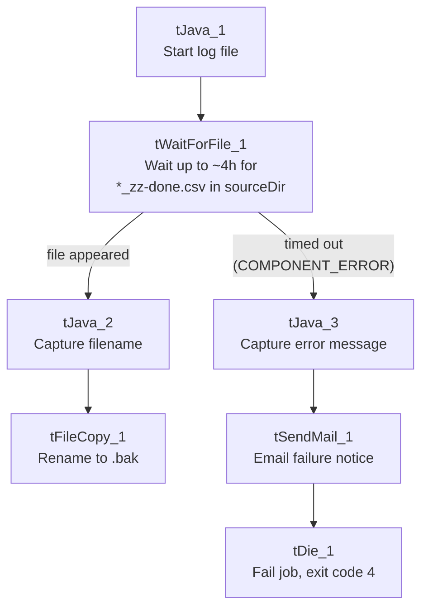

# Talend Job: Export_File_Check

## Overview

Unlike the other jobs documented so far, this one doesn't load any data itself — it's a gatekeeper. It waits for an upstream process to finish exporting the day's Latitude data (signaled by a specific "done" marker file appearing in the shared source folder) and only then lets whatever runs next proceed. If that marker file never shows up within a set window, it emails a notification and fails the job on purpose, so someone finds out the export never happened.

## Detail table

| Field | Value |
|---|---|
| Job name | Export_File_Check |
| Version | 0.1 |
| Project | LATITUDE |
| Author | jmach@harriscollect.com |
| Created | 2025-04-21T10:16:45.638-0700 |
| Last Modified | 2026-07-20T16:18:20.070-0700 |

## Step-by-step data flow

1. **Set up logging.** `tJava_1` opens a log file for this run in `context.logDir`.
2. **Wait for the marker file.** `tWaitForFile_1` watches `context.sourceDir` for a file matching `*_zz-done.csv` to be created. It checks every 500ms, and gives up after 240 checks of up to 60 seconds each (up to roughly 4 hours total) if nothing appears.
   - **If the file appears in time:** the job continues down the success path.
   - **If it times out (`COMPONENT_ERROR`):** the job continues down the failure path instead.
3. **Success path:** `tJava_2` captures the file's name and path from the wait step into `context.fileCreated`/`context.fileName`, then `tFileCopy_1` copies/renames that file within `context.sourceDir`, appending `.bak` to the filename (and removing the original, per its `REMOVE_FILE`/`REPLACE_FILE` settings) — effectively marking the marker file as "seen" so it isn't picked up as new again.
4. **Failure path:** `tJava_3` captures the wait step's error message into `context.errorMsg`, `tSendMail_1` emails `jmach@harriscollect.com` with the subject "Latitude export failure to start notification" and a body reading `"The Latitude export to Snowflake failed to start: " + context.errorMsg`, and then `tDie_1` fails the job with exit code 4 and the message `"No Latitude export files to load into Snowflake!"`.

## Settings tables

### Watcher: `tWaitForFile_1`

| Setting | Value | What it means |
|---|---|---|
| DIRECTORY | `context.sourceDir` | Watches the same shared folder every load job reads from. |
| FILEMASK | `*_zz-done.csv` | Only a file whose name ends in `_zz-done.csv` counts as "the export finished" — an explicit completion marker, not the data file itself. |
| ACTION_ON / THEN | `filecreated` / `exitloop` | Stops waiting as soon as a matching file is created (doesn't wait for it to be modified or deleted). |
| WAIT / MAX_ITERATIONS | 60 (seconds) / 240 | Checks every 60 seconds, up to 240 times — about 4 hours maximum before giving up. |
| INTERVAL_CHECK | 500 (ms) | Polls the folder every half-second while waiting for the next 60-second check window. |

### Alert: `tSendMail_1` (failure path only)

| Setting | Value | What it means |
|---|---|---|
| TO / FROM | `jmach@harriscollect.com` / `svc_analytics@harriscollect.com` | Sent to one person's mailbox from a shared service account. |
| SUBJECT | "Latitude export failure to start notification" | |
| MESSAGE | `"The Latitude export to Snowflake failed to start: " + context.errorMsg` | Includes the actual error text captured from the timed-out wait step. |
| DIE_ON_ERROR | true | If sending the email itself fails, that failure stops the job too — there's no "log and continue" fallback if the mail server is unreachable. |

## Dependencies & configuration

- **Triggers/depends on other jobs:** none found — no `tRunJob` links. Whatever schedules the rest of the LATITUDE load jobs to run only after this one succeeds is external to Talend (not visible in this metadata).
- **Context variables used:** `context.sourceDir`, `context.logDir` (from `Directories_0.1`), plus job-local variables `errorMsg`, `fileCreated`, `fileName` set during the run.
- **Alert recipient is a single named individual** (`jmach@harriscollect.com`), not a distribution list or team alias — see Issues observed.

## Glossary

| Component type | Plain-English meaning |
|---|---|
| `tWaitForFile` | Pauses the job, checking a folder repeatedly, until a file matching a given pattern shows up (or a timeout is reached). |
| `tFileCopy` | Copies (and optionally renames or removes the original) a file — used here to mark the "done" file as already handled. |
| `tSendMail` | Sends an email — used here purely as a failure alert, with no data attached. |
| `tDie` | Fails the job immediately with a specific message and exit code. |

## Issues observed

- **The failure alert goes to one named person's mailbox**, not a shared team alias or distribution list. If that person is unavailable, a genuine export failure could go unnoticed until someone checks the job log directly.
- **The 4-hour wait window is hardcoded** (`WAIT`=60, `MAX_ITERATIONS`=240) rather than driven by a context variable — if the expected export timing ever changes, this has to be edited directly in the job rather than via configuration.
- **No corresponding "everything's fine" notification** — the job is silent on the success path (it only emails on failure), so there's no positive confirmation in this job that the gate passed; that has to be inferred from whatever runs next actually starting.
