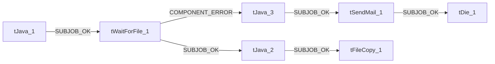

# Talend Job: Export_File_Check

## Purpose

Check for existence of Latitude export files

- **Project**: LATITUDE
- **Version**: 0.1
- **Job Type**: Standard

- **Author**: jmach@harriscollect.com
- **Created**: 2025-04-21T10:16:45.638-0700
- **Last Modified**: 2026-07-20T16:18:20.070-0700

## Components

| # | Component | Type | Key Parameters |
|---|-----------|------|----------------|
| 1 | tJava_1 | `tJava` | `CODE`=java.io.File logFile = new java.io.File(context.lo, `IMPORT`=//import java.util.List;, `CONNECTION_FORMAT`=row |
| 2 | tSendMail_1 | `tSendMail` | `TO`="jmach@harriscollect.com", `FROM`="svc_analytics@harriscollect.com", `NEED_PERSONAL_NAME`=false, `PERSONAL_NAME`="sender", `SUBJECT`="Latitude export failure to start notification" |
| 3 | tDie_1 | `tDie` | `MESSAGE`="No Latitude export files to load into Snowflake!", `CODE`=4, `PRIORITY`=5, `EXIT_JVM`=false, `CONNECTION_FORMAT`=row |
| 4 | tWaitForFile_1 | `tWaitForFile` | `WAIT`=60, `MAX_ITERATIONS`=240, `DIRECTORY`=context.sourceDir, `FILEMASK`="*_zz-done.csv", `INCLUDE_SUBDIR`=false |
| 5 | tJava_2 | `tJava` | `CODE`=context.fileCreated = ((String)globalMap.get("tWai, `IMPORT`=//import java.util.List;, `CONNECTION_FORMAT`=row |
| 6 | tJava_3 | `tJava` | `CODE`=context.errorMsg = ((String)globalMap.get("tWaitFo, `IMPORT`=//import java.util.List;, `CONNECTION_FORMAT`=row |
| 7 | tFileCopy_1 | `tFileCopy` | `FILENAME`=context.fileCreated, `ENABLE_COPY_DIRECTORY`=false, `SOURCE_DERECTORY`="C:/Talend-Studio-20211109_1610-V8.0.1/workspace", `DESTINATION`=context.sourceDir, `RENAME`=true |

## Schemas

### tWaitForFile_1

| Column | Type | Nullable | Length |
|--------|------|----------|--------|
| CURRENT_ITERATION | id_Integer | Yes | — |
| PRESENT_FILE | id_String | Yes | 255 |
| DELETED_FILE | id_String | Yes | 255 |
| CREATED_FILE | id_String | Yes | 255 |
| UPDATED_FILE | id_String | Yes | 255 |
| FILENAME | id_String | Yes | 255 |
| NOT_UPDATED_FILE | id_String | Yes | 255 |

## Data Flow

