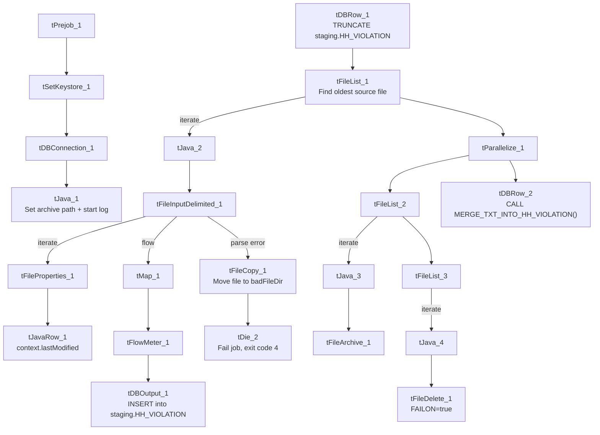

# Talend Job: HH_Violation_Text_Load

## Overview

This job loads highway/toll-violation records (`HH_VIOLATION` — tollway, plaza, lane, speed, plate/vehicle details) into Snowflake, following the standard truncate → load → merge → archive/delete pattern. It's distinguished from most peers by having an explicit bad-file handling path: if the source file fails to parse, the file is moved aside and the job dies with a specific message, instead of just letting Talend's generic error handling take over.

## Detail table

| Field | Value |
|---|---|
| Job name | HH_Violation_Text_Load |
| Version | 0.1 |
| Project | LATITUDE |
| Author | jmach@harriscollect.com |
| Created | 2025-09-26T10:02:04.422-0700 |
| Last Modified | 2026-07-29T09:26:05.042-0700 |

## Step-by-step data flow

1. **Set up.** `tPrejob_1` → `tSetKeystore_1` → `tDBConnection_1`; separately `tJava_1` (after the connection completes) appends today's date to `context.archiveDir` and opens a log file.
2. **Empty the staging table.** `tDBRow_1` runs `TRUNCATE TABLE LIQUID_STAGING.HH_VIOLATION;`.
3. **Find and read the file.** `tFileList_1` lists files in `context.sourceDir` (excluding `*.txt`), this time **sorted by modified date, oldest first** (`ORDER_BY_MODIFIEDDATE`=true, ascending) rather than "no particular order" like several peers. `tJava_2` captures the path; `tFileInputDelimited_1` reads it (`|~|`/`|$|`, quoted with `"`, header row, ISO-8859-15 encoding, empty rows removed, `DIE_ON_ERROR`=true).
   - **If the file parses successfully:** flow continues to the map/load steps below, and separately to `tFileProperties_1` (per-file, gets the last-modified timestamp) → `tJavaRow_1` (stores it in `context.lastModified`).
   - **If parsing fails (`COMPONENT_ERROR`):** `tFileCopy_1` moves the bad file into `context.badFileDir` (with `REMOVE_FILE`/`REPLACE_FILE` set so the original is cleared out), then `tDie_2` fails the job with the message `"File parsing error: " + <the file-input component's error message>` (exit code 4).
4. **Transform and load staging.** `tMap_1` maps the file's columns onto the `HH_VIOLATION` schema, adding `LOAD_DT` and `LASTMODIFIED`. Rows pass through `tFlowMeter_1` into `tDBOutput_1`, which inserts them into staging.
5. **Merge and clean up — in parallel.** `tParallelize_1` splits into:
   - **Merge branch:** `tDBRow_2` runs `CALL MERGE_TXT_INTO_HH_VIOLATION();`.
   - **Cleanup branch:** `tFileList_2` → `tJava_3` (captures path + name) → `tFileArchive_1` (zips into `context.archiveDir`); and `tFileList_3` → `tJava_4` (captures path + name) → `tFileDelete_1` (deletes the source file; `FAILON`=true here, unlike most peers, so a failed delete fails the whole job).

## Settings tables

### Source: `tFileInputDelimited_1`

| Setting | Value | What it means |
|---|---|---|
| FILENAME | `context.filePath` | Reads whichever file `tFileList_1` just found. |
| FIELDSEPARATOR / ROWSEPARATOR | `\|~\|` / `\|$\|` | Standard project pipe-delimited format. |
| REMOVE_EMPTY_ROW | true | Blank lines in the file are skipped. |
| ENCODING | ISO-8859-15 | Standard for most peer jobs. |
| DIE_ON_ERROR | true | Combined with the `COMPONENT_ERROR` branch below, this is what routes parsing failures to the bad-file/die path rather than silently continuing. |
| TEMP_DIR | `"C:/Talend-Studio-.../workspace"` | Hardcoded Windows path. |
| ORDER_BY_MODIFIEDDATE (on `tFileList_1`) | true, ascending | Picks the **oldest** unprocessed file first, rather than "no particular order" as in `Bankruptcy_Text_Load`/`Debtor_Table_Text_Load`. |

### Error path: `tFileCopy_1` → `tDie_2`

| Setting | Value | What it means |
|---|---|---|
| DESTINATION (`tFileCopy_1`) | `context.badFileDir` | A dedicated "bad files" folder — this context variable is not part of the `Directories_0.1` group captured in `_shared_context.json` (see Issues observed). |
| REMOVE_FILE / REPLACE_FILE | true / true | The original file is removed from the source folder once copied aside. |
| MESSAGE (`tDie_2`) | `"File parsing error: " + <tFileInputDelimited_1 error message>` | Includes the actual parser error text. |
| CODE (`tDie_2`) | 4 | Job exit code on failure. |

### Target: `tDBOutput_1`

| Setting | Value | What it means |
|---|---|---|
| Table | HH_VIOLATION | Loads into the staging copy of the table. |
| Output action | INSERT | Adds rows only. |
| Table action | NONE | Table structure untouched. |

### Merge step: `tDBRow_2`

| Setting | Value | What it means |
|---|---|---|
| Query | `CALL MERGE_TXT_INTO_HH_VIOLATION();` | Runs the Snowflake merge procedure — no `tDie`/`tWarn` result check follows it. |

## Dependencies & configuration

- **Triggers/depends on other jobs:** none found — no `tRunJob` links.
- **Context variables used:** `context.sourceDir`, `context.archiveDir`, `context.filePath`, `context.fileName`, `context.logDir`, `context.keystorePath`, `context.lastModified` (all `Directories_0.1` or job-local), plus `context.badFileDir`, which is **not** part of the `Directories_0.1` group captured in `_shared_context.json`. Uses the shared Snowflake connection object, not `LEGACY_DW_0.1` variables directly.

## Glossary

| Component type | Plain-English meaning |
|---|---|
| `tPrejob` / `tParallelize` | Job-flow control (see job_Address_Text_Load.md). |
| `tSnowflakeConnection` (`tDBConnection`) | Opens the shared Snowflake connection (see job_Bankruptcy_Text_Load.md). |
| `tFileList` | Lists files for iteration (see job_Address_Text_Load.md). |
| `tFileInputDelimited` | Reads a delimited text file (see job_Address_Text_Load.md). |
| `tFileProperties` | Reads file-system metadata like last-modified time (see job_Address_Text_Load.md). |
| `tJavaRow` | Custom code that runs once per row (see job_cmi_Hermes_Recommendations_Load.md). |
| `tMap` | Maps/transforms columns (see job_Address_Text_Load.md). |
| `tFlowMeter` | Counts rows passing through (see job_Address_Text_Load.md). |
| `tDBOutput` / `tSnowflakeOutput` | Writes rows to Snowflake (see job_Address_Text_Load.md). |
| `tDBRow` / `tSnowflakeRow` | Runs a single SQL statement (see job_Address_Text_Load.md). |
| `tJava` | Custom Java code block (see job_Address_Text_Load.md). |
| `tFileArchive` | Zips a file into an archive location (see job_Address_Text_Load.md). |
| `tFileDelete` | Deletes a file (see job_Address_Text_Load.md). |
| `tFileCopy` | Copies/moves a file (see job_Export_File_Check.md) — here used to relocate a bad file rather than mark a "done" file as seen. |
| `tDie` | Fails the job with a specific message and exit code (see job_cmi_Hermes_Recommendations_Load.md). |
| `tSetKeystore` | Configures the SSL keystore (see job_Address_Text_Load.md). |

## Issues observed

- **`context.badFileDir` is referenced but not defined in the `Directories_0.1` context group** captured in `_shared_context.json` — its actual folder location can't be confirmed from this metadata.
- **`tFileDelete_1.FAILON` is `true`** here, unlike most peer jobs (`Bankruptcy_Text_Load`, `Debtor_Table_Text_Load`, `MiscExtra_Text_Load`, etc. all use `false`) — meaning a failed delete will fail this job outright, a stricter behavior than the norm.
- **This is the only one of the 9 jobs reviewed with an explicit parse-error / bad-file path** (`tFileCopy_1` → `tDie_2`) — a good pattern, but it means peer jobs without it would simply hit Talend's generic error handling on a malformed file, with no automatic relocation of the bad file.
- **Hardcoded, machine-specific paths** on `tFileInputDelimited_1.TEMP_DIR`, `tFileArchive_1.SOURCE_FILE`, `tFileDelete_1.DIRECTORY`/`PATH`, `tSetKeystore_1.SSL_TRUSTSERVER_TRUSTSTORE`, and `tFileCopy_1.SOURCE_DERECTORY` — the same project-wide pattern seen elsewhere.
