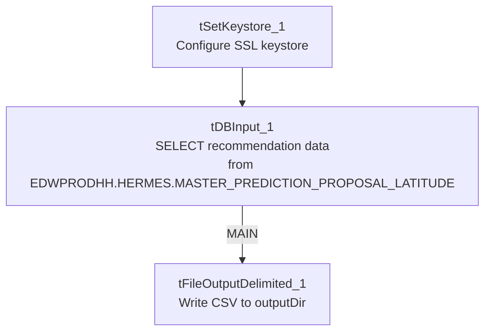

# Talend Job: Hermes_Latitude_Recommendations

## Overview

Unlike most jobs in this project, this one runs in reverse: it reads contact-channel recommendation data **out of** Snowflake (which channel — call, text, VoApps voice message, etc. — to try next for a given account/phone number) and writes it **out to** a CSV file for an external system (Hermes) to pick up. It is a short, simple job with no file-watching, no staging table, no merge step, and no archiving — just a query and a file write.

## Detail table

| Field | Value |
|---|---|
| Job name | Hermes_Latitude_Recommendations |
| Version | 0.1 |
| Project | LATITUDE |
| Author | jmach@harriscollect.com |
| Created | 2025-03-26T09:18:27.296-0700 |
| Last Modified | 2026-02-05T12:12:45.917-0800 |

## Step-by-step data flow

1. **Set up.** `tSetKeystore_1` configures the SSL keystore used for the Snowflake connection.
2. **Query Snowflake.** `tDBInput_1` runs a `SELECT` against `EDWPRODHH.HERMES.MASTER_PREDICTION_PROPOSAL_LATITUDE`, pulling `NUMBER`, `PROPOSED_CHANNEL`, `TEMPLATE`, `PHONE_NUMBER`, `SUBTEAM`, `TEXT_TYPE`, `SETTLEMENT_AMT`, and several VoApps-specific columns (target date, caller number, message ID, zip code, voice-append flag) plus `HERMES_REQUEST_ID`. Note the database and schema (`EDWPRODHH.HERMES`) are written directly into the SQL text rather than built from a context variable — see Issues observed.
3. **Write the file.** `tDBInput_1`'s output flows (`MAIN`, not `FLOW` — a labeling detail specific to this job) into `tFileOutputDelimited_1`, which writes a comma-separated file named `master_prediction_proposal_latitude_<CCYYMMDD>.csv` into `context.outputDir`, with a header row, encoded ISO-8859-15.

There is no `tPrejob`, no file list/watch, no staging table, no merge call, and no archive/delete step — this job simply extracts and writes once per run.

## Settings tables

### Source: `tDBInput_1` (queries Snowflake)

| Setting | Value | What it means |
|---|---|---|
| Query | `SELECT "NUMBER", PROPOSED_CHANNEL, TEMPLATE, PHONE_NUMBER, SUBTEAM, TEXT_TYPE, SETTLEMENT_AMT, VOAPPS_TARGET_DATE, VOAPPS_CALLER_NUMBER, VOAPPS_MESSAGE_ID, VOAPPS_ZIP_CODE, VOAPPS_VOICE_APPEND, HERMES_REQUEST_ID FROM EDWPRODHH.HERMES.MASTER_PREDICTION_PROPOSAL_LATITUDE;` | Reads recommendation rows from a fully-qualified, hardcoded Snowflake table path rather than a repository-mapped table reference. |

### Target: `tFileOutputDelimited_1` (writes the export file)

| Setting | Value | What it means |
|---|---|---|
| FILENAME | `context.outputDir + "master_prediction_proposal_latitude_" + TalendDate.getDate("CCYYMMDD") + ".csv"` | Output file is named with today's date, written to `context.outputDir` (a context variable not found in the `Directories_0.1` group provided — see Issues observed). |
| FIELDSEPARATOR | `,` | Plain comma-separated, unlike the pipe-delimited (`\|~\|`/`\|$\|`) format used by the project's "load" jobs. |
| INCLUDEHEADER | true | The output file has a header row. |
| ENCODING | ISO-8859-15 | Western European encoding, matching most load jobs' input encoding. |
| APPEND | false | Each run overwrites rather than appends to the file. |

## Dependencies & configuration

- **Triggers/depends on other jobs:** none found — no `tRunJob` links.
- **Context variables used:** `context.keystorePath`, `context.outputDir`. Neither `sourceDir`/`archiveDir`/`fileName`/`logDir` (typical of load jobs) nor any `LEGACY_DW_` variable is referenced. `context.outputDir` does not appear in the `Directories_0.1` context group supplied in `_shared_context.json` (which lists `sourceDir`, `filePath`, `archiveDir`, `fileName`, `logDir`, `keystorePath` only) — its dev/prod values could not be confirmed from the provided metadata.
- **Snowflake connection:** no separate `tDBConnection` component appears in this job's component list; `tDBInput_1` (a `tSnowflakeInput`) carries its own embedded connection configuration. `context_vars_referenced` shows no `LEGACY_DW_` variables, so it does not appear to reference the legacy data-warehouse context group directly — though the query text itself hardcodes the database/schema name `EDWPRODHH.HERMES` (see Issues observed).

## Glossary

| Component type | Plain-English meaning |
|---|---|
| `tSetKeystore` | Configures the SSL keystore for the Snowflake connection (see `job_Address_Text_Load.md`). |
| `tSnowflakeInput` (`tDBInput`) | Runs a `SELECT` query against Snowflake and streams the results into the job as rows — the mirror image of `tSnowflakeOutput`/`tDBOutput`, which writes rows *into* Snowflake. Not used in any of the 3 reference docs; this is the first export-style job in this batch. |
| `tFileOutputDelimited` | Writes rows out to a delimited text file (the mirror image of `tFileInputDelimited`). Not used in any of the 3 reference docs. |

## Issues observed

- **The source database/schema is hardcoded directly in the SQL text** (`EDWPRODHH.HERMES.MASTER_PREDICTION_PROPOSAL_LATITUDE`) rather than built from a context variable, even though `LEGACY_DW_db` (`EDWPRODHH`) exists as a context variable in `_shared_context.json`. If the underlying database is ever renamed or the job is pointed at a different environment, this query has to be edited directly rather than via configuration.
- **`context.outputDir` is used but not documented** in the `Directories_0.1` context group provided — its actual folder path(s) are unknown from this metadata; verify with the team or Talend Studio directly.
- **No archiving, deletion, or merge/reconciliation step** — this is a pure one-shot extract-and-write job, so none of the usual "Issues" caveats about `MERGE_TXT_INTO_*` procedures or hardcoded workspace paths apply here.
