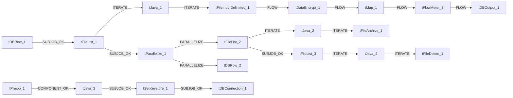

# Talend Job: Insurance_Text_Load

- **Project**: LATITUDE
- **Version**: 0.1
- **Job Type**: Standard

- **Author**: jmach@harriscollect.com
- **Created**: 2026-01-19T09:36:12.366-0800
- **Last Modified**: 2026-04-28T17:04:32.926-0700

## Components

| # | Component | Type | Key Parameters |
|---|-----------|------|----------------|
| 1 | tDBConnection_1 | `tSnowflakeConnection` | `CONNECTION_FORMAT`=row, `PROPERTIES`={"@id":2,"@type":"org.talend.components.snowflake. |
| 2 | tFileList_1 | `tFileList` | `DIRECTORY`=context.sourceDir, `LIST_MODE`=FILES, `INCLUDSUBDIR`=false, `CASE_SENSITIVE`=YES, `ERROR`=false |
| 3 | tJava_1 | `tJava` | `CODE`=context.filePath=((String)globalMap.get("tFileList, `IMPORT`=//import java.util.List;, `CONNECTION_FORMAT`=row |
| 4 | tFileInputDelimited_1 | `tFileInputDelimited` | `USE_EXISTING_DYNAMIC`=false, `FILENAMETEXT`="When the input source is a stream or a zip file,f, `FILENAME`=context.filePath, `CSV_OPTION`=false, `ROWSEPARATOR`="|$|" |
| 5 | tDataEncrypt_1 | `tDataEncrypt` | `CRYPTO_METHOD`=AES, `CRYPTO_FILE_PATH`=context.cryptoPath, `GEN_CRYPTO_FILE_CONTROLLER`=false, `ALGO_VERSION`=2, `CONNECTION_FORMAT`=row |
| 6 | tMap_1 | `tMap` | `LINK_STYLE`=AUTO, `DIE_ON_ERROR`=true, `LKUP_PARALLELIZE`=false, `LEVENSHTEIN`=0, `JACCARD`=0 |
| 7 | tFlowMeter_3 | `tFlowMeter` | `USEROWLABEL`=true, `METTERLABEL`="MyLabel", `ABSOLUTE`=Absolute, `CONNECTION_FORMAT`=row |
| 8 | tDBOutput_1 | `tSnowflakeOutput` | `CONNECTION_FORMAT`=row, `PROPERTIES`={"@id":3,"@type":"org.talend.components.snowflake. |
| 9 | tDBRow_1 | `tSnowflakeRow` | `CONNECTION_FORMAT`=row, `PROPERTIES`={"@id":3,"@type":"org.talend.components.snowflake. |
| 10 | tDBRow_2 | `tSnowflakeRow` | `CONNECTION_FORMAT`=row, `PROPERTIES`={"@id":3,"@type":"org.talend.components.snowflake. |
| 11 | tPrejob_1 | `tPrejob` | `CONNECTION_FORMAT`=row |
| 12 | tFileList_2 | `tFileList` | `DIRECTORY`=context.sourceDir, `LIST_MODE`=FILES, `INCLUDSUBDIR`=false, `CASE_SENSITIVE`=YES, `ERROR`=false |
| 13 | tJava_2 | `tJava` | `CODE`=context.filePath = ((String)globalMap.get("tFileLi, `IMPORT`=//import java.util.List;, `CONNECTION_FORMAT`=row |
| 14 | tFileArchive_1 | `tFileArchive` | `SOURCE`=context.sourceDir, `SOURCE_FILE`="C:/Talend-Studio-20211109_1610-V8.0.1/workspace/s, `SUB_DIRECTROY`=false, `TARGET`=context.archiveDir + context.fileName+".zip", `MKDIR`=true |
| 15 | tFileList_3 | `tFileList` | `DIRECTORY`=context.sourceDir, `LIST_MODE`=FILES, `INCLUDSUBDIR`=false, `CASE_SENSITIVE`=YES, `ERROR`=false |
| 16 | tJava_4 | `tJava` | `CODE`=context.filePath = ((String)globalMap.get("tFileLi, `IMPORT`=//import java.util.List;, `CONNECTION_FORMAT`=row |
| 17 | tFileDelete_1 | `tFileDelete` | `FILENAME`=context.filePath, `DIRECTORY`="C:/Talend-Studio-20211109_1610-V8.0.1/workspace/d, `PATH`="C:/Talend-Studio-20211109_1610-V8.0.1/workspace/d, `FAILON`=false, `FOLDER`=false |
| 18 | tParallelize_1 | `tParallelize` | `WAIT_FOR`=All, `SLEEPTIME`=100, `DIE_ON_ERROR`=false, `CONNECTION_FORMAT`=row |
| 19 | tJava_3 | `tJava` | `CODE`=context.archiveDir = context.archiveDir + TalendDa, `IMPORT`=//import java.util.List;, `CONNECTION_FORMAT`=row |
| 20 | tSetKeystore_1 | `tSetKeystore` | `SET_TRUSTSTORE`=false, `SET_TRUSTSTORE_KEYSTORE`=false, `TRUSTSTORE_TYPE`=JKS, `SSL_TRUSTSERVER_TRUSTSTORE`="C:/clientTrustStore.trustStore", `KEYSTORE_TYPE`=PKCS12 |

## Schemas

### tFileInputDelimited_1

| Column | Type | Nullable | Length |
|--------|------|----------|--------|
| InsuranceId | id_BigDecimal | Yes | -1 |
| Number | id_BigDecimal | Yes | -1 |
| CarrierId | id_BigDecimal | Yes | -1 |
| InsuredName | id_String | Yes | -1 |
| InsuredStreet1 | id_String | Yes | -1 |
| InsuredStreet2 | id_String | Yes | -1 |
| InsuredCity | id_String | Yes | -1 |
| InsuredState | id_String | Yes | -1 |
| InsuredZip | id_String | Yes | -1 |
| InsuredCountry | id_String | Yes | -1 |
| InsuredCounty | id_String | Yes | -1 |
| InsuredPhone | id_String | Yes | -1 |
| InsuredBirthday | id_String | Yes | -1 |
| InsuredSex | id_String | Yes | -1 |
| InsuredEmployer | id_String | Yes | -1 |
| AuthPmtToProvidor | id_BigDecimal | Yes | -1 |
| AcceptAssignment | id_BigDecimal | Yes | -1 |
| EmployerHealthPlan | id_String | Yes | -1 |
| PolicyNumber | id_String | Yes | -1 |
| PatientRelationToInsured | id_String | Yes | -1 |
| Program | id_String | Yes | -1 |
| GroupNumber | id_String | Yes | -1 |
| GroupName | id_String | Yes | -1 |
| AdditionalInfo | id_String | Yes | -1 |
| DateCreated | id_String | Yes | -1 |
| DateUpdated | id_String | Yes | -1 |
| UpdateChecksum | id_BigDecimal | Yes | -1 |
| CreatedBy | id_BigDecimal | Yes | -1 |
| UpdatedBy | id_BigDecimal | Yes | -1 |
| CoordinationNumber | id_String | Yes | -1 |
| InsuredWorkPhone | id_String | Yes | -1 |
| InsuredSSN | id_String | Yes | -1 |
| Invalid | id_BigDecimal | Yes | -1 |
| InvalidReason | id_String | Yes | -1 |
| TimelyFiling | id_String | Yes | -1 |
| Category | id_String | Yes | -1 |
| InsuranceId | id_BigDecimal | Yes | -1 |
| Number | id_BigDecimal | Yes | -1 |
| CarrierId | id_BigDecimal | Yes | -1 |
| InsuredName | id_String | Yes | -1 |
| InsuredStreet1 | id_String | Yes | -1 |
| InsuredStreet2 | id_String | Yes | -1 |
| InsuredCity | id_String | Yes | -1 |
| InsuredState | id_String | Yes | -1 |
| InsuredZip | id_String | Yes | -1 |
| InsuredCountry | id_String | Yes | -1 |
| InsuredCounty | id_String | Yes | -1 |
| InsuredPhone | id_String | Yes | -1 |
| InsuredBirthday | id_String | Yes | -1 |
| InsuredSex | id_String | Yes | -1 |
| InsuredEmployer | id_String | Yes | -1 |
| AuthPmtToProvidor | id_BigDecimal | Yes | -1 |
| AcceptAssignment | id_BigDecimal | Yes | -1 |
| EmployerHealthPlan | id_String | Yes | -1 |
| PolicyNumber | id_String | Yes | -1 |
| PatientRelationToInsured | id_String | Yes | -1 |
| Program | id_String | Yes | -1 |
| GroupNumber | id_String | Yes | -1 |
| GroupName | id_String | Yes | -1 |
| AdditionalInfo | id_String | Yes | -1 |
| DateCreated | id_String | Yes | -1 |
| DateUpdated | id_String | Yes | -1 |
| UpdateChecksum | id_BigDecimal | Yes | -1 |
| CreatedBy | id_BigDecimal | Yes | -1 |
| UpdatedBy | id_BigDecimal | Yes | -1 |
| CoordinationNumber | id_String | Yes | -1 |
| InsuredWorkPhone | id_String | Yes | -1 |
| InsuredSSN | id_String | Yes | -1 |
| Invalid | id_BigDecimal | Yes | -1 |
| InvalidReason | id_String | Yes | -1 |
| TimelyFiling | id_String | Yes | -1 |
| Category | id_String | Yes | -1 |
| errorCode | id_String | Yes | 255 |
| errorMessage | id_String | Yes | 255 |

### tDataEncrypt_1

| Column | Type | Nullable | Length |
|--------|------|----------|--------|
| InsuranceId | id_BigDecimal | Yes | -1 |
| Number | id_BigDecimal | Yes | -1 |
| CarrierId | id_BigDecimal | Yes | -1 |
| InsuredName | id_String | Yes | -1 |
| InsuredStreet1 | id_String | Yes | -1 |
| InsuredStreet2 | id_String | Yes | -1 |
| InsuredCity | id_String | Yes | -1 |
| InsuredState | id_String | Yes | -1 |
| InsuredZip | id_String | Yes | -1 |
| InsuredCountry | id_String | Yes | -1 |
| InsuredCounty | id_String | Yes | -1 |
| InsuredPhone | id_String | Yes | -1 |
| InsuredBirthday | id_String | Yes | -1 |
| InsuredSex | id_String | Yes | -1 |
| InsuredEmployer | id_String | Yes | -1 |
| AuthPmtToProvidor | id_BigDecimal | Yes | -1 |
| AcceptAssignment | id_BigDecimal | Yes | -1 |
| EmployerHealthPlan | id_String | Yes | -1 |
| PolicyNumber | id_String | Yes | -1 |
| PatientRelationToInsured | id_String | Yes | -1 |
| Program | id_String | Yes | -1 |
| GroupNumber | id_String | Yes | -1 |
| GroupName | id_String | Yes | -1 |
| AdditionalInfo | id_String | Yes | -1 |
| DateCreated | id_String | Yes | -1 |
| DateUpdated | id_String | Yes | -1 |
| UpdateChecksum | id_BigDecimal | Yes | -1 |
| CreatedBy | id_BigDecimal | Yes | -1 |
| UpdatedBy | id_BigDecimal | Yes | -1 |
| CoordinationNumber | id_String | Yes | -1 |
| InsuredWorkPhone | id_String | Yes | -1 |
| InsuredSSN | id_String | Yes | -1 |
| Invalid | id_BigDecimal | Yes | -1 |
| InvalidReason | id_String | Yes | -1 |
| TimelyFiling | id_String | Yes | -1 |
| Category | id_String | Yes | -1 |

### tMap_1

| Column | Type | Nullable | Length |
|--------|------|----------|--------|
| LOAD_DT | id_Date | Yes | -1 |
| INSURANCEID | id_BigDecimal | No | 38 |
| NUMBER | id_BigDecimal | No | 38 |
| CARRIER | id_BigDecimal | No | 38 |
| INSUREDNAME | id_String | Yes | 50 |
| INSUREDSTREET1 | id_String | Yes | 128 |
| INSUREDSTREET2 | id_String | Yes | 128 |
| INSUREDCITY | id_String | Yes | 50 |
| INSUREDSTATE | id_String | Yes | 3 |
| INSUREDZIP | id_String | Yes | 10 |
| INSUREDCOUNTRY | id_String | Yes | 128 |
| INSUREDCOUNTY | id_String | Yes | 128 |
| INSUREDPHONE | id_String | Yes | 20 |
| INSUREDBIRTHDAY | id_String | Yes | 30 |
| INSUREDSEX | id_String | Yes | 1 |
| INSUREDEMPLOYER | id_String | Yes | 50 |
| AUTHPMTTOPROVIDOR | id_BigDecimal | No | 38 |
| ACCEPTASSIGNMENT | id_BigDecimal | No | 38 |
| EMPLOYERHEALTHPLAN | id_String | Yes | 50 |
| POLICYNUMBER | id_String | Yes | 50 |
| PATIENTRELATIONTOINSURED | id_String | Yes | 50 |
| PROGRAM | id_String | Yes | 50 |
| GROUPNUMBER | id_String | Yes | 50 |
| GROUPNAME | id_String | Yes | 50 |
| ADDITIONALINFO | id_String | Yes | 5000 |
| DATECREATED | id_String | Yes | 30 |
| DATEUPDATED | id_String | Yes | 30 |
| UPDATECHECKSUM | id_BigDecimal | Yes | 38 |
| CREATEDBY | id_BigDecimal | Yes | 38 |
| UPDATEDBY | id_BigDecimal | Yes | 38 |
| COORDINATIONNUMBER | id_String | Yes | 50 |
| INSUREDWORKPHONE | id_String | Yes | 20 |
| INSUREDSSN | id_String | Yes | 255 |
| INVALID | id_BigDecimal | No | 38 |
| INVALIDREASON | id_String | Yes | 16777216 |
| TIMELYFILING | id_String | Yes | 16777216 |
| CATEGORY | id_String | Yes | 15 |

### tFlowMeter_3

| Column | Type | Nullable | Length |
|--------|------|----------|--------|
| LOAD_DT | id_Date | Yes | -1 |
| INSURANCEID | id_BigDecimal | No | 38 |
| NUMBER | id_BigDecimal | No | 38 |
| CARRIER | id_BigDecimal | No | 38 |
| INSUREDNAME | id_String | Yes | 50 |
| INSUREDSTREET1 | id_String | Yes | 128 |
| INSUREDSTREET2 | id_String | Yes | 128 |
| INSUREDCITY | id_String | Yes | 50 |
| INSUREDSTATE | id_String | Yes | 3 |
| INSUREDZIP | id_String | Yes | 10 |
| INSUREDCOUNTRY | id_String | Yes | 128 |
| INSUREDCOUNTY | id_String | Yes | 128 |
| INSUREDPHONE | id_String | Yes | 20 |
| INSUREDBIRTHDAY | id_String | Yes | 30 |
| INSUREDSEX | id_String | Yes | 1 |
| INSUREDEMPLOYER | id_String | Yes | 50 |
| AUTHPMTTOPROVIDOR | id_BigDecimal | No | 38 |
| ACCEPTASSIGNMENT | id_BigDecimal | No | 38 |
| EMPLOYERHEALTHPLAN | id_String | Yes | 50 |
| POLICYNUMBER | id_String | Yes | 50 |
| PATIENTRELATIONTOINSURED | id_String | Yes | 50 |
| PROGRAM | id_String | Yes | 50 |
| GROUPNUMBER | id_String | Yes | 50 |
| GROUPNAME | id_String | Yes | 50 |
| ADDITIONALINFO | id_String | Yes | 5000 |
| DATECREATED | id_String | Yes | 30 |
| DATEUPDATED | id_String | Yes | 30 |
| UPDATECHECKSUM | id_BigDecimal | Yes | 38 |
| CREATEDBY | id_BigDecimal | Yes | 38 |
| UPDATEDBY | id_BigDecimal | Yes | 38 |
| COORDINATIONNUMBER | id_String | Yes | 50 |
| INSUREDWORKPHONE | id_String | Yes | 20 |
| INSUREDSSN | id_String | Yes | 255 |
| INVALID | id_BigDecimal | No | 38 |
| INVALIDREASON | id_String | Yes | 16777216 |
| TIMELYFILING | id_String | Yes | 16777216 |
| CATEGORY | id_String | Yes | 15 |

### tDBOutput_1

| Column | Type | Nullable | Length |
|--------|------|----------|--------|
| LOAD_DT | id_Date | Yes | -1 |
| INSURANCEID | id_BigDecimal | No | 38 |
| NUMBER | id_BigDecimal | No | 38 |
| CARRIER | id_BigDecimal | No | 38 |
| INSUREDNAME | id_String | Yes | 50 |
| INSUREDSTREET1 | id_String | Yes | 128 |
| INSUREDSTREET2 | id_String | Yes | 128 |
| INSUREDCITY | id_String | Yes | 50 |
| INSUREDSTATE | id_String | Yes | 3 |
| INSUREDZIP | id_String | Yes | 10 |
| INSUREDCOUNTRY | id_String | Yes | 128 |
| INSUREDCOUNTY | id_String | Yes | 128 |
| INSUREDPHONE | id_String | Yes | 20 |
| INSUREDBIRTHDAY | id_String | Yes | 30 |
| INSUREDSEX | id_String | Yes | 1 |
| INSUREDEMPLOYER | id_String | Yes | 50 |
| AUTHPMTTOPROVIDOR | id_BigDecimal | No | 38 |
| ACCEPTASSIGNMENT | id_BigDecimal | No | 38 |
| EMPLOYERHEALTHPLAN | id_String | Yes | 50 |
| POLICYNUMBER | id_String | Yes | 50 |
| PATIENTRELATIONTOINSURED | id_String | Yes | 50 |
| PROGRAM | id_String | Yes | 50 |
| GROUPNUMBER | id_String | Yes | 50 |
| GROUPNAME | id_String | Yes | 50 |
| ADDITIONALINFO | id_String | Yes | 5000 |
| DATECREATED | id_String | Yes | 30 |
| DATEUPDATED | id_String | Yes | 30 |
| UPDATECHECKSUM | id_BigDecimal | Yes | 38 |
| CREATEDBY | id_BigDecimal | Yes | 38 |
| UPDATEDBY | id_BigDecimal | Yes | 38 |
| COORDINATIONNUMBER | id_String | Yes | 50 |
| INSUREDWORKPHONE | id_String | Yes | 20 |
| INSUREDSSN | id_String | Yes | 255 |
| INVALID | id_BigDecimal | No | 38 |
| INVALIDREASON | id_String | Yes | 16777216 |
| TIMELYFILING | id_String | Yes | 16777216 |
| CATEGORY | id_String | Yes | 15 |
| columnName | id_String | No | 255 |
| rowNumber | id_String | No | 255 |
| category | id_String | No | 255 |
| character | id_String | No | 255 |
| errorMessage | id_String | No | 255 |
| byteOffset | id_String | No | 255 |
| line | id_String | No | 255 |
| sqlState | id_String | No | 255 |
| code | id_String | No | 255 |

### tDBRow_1

| Column | Type | Nullable | Length |
|--------|------|----------|--------|
| errorCode | id_String | No | 255 |
| errorMessage | id_String | No | 255 |

### tDBRow_2

| Column | Type | Nullable | Length |
|--------|------|----------|--------|
| errorCode | id_String | No | 255 |
| errorMessage | id_String | No | 255 |

## Data Flow

