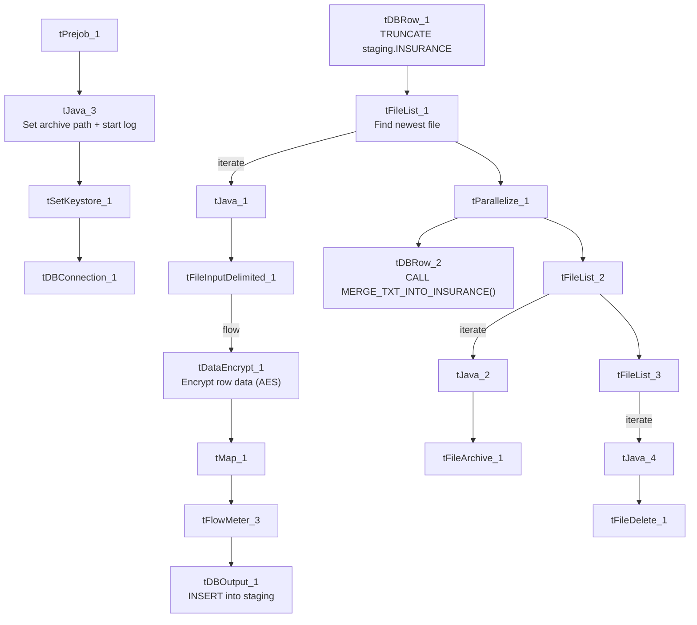

# Talend Job: Insurance_Text_Load

## Overview

This job loads patient/debtor insurance records (carrier, policy number, insured person details, including SSN) into Snowflake. It follows the standard text-load pattern — truncate staging, read and map the file, load staging, merge into the permanent `INSURANCE` table, archive/delete the source — but is one of a smaller number of jobs that also runs the mapped rows through a `tDataEncrypt` step before loading, presumably because the file carries sensitive fields like `InsuredSSN`.

## Detail table

| Field | Value |
|---|---|
| Job name | Insurance_Text_Load |
| Version | 0.1 |
| Project | LATITUDE |
| Author | jmach@harriscollect.com |
| Created | 2026-01-19T09:36:12.366-0800 |
| Last Modified | 2026-04-28T17:04:32.926-0700 |

## Step-by-step data flow

1. **Set up.** `tPrejob_1` starts the job; `tJava_3` sets the dated archive path and opens the log; `tSetKeystore_1` configures the SSL keystore; `tDBConnection_1` opens the Snowflake connection.
2. **Empty the staging table.** `tDBRow_1` runs `TRUNCATE TABLE LIQUID_STAGING.INSURANCE;`.
3. **Find the file.** `tFileList_1` lists files in `context.sourceDir` (skipping `.txt`), sorted by last-modified date. The match becomes `context.filePath` (`tJava_1`).
4. **Read, encrypt, and reshape.** `tFileInputDelimited_1` reads the file as pipe-delimited (`|~|`/`|$|`), US-ASCII encoded, with a header row. The raw rows flow into `tDataEncrypt_1`, which encrypts the row data (AES, algorithm version 2) before it reaches `tMap_1`, which maps the (now-encrypted) columns onto the `INSURANCE` schema.
5. **Load staging.** Mapped rows pass through a row counter (`tFlowMeter_3`) into `tDBOutput_1`, which inserts them into the staging table.
6. **Merge and cleanup — in parallel.** `tParallelize_1` splits into:
   - **Merge branch:** `tDBRow_2` runs `CALL MERGE_TXT_INTO_INSURANCE();`. No `tDie`/`tWarn` reacts to the result.
   - **Cleanup branch:** the file is listed again, archived as a `.zip` into `context.archiveDir` (`tFileArchive_1`), and deleted (`tFileDelete_1`).

## Settings tables

### Source: `tFileInputDelimited_1`

| Setting | Value | What it means |
|---|---|---|
| FILENAME | `context.filePath` | Reads whichever file `tFileList_1` just found. |
| FIELDSEPARATOR / ROWSEPARATOR | `\|~\|` / `\|$\|` | Standard pipe-delimited format. |
| ENCODING | US-ASCII | Matches `Carrier_Text_Load`/`cmi_Hermes_Recommendations_Load`. |
| SCHEMA_REJECT | repository schema `"ins"` | Correctly points at an insurance-specific reject schema (unlike the mismatched "customer" reject schema in `Carrier_Text_Load` and others). |
| EXCLUDEFILEMASK (on `tFileList_1`) | `*.txt` | `.txt` files skipped. |

### Encryption step: `tDataEncrypt_1`

| Setting | Value | What it means |
|---|---|---|
| CRYPTO_METHOD | AES | Rows are encrypted with AES before loading. |
| SECRET_KEY / PASSWORD_M1 | redacted | The encryption key/password are not visible in this metadata. |
| CRYPTO_FILE_PATH | `context.cryptoPath` | Path used for the encryption's supporting file — parameterized via context, unlike most of the hardcoded paths flagged below. |
| ALGO_VERSION | 2 | Uses version 2 of Talend's encryption algorithm. |

### Target: `tDBOutput_1`

| Setting | Value | What it means |
|---|---|---|
| Table | INSURANCE | Loads into the staging copy of this table. |
| Output action | INSERT | Adds rows only. |
| Table action | NONE | No table create/drop/truncate here. |

### Merge step: `tDBRow_2`

| Setting | Value | What it means |
|---|---|---|
| Query | `CALL MERGE_TXT_INTO_INSURANCE();` | Folds staged rows into the permanent `INSURANCE` table. |

## Dependencies & configuration

- **Triggers/depends on other jobs:** none found — no `tRunJob` links.
- **Context variables used:** `context.sourceDir`, `context.archiveDir`, `context.filePath`, `context.fileName`, `context.logDir`, `context.keystorePath`, `context.cryptoPath` (all `Directories_0.1`, except `cryptoPath` which is a job-specific addition not itself documented in `_shared_context.json`'s variable list). Uses the shared Snowflake connection object, not `LEGACY_DW_0.1` directly.
- **Hardcoded values found:** `tFileInputDelimited_1.TEMP_DIR`, `tFileArchive_1.SOURCE_FILE`, `tFileDelete_1.DIRECTORY`/`PATH`, and `tSetKeystore_1.SSL_TRUSTSERVER_TRUSTSTORE` — the same fixed Windows paths seen project-wide.

## Glossary

| Component type | Plain-English meaning |
|---|---|
| `tPrejob` / `tParallelize` | Job-flow control (see `job_Address_Text_Load.md`). |
| `tFileList` | Lists files to loop over (see `job_Address_Text_Load.md`). |
| `tFileInputDelimited` | Reads a delimited text file (see `job_Address_Text_Load.md`). |
| `tDataEncrypt` | Encrypts row data using a specified algorithm (here AES) and key/password before it moves further down the flow — not covered in the three reference docs. Used here because the file carries sensitive fields (e.g. Social Security Number). |
| `tMap` | Maps/transforms columns (see `job_Address_Text_Load.md`). |
| `tFlowMeter` | Counts rows passing a point in the flow (see `job_Address_Text_Load.md`). |
| `tDBOutput` / `tSnowflakeOutput` | Writes rows to Snowflake (see `job_Address_Text_Load.md`). |
| `tDBRow` / `tSnowflakeRow` | Runs a single SQL statement (see `job_Address_Text_Load.md`). |
| `tJava` | Custom Java code blocks (see `job_Address_Text_Load.md`). |
| `tFileArchive` | Zips a file into an archive location (see `job_Address_Text_Load.md`). |
| `tFileDelete` | Deletes a file from disk (see `job_Address_Text_Load.md`). |
| `tSetKeystore` | Configures the SSL keystore for Snowflake (see `job_Address_Text_Load.md`). |

## Issues observed

- **Encryption key/password are redacted in this metadata**, so it's not possible to confirm from Talend alone what's actually encrypted vs. left in the clear before the merge step — worth verifying with whoever manages the encryption keys, given the presence of `InsuredSSN` in the schema.
- **No merge-result checking** — no `tDie`/`tWarn` reacts to the merge outcome, unlike `PatientInfo_Text_Load` and `cmi_Hermes_Recommendations_Load`.
- **Hardcoded, machine-specific paths** exist alongside the parameterized ones (see Dependencies & configuration) — the same project-wide pattern flagged in `Address_Text_Load`.
