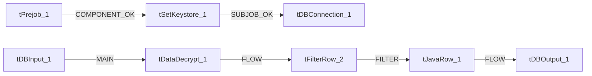

# Talend Job: Last4SSN_Extract

- **Project**: LATITUDE
- **Version**: 0.1
- **Job Type**: Standard

- **Author**: jmach@harriscollect.com
- **Created**: 2026-05-27T10:22:29.826-0700
- **Last Modified**: 2026-05-27T11:11:29.716-0700

## Components

| # | Component | Type | Key Parameters |
|---|-----------|------|----------------|
| 1 | tDBConnection_1 | `tSnowflakeConnection` | `COMPONENT_NAME`=tSnowflakeConnection, `FAMILY`=Cloud/Snowflake, `START`=false, `STARTABLE`=true, `SUBTREE_START`=true |
| 2 | tSetKeystore_1 | `tSetKeystore` | `SET_TRUSTSTORE`=false, `SET_TRUSTSTORE_KEYSTORE`=false, `TRUSTSTORE_TYPE`=JKS, `SSL_TRUSTSERVER_TRUSTSTORE`="C:/clientTrustStore.trustStore", `KEYSTORE_TYPE`=PKCS12 |
| 3 | tPrejob_1 | `tPrejob` | `CONNECTION_FORMAT`=row |
| 4 | tDBInput_1 | `tSnowflakeInput` | `CONNECTION_FORMAT`=row, `PROPERTIES`={"@id":4,"@type":"org.talend.components.snowflake. |
| 5 | tDataDecrypt_1 | `tDataDecrypt` | `CRYPTO_METHOD`=AES, `CRYPTO_FILE_PATH`=context.cryptoPath, `DIE_ON_ERROR`=true, `ALGO_VERSION`=2, `CONNECTION_FORMAT`=row |
| 6 | tFilterRow_2 | `tFilterRow` | `LOGICAL_OP`=&&, `USE_ADVANCED`=true, `ADVANCED_COND`=// code sample : use input_row to define the condi, `CONNECTION_FORMAT`=row |
| 7 | tJavaRow_1 | `tJavaRow` | `CODE`=//Code generated according to input schema and out, `IMPORT`=//import java.util.List;, `CONNECTION_FORMAT`=row |
| 8 | tDBOutput_1 | `tSnowflakeOutput` | `PROPERTIES`={"@id":4,"@type":"org.talend.components.snowflake. |

## Schemas

### tDBInput_1

| Column | Type | Nullable | Length |
|--------|------|----------|--------|
| DEBTORID | id_BigDecimal | No | 38 |
| SSN | id_String | Yes | 16777216 |

### tDataDecrypt_1

| Column | Type | Nullable | Length |
|--------|------|----------|--------|
| DEBTORID | id_BigDecimal | No | 38 |
| SSN | id_String | Yes | 16777216 |

### tFilterRow_2

| Column | Type | Nullable | Length |
|--------|------|----------|--------|
| DEBTORID | id_BigDecimal | No | 38 |
| SSN | id_String | Yes | 16777216 |
| DEBTORID | id_BigDecimal | No | 38 |
| SSN | id_String | Yes | 16777216 |
| DEBTORID | id_BigDecimal | No | 38 |
| SSN | id_String | Yes | 16777216 |
| errorMessage | id_String | Yes | 255 |

### tJavaRow_1

| Column | Type | Nullable | Length |
|--------|------|----------|--------|
| DEBTORID | id_BigDecimal | No | 38 |
| LAST4SSN | id_String | Yes | -1 |

### tDBOutput_1

| Column | Type | Nullable | Length |
|--------|------|----------|--------|
| DEBTORID | id_BigDecimal | No | 38 |
| LAST4SSN | id_String | Yes | 4 |
| columnName | id_String | No | 255 |
| rowNumber | id_String | No | 255 |
| category | id_String | No | 255 |
| character | id_String | No | 255 |
| errorMessage | id_String | No | 255 |
| byteOffset | id_String | No | 255 |
| line | id_String | No | 255 |
| sqlState | id_String | No | 255 |
| code | id_String | No | 255 |

## Data Flow

