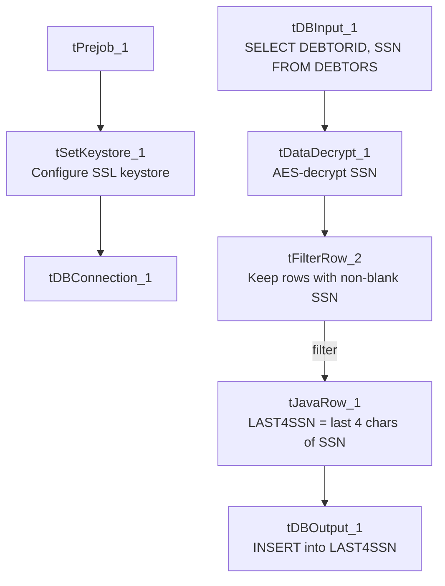

# Talend Job: Last4SSN_Extract

## Overview

Unlike the "Text Load" jobs, this is a utility/extract job with no file involved at all. It reads debtor Social Security Numbers directly from a SQL Server table (`DEBTORS`), decrypts them, filters out any that are missing or blank, derives just the last four digits, and inserts the result into a Snowflake table (`LAST4SSN`). There is no staging truncate and no merge-into-permanent-table step anywhere in this job — every run simply inserts rows, which is a real departure from every other job reviewed in this batch (see Issues observed).

## Detail table

| Field | Value |
|---|---|
| Job name | Last4SSN_Extract |
| Version | 0.1 |
| Project | LATITUDE |
| Author | jmach@harriscollect.com |
| Created | 2026-05-27T10:22:29.826-0700 |
| Last Modified | 2026-05-27T11:11:29.716-0700 |

## Step-by-step data flow

1. **Set up.** `tPrejob_1` starts the job; `tSetKeystore_1` configures the SSL client keystore; `tDBConnection_1` opens the Snowflake connection.
2. **Read source data.** `tDBInput_1` runs `SELECT DEBTORID, SSN FROM DEBTORS;` — a query against a database table (per `_shared_context.json`, the project's other configured connection, `Liquid_0.1`, is a Microsoft SQL Server database named `LiquidModel`; whether `DEBTORS` is read from that connection or from Snowflake isn't distinguishable from this metadata alone — the component type recorded is `tSnowflakeInput`, so it is most likely querying a `DEBTORS` table that also exists in Snowflake). This runs independently of the setup chain above (no explicit trigger link between them).
3. **Decrypt.** `tDataDecrypt_1` decrypts the `SSN` column using AES, referencing a key file at `context.cryptoPath`. `DIE_ON_ERROR` is set, so a decryption failure fails the job.
4. **Filter.** `tFilterRow_2` keeps only rows where `SSN` is not null and (per the truncated condition text available) not blank after trimming — the exact full condition text is cut off in this metadata (see Issues observed).
5. **Derive last 4 digits.** `tJavaRow_1` sets `output_row.LAST4SSN` to the last 4 characters of the trimmed `SSN`, alongside `DEBTORID`.
6. **Load.** `tDBOutput_1` inserts the `DEBTORID`/`LAST4SSN` pairs into the Snowflake `LAST4SSN` table (action: INSERT, no table-structure change). There is no preceding `TRUNCATE` and no follow-up `MERGE`/`CALL` step.

## Settings tables

### Source: `tDBInput_1` (`tSnowflakeInput`)

| Setting | Value | What it means |
|---|---|---|
| Query | `SELECT DEBTORID, SSN FROM DEBTORS;` | Pulls every debtor's ID and (encrypted) SSN — no filtering happens in SQL; all filtering happens later in `tFilterRow_2`. |

### Decrypt: `tDataDecrypt_1`

| Setting | Value | What it means |
|---|---|---|
| CRYPTO_METHOD | AES | Symmetric encryption algorithm used to decrypt the SSN values. |
| CRYPTO_FILE_PATH | `context.cryptoPath` | Points to the key/crypto configuration file needed to decrypt — parameterized via context rather than hardcoded. |
| DIE_ON_ERROR | true | If decryption fails (e.g., bad key, corrupt data), the whole job fails immediately. |
| ALGO_VERSION | 2 | Which version of Talend's internal encryption algorithm implementation is used — needs to match whatever encrypted the data originally. |

### Filter: `tFilterRow_2`

| Setting | Value | What it means |
|---|---|---|
| LOGICAL_OP | `&&` (AND) | Multiple filter conditions must all be true for a row to pass. |
| ADVANCED_COND | `(input_row.SSN != null) && (input_row.SSN.trim()...` (truncated in metadata) | Keeps only rows with a genuinely populated SSN. The full condition text is cut off in the extracted metadata — unable to determine the complete filter logic from what's available; verify with team / in Talend Studio directly. |

### Target: `tDBOutput_1`

| Setting | Value | What it means |
|---|---|---|
| Table | LAST4SSN | Writes directly into this Snowflake table — no staging schema prefix recorded. |
| Output action | INSERT | Adds rows only. |
| Table action | NONE | No truncate/create/drop happens here or anywhere else in this job. |

## Dependencies & configuration

- **Triggers/depends on other jobs:** none — no `tRunJob` links found.
- **Context variables used:** `context.cryptoPath` (not part of the documented `Directories_0.1`/`LEGACY_DW_0.1` groups in `_shared_context.json` — likely a job-specific or otherwise-undocumented context variable) and `context.keystorePath` (`Directories_0.1`). This job does **not** reference `context.sourceDir`, `context.archiveDir`, `context.fileName`, or `context.logDir` at all — consistent with it not touching any files.
- **Snowflake connection:** uses the shared connection object (`tDBConnection_1`), not `LEGACY_DW_*` context variables directly.

## Glossary

| Component type | Plain-English meaning |
|---|---|
| `tPrejob` | Marks setup steps that must finish before the main job starts (see `job_Address_Text_Load.md`). |
| `tSetKeystore` | Configures the SSL keystore used for the Snowflake connection (see `job_Address_Text_Load.md`). |
| `tSnowflakeInput` (`tDBInput`) | Runs a SQL query against a database and streams the result rows into the job as its starting data — the mirror image of `tSnowflakeOutput`; instead of writing rows out, it reads them in. Here it's the job's only data source, replacing the file-reading (`tFileInputDelimited`) step used by the "Text Load" jobs. |
| `tDataDecrypt` | Decrypts a column's contents using a configured algorithm and key file — the opposite of an encryption step; used here to turn the stored, encrypted SSN values back into plain text so the last 4 digits can be extracted. |
| `tFilterRow` | Passes through only the rows that satisfy a defined condition (simple field comparisons, or — as here — a custom Java-like expression), discarding the rest. |
| `tJavaRow` | A small custom-code step that runs once per row to compute or transform values — here it derives `LAST4SSN` from the decrypted `SSN` (see `job_Address_Text_Load.md` for the general concept). |
| `tSnowflakeOutput` (`tDBOutput`) | Writes rows into a Snowflake table (see `job_Address_Text_Load.md`). |

## Issues observed

- **No truncate-and-merge pattern.** Every other job in this review batch clears its staging table and merges into a permanent table via a stored procedure; this job just runs a plain `INSERT` into `LAST4SSN` with no preceding `TRUNCATE` and no following `MERGE`/`CALL`. Run twice without some other safeguard (a table-level unique constraint or dedup logic that isn't visible in Talend), and it would likely produce duplicate `DEBTORID` rows. Confirm with the team whether `LAST4SSN` has a uniqueness constraint or whether this job is expected to run only once per data refresh.
- **The `tFilterRow_2` condition text is truncated in the extracted metadata** — only `(input_row.SSN != null) && (input_row.SSN.trim()...` is visible. Unable to determine the complete filter logic from what's available; verify the full condition in Talend Studio directly.
- **`context.cryptoPath` is not part of the `Directories_0.1` or `LEGACY_DW_0.1` context groups** documented in `_shared_context.json` — its actual configured value (dev vs. prod) could not be determined from the provided shared-context data.
- **Hardcoded keystore path**: `tSetKeystore_1.SSL_TRUSTSERVER_TRUSTSTORE` is fixed to `C:/clientTrustStore.trustStore` rather than a context variable — the same pattern flagged project-wide.
- **This is the newest job reviewed in this batch** — created and last modified on the same day (2026-05-27), about 49 minutes apart — suggesting it may be a recent, possibly still-evolving addition to the project.
