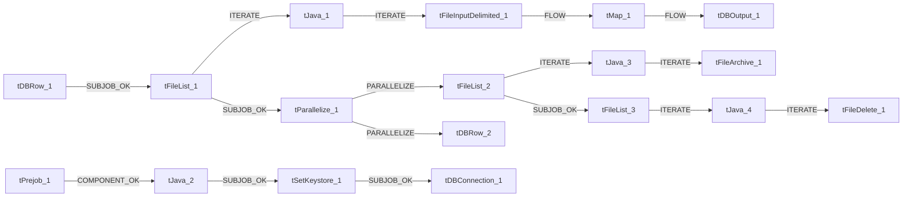

# Talend Job: LetterRequest_Table_Text_Load

- **Project**: LATITUDE
- **Version**: 0.1
- **Job Type**: Standard

- **Author**: jmach@harriscollect.com
- **Created**: 2024-10-24T08:48:53.448-0700
- **Last Modified**: 2025-09-30T19:55:44.115-0700

## Components

| # | Component | Type | Key Parameters |
|---|-----------|------|----------------|
| 1 | tDBConnection_1 | `tSnowflakeConnection` | `CONNECTION_FORMAT`=row, `PROPERTIES`={"@id":2,"@type":"org.talend.components.snowflake. |
| 2 | tFileList_1 | `tFileList` | `DIRECTORY`=context.sourceDir, `LIST_MODE`=FILES, `INCLUDSUBDIR`=false, `CASE_SENSITIVE`=YES, `ERROR`=false |
| 3 | tJava_1 | `tJava` | `CODE`=context.filePath= ((String)globalMap.get("tFileLis, `IMPORT`=//import java.util.List;, `CONNECTION_FORMAT`=row |
| 4 | tFileInputDelimited_1 | `tFileInputDelimited` | `USE_EXISTING_DYNAMIC`=false, `FILENAMETEXT`="When the input source is a stream or a zip file,f, `FILENAME`=context.filePath, `CSV_OPTION`=false, `ROWSEPARATOR`="|$|" |
| 5 | tMap_1 | `tMap` | `LINK_STYLE`=AUTO, `DIE_ON_ERROR`=true, `LKUP_PARALLELIZE`=false, `LEVENSHTEIN`=0, `JACCARD`=0 |
| 6 | tDBOutput_1 | `tSnowflakeOutput` | `CONNECTION_FORMAT`=row, `PROPERTIES`={"@id":3,"@type":"org.talend.components.snowflake. |
| 7 | tDBRow_1 | `tSnowflakeRow` | `CONNECTION_FORMAT`=row, `PROPERTIES`={"@id":3,"@type":"org.talend.components.snowflake. |
| 8 | tDBRow_2 | `tSnowflakeRow` | `CONNECTION_FORMAT`=row, `PROPERTIES`={"@id":3,"@type":"org.talend.components.snowflake. |
| 9 | tPrejob_1 | `tPrejob` | `CONNECTION_FORMAT`=row |
| 10 | tFileList_2 | `tFileList` | `DIRECTORY`=context.sourceDir, `LIST_MODE`=FILES, `INCLUDSUBDIR`=false, `CASE_SENSITIVE`=YES, `ERROR`=false |
| 11 | tJava_3 | `tJava` | `CODE`=context.filePath = ((String)globalMap.get("tFileLi, `IMPORT`=//import java.util.List;, `CONNECTION_FORMAT`=row |
| 12 | tFileArchive_1 | `tFileArchive` | `SOURCE`=context.sourceDir, `SOURCE_FILE`="C:/Talend-Studio-20211109_1610-V8.0.1/workspace/s, `SUB_DIRECTROY`=false, `TARGET`=context.archiveDir + context.fileName+".zip", `MKDIR`=true |
| 13 | tFileList_3 | `tFileList` | `DIRECTORY`=context.sourceDir, `LIST_MODE`=FILES, `INCLUDSUBDIR`=false, `CASE_SENSITIVE`=YES, `ERROR`=false |
| 14 | tJava_4 | `tJava` | `CODE`=context.filePath = ((String)globalMap.get("tFileLi, `IMPORT`=//import java.util.List;, `CONNECTION_FORMAT`=row |
| 15 | tFileDelete_1 | `tFileDelete` | `FILENAME`=context.filePath, `DIRECTORY`="C:/Talend-Studio-20211109_1610-V8.0.1/workspace/d, `PATH`="C:/Talend-Studio-20211109_1610-V8.0.1/workspace/d, `FAILON`=false, `FOLDER`=false |
| 16 | tParallelize_1 | `tParallelize` | `WAIT_FOR`=All, `SLEEPTIME`=100, `DIE_ON_ERROR`=false, `CONNECTION_FORMAT`=row |
| 17 | tJava_2 | `tJava` | `CODE`=context.archiveDir = context.archiveDir + TalendDa, `IMPORT`=//import java.util.List;, `CONNECTION_FORMAT`=row |
| 18 | tSetKeystore_1 | `tSetKeystore` | `SET_TRUSTSTORE`=false, `SET_TRUSTSTORE_KEYSTORE`=false, `TRUSTSTORE_TYPE`=JKS, `SSL_TRUSTSERVER_TRUSTSTORE`="C:/clientTrustStore.trustStore", `KEYSTORE_TYPE`=PKCS12 |

## Schemas

### tFileInputDelimited_1

| Column | Type | Nullable | Length |
|--------|------|----------|--------|
| LETTERREQUESTID | id_Integer | Yes | 38 |
| ACCOUNTID | id_Integer | Yes | 38 |
| CUSTOMERCODE | id_String | Yes | 16777216 |
| LETTERID | id_Integer | Yes | 38 |
| LETTERCODE | id_String | Yes | 16777216 |
| DATEREQUESTED | id_String | Yes | 16777216 |
| DATEPROCESSED | id_String | Yes | 16777216 |
| JOBNAME | id_String | Yes | 16777216 |
| DUEDATE | id_String | Yes | 16777216 |
| AMOUNTDUE | id_String | Yes | 16777216 |
| USERNAME | id_String | Yes | 16777216 |
| SUSPEND | id_String | Yes | 16777216 |
| SIFPMT1 | id_String | Yes | 16777216 |
| SIFPMT2 | id_String | Yes | 16777216 |
| SIFPMT3 | id_String | Yes | 16777216 |
| SIFPMT4 | id_String | Yes | 16777216 |
| SIFPMT5 | id_String | Yes | 16777216 |
| SIFPMT6 | id_String | Yes | 16777216 |
| MANUAL | id_String | Yes | 16777216 |
| ADDEDITMODE | id_Integer | Yes | 38 |
| EDITED | id_Integer | Yes | 38 |
| DOCUMENTDATA | id_String | Yes | 8388608 |
| DELETED | id_Integer | Yes | 38 |
| COPYCUSTOMER | id_Integer | Yes | 38 |
| SAVEIMAGE | id_Integer | Yes | 38 |
| PROCESSINGMETHOD | id_Integer | Yes | 38 |
| ERRORDESCRIPTION | id_String | Yes | 16777216 |
| DATECREATED | id_String | Yes | 16777216 |
| DATEUPDATED | id_String | Yes | 16777216 |
| SUBJDEBTORID | id_Integer | Yes | 38 |
| SENDERID | id_Integer | Yes | 38 |
| REQUESTERID | id_Integer | Yes | 38 |
| FUTUREID | id_Integer | Yes | 38 |
| RECIPIENTDEBTORID | id_Integer | Yes | 38 |
| RECIPIENTDEBTORSEQ | id_Integer | Yes | 38 |
| LTRSERIESQUEUEID | id_Integer | Yes | 38 |
| SIFPMT7 | id_String | Yes | 16777216 |
| SIFPMT8 | id_String | Yes | 16777216 |
| SIFPMT9 | id_String | Yes | 16777216 |
| SIFPMT10 | id_String | Yes | 16777216 |
| SIFPMT11 | id_String | Yes | 16777216 |
| SIFPMT12 | id_String | Yes | 16777216 |
| SIFPMT13 | id_String | Yes | 16777216 |
| SIFPMT14 | id_String | Yes | 16777216 |
| SIFPMT15 | id_String | Yes | 16777216 |
| SIFPMT16 | id_String | Yes | 16777216 |
| SIFPMT17 | id_String | Yes | 16777216 |
| SIFPMT18 | id_String | Yes | 16777216 |
| SIFPMT19 | id_String | Yes | 16777216 |
| SIFPMT20 | id_String | Yes | 16777216 |
| SIFPMT21 | id_String | Yes | 16777216 |
| SIFPMT22 | id_String | Yes | 16777216 |
| SIFPMT23 | id_String | Yes | 16777216 |
| SIFPMT24 | id_String | Yes | 16777216 |
| EMAILID | id_Integer | Yes | 38 |
| SMSID | id_Integer | Yes | 38 |
| HASATTORNEYRESTRICTION | id_Integer | Yes | 38 |
| LETTERREQUESTID | id_Integer | Yes | 38 |
| ACCOUNTID | id_Integer | Yes | 38 |
| CUSTOMERCODE | id_String | Yes | 16777216 |
| LETTERID | id_Integer | Yes | 38 |
| LETTERCODE | id_String | Yes | 16777216 |
| DATEREQUESTED | id_String | Yes | 16777216 |
| DATEPROCESSED | id_String | Yes | 16777216 |
| JOBNAME | id_String | Yes | 16777216 |
| DUEDATE | id_String | Yes | 16777216 |
| AMOUNTDUE | id_String | Yes | 16777216 |
| USERNAME | id_String | Yes | 16777216 |
| SUSPEND | id_String | Yes | 16777216 |
| SIFPMT1 | id_String | Yes | 16777216 |
| SIFPMT2 | id_String | Yes | 16777216 |
| SIFPMT3 | id_String | Yes | 16777216 |
| SIFPMT4 | id_String | Yes | 16777216 |
| SIFPMT5 | id_String | Yes | 16777216 |
| SIFPMT6 | id_String | Yes | 16777216 |
| MANUAL | id_String | Yes | 16777216 |
| ADDEDITMODE | id_Integer | Yes | 38 |
| EDITED | id_Integer | Yes | 38 |
| DOCUMENTDATA | id_String | Yes | 8388608 |
| DELETED | id_Integer | Yes | 38 |
| COPYCUSTOMER | id_Integer | Yes | 38 |
| SAVEIMAGE | id_Integer | Yes | 38 |
| PROCESSINGMETHOD | id_Integer | Yes | 38 |
| ERRORDESCRIPTION | id_String | Yes | 16777216 |
| DATECREATED | id_String | Yes | 16777216 |
| DATEUPDATED | id_String | Yes | 16777216 |
| SUBJDEBTORID | id_Integer | Yes | 38 |
| SENDERID | id_Integer | Yes | 38 |
| REQUESTERID | id_Integer | Yes | 38 |
| FUTUREID | id_Integer | Yes | 38 |
| RECIPIENTDEBTORID | id_Integer | Yes | 38 |
| RECIPIENTDEBTORSEQ | id_Integer | Yes | 38 |
| LTRSERIESQUEUEID | id_Integer | Yes | 38 |
| SIFPMT7 | id_String | Yes | 16777216 |
| SIFPMT8 | id_String | Yes | 16777216 |
| SIFPMT9 | id_String | Yes | 16777216 |
| SIFPMT10 | id_String | Yes | 16777216 |
| SIFPMT11 | id_String | Yes | 16777216 |
| SIFPMT12 | id_String | Yes | 16777216 |
| SIFPMT13 | id_String | Yes | 16777216 |
| SIFPMT14 | id_String | Yes | 16777216 |
| SIFPMT15 | id_String | Yes | 16777216 |
| SIFPMT16 | id_String | Yes | 16777216 |
| SIFPMT17 | id_String | Yes | 16777216 |
| SIFPMT18 | id_String | Yes | 16777216 |
| SIFPMT19 | id_String | Yes | 16777216 |
| SIFPMT20 | id_String | Yes | 16777216 |
| SIFPMT21 | id_String | Yes | 16777216 |
| SIFPMT22 | id_String | Yes | 16777216 |
| SIFPMT23 | id_String | Yes | 16777216 |
| SIFPMT24 | id_String | Yes | 16777216 |
| EMAILID | id_Integer | Yes | 38 |
| SMSID | id_Integer | Yes | 38 |
| HASATTORNEYRESTRICTION | id_Integer | Yes | 38 |
| errorCode | id_String | Yes | 255 |
| errorMessage | id_String | Yes | 255 |

### tMap_1

| Column | Type | Nullable | Length |
|--------|------|----------|--------|
| LOAD_DT | id_Date | Yes | -1 |
| LetterRequestID | id_Integer | Yes | -1 |
| AccountID | id_Integer | Yes | -1 |
| CustomerCode | id_String | Yes | -1 |
| LetterID | id_Integer | Yes | -1 |
| LetterCode | id_String | Yes | -1 |
| DateRequested | id_String | Yes | -1 |
| DateProcessed | id_String | Yes | -1 |
| JobName | id_String | Yes | -1 |
| DueDate | id_String | Yes | -1 |
| AmountDue | id_String | Yes | -1 |
| UserName | id_String | Yes | -1 |
| Suspend | id_String | Yes | -1 |
| SifPmt1 | id_String | Yes | -1 |
| SifPmt2 | id_String | Yes | -1 |
| SifPmt3 | id_String | Yes | -1 |
| SifPmt4 | id_String | Yes | -1 |
| SifPmt5 | id_String | Yes | -1 |
| SifPmt6 | id_String | Yes | -1 |
| Manual | id_String | Yes | -1 |
| AddEditMode | id_Integer | Yes | -1 |
| Edited | id_Integer | Yes | -1 |
| DocumentData | id_String | Yes | -1 |
| Deleted | id_Integer | Yes | -1 |
| CopyCustomer | id_Integer | Yes | -1 |
| SaveImage | id_Integer | Yes | -1 |
| ProcessingMethod | id_Integer | Yes | -1 |
| ErrorDescription | id_String | Yes | -1 |
| DateCreated | id_String | Yes | -1 |
| DateUpdated | id_String | Yes | -1 |
| SubjDebtorID | id_Integer | Yes | -1 |
| SenderID | id_Integer | Yes | -1 |
| RequesterID | id_Integer | Yes | -1 |
| FutureID | id_Integer | Yes | -1 |
| RecipientDebtorID | id_Integer | Yes | -1 |
| RecipientDebtorSeq | id_Integer | Yes | -1 |
| LtrSeriesQueueID | id_Integer | Yes | -1 |
| SifPmt7 | id_String | Yes | -1 |
| SifPmt8 | id_String | Yes | -1 |
| SifPmt9 | id_String | Yes | -1 |
| SifPmt10 | id_String | Yes | -1 |
| SifPmt11 | id_String | Yes | -1 |
| SifPmt12 | id_String | Yes | -1 |
| SifPmt13 | id_String | Yes | -1 |
| SifPmt14 | id_String | Yes | -1 |
| SifPmt15 | id_String | Yes | -1 |
| SifPmt16 | id_String | Yes | -1 |
| SifPmt17 | id_String | Yes | -1 |
| SifPmt18 | id_String | Yes | -1 |
| SifPmt19 | id_String | Yes | -1 |
| SifPmt20 | id_String | Yes | -1 |
| SifPmt21 | id_String | Yes | -1 |
| SifPmt22 | id_String | Yes | -1 |
| SifPmt23 | id_String | Yes | -1 |
| SifPmt24 | id_String | Yes | -1 |
| EMAILID | id_Integer | Yes | 38 |
| SMSID | id_Integer | Yes | 38 |
| HASATTORNEYRESTRICTION | id_Integer | Yes | 38 |

### tDBOutput_1

| Column | Type | Nullable | Length |
|--------|------|----------|--------|
| LOAD_DT | id_Date | Yes | -1 |
| LetterRequestID | id_Integer | Yes | -1 |
| AccountID | id_Integer | Yes | -1 |
| CustomerCode | id_String | Yes | -1 |
| LetterID | id_Integer | Yes | -1 |
| LetterCode | id_String | Yes | -1 |
| DateRequested | id_String | Yes | -1 |
| DateProcessed | id_String | Yes | -1 |
| JobName | id_String | Yes | -1 |
| DueDate | id_String | Yes | -1 |
| AmountDue | id_String | Yes | -1 |
| UserName | id_String | Yes | -1 |
| Suspend | id_String | Yes | -1 |
| SifPmt1 | id_String | Yes | -1 |
| SifPmt2 | id_String | Yes | -1 |
| SifPmt3 | id_String | Yes | -1 |
| SifPmt4 | id_String | Yes | -1 |
| SifPmt5 | id_String | Yes | -1 |
| SifPmt6 | id_String | Yes | -1 |
| Manual | id_String | Yes | -1 |
| AddEditMode | id_Integer | Yes | -1 |
| Edited | id_Integer | Yes | -1 |
| DocumentData | id_String | Yes | -1 |
| Deleted | id_Integer | Yes | -1 |
| CopyCustomer | id_Integer | Yes | -1 |
| SaveImage | id_Integer | Yes | -1 |
| ProcessingMethod | id_Integer | Yes | -1 |
| ErrorDescription | id_String | Yes | -1 |
| DateCreated | id_String | Yes | -1 |
| DateUpdated | id_String | Yes | -1 |
| SubjDebtorID | id_Integer | Yes | -1 |
| SenderID | id_Integer | Yes | -1 |
| RequesterID | id_Integer | Yes | -1 |
| FutureID | id_Integer | Yes | -1 |
| RecipientDebtorID | id_Integer | Yes | -1 |
| RecipientDebtorSeq | id_Integer | Yes | -1 |
| LtrSeriesQueueID | id_Integer | Yes | -1 |
| SifPmt7 | id_String | Yes | -1 |
| SifPmt8 | id_String | Yes | -1 |
| SifPmt9 | id_String | Yes | -1 |
| SifPmt10 | id_String | Yes | -1 |
| SifPmt11 | id_String | Yes | -1 |
| SifPmt12 | id_String | Yes | -1 |
| SifPmt13 | id_String | Yes | -1 |
| SifPmt14 | id_String | Yes | -1 |
| SifPmt15 | id_String | Yes | -1 |
| SifPmt16 | id_String | Yes | -1 |
| SifPmt17 | id_String | Yes | -1 |
| SifPmt18 | id_String | Yes | -1 |
| SifPmt19 | id_String | Yes | -1 |
| SifPmt20 | id_String | Yes | -1 |
| SifPmt21 | id_String | Yes | -1 |
| SifPmt22 | id_String | Yes | -1 |
| SifPmt23 | id_String | Yes | -1 |
| SifPmt24 | id_String | Yes | -1 |
| EMAILID | id_Integer | Yes | 38 |
| SMSID | id_Integer | Yes | 38 |
| HASATTORNEYRESTRICTION | id_Integer | Yes | 38 |
| columnName | id_String | No | 255 |
| rowNumber | id_String | No | 255 |
| category | id_String | No | 255 |
| character | id_String | No | 255 |
| errorMessage | id_String | No | 255 |
| byteOffset | id_String | No | 255 |
| line | id_String | No | 255 |
| sqlState | id_String | No | 255 |
| code | id_String | No | 255 |

### tDBRow_1

| Column | Type | Nullable | Length |
|--------|------|----------|--------|
| errorCode | id_String | No | 255 |
| errorMessage | id_String | No | 255 |

### tDBRow_2

| Column | Type | Nullable | Length |
|--------|------|----------|--------|
| errorCode | id_String | No | 255 |
| errorMessage | id_String | No | 255 |

## Data Flow

