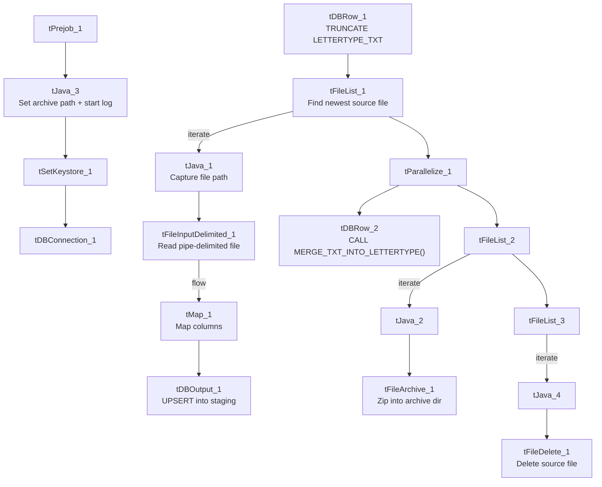

# Talend Job: LetterType_Text_Load

## Overview

This job loads letter-type reference data (code, description, audit fields) from a shared folder into Snowflake, following the project's standard truncate-load-merge-archive pattern (see `job_Address_Text_Load.md`). Its one notable deviation is that its Snowflake write step is configured as an UPSERT rather than a plain INSERT, meaning the staging load itself can update existing staging rows in addition to inserting new ones — before the separate merge procedure even runs. It has no scheduling information in this metadata — something outside Talend decides when it runs.

## Detail table

| Field | Value |
|---|---|
| Job name | LetterType_Text_Load |
| Version | 0.1 |
| Project | LATITUDE |
| Author | jmach@harriscollect.com |
| Created | 2025-04-09T09:25:51.797-0700 |
| Last Modified | 2025-10-01T09:52:33.439-0700 |

## Step-by-step data flow

1. **Set up.** `tPrejob_1` starts the job; `tJava_3` appends today's date to `context.archiveDir` and opens a log file; `tSetKeystore_1` configures the SSL client keystore; `tDBConnection_1` opens the Snowflake connection.
2. **Empty the staging table.** In a separate, parallel start point, `tDBRow_1` runs `TRUNCATE TABLE LETTERTYPE_TXT;`.
3. **Find and read the file.** `tFileList_1` lists files in `context.sourceDir` (ordered by modified date, skipping `.txt`); `tJava_1` captures the found path into `context.filePath`; `tFileInputDelimited_1` reads it as a pipe-delimited, US-ASCII-encoded file (using the repository schema named `lettertype`) with a header row.
4. **Transform and load.** `tMap_1` maps the file's columns (ID, Code, Description, Created/CreatedBy, Updated/UpdatedBy) onto the `LETTERTYPE_TXT` schema, adding `LOAD_DT`. The mapped rows go directly into `tDBOutput_1`, which **upserts** them into Snowflake (see Issues observed).
5. **Merge and clean up — in parallel.** `tParallelize_1` splits into two branches once the file has been listed:
   - **Merge branch:** `tDBRow_2` calls `CALL MERGE_TXT_INTO_LETTERTYPE();`.
   - **Cleanup branch:** the source file is listed again and archived (`tFileArchive_1`, zipped into `context.archiveDir`); it's also listed a third time and deleted (`tFileDelete_1`).

## Settings tables

### Source: `tFileInputDelimited_1`

| Setting | Value | What it means |
|---|---|---|
| FILENAME | `context.filePath` | Reads whichever file `tFileList_1` just found. |
| FIELDSEPARATOR / ROWSEPARATOR | `\|~\|` / `\|$\|` | The project's standard pipe-delimited format. |
| CSVROWSEPARATOR | `\r\n` | Only relevant if CSV mode were used (it isn't here); differs from most peers' `\n`. |
| ESCAPE_CHAR / TEXT_ENCLOSURE | (empty) / (empty) | No quote/escape character is configured, unlike most peer jobs which use `"` for both. |
| HEADER | 1 | First line is a header, not data. |
| ENCODING | US-ASCII | Plain ASCII, not ISO-8859-15. |
| SCHEMA:REPOSITORY_SCHEMA_TYPE | `lettertype` (repository schema) | Uses a centrally-defined column layout. |
| EXCLUDEFILEMASK (on `tFileList_1`) | `*.txt` | `.txt` files are skipped. |

### Target: `tDBOutput_1`

| Setting | Value | What it means |
|---|---|---|
| Table | LETTERTYPE_TXT | Loads the staging copy of the letter-type table. |
| Output action | **UPSERT** | Inserts new rows or updates existing ones by key, directly in the staging load — this differs from every other assigned job, which uses a plain INSERT here (see Issues observed). |
| Table action | NONE | Table structure isn't touched here; truncation is handled separately by `tDBRow_1`. |

### Merge step: `tDBRow_2`

| Setting | Value | What it means |
|---|---|---|
| Query | `CALL MERGE_TXT_INTO_LETTERTYPE();` | Folds staged rows into the permanent table; its own logic lives in Snowflake. |

## Dependencies & configuration

- **Triggers/depends on other jobs:** none found — no `tRunJob` links.
- **Context variables used:** `context.sourceDir`, `context.archiveDir`, `context.filePath`, `context.fileName`, `context.logDir`, `context.keystorePath` (all `Directories_0.1`).
- **LEGACY_DW usage:** none — this job uses the shared Snowflake connection object, not `LEGACY_DW_0.1` variables directly.

## Glossary

| Component type | Plain-English meaning |
|---|---|
| `tPrejob` / `tParallelize` | Job-flow control. (see `job_Address_Text_Load.md`) |
| `tFileList` | Lists files in a folder so the job can loop over them. (see `job_Address_Text_Load.md`) |
| `tFileInputDelimited` | Reads a delimited text file row by row. (see `job_Address_Text_Load.md`) |
| `tMap` | Maps/transforms columns from input to output. (see `job_Address_Text_Load.md`) |
| `tDBOutput` / `tSnowflakeOutput` | Writes rows into a Snowflake table — here configured to UPSERT rather than INSERT. (see `job_Address_Text_Load.md`) |
| `tDBRow` / `tSnowflakeRow` | Runs a single SQL statement — used here for `TRUNCATE` and `CALL <procedure>`. (see `job_Address_Text_Load.md`) |
| `tJava` | A small block of custom Java code. (see `job_Address_Text_Load.md`) |
| `tFileArchive` | Compresses a file into a `.zip` and archives it. (see `job_Address_Text_Load.md`) |
| `tFileDelete` | Deletes a file from disk. (see `job_Address_Text_Load.md`) |
| `tSetKeystore` | Configures the SSL keystore for the Snowflake connection. (see `job_Address_Text_Load.md`) |

## Issues observed

- **The staging load uses UPSERT instead of INSERT.** Every other assigned job in this batch inserts fresh rows into an already-truncated staging table (so INSERT vs. UPSERT shouldn't normally matter, since the table is empty going in). Having UPSERT here is functionally redundant given the preceding `TRUNCATE`, unless it's intentional protection against duplicate keys within a single source file — worth confirming with the team whether this was a deliberate choice or a copy-paste artifact from a different job template.
- **No quote/escape character configured** (`ESCAPE_CHAR`/`TEXT_ENCLOSURE` both empty), unlike most peer jobs which set both to `"`. If any `Description` value in the source file ever contains a pipe character or needs quoting, this could parse incorrectly.
- **No row counter (`tFlowMeter`)** between `tMap_1` and `tDBOutput_1`, unlike some peer jobs.
- **The merge procedure's own logic is outside Talend**, same caveat as every other job that calls a `MERGE_TXT_INTO_*` procedure.
