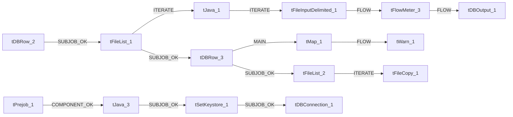

# Talend Job: Livevox_Daily_Load

- **Project**: LATITUDE
- **Version**: 0.1
- **Job Type**: Standard

- **Author**: jmach@harriscollect.com
- **Created**: 2025-02-10T09:57:45.302-0800
- **Last Modified**: 2025-10-01T10:00:50.577-0700

## Components

| # | Component | Type | Key Parameters |
|---|-----------|------|----------------|
| 1 | tDBConnection_1 | `tSnowflakeConnection` | `CONNECTION_FORMAT`=row, `PROPERTIES`={"@id":2,"@type":"org.talend.components.snowflake. |
| 2 | tDBRow_2 | `tSnowflakeRow` | `CONNECTION_FORMAT`=row, `PROPERTIES`={"@id":3,"@type":"org.talend.components.snowflake. |
| 3 | tPrejob_1 | `tPrejob` | `CONNECTION_FORMAT`=row |
| 4 | tJava_3 | `tJava` | `CODE`=java.io.File logFile = new java.io.File(context.lo, `IMPORT`=//import java.util.List;, `CONNECTION_FORMAT`=row |
| 5 | tFileList_1 | `tFileList` | `DIRECTORY`=context.sourceRoot, `LIST_MODE`=FILES, `INCLUDSUBDIR`=false, `CASE_SENSITIVE`=YES, `ERROR`=false |
| 6 | tJava_1 | `tJava` | `CODE`=context.filePath = ((String)globalMap.get("tFileLi, `IMPORT`=//import java.util.List;, `CONNECTION_FORMAT`=row |
| 7 | tFileInputDelimited_1 | `tFileInputDelimited` | `USE_EXISTING_DYNAMIC`=false, `FILENAMETEXT`="When the input source is a stream or a zip file,f, `FILENAME`=context.filePath, `CSV_OPTION`=false, `ROWSEPARATOR`="\n" |
| 8 | tFlowMeter_3 | `tFlowMeter` | `USEROWLABEL`=true, `METTERLABEL`="MyLabel", `ABSOLUTE`=Absolute, `CONNECTION_FORMAT`=row |
| 9 | tDBOutput_1 | `tSnowflakeOutput` | `CONNECTION_FORMAT`=row, `PROPERTIES`={"@id":3,"@type":"org.talend.components.snowflake. |
| 10 | tDBRow_3 | `tSnowflakeRow` | `CONNECTION_FORMAT`=row, `PROPERTIES`={"@id":3,"@type":"org.talend.components.snowflake. |
| 11 | tMap_1 | `tMap` | `LINK_STYLE`=AUTO, `DIE_ON_ERROR`=true, `LKUP_PARALLELIZE`=false, `LEVENSHTEIN`=0, `JACCARD`=0 |
| 12 | tWarn_1 | `tWarn` | `MESSAGE`="Return Code from merge by refnum: " + out1.RETVAL, `CODE`=42, `PRIORITY`=4, `CONNECTION_FORMAT`=row |
| 13 | tFileList_2 | `tFileList` | `DIRECTORY`=context.sourceRoot, `LIST_MODE`=FILES, `INCLUDSUBDIR`=false, `CASE_SENSITIVE`=YES, `ERROR`=false |
| 14 | tFileCopy_1 | `tFileCopy` | `FILENAME`=((String)globalMap.get("tFileList_2_CURRENT_FILEPA, `ENABLE_COPY_DIRECTORY`=false, `SOURCE_DERECTORY`=((String)globalMap.get("tFileList_2_CURRENT_FILEPA, `DESTINATION`=context.archiveDir, `RENAME`=false |
| 15 | tSetKeystore_1 | `tSetKeystore` | `SET_TRUSTSTORE`=false, `SET_TRUSTSTORE_KEYSTORE`=false, `TRUSTSTORE_TYPE`=JKS, `SSL_TRUSTSERVER_TRUSTSTORE`="C:/clientTrustStore.trustStore", `KEYSTORE_TYPE`=PKCS12 |

## Schemas

### tDBRow_2

| Column | Type | Nullable | Length |
|--------|------|----------|--------|
| errorCode | id_String | No | 255 |
| errorMessage | id_String | No | 255 |

### tFileInputDelimited_1

| Column | Type | Nullable | Length |
|--------|------|----------|--------|
| Entry_Type | id_String | Yes | 2 |
| Call_Direction | id_String | Yes | 1 |
| Reference_Number | id_String | Yes | 255 |
| Phone_Number_Dialed | id_String | Yes | 100 |
| Result_Date | id_Date | Yes | -1 |
| Result_Time | id_String | Yes | 10 |
| Code_Name | id_String | Yes | 255 |
| TFH_ID | id_String | Yes | 10 |
| TFH_Result | id_String | Yes | 255 |
| TFH_Result_Category | id_String | Yes | 10 |
| TFH_Custom_Result_1 | id_String | Yes | 50 |
| TFH_Custom_Result_2 | id_String | Yes | 50 |
| TFH_Custom_Result_3 | id_String | Yes | 50 |
| Phone_Cell_Flag | id_String | Yes | 1 |
| Agent_ID | id_String | Yes | 10 |
| Agent_Login | id_String | Yes | 20 |
| Agent_Last_Name | id_String | Yes | 20 |
| Agent_Name | id_String | Yes | 20 |
| Treatment_Event_ID | id_String | Yes | 10 |
| Call_Center_ID | id_String | Yes | 10 |
| Call_Center_Name | id_String | Yes | 50 |
| Service_ID | id_String | Yes | 10 |
| Service_Name | id_String | Yes | 50 |
| Campaign_ID | id_String | Yes | 10 |
| Campaign_Name | id_String | Yes | 100 |
| Talk_Time | id_String | Yes | 10 |
| Hold_Time | id_String | Yes | 10 |
| Wrapup_Time | id_String | Yes | 10 |
| Call_Duration | id_String | Yes | 10 |
| Session_ID | id_String | No | 100 |
| Transfer_Call_Result | id_String | Yes | 50 |
| IVR_Time | id_String | Yes | -1 |
| Queue_Time | id_String | Yes | -1 |
| From_Number1 | id_String | Yes | 100 |
| Entry_Type | id_String | Yes | 2 |
| Call_Direction | id_String | Yes | 1 |
| Reference_Number | id_String | Yes | 255 |
| Phone_Number_Dialed | id_String | Yes | 100 |
| Result_Date | id_Date | Yes | -1 |
| Result_Time | id_String | Yes | 10 |
| Code_Name | id_String | Yes | 255 |
| TFH_ID | id_String | Yes | 10 |
| TFH_Result | id_String | Yes | 255 |
| TFH_Result_Category | id_String | Yes | 10 |
| TFH_Custom_Result_1 | id_String | Yes | 50 |
| TFH_Custom_Result_2 | id_String | Yes | 50 |
| TFH_Custom_Result_3 | id_String | Yes | 50 |
| Phone_Cell_Flag | id_String | Yes | 1 |
| Agent_ID | id_String | Yes | 10 |
| Agent_Login | id_String | Yes | 20 |
| Agent_Last_Name | id_String | Yes | 20 |
| Agent_Name | id_String | Yes | 20 |
| Treatment_Event_ID | id_String | Yes | 10 |
| Call_Center_ID | id_String | Yes | 10 |
| Call_Center_Name | id_String | Yes | 50 |
| Service_ID | id_String | Yes | 10 |
| Service_Name | id_String | Yes | 50 |
| Campaign_ID | id_String | Yes | 10 |
| Campaign_Name | id_String | Yes | 100 |
| Talk_Time | id_String | Yes | 10 |
| Hold_Time | id_String | Yes | 10 |
| Wrapup_Time | id_String | Yes | 10 |
| Call_Duration | id_String | Yes | 10 |
| Session_ID | id_String | No | 100 |
| Transfer_Call_Result | id_String | Yes | 50 |
| IVR_Time | id_String | Yes | -1 |
| Queue_Time | id_String | Yes | -1 |
| From_Number1 | id_String | Yes | 100 |
| errorCode | id_String | Yes | 255 |
| errorMessage | id_String | Yes | 255 |

### tFlowMeter_3

| Column | Type | Nullable | Length |
|--------|------|----------|--------|
| Entry_Type | id_String | Yes | 2 |
| Call_Direction | id_String | Yes | 1 |
| Reference_Number | id_String | Yes | 255 |
| Phone_Number_Dialed | id_String | Yes | 100 |
| Result_Date | id_Date | Yes | -1 |
| Result_Time | id_String | Yes | 10 |
| Code_Name | id_String | Yes | 255 |
| TFH_ID | id_String | Yes | 10 |
| TFH_Result | id_String | Yes | 255 |
| TFH_Result_Category | id_String | Yes | 10 |
| TFH_Custom_Result_1 | id_String | Yes | 50 |
| TFH_Custom_Result_2 | id_String | Yes | 50 |
| TFH_Custom_Result_3 | id_String | Yes | 50 |
| Phone_Cell_Flag | id_String | Yes | 1 |
| Agent_ID | id_String | Yes | 10 |
| Agent_Login | id_String | Yes | 20 |
| Agent_Last_Name | id_String | Yes | 20 |
| Agent_Name | id_String | Yes | 20 |
| Treatment_Event_ID | id_String | Yes | 10 |
| Call_Center_ID | id_String | Yes | 10 |
| Call_Center_Name | id_String | Yes | 50 |
| Service_ID | id_String | Yes | 10 |
| Service_Name | id_String | Yes | 50 |
| Campaign_ID | id_String | Yes | 10 |
| Campaign_Name | id_String | Yes | 100 |
| Talk_Time | id_String | Yes | 10 |
| Hold_Time | id_String | Yes | 10 |
| Wrapup_Time | id_String | Yes | 10 |
| Call_Duration | id_String | Yes | 10 |
| Session_ID | id_String | No | 100 |
| Transfer_Call_Result | id_String | Yes | 50 |
| IVR_Time | id_String | Yes | -1 |
| Queue_Time | id_String | Yes | -1 |
| From_Number1 | id_String | Yes | 100 |

### tDBOutput_1

| Column | Type | Nullable | Length |
|--------|------|----------|--------|
| Entry_Type | id_String | Yes | 2 |
| Call_Direction | id_String | Yes | 1 |
| Reference_Number | id_String | Yes | 255 |
| Phone_Number_Dialed | id_String | Yes | 100 |
| Result_Date | id_Date | Yes | -1 |
| Result_Time | id_String | Yes | 10 |
| Code_Name | id_String | Yes | 255 |
| TFH_ID | id_String | Yes | 10 |
| TFH_Result | id_String | Yes | 255 |
| TFH_Result_Category | id_String | Yes | 10 |
| TFH_Custom_Result_1 | id_String | Yes | 50 |
| TFH_Custom_Result_2 | id_String | Yes | 50 |
| TFH_Custom_Result_3 | id_String | Yes | 50 |
| Phone_Cell_Flag | id_String | Yes | 1 |
| Agent_ID | id_String | Yes | 10 |
| Agent_Login | id_String | Yes | 20 |
| Agent_Last_Name | id_String | Yes | 20 |
| Agent_Name | id_String | Yes | 20 |
| Treatment_Event_ID | id_String | Yes | 10 |
| Call_Center_ID | id_String | Yes | 10 |
| Call_Center_Name | id_String | Yes | 50 |
| Service_ID | id_String | Yes | 10 |
| Service_Name | id_String | Yes | 50 |
| Campaign_ID | id_String | Yes | 10 |
| Campaign_Name | id_String | Yes | 100 |
| Talk_Time | id_String | Yes | 10 |
| Hold_Time | id_String | Yes | 10 |
| Wrapup_Time | id_String | Yes | 10 |
| Call_Duration | id_String | Yes | 10 |
| Session_ID | id_String | No | 100 |
| Transfer_Call_Result | id_String | Yes | 50 |
| IVR_Time | id_String | Yes | -1 |
| Queue_Time | id_String | Yes | -1 |
| From_Number1 | id_String | Yes | 100 |
| columnName | id_String | No | 255 |
| rowNumber | id_String | No | 255 |
| category | id_String | No | 255 |
| character | id_String | No | 255 |
| errorMessage | id_String | No | 255 |
| byteOffset | id_String | No | 255 |
| line | id_String | No | 255 |
| sqlState | id_String | No | 255 |
| code | id_String | No | 255 |

### tDBRow_3

| Column | Type | Nullable | Length |
|--------|------|----------|--------|
| RETVALUE | id_BigDecimal | No | -1 |
| RETVALUE | id_BigDecimal | No | -1 |
| RETVALUE | id_BigDecimal | No | -1 |
| errorCode | id_String | No | 255 |
| errorMessage | id_String | No | 255 |

### tMap_1

| Column | Type | Nullable | Length |
|--------|------|----------|--------|
| RETVALUE | id_String | No | -1 |

### tWarn_1

| Column | Type | Nullable | Length |
|--------|------|----------|--------|
| RETVALUE | id_String | No | -1 |

## Data Flow

