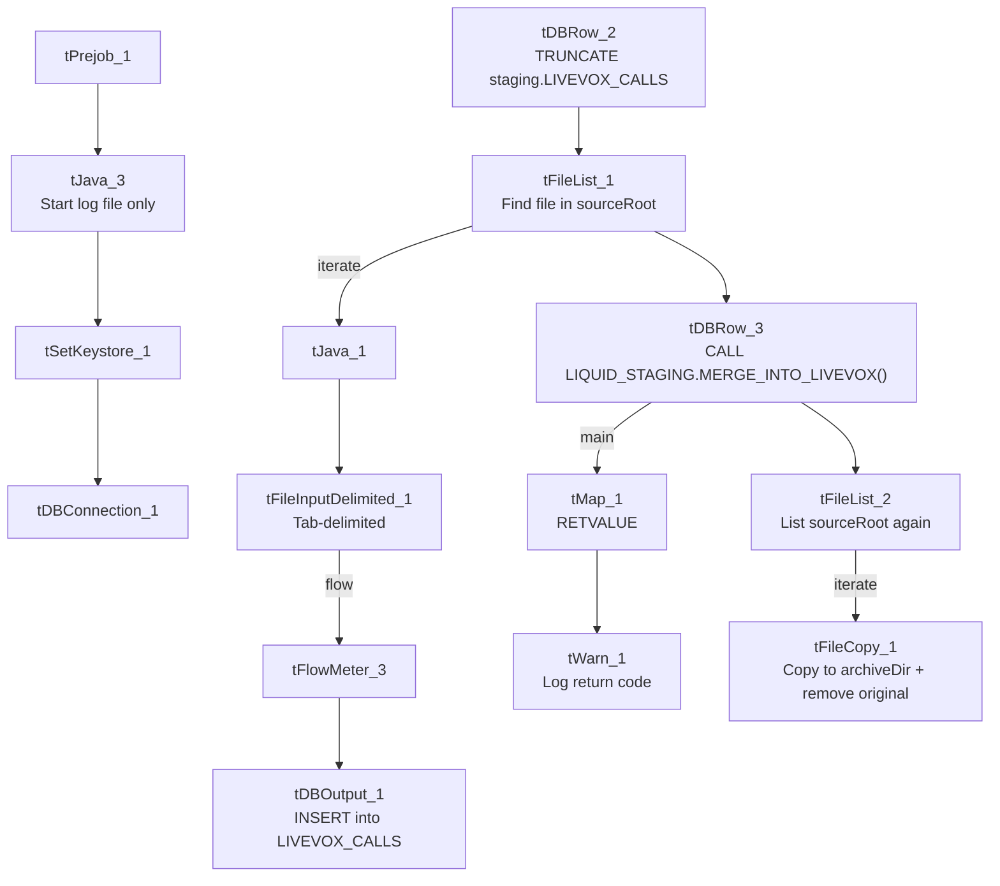

# Talend Job: Livevox_Daily_Load

## Overview

This job loads daily call-detail records from LiveVox (the project's outbound dialer platform) into Snowflake. It shares the project's general shape — truncate staging, load, merge, clear the source file — but deviates from the standard "text load" pattern in several ways: the source file is tab-delimited (not the project's usual `|~|`/`|$|` pipe format), it reads from a different context variable (`context.sourceRoot` instead of `context.sourceDir`), it has no archive-then-delete two-step (a single `tFileCopy` does both), and its merge-result check only ever logs a warning — there's no failure path.

## Detail table

| Field | Value |
|---|---|
| Job name | Livevox_Daily_Load |
| Version | 0.1 |
| Project | LATITUDE |
| Author | jmach@harriscollect.com |
| Created | 2025-02-10T09:57:45.302-0800 |
| Last Modified | 2025-10-01T10:00:50.577-0700 |

## Step-by-step data flow

1. **Set up.** `tPrejob_1` → `tJava_3` (opens a log file only — unlike most peers, this job does **not** append a date to `context.archiveDir` here) → `tSetKeystore_1` → `tDBConnection_1`.
2. **Empty the staging table.** `tDBRow_2` runs `TRUNCATE TABLE LIQUID_STAGING.LIVEVOX_CALLS;`.
3. **Find and read the file.** `tFileList_1` lists files in `context.sourceRoot` (excluding `*.txt`); `tJava_1` captures the path into `context.filePath`; `tFileInputDelimited_1` reads it — **tab-delimited** (`\t` fields, `\n` rows), header row, US-ASCII encoding, `DIE_ON_ERROR`=false.
4. **Load staging.** Rows pass through `tFlowMeter_3` into `tDBOutput_1`, which inserts them into `LIVEVOX_CALLS` (no `tMap` step in this branch — the file's columns appear to map straight onto the staging schema without an explicit transform component).
5. **Merge and log the result.** Once `tFileList_1` completes, `tDBRow_3` runs `CALL LIQUID_STAGING.MERGE_INTO_LIVEVOX();` — note the procedure name doesn't follow the project's usual `MERGE_TXT_INTO_<TABLE>` convention. Its single-column result (`RETVALUE`) flows through `tMap_1` to `tWarn_1`, which logs `"Return Code from merge by refnum: " + <RETVALUE>` (severity code 42) — **there is no `tDie` component reacting to a failed merge**, unlike `cmi_Hermes_Recommendations_Load`'s equivalent pattern.
6. **Clear the source file.** `tDBRow_3`'s success also triggers `tFileList_2` (again on `context.sourceRoot`), which for each file found runs `tFileCopy_1` — copying it into `context.archiveDir` and removing the original (`REMOVE_FILE`=true, `REPLACE_FILE`=true) in a single step. There is no separate zip/archive component and no separate delete component in this job.

## Settings tables

### Source: `tFileInputDelimited_1`

| Setting | Value | What it means |
|---|---|---|
| FILENAME | `context.filePath` | Reads whichever file `tFileList_1` just found. |
| DIRECTORY (on `tFileList_1`) | `context.sourceRoot` | **Not** `context.sourceDir` like every other job in this batch — a different, job-specific source folder. |
| FIELDSEPARATOR / ROWSEPARATOR | `\t` / `\n` | Tab-delimited with plain newline rows — the project's only job among these 9 that doesn't use the `\|~\|`/`\|$\|` custom format, consistent with this being a raw LiveVox export rather than an internally-generated extract. |
| ENCODING | US-ASCII | Plain ASCII. |
| DIE_ON_ERROR | false | A malformed row is skipped/logged rather than failing the job. |
| TEMP_DIR | `"C:/Talend-Studio-.../workspace"` | Hardcoded Windows path. |

### Target: `tDBOutput_1`

| Setting | Value | What it means |
|---|---|---|
| Table | LIVEVOX_CALLS | Loads into the staging copy of the call-log table. |
| Output action | INSERT | Adds rows only. |
| Table action | NONE | Table structure untouched. |

### Merge & result log: `tDBRow_3` → `tMap_1` → `tWarn_1`

| Setting | Value | What it means |
|---|---|---|
| Query (`tDBRow_3`) | `CALL LIQUID_STAGING.MERGE_INTO_LIVEVOX();` | Runs the Snowflake merge procedure — note the name (`MERGE_INTO_LIVEVOX`) breaks the project's usual `MERGE_TXT_INTO_<TABLE>` naming convention (no `TXT`, and the table itself is `LIVEVOX_CALLS`, not `LIVEVOX`). |
| `tWarn_1` message | `"Return Code from merge by refnum: " + RETVALUE` (severity 42) | Logs whatever value the procedure returns — this happens regardless of whether the merge actually succeeded or failed, since there's no `tDie` branch. |

### Cleanup: `tFileCopy_1`

| Setting | Value | What it means |
|---|---|---|
| DESTINATION | `context.archiveDir` | Copies the raw (unzipped) source file straight into the archive folder. |
| REMOVE_FILE / REPLACE_FILE | true / true | The original is deleted from `sourceRoot` once copied — functioning as a combined archive+delete step. |
| SOURCE_DERECTORY | *(same value as `FILENAME`, a full file path)* | This parameter is meant to hold a directory, but is set to the same expression as `FILENAME` (a full path); it has no effect here because `ENABLE_COPY_DIRECTORY` is `false`, but it looks like a copy/paste leftover. |

## Dependencies & configuration

- **Triggers/depends on other jobs:** none found — no `tRunJob` links.
- **Context variables used:** `context.sourceRoot`, `context.filePath`, `context.archiveDir`, `context.logDir`, `context.keystorePath`. Notably, `context.sourceRoot` is **not** one of the `Directories_0.1` variables captured in `_shared_context.json` (which only lists `sourceDir`, `filePath`, `archiveDir`, `fileName`, `logDir`, `keystorePath`) — its actual dev/prod values are unknown from the provided metadata. This job also never references `context.fileName` at all.
- **`LEGACY_DW_*` usage:** the project-wide background notes for this documentation effort flag `Livevox_Daily_Load` as one of only three jobs that reference `LEGACY_DW_0.1` context variables directly (bypassing the shared connection object). However, this job's own extracted metadata does **not** show that: `tDBConnection_1`'s parameters are empty, and no `LEGACY_DW_` prefixed variable appears anywhere in this job's JSON (checked directly, not just in `context_vars_referenced`). This may simply mean the connection details aren't captured in this extract format — worth confirming directly in Talend Studio rather than relying on this write-up for that specific question.

## Glossary

| Component type | Plain-English meaning |
|---|---|
| `tPrejob` | Job-flow control marking setup steps (see job_Address_Text_Load.md). |
| `tSnowflakeConnection` (`tDBConnection`) | Opens the shared Snowflake connection (see job_Bankruptcy_Text_Load.md). |
| `tFileList` | Lists files for iteration (see job_Address_Text_Load.md). |
| `tFileInputDelimited` | Reads a delimited text file (see job_Address_Text_Load.md). |
| `tFlowMeter` | Counts rows passing through (see job_Address_Text_Load.md). |
| `tDBOutput` / `tSnowflakeOutput` | Writes rows to Snowflake (see job_Address_Text_Load.md). |
| `tDBRow` / `tSnowflakeRow` | Runs a single SQL statement (see job_Address_Text_Load.md). |
| `tMap` | Maps/transforms columns (see job_Address_Text_Load.md) — here used just to carry the procedure's single `RETVALUE` result column through to the warning log. |
| `tWarn` | Logs a warning without failing the job (see job_cmi_Hermes_Recommendations_Load.md). |
| `tJava` | Custom Java code block (see job_Address_Text_Load.md). |
| `tFileCopy` | Copies (and here, also removes the original of) a file (see job_Export_File_Check.md). |
| `tSetKeystore` | Configures the SSL keystore (see job_Address_Text_Load.md). |

## Issues observed

- **No failure path on a failed merge.** Unlike `cmi_Hermes_Recommendations_Load`'s `tDie`/`tWarn` pair, this job only ever logs the procedure's return value via `tWarn_1` — there's no component that fails the job if `MERGE_INTO_LIVEVOX()` reports an error. A failed merge here could go unnoticed unless someone reads the log.
- **Merge procedure name (`MERGE_INTO_LIVEVOX`) breaks the project's naming convention** used elsewhere (`MERGE_TXT_INTO_<TABLE>`), and doesn't match the actual table name (`LIVEVOX_CALLS`).
- **Uses `context.sourceRoot` instead of `context.sourceDir`**, and that variable isn't part of the `Directories_0.1` context group captured in `_shared_context.json` — its dev/prod values can't be confirmed here.
- **No archive/zip step** — the source file is moved to `context.archiveDir` unzipped via `tFileCopy_1`, unlike every other Text_Load job reviewed, which zip the file via `tFileArchive` before deleting it.
- **`tFileCopy_1.SOURCE_DERECTORY` is set to a file path expression, not a directory** — likely a copy/paste artifact, though it has no effect since directory-copy mode is disabled.
- **Does not append a date subfolder to `context.archiveDir`** the way most peer jobs do (`context.archiveDir = context.archiveDir + <date> + "/"`) — files of different days may land in the same archive folder without date-based separation.
- **File format itself (tab-delimited, not the project's `\|~\|`/`\|$\|` convention) and the `LEGACY_DW_*` connection question noted above** are both worth a quick confirmation with the team, since they diverge from what's assumed elsewhere in this documentation effort.
