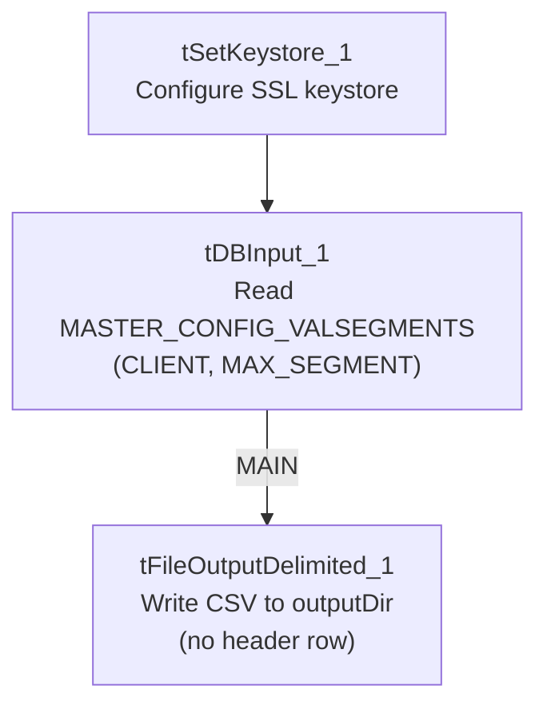

# Talend Job: Master_Config_Val_Segs_Export

## Overview

Like `Hermes_Latitude_Recommendations`, this job reads data **out of** Snowflake and writes it to a file, rather than the usual load-into-Snowflake pattern. It exports the `MASTER_CONFIG_VALSEGMENTS` table (client codes paired with a maximum segment number — likely a collections/valuation-segmentation configuration table) to a dated CSV file. It is a minimal, two-step job with no file-watching, staging, merge, or cleanup logic.

## Detail table

| Field | Value |
|---|---|
| Job name | Master_Config_Val_Segs_Export |
| Version | 0.1 |
| Project | LATITUDE |
| Author | jmach@harriscollect.com |
| Created | 2026-05-12T15:33:49.566-0700 |
| Last Modified | 2026-05-12T15:36:37.011-0700 |

## Step-by-step data flow

1. **Set up.** `tSetKeystore_1` configures the SSL keystore for the Snowflake connection.
2. **Read the table.** `tDBInput_1` (a `tSnowflakeInput`) is configured to read directly from the `MASTER_CONFIG_VALSEGMENTS` table (via the component's table selector, not a hand-written query), returning just two columns: `CLIENT` and `MAX_SEGMENT`.
3. **Write the file.** The result flows (`MAIN`) into `tFileOutputDelimited_1`, which writes a comma-separated file named `master_config_valsegments_<CCYY-MM-DD>.csv` into `context.outputDir`. Unlike `Hermes_Latitude_Recommendations`'s export file, this one is written **without** a header row (`INCLUDEHEADER = false`).

There is no `tPrejob`, file-watching, staging table, merge call, or archive/delete step.

## Settings tables

### Source: `tDBInput_1` (reads Snowflake)

| Setting | Value | What it means |
|---|---|---|
| Table | MASTER_CONFIG_VALSEGMENTS | Read via the component's table selector rather than a custom `SELECT` statement (contrast with `Hermes_Latitude_Recommendations`, which uses a hand-written query). |
| Columns | `CLIENT`, `MAX_SEGMENT` | Only two columns are pulled — a client identifier and what appears to be a maximum segment number for that client. |

### Target: `tFileOutputDelimited_1` (writes the export file)

| Setting | Value | What it means |
|---|---|---|
| FILENAME | `context.outputDir + "master_config_valsegments_" + TalendDate.getDate("CCYY-MM-DD") + ".csv"` | Dated output file written to `context.outputDir`. |
| FIELDSEPARATOR | `,` | Plain comma-separated. |
| INCLUDEHEADER | false | No header row — differs from `Hermes_Latitude_Recommendations`'s export, which does include one. Anything consuming this file needs to know the column order in advance. |
| ENCODING | ISO-8859-15 | Western European encoding. |
| APPEND | false | Overwrites rather than appends each run. |

## Dependencies & configuration

- **Triggers/depends on other jobs:** none found — no `tRunJob` links.
- **Context variables used:** `context.keystorePath`, `context.outputDir` only. As with `Hermes_Latitude_Recommendations`, `context.outputDir` is not part of the `Directories_0.1` group provided in `_shared_context.json`.
- **Shared Snowflake connection vs. `LEGACY_DW_*`:** this job is called out in the project-wide background as one of only three jobs (alongside `Master_Prediction_Scores_Export` and `Livevox_Daily_Load`) expected to reference the `LEGACY_DW_0.1` context group directly rather than using the shared connection object. **However, the `context_vars_referenced` list actually extracted for this job is only `['keystorePath', 'outputDir']` — it contains no `LEGACY_DW_`-prefixed variable.** A full-text search of this job's JSON likewise turns up no `LEGACY_DW` references. The `tDBInput_1` component's own `parameters` dictionary is empty in this extract (its connection-level settings appear to have been filtered out as technical noise), so it's possible the underlying connection does reference `LEGACY_DW_*` fields (e.g., account/warehouse/database) in a way this extraction didn't surface as a textual `context.LEGACY_DW_*` reference. **This could not be confirmed from the provided metadata — verify directly in Talend Studio.**

## Glossary

| Component type | Plain-English meaning |
|---|---|
| `tSetKeystore` | Configures the SSL keystore for the Snowflake connection (see `job_Address_Text_Load.md`). |
| `tSnowflakeInput` (`tDBInput`) | Runs a query (or, as here, a direct table read) against Snowflake and streams the results into the job as rows. See `job_Hermes_Latitude_Recommendations.md` for a fuller explanation. |
| `tFileOutputDelimited` | Writes rows out to a delimited text file. See `job_Hermes_Latitude_Recommendations.md`. |

## Issues observed

- **The expected `LEGACY_DW_*` reference isn't visible in this job's extracted metadata**, contrary to the project-wide note that this is one of three jobs that reference it directly. Since `tDBInput_1`'s own connection parameters were filtered out of this extract, this discrepancy is most likely an artifact of the extraction rather than a real absence — but it should be confirmed directly against the job in Talend Studio before treating this job as either "uses shared connection" or "uses `LEGACY_DW_*` directly" with confidence.
- **No header row on the output file** (`INCLUDEHEADER = false`), unlike the otherwise-similar `Hermes_Latitude_Recommendations` export — anything consuming `master_config_valsegments_*.csv` must already know the two-column order (`CLIENT`, `MAX_SEGMENT`).
- **`context.outputDir` is used but not documented** in the `Directories_0.1` context group provided — its actual folder path(s) are unknown from this metadata.
- **No archiving, deletion, or merge step** — this is a pure extract-and-write job.
