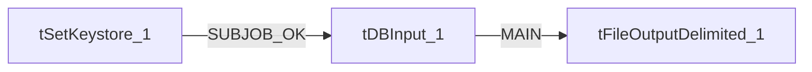

# Talend Job: Master_Config_Val_Segs_Export

- **Project**: LATITUDE
- **Version**: 0.1
- **Job Type**: Standard

- **Author**: jmach@harriscollect.com
- **Created**: 2026-05-12T15:33:49.566-0700
- **Last Modified**: 2026-05-12T15:36:37.011-0700

## Components

| # | Component | Type | Key Parameters |
|---|-----------|------|----------------|
| 1 | tSetKeystore_1 | `tSetKeystore` | `SET_TRUSTSTORE`=false, `SET_TRUSTSTORE_KEYSTORE`=false, `TRUSTSTORE_TYPE`=JKS, `SSL_TRUSTSERVER_TRUSTSTORE`="C:/clientTrustStore.trustStore", `KEYSTORE_TYPE`=PKCS12 |
| 2 | tDBInput_1 | `tSnowflakeInput` | `CONNECTION_FORMAT`=row, `PROPERTIES`={"@id":3,"@type":"org.talend.components.snowflake. |
| 3 | tFileOutputDelimited_1 | `tFileOutputDelimited` | `USESTREAM`=false, `STREAMNAME`=outputStream, `FILENAME`=context.outputDir + "master_config_valsegments_"+T, `ROWSEPARATOR`="\n", `OS_LINE_SEPARATOR_AS_ROW_SEPARATOR`=true |

## Schemas

### tDBInput_1

| Column | Type | Nullable | Length |
|--------|------|----------|--------|
| CLIENT | id_String | Yes | 15 |
| MAX_SEGMENT | id_Integer | Yes | 9 |

### tFileOutputDelimited_1

| Column | Type | Nullable | Length |
|--------|------|----------|--------|
| CLIENT | id_String | Yes | 15 |
| MAX_SEGMENT | id_Integer | Yes | 9 |

## Data Flow

