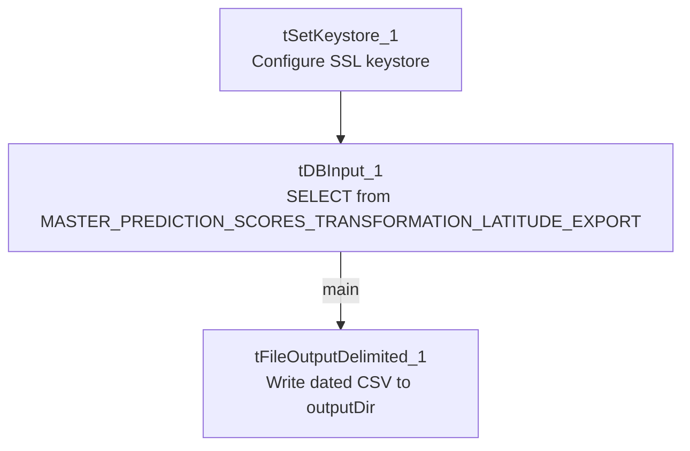

# Talend Job: Master_Prediction_Scores_Export

## Overview

Unlike the "text load" jobs, this one runs in reverse: it reads a small result set (a debtor number and a segment/letter-scoring value) out of a Snowflake table and writes it out to a CSV file on disk. There's no source-folder watching, no staging-table truncate/merge, and no archive/delete step — it's a straight query-to-file export, and one of the simplest jobs in the project (just three components).

## Detail table

| Field | Value |
|---|---|
| Job name | Master_Prediction_Scores_Export |
| Version | 0.1 |
| Project | LATITUDE |
| Author | jmach@harriscollect.com |
| Created | 2026-05-12T14:48:07.119-0700 |
| Last Modified | 2026-05-12T15:36:55.630-0700 |

## Step-by-step data flow

1. **Configure SSL.** `tSetKeystore_1` sets up the SSL client keystore (`context.keystorePath`) used to reach Snowflake.
2. **Read from Snowflake.** `tDBInput_1` (a `tSnowflakeInput`) queries the `MASTER_PREDICTION_SCORES_TRANSFORMATION_LATITUDE_EXPORT` table, pulling two columns: `DEBTORNUMBER` and `SEGMENT_LETTERS_VAL`.
3. **Write to file.** The rows flow straight into `tFileOutputDelimited_1`, which writes a comma-separated file to `context.outputDir + "master_prediction_scores_transformation_latitude_export_" + <CCYY-MM-DD> + ".csv"` — no header row, ISO-8859-15 encoding.

## Settings tables

### Source: `tDBInput_1` (`tSnowflakeInput`)

| Setting | Value | What it means |
|---|---|---|
| Table | MASTER_PREDICTION_SCORES_TRANSFORMATION_LATITUDE_EXPORT | The Snowflake table/view being read. No custom query text is recorded — it's a straight table read. |
| Columns | DEBTORNUMBER, SEGMENT_LETTERS_VAL | Just two columns come out of this table for this export. |

### Target: `tFileOutputDelimited_1`

| Setting | Value | What it means |
|---|---|---|
| FILENAME | `context.outputDir + "master_prediction_scores_transformation_latitude_export_" + TalendDate.getDate("CCYY-MM-DD") + ".csv"` | The output filename is date-stamped with the run date, so each day's export lands in its own file rather than overwriting the last one. |
| FIELDSEPARATOR | `,` | Plain comma-separated, unlike the `\|~\|`/`\|$\|` custom delimiters used by the load jobs — this is an outbound file, not one of the pipe-delimited inbound feeds. |
| INCLUDEHEADER | false | No column-name header row is written. |
| ENCODING | ISO-8859-15 | Western European encoding, matching several of the load jobs' file encoding. |
| APPEND | false | Each run creates a fresh file rather than appending to an existing one (consistent with the date-stamped filename). |

## Dependencies & configuration

- **Triggers/depends on other jobs:** none found — no `tRunJob` links.
- **Context variables used:** `context.keystorePath` and `context.outputDir`. `keystorePath` is part of the shared `Directories_0.1` context group (see `_shared_context.json`); `outputDir` is **not** one of the `Directories_0.1` variables documented there (which only defines `sourceDir`/`filePath`/`archiveDir`/`fileName`/`logDir`/`keystorePath`) — it appears to be a variable added specifically for this export job. Its actual value is not visible in this metadata; verify with the team where it points in dev vs. prod.
- **Connection style — this is one of the exceptions.** This job has **no** `tDBConnection`/`tSnowflakeConnection` component at all, unlike every load job documented so far (`Address_Text_Load`, `Carrier_Text_Load`, etc.), which open the shared, repository-linked Snowflake connection before doing any Snowflake work. Per the project-wide connection audit, `Master_Prediction_Scores_Export` is one of only three jobs (`Master_Config_Val_Segs_Export` and `Livevox_Daily_Load` are the other two) that instead configure Snowflake connectivity directly on the `tSnowflakeInput` component itself, referencing the `LEGACY_DW_0.1` context group's variables (account `xca26579.us-east-1`, warehouse `COMPUTE_WH`, database `EDWPRODHH`, schema `DW`, per `_shared_context.json`) rather than the shared connection object. The specific `LEGACY_DW_*` variable names aren't visible on `tDBInput_1` in this trimmed metadata (its `parameters` are empty aside from the extracted `snowflake.table` value), so this can't be independently re-verified from this file alone — treat it as confirmed by the broader project audit rather than by this job's JSON in isolation.

## Glossary

| Component type | Plain-English meaning |
|---|---|
| `tSetKeystore` | Configures the SSL keystore for the Snowflake connection (see `job_Address_Text_Load.md`). |
| `tSnowflakeInput` | Runs a query against Snowflake and streams the results into the job as rows — the mirror image of `tSnowflakeOutput`. Not used in the three reference docs (they all write to Snowflake, not read from it). |
| `tFileOutputDelimited` | Writes rows out to a delimited text file — the mirror image of `tFileInputDelimited`. Also not used in the three reference docs. |

## Issues observed

- **`context.outputDir` is not part of the documented `Directories_0.1` context group.** Every other directory-style variable in this project (`sourceDir`, `archiveDir`, `filePath`, `fileName`, `logDir`, `keystorePath`) has a recorded dev/prod pair in `_shared_context.json`; `outputDir` does not, meaning its actual configured value(s) are invisible from the shared context metadata provided. Confirm with the team where this points before relying on the export path.
- **No archive or cleanup step.** Every load job reviewed so far explicitly archives and deletes its source file after processing; this export job has no equivalent for the file it writes — there's nothing in this metadata that manages, rotates, or cleans up the exported CSVs over time, so a downstream process (external to Talend) must be responsible for consuming or clearing them.
- **This job's Snowflake connection details are not independently visible in its own metadata** — the `LEGACY_DW_0.1`-direct-reference behavior is asserted by the broader project audit (see Dependencies & configuration) but the specific evidence (e.g. named `LEGACY_DW_*` parameters on `tDBInput_1`) was filtered out of this trimmed extract. Flagging so this isn't mistaken for something independently verifiable from this file.
