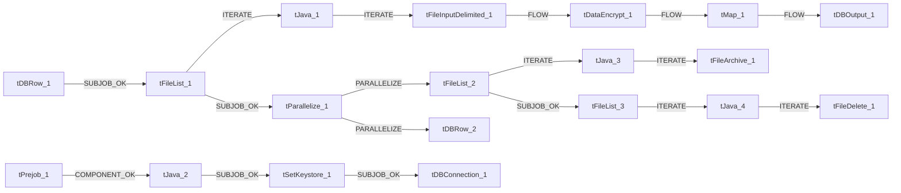

# Talend Job: Master_Table_Text_Load

- **Project**: LATITUDE
- **Version**: 0.1
- **Job Type**: Standard

- **Author**: jmach@harriscollect.com
- **Created**: 2024-10-18T09:16:38.643-0700
- **Last Modified**: 2026-07-12T13:06:41.008-0700

## Components

| # | Component | Type | Key Parameters |
|---|-----------|------|----------------|
| 1 | tDBConnection_1 | `tSnowflakeConnection` | `CONNECTION_FORMAT`=row, `PROPERTIES`={"@id":2,"@type":"org.talend.components.snowflake. |
| 2 | tFileList_1 | `tFileList` | `DIRECTORY`=context.sourceDir, `LIST_MODE`=FILES, `INCLUDSUBDIR`=false, `CASE_SENSITIVE`=YES, `ERROR`=false |
| 3 | tJava_1 | `tJava` | `CODE`=context.filePath= ((String)globalMap.get("tFileLis, `IMPORT`=//import java.util.List;, `CONNECTION_FORMAT`=row |
| 4 | tFileInputDelimited_1 | `tFileInputDelimited` | `USE_EXISTING_DYNAMIC`=false, `FILENAMETEXT`="When the input source is a stream or a zip file,f, `FILENAME`=context.filePath, `CSV_OPTION`=false, `ROWSEPARATOR`="|$|" |
| 5 | tDataEncrypt_1 | `tDataEncrypt` | `CRYPTO_METHOD`=AES, `CRYPTO_FILE_PATH`=context.cryptoPath, `GEN_CRYPTO_FILE_CONTROLLER`=false, `ALGO_VERSION`=2, `CONNECTION_FORMAT`=row |
| 6 | tMap_1 | `tMap` | `LINK_STYLE`=AUTO, `TEMPORARY_DATA_DIRECTORY`=/tmp, `DIE_ON_ERROR`=true, `LKUP_PARALLELIZE`=false, `LEVENSHTEIN`=0 |
| 7 | tDBOutput_1 | `tSnowflakeOutput` | `CONNECTION_FORMAT`=row, `PROPERTIES`={"@id":4,"@type":"org.talend.components.snowflake. |
| 8 | tDBRow_1 | `tSnowflakeRow` | `CONNECTION_FORMAT`=row, `PROPERTIES`={"@id":3,"@type":"org.talend.components.snowflake. |
| 9 | tDBRow_2 | `tSnowflakeRow` | `CONNECTION_FORMAT`=row, `PROPERTIES`={"@id":3,"@type":"org.talend.components.snowflake. |
| 10 | tPrejob_1 | `tPrejob` | `CONNECTION_FORMAT`=row |
| 11 | tFileList_2 | `tFileList` | `DIRECTORY`=context.sourceDir, `LIST_MODE`=FILES, `INCLUDSUBDIR`=false, `CASE_SENSITIVE`=YES, `ERROR`=false |
| 12 | tJava_3 | `tJava` | `CODE`=context.filePath = ((String)globalMap.get("tFileLi, `IMPORT`=//import java.util.List;, `CONNECTION_FORMAT`=row |
| 13 | tFileArchive_1 | `tFileArchive` | `SOURCE`=context.sourceDir, `SOURCE_FILE`="C:/Talend-Studio-20211109_1610-V8.0.1/workspace/s, `SUB_DIRECTROY`=false, `TARGET`=context.archiveDir + context.fileName+".zip", `MKDIR`=true |
| 14 | tFileList_3 | `tFileList` | `DIRECTORY`=context.sourceDir, `LIST_MODE`=FILES, `INCLUDSUBDIR`=false, `CASE_SENSITIVE`=YES, `ERROR`=false |
| 15 | tJava_4 | `tJava` | `CODE`=context.filePath = ((String)globalMap.get("tFileLi, `IMPORT`=//import java.util.List;, `CONNECTION_FORMAT`=row |
| 16 | tFileDelete_1 | `tFileDelete` | `FILENAME`=context.filePath, `DIRECTORY`="C:/Talend-Studio-20211109_1610-V8.0.1/workspace/d, `PATH`="C:/Talend-Studio-20211109_1610-V8.0.1/workspace/d, `FAILON`=false, `FOLDER`=false |
| 17 | tParallelize_1 | `tParallelize` | `WAIT_FOR`=All, `SLEEPTIME`=100, `DIE_ON_ERROR`=false, `CONNECTION_FORMAT`=row |
| 18 | tJava_2 | `tJava` | `CODE`=context.archiveDir = context.archiveDir + TalendDa, `IMPORT`=//import java.util.List;, `CONNECTION_FORMAT`=row |
| 19 | tSetKeystore_1 | `tSetKeystore` | `SET_TRUSTSTORE`=false, `SET_TRUSTSTORE_KEYSTORE`=false, `TRUSTSTORE_TYPE`=JKS, `SSL_TRUSTSERVER_TRUSTSTORE`="C:/clientTrustStore.trustStore", `KEYSTORE_TYPE`=PKCS12 |

## Schemas

### tFileInputDelimited_1

| Column | Type | Nullable | Length |
|--------|------|----------|--------|
| NUMBER | id_Integer | No | 38 |
| LINK | id_Integer | Yes | 38 |
| DESK | id_String | Yes | 16777216 |
| NAME | id_String | Yes | 16777216 |
| STREET1 | id_String | Yes | 16777216 |
| STREET2 | id_String | Yes | 16777216 |
| CITY | id_String | Yes | 16777216 |
| STATE | id_String | Yes | 16777216 |
| ZIPCODE | id_String | Yes | 16777216 |
| CTL | id_String | Yes | 16777216 |
| OTHER | id_String | Yes | 16777216 |
| MR | id_String | Yes | 16777216 |
| ACCOUNT | id_String | Yes | 16777216 |
| HOMEPHONE | id_String | Yes | 16777216 |
| WORKPHONE | id_String | Yes | 16777216 |
| SPECIALNOTE | id_String | Yes | 16777216 |
| RECEIVED | id_String | Yes | 16777216 |
| CLOSED | id_String | Yes | 16777216 |
| RETURNED | id_String | Yes | 16777216 |
| LASTPAID | id_String | Yes | 16777216 |
| LASTPAIDAMT | id_String | Yes | 16777216 |
| LASTINTEREST | id_String | Yes | 16777216 |
| INTERESTRATE | id_String | Yes | 16777216 |
| WORKED | id_String | Yes | 16777216 |
| USERDATE1 | id_String | Yes | 16777216 |
| USERDATE2 | id_String | Yes | 16777216 |
| USERDATE3 | id_String | Yes | 16777216 |
| CONTACTED | id_String | Yes | 16777216 |
| STATUS | id_String | Yes | 16777216 |
| CUSTOMER | id_String | Yes | 16777216 |
| SSN | id_String | Yes | 16777216 |
| ORIGINAL | id_String | Yes | 16777216 |
| ORIGINAL1 | id_String | Yes | 16777216 |
| ORIGINAL2 | id_String | Yes | 16777216 |
| ORIGINAL3 | id_String | Yes | 16777216 |
| ORIGINAL4 | id_String | Yes | 16777216 |
| ORIGINAL5 | id_String | Yes | 16777216 |
| ORIGINAL6 | id_String | Yes | 16777216 |
| ORIGINAL7 | id_String | Yes | 16777216 |
| ORIGINAL8 | id_String | Yes | 16777216 |
| ORIGINAL9 | id_String | Yes | 16777216 |
| ORIGINAL10 | id_String | Yes | 16777216 |
| ACCRUED2 | id_String | Yes | 16777216 |
| ACCRUED10 | id_String | Yes | 16777216 |
| PAID | id_String | Yes | 16777216 |
| PAID1 | id_String | Yes | 16777216 |
| PAID2 | id_String | Yes | 16777216 |
| PAID3 | id_String | Yes | 16777216 |
| PAID4 | id_String | Yes | 16777216 |
| PAID5 | id_String | Yes | 16777216 |
| PAID6 | id_String | Yes | 16777216 |
| PAID7 | id_String | Yes | 16777216 |
| PAID8 | id_String | Yes | 16777216 |
| PAID9 | id_String | Yes | 16777216 |
| PAID10 | id_String | Yes | 16777216 |
| CURRENT0 | id_String | Yes | 16777216 |
| CURRENT1 | id_String | Yes | 16777216 |
| CURRENT2 | id_String | Yes | 16777216 |
| CURRENT3 | id_String | Yes | 16777216 |
| CURRENT4 | id_String | Yes | 16777216 |
| CURRENT5 | id_String | Yes | 16777216 |
| CURRENT6 | id_String | Yes | 16777216 |
| CURRENT7 | id_String | Yes | 16777216 |
| CURRENT8 | id_String | Yes | 16777216 |
| CURRENT9 | id_String | Yes | 16777216 |
| CURRENT10 | id_String | Yes | 16777216 |
| ATTORNEY | id_String | Yes | 16777216 |
| ASSIGNEDATTORNEY | id_String | Yes | 16777216 |
| PROMAMT | id_String | Yes | 16777216 |
| PROMDUE | id_String | Yes | 16777216 |
| SIFPCT | id_String | Yes | 16777216 |
| QUEUE | id_String | Yes | 16777216 |
| QFLAG | id_String | Yes | 16777216 |
| QDATE | id_String | Yes | 16777216 |
| QLEVEL | id_String | Yes | 16777216 |
| QTIME | id_String | Yes | 16777216 |
| EXTRACODES | id_String | Yes | 16777216 |
| SALARY | id_String | Yes | 16777216 |
| FEECODE | id_String | Yes | 16777216 |
| CLIDLC | id_String | Yes | 16777216 |
| CLIDLP | id_String | Yes | 16777216 |
| SEQ | id_String | Yes | 16777216 |
| PSEQ | id_String | Yes | 16777216 |
| BRANCH | id_String | Yes | 16777216 |
| FINDERS | id_String | Yes | 16777216 |
| COMPLETE1 | id_String | Yes | 16777216 |
| COMPLETE2 | id_String | Yes | 16777216 |
| DESK1 | id_String | Yes | 16777216 |
| DESK2 | id_String | Yes | 16777216 |
| FULL0 | id_String | Yes | 16777216 |
| TOTALVIEWED | id_String | Yes | 16777216 |
| TOTALWORKED | id_String | Yes | 16777216 |
| TOTALCONTACTED | id_String | Yes | 16777216 |
| NSF | id_String | Yes | 16777216 |
| HASBIGNOTE | id_String | Yes | 16777216 |
| FIRSTDESK | id_String | Yes | 16777216 |
| FIRSTRECEIVED | id_String | Yes | 16777216 |
| AGENCYFLAG | id_String | Yes | 16777216 |
| AGENCYCODE | id_String | Yes | 16777216 |
| FEESCHEDULE | id_String | Yes | 16777216 |
| CUSTDIVISION | id_String | Yes | 16777216 |
| CUSTDISTRICT | id_String | Yes | 16777216 |
| CUSTBRANCH | id_String | Yes | 16777216 |
| DELINQUENCYDATE | id_String | Yes | 16777216 |
| CURRENCYTYPE | id_String | Yes | 16777216 |
| DOB | id_String | Yes | 16777216 |
| SYSMONTH | id_String | Yes | 16777216 |
| SYSYEAR | id_String | Yes | 16777216 |
| DMDATESTAMP | id_String | Yes | 16777216 |
| ID1 | id_String | Yes | 16777216 |
| ID2 | id_String | Yes | 16777216 |
| PURCHASEDPORTFOLIO | id_String | Yes | 16777216 |
| SOLDPORTFOLIO | id_String | Yes | 16777216 |
| ORIGINALCREDITOR | id_String | Yes | 16777216 |
| ATTORNEYID | id_String | Yes | 16777216 |
| BPDATE | id_String | Yes | 16777216 |
| NSFDATE | id_String | Yes | 16777216 |
| CONTRACTDATE | id_String | Yes | 16777216 |
| CHARGEOFFDATE | id_String | Yes | 16777216 |
| SHOULDQUEUE | id_String | Yes | 16777216 |
| RESTRICTEDACCESS | id_String | Yes | 16777216 |
| LINKDRIVER | id_String | Yes | 16777216 |
| SCORE | id_String | Yes | 16777216 |
| SALESMAN1ID | id_String | Yes | 16777216 |
| SALESMAN2ID | id_String | Yes | 16777216 |
| SALESMAN3ID | id_String | Yes | 16777216 |
| AIMAGENCY | id_String | Yes | 16777216 |
| AIMASSIGNED | id_String | Yes | 16777216 |
| CBRPREVENT | id_String | Yes | 16777216 |
| CBREXCEPTION | id_String | Yes | 16777216 |
| CBREXTENDDAYS | id_String | Yes | 16777216 |
| CLIALP | id_String | Yes | 16777216 |
| CLIALC | id_String | Yes | 16777216 |
| CBROVERRIDE | id_String | Yes | 16777216 |
| VIEWED | id_String | Yes | 16777216 |
| QUEUEHOLD | id_String | Yes | 16777216 |
| SECURED | id_String | Yes | 16777216 |
| PREVIOUSCREDITOR | id_String | Yes | 16777216 |
| STATUTEDATE | id_String | Yes | 16777216 |
| ATTORNEYLAWLIST | id_String | Yes | 16777216 |
| ATTORNEYSTATUS | id_String | Yes | 16777216 |
| CLASSOFBUSINESS | id_String | Yes | 16777216 |
| CLAIMTYPE | id_String | Yes | 16777216 |
| ATTORNEYACCOUNTID | id_String | Yes | 16777216 |
| INTERESTBUCKETS | id_String | Yes | 16777216 |
| BLANKETSIFOVERRIDE | id_String | Yes | 16777216 |
| ARCHIVED | id_String | Yes | 16777216 |
| PREVENTLINKING | id_String | Yes | 16777216 |
| ISINTERESTDEFERRED | id_String | Yes | 16777216 |
| DEFERREDINTEREST | id_String | Yes | 16777216 |
| SETTLEMENTID | id_String | Yes | 16777216 |
| EXCHANGEBATCHID | id_String | Yes | 16777216 |
| CHARGEDOFF | id_String | Yes | 16777216 |
| PERSONALRECEIVERSHIP_AMORTIZATION | id_String | Yes | 16777216 |
| CBREXCEPTION32 | id_String | Yes | 16777216 |
| FIRSTINTEREST | id_String | Yes | 30 |
| AWG | id_Integer | Yes | 38 |
| REHAB | id_Integer | Yes | 38 |
| CONSOLIDATION | id_Integer | Yes | 38 |
| LOANTYPE | id_Integer | Yes | 38 |
| REHABINELIGIBLE | id_Integer | Yes | 38 |
| CCOSTOVERRIDE | id_Integer | Yes | 38 |
| CCOSTDATE | id_String | Yes | 30 |
| ASSESSEDCC | id_String | Yes | 20 |
| PREVIOUSREHABPRIORTOPLACEMENT | id_Integer | Yes | 38 |
| PREVIOUSREHABDATE | id_String | Yes | 30 |
| PREVIOUSLYCONSOLIDATED | id_Integer | Yes | 38 |
| COUNTRY | id_String | Yes | 128 |
| COUNTY | id_String | Yes | 128 |
| VALIDATIONNOTICESENTDATE | id_String | Yes | 30 |
| VALIDATIONPERIODEXPIRATION | id_String | Yes | 30 |
| VALIDATIONPERIODCOMPLETED | id_Integer | Yes | 38 |
| VALIDATIONNOTICETYPE | id_String | Yes | 10 |
| CREATEDBY | id_String | Yes | 50 |
| CREATEDDATE | id_String | Yes | 30 |
| DEBTORIGINATIONSTATE | id_String | Yes | 3 |
| CONTRACTSTATE | id_String | Yes | 3 |
| CONTRACTTYPE | id_String | Yes | 30 |
| NUMBER | id_Integer | No | 38 |
| LINK | id_Integer | Yes | 38 |
| DESK | id_String | Yes | 16777216 |
| NAME | id_String | Yes | 16777216 |
| STREET1 | id_String | Yes | 16777216 |
| STREET2 | id_String | Yes | 16777216 |
| CITY | id_String | Yes | 16777216 |
| STATE | id_String | Yes | 16777216 |
| ZIPCODE | id_String | Yes | 16777216 |
| CTL | id_String | Yes | 16777216 |
| OTHER | id_String | Yes | 16777216 |
| MR | id_String | Yes | 16777216 |
| ACCOUNT | id_String | Yes | 16777216 |
| HOMEPHONE | id_String | Yes | 16777216 |
| WORKPHONE | id_String | Yes | 16777216 |
| SPECIALNOTE | id_String | Yes | 16777216 |
| RECEIVED | id_String | Yes | 16777216 |
| CLOSED | id_String | Yes | 16777216 |
| RETURNED | id_String | Yes | 16777216 |
| LASTPAID | id_String | Yes | 16777216 |
| LASTPAIDAMT | id_String | Yes | 16777216 |
| LASTINTEREST | id_String | Yes | 16777216 |
| INTERESTRATE | id_String | Yes | 16777216 |
| WORKED | id_String | Yes | 16777216 |
| USERDATE1 | id_String | Yes | 16777216 |
| USERDATE2 | id_String | Yes | 16777216 |
| USERDATE3 | id_String | Yes | 16777216 |
| CONTACTED | id_String | Yes | 16777216 |
| STATUS | id_String | Yes | 16777216 |
| CUSTOMER | id_String | Yes | 16777216 |
| SSN | id_String | Yes | 16777216 |
| ORIGINAL | id_String | Yes | 16777216 |
| ORIGINAL1 | id_String | Yes | 16777216 |
| ORIGINAL2 | id_String | Yes | 16777216 |
| ORIGINAL3 | id_String | Yes | 16777216 |
| ORIGINAL4 | id_String | Yes | 16777216 |
| ORIGINAL5 | id_String | Yes | 16777216 |
| ORIGINAL6 | id_String | Yes | 16777216 |
| ORIGINAL7 | id_String | Yes | 16777216 |
| ORIGINAL8 | id_String | Yes | 16777216 |
| ORIGINAL9 | id_String | Yes | 16777216 |
| ORIGINAL10 | id_String | Yes | 16777216 |
| ACCRUED2 | id_String | Yes | 16777216 |
| ACCRUED10 | id_String | Yes | 16777216 |
| PAID | id_String | Yes | 16777216 |
| PAID1 | id_String | Yes | 16777216 |
| PAID2 | id_String | Yes | 16777216 |
| PAID3 | id_String | Yes | 16777216 |
| PAID4 | id_String | Yes | 16777216 |
| PAID5 | id_String | Yes | 16777216 |
| PAID6 | id_String | Yes | 16777216 |
| PAID7 | id_String | Yes | 16777216 |
| PAID8 | id_String | Yes | 16777216 |
| PAID9 | id_String | Yes | 16777216 |
| PAID10 | id_String | Yes | 16777216 |
| CURRENT0 | id_String | Yes | 16777216 |
| CURRENT1 | id_String | Yes | 16777216 |
| CURRENT2 | id_String | Yes | 16777216 |
| CURRENT3 | id_String | Yes | 16777216 |
| CURRENT4 | id_String | Yes | 16777216 |
| CURRENT5 | id_String | Yes | 16777216 |
| CURRENT6 | id_String | Yes | 16777216 |
| CURRENT7 | id_String | Yes | 16777216 |
| CURRENT8 | id_String | Yes | 16777216 |
| CURRENT9 | id_String | Yes | 16777216 |
| CURRENT10 | id_String | Yes | 16777216 |
| ATTORNEY | id_String | Yes | 16777216 |
| ASSIGNEDATTORNEY | id_String | Yes | 16777216 |
| PROMAMT | id_String | Yes | 16777216 |
| PROMDUE | id_String | Yes | 16777216 |
| SIFPCT | id_String | Yes | 16777216 |
| QUEUE | id_String | Yes | 16777216 |
| QFLAG | id_String | Yes | 16777216 |
| QDATE | id_String | Yes | 16777216 |
| QLEVEL | id_String | Yes | 16777216 |
| QTIME | id_String | Yes | 16777216 |
| EXTRACODES | id_String | Yes | 16777216 |
| SALARY | id_String | Yes | 16777216 |
| FEECODE | id_String | Yes | 16777216 |
| CLIDLC | id_String | Yes | 16777216 |
| CLIDLP | id_String | Yes | 16777216 |
| SEQ | id_String | Yes | 16777216 |
| PSEQ | id_String | Yes | 16777216 |
| BRANCH | id_String | Yes | 16777216 |
| FINDERS | id_String | Yes | 16777216 |
| COMPLETE1 | id_String | Yes | 16777216 |
| COMPLETE2 | id_String | Yes | 16777216 |
| DESK1 | id_String | Yes | 16777216 |
| DESK2 | id_String | Yes | 16777216 |
| FULL0 | id_String | Yes | 16777216 |
| TOTALVIEWED | id_String | Yes | 16777216 |
| TOTALWORKED | id_String | Yes | 16777216 |
| TOTALCONTACTED | id_String | Yes | 16777216 |
| NSF | id_String | Yes | 16777216 |
| HASBIGNOTE | id_String | Yes | 16777216 |
| FIRSTDESK | id_String | Yes | 16777216 |
| FIRSTRECEIVED | id_String | Yes | 16777216 |
| AGENCYFLAG | id_String | Yes | 16777216 |
| AGENCYCODE | id_String | Yes | 16777216 |
| FEESCHEDULE | id_String | Yes | 16777216 |
| CUSTDIVISION | id_String | Yes | 16777216 |
| CUSTDISTRICT | id_String | Yes | 16777216 |
| CUSTBRANCH | id_String | Yes | 16777216 |
| DELINQUENCYDATE | id_String | Yes | 16777216 |
| CURRENCYTYPE | id_String | Yes | 16777216 |
| DOB | id_String | Yes | 16777216 |
| SYSMONTH | id_String | Yes | 16777216 |
| SYSYEAR | id_String | Yes | 16777216 |
| DMDATESTAMP | id_String | Yes | 16777216 |
| ID1 | id_String | Yes | 16777216 |
| ID2 | id_String | Yes | 16777216 |
| PURCHASEDPORTFOLIO | id_String | Yes | 16777216 |
| SOLDPORTFOLIO | id_String | Yes | 16777216 |
| ORIGINALCREDITOR | id_String | Yes | 16777216 |
| ATTORNEYID | id_String | Yes | 16777216 |
| BPDATE | id_String | Yes | 16777216 |
| NSFDATE | id_String | Yes | 16777216 |
| CONTRACTDATE | id_String | Yes | 16777216 |
| CHARGEOFFDATE | id_String | Yes | 16777216 |
| SHOULDQUEUE | id_String | Yes | 16777216 |
| RESTRICTEDACCESS | id_String | Yes | 16777216 |
| LINKDRIVER | id_String | Yes | 16777216 |
| SCORE | id_String | Yes | 16777216 |
| SALESMAN1ID | id_String | Yes | 16777216 |
| SALESMAN2ID | id_String | Yes | 16777216 |
| SALESMAN3ID | id_String | Yes | 16777216 |
| AIMAGENCY | id_String | Yes | 16777216 |
| AIMASSIGNED | id_String | Yes | 16777216 |
| CBRPREVENT | id_String | Yes | 16777216 |
| CBREXCEPTION | id_String | Yes | 16777216 |
| CBREXTENDDAYS | id_String | Yes | 16777216 |
| CLIALP | id_String | Yes | 16777216 |
| CLIALC | id_String | Yes | 16777216 |
| CBROVERRIDE | id_String | Yes | 16777216 |
| VIEWED | id_String | Yes | 16777216 |
| QUEUEHOLD | id_String | Yes | 16777216 |
| SECURED | id_String | Yes | 16777216 |
| PREVIOUSCREDITOR | id_String | Yes | 16777216 |
| STATUTEDATE | id_String | Yes | 16777216 |
| ATTORNEYLAWLIST | id_String | Yes | 16777216 |
| ATTORNEYSTATUS | id_String | Yes | 16777216 |
| CLASSOFBUSINESS | id_String | Yes | 16777216 |
| CLAIMTYPE | id_String | Yes | 16777216 |
| ATTORNEYACCOUNTID | id_String | Yes | 16777216 |
| INTERESTBUCKETS | id_String | Yes | 16777216 |
| BLANKETSIFOVERRIDE | id_String | Yes | 16777216 |
| ARCHIVED | id_String | Yes | 16777216 |
| PREVENTLINKING | id_String | Yes | 16777216 |
| ISINTERESTDEFERRED | id_String | Yes | 16777216 |
| DEFERREDINTEREST | id_String | Yes | 16777216 |
| SETTLEMENTID | id_String | Yes | 16777216 |
| EXCHANGEBATCHID | id_String | Yes | 16777216 |
| CHARGEDOFF | id_String | Yes | 16777216 |
| PERSONALRECEIVERSHIP_AMORTIZATION | id_String | Yes | 16777216 |
| CBREXCEPTION32 | id_String | Yes | 16777216 |
| FIRSTINTEREST | id_String | Yes | 30 |
| AWG | id_Integer | Yes | 38 |
| REHAB | id_Integer | Yes | 38 |
| CONSOLIDATION | id_Integer | Yes | 38 |
| LOANTYPE | id_Integer | Yes | 38 |
| REHABINELIGIBLE | id_Integer | Yes | 38 |
| CCOSTOVERRIDE | id_Integer | Yes | 38 |
| CCOSTDATE | id_String | Yes | 30 |
| ASSESSEDCC | id_String | Yes | 20 |
| PREVIOUSREHABPRIORTOPLACEMENT | id_Integer | Yes | 38 |
| PREVIOUSREHABDATE | id_String | Yes | 30 |
| PREVIOUSLYCONSOLIDATED | id_Integer | Yes | 38 |
| COUNTRY | id_String | Yes | 128 |
| COUNTY | id_String | Yes | 128 |
| VALIDATIONNOTICESENTDATE | id_String | Yes | 30 |
| VALIDATIONPERIODEXPIRATION | id_String | Yes | 30 |
| VALIDATIONPERIODCOMPLETED | id_Integer | Yes | 38 |
| VALIDATIONNOTICETYPE | id_String | Yes | 10 |
| CREATEDBY | id_String | Yes | 50 |
| CREATEDDATE | id_String | Yes | 30 |
| DEBTORIGINATIONSTATE | id_String | Yes | 3 |
| CONTRACTSTATE | id_String | Yes | 3 |
| CONTRACTTYPE | id_String | Yes | 30 |
| errorCode | id_String | Yes | 255 |
| errorMessage | id_String | Yes | 255 |

### tDataEncrypt_1

| Column | Type | Nullable | Length |
|--------|------|----------|--------|
| NUMBER | id_Integer | No | 38 |
| LINK | id_Integer | Yes | 38 |
| DESK | id_String | Yes | 16777216 |
| NAME | id_String | Yes | 16777216 |
| STREET1 | id_String | Yes | 16777216 |
| STREET2 | id_String | Yes | 16777216 |
| CITY | id_String | Yes | 16777216 |
| STATE | id_String | Yes | 16777216 |
| ZIPCODE | id_String | Yes | 16777216 |
| CTL | id_String | Yes | 16777216 |
| OTHER | id_String | Yes | 16777216 |
| MR | id_String | Yes | 16777216 |
| ACCOUNT | id_String | Yes | 16777216 |
| HOMEPHONE | id_String | Yes | 16777216 |
| WORKPHONE | id_String | Yes | 16777216 |
| SPECIALNOTE | id_String | Yes | 16777216 |
| RECEIVED | id_String | Yes | 16777216 |
| CLOSED | id_String | Yes | 16777216 |
| RETURNED | id_String | Yes | 16777216 |
| LASTPAID | id_String | Yes | 16777216 |
| LASTPAIDAMT | id_String | Yes | 16777216 |
| LASTINTEREST | id_String | Yes | 16777216 |
| INTERESTRATE | id_String | Yes | 16777216 |
| WORKED | id_String | Yes | 16777216 |
| USERDATE1 | id_String | Yes | 16777216 |
| USERDATE2 | id_String | Yes | 16777216 |
| USERDATE3 | id_String | Yes | 16777216 |
| CONTACTED | id_String | Yes | 16777216 |
| STATUS | id_String | Yes | 16777216 |
| CUSTOMER | id_String | Yes | 16777216 |
| SSN | id_String | Yes | 16777216 |
| ORIGINAL | id_String | Yes | 16777216 |
| ORIGINAL1 | id_String | Yes | 16777216 |
| ORIGINAL2 | id_String | Yes | 16777216 |
| ORIGINAL3 | id_String | Yes | 16777216 |
| ORIGINAL4 | id_String | Yes | 16777216 |
| ORIGINAL5 | id_String | Yes | 16777216 |
| ORIGINAL6 | id_String | Yes | 16777216 |
| ORIGINAL7 | id_String | Yes | 16777216 |
| ORIGINAL8 | id_String | Yes | 16777216 |
| ORIGINAL9 | id_String | Yes | 16777216 |
| ORIGINAL10 | id_String | Yes | 16777216 |
| ACCRUED2 | id_String | Yes | 16777216 |
| ACCRUED10 | id_String | Yes | 16777216 |
| PAID | id_String | Yes | 16777216 |
| PAID1 | id_String | Yes | 16777216 |
| PAID2 | id_String | Yes | 16777216 |
| PAID3 | id_String | Yes | 16777216 |
| PAID4 | id_String | Yes | 16777216 |
| PAID5 | id_String | Yes | 16777216 |
| PAID6 | id_String | Yes | 16777216 |
| PAID7 | id_String | Yes | 16777216 |
| PAID8 | id_String | Yes | 16777216 |
| PAID9 | id_String | Yes | 16777216 |
| PAID10 | id_String | Yes | 16777216 |
| CURRENT0 | id_String | Yes | 16777216 |
| CURRENT1 | id_String | Yes | 16777216 |
| CURRENT2 | id_String | Yes | 16777216 |
| CURRENT3 | id_String | Yes | 16777216 |
| CURRENT4 | id_String | Yes | 16777216 |
| CURRENT5 | id_String | Yes | 16777216 |
| CURRENT6 | id_String | Yes | 16777216 |
| CURRENT7 | id_String | Yes | 16777216 |
| CURRENT8 | id_String | Yes | 16777216 |
| CURRENT9 | id_String | Yes | 16777216 |
| CURRENT10 | id_String | Yes | 16777216 |
| ATTORNEY | id_String | Yes | 16777216 |
| ASSIGNEDATTORNEY | id_String | Yes | 16777216 |
| PROMAMT | id_String | Yes | 16777216 |
| PROMDUE | id_String | Yes | 16777216 |
| SIFPCT | id_String | Yes | 16777216 |
| QUEUE | id_String | Yes | 16777216 |
| QFLAG | id_String | Yes | 16777216 |
| QDATE | id_String | Yes | 16777216 |
| QLEVEL | id_String | Yes | 16777216 |
| QTIME | id_String | Yes | 16777216 |
| EXTRACODES | id_String | Yes | 16777216 |
| SALARY | id_String | Yes | 16777216 |
| FEECODE | id_String | Yes | 16777216 |
| CLIDLC | id_String | Yes | 16777216 |
| CLIDLP | id_String | Yes | 16777216 |
| SEQ | id_String | Yes | 16777216 |
| PSEQ | id_String | Yes | 16777216 |
| BRANCH | id_String | Yes | 16777216 |
| FINDERS | id_String | Yes | 16777216 |
| COMPLETE1 | id_String | Yes | 16777216 |
| COMPLETE2 | id_String | Yes | 16777216 |
| DESK1 | id_String | Yes | 16777216 |
| DESK2 | id_String | Yes | 16777216 |
| FULL0 | id_String | Yes | 16777216 |
| TOTALVIEWED | id_String | Yes | 16777216 |
| TOTALWORKED | id_String | Yes | 16777216 |
| TOTALCONTACTED | id_String | Yes | 16777216 |
| NSF | id_String | Yes | 16777216 |
| HASBIGNOTE | id_String | Yes | 16777216 |
| FIRSTDESK | id_String | Yes | 16777216 |
| FIRSTRECEIVED | id_String | Yes | 16777216 |
| AGENCYFLAG | id_String | Yes | 16777216 |
| AGENCYCODE | id_String | Yes | 16777216 |
| FEESCHEDULE | id_String | Yes | 16777216 |
| CUSTDIVISION | id_String | Yes | 16777216 |
| CUSTDISTRICT | id_String | Yes | 16777216 |
| CUSTBRANCH | id_String | Yes | 16777216 |
| DELINQUENCYDATE | id_String | Yes | 16777216 |
| CURRENCYTYPE | id_String | Yes | 16777216 |
| DOB | id_String | Yes | 16777216 |
| SYSMONTH | id_String | Yes | 16777216 |
| SYSYEAR | id_String | Yes | 16777216 |
| DMDATESTAMP | id_String | Yes | 16777216 |
| ID1 | id_String | Yes | 16777216 |
| ID2 | id_String | Yes | 16777216 |
| PURCHASEDPORTFOLIO | id_String | Yes | 16777216 |
| SOLDPORTFOLIO | id_String | Yes | 16777216 |
| ORIGINALCREDITOR | id_String | Yes | 16777216 |
| ATTORNEYID | id_String | Yes | 16777216 |
| BPDATE | id_String | Yes | 16777216 |
| NSFDATE | id_String | Yes | 16777216 |
| CONTRACTDATE | id_String | Yes | 16777216 |
| CHARGEOFFDATE | id_String | Yes | 16777216 |
| SHOULDQUEUE | id_String | Yes | 16777216 |
| RESTRICTEDACCESS | id_String | Yes | 16777216 |
| LINKDRIVER | id_String | Yes | 16777216 |
| SCORE | id_String | Yes | 16777216 |
| SALESMAN1ID | id_String | Yes | 16777216 |
| SALESMAN2ID | id_String | Yes | 16777216 |
| SALESMAN3ID | id_String | Yes | 16777216 |
| AIMAGENCY | id_String | Yes | 16777216 |
| AIMASSIGNED | id_String | Yes | 16777216 |
| CBRPREVENT | id_String | Yes | 16777216 |
| CBREXCEPTION | id_String | Yes | 16777216 |
| CBREXTENDDAYS | id_String | Yes | 16777216 |
| CLIALP | id_String | Yes | 16777216 |
| CLIALC | id_String | Yes | 16777216 |
| CBROVERRIDE | id_String | Yes | 16777216 |
| VIEWED | id_String | Yes | 16777216 |
| QUEUEHOLD | id_String | Yes | 16777216 |
| SECURED | id_String | Yes | 16777216 |
| PREVIOUSCREDITOR | id_String | Yes | 16777216 |
| STATUTEDATE | id_String | Yes | 16777216 |
| ATTORNEYLAWLIST | id_String | Yes | 16777216 |
| ATTORNEYSTATUS | id_String | Yes | 16777216 |
| CLASSOFBUSINESS | id_String | Yes | 16777216 |
| CLAIMTYPE | id_String | Yes | 16777216 |
| ATTORNEYACCOUNTID | id_String | Yes | 16777216 |
| INTERESTBUCKETS | id_String | Yes | 16777216 |
| BLANKETSIFOVERRIDE | id_String | Yes | 16777216 |
| ARCHIVED | id_String | Yes | 16777216 |
| PREVENTLINKING | id_String | Yes | 16777216 |
| ISINTERESTDEFERRED | id_String | Yes | 16777216 |
| DEFERREDINTEREST | id_String | Yes | 16777216 |
| SETTLEMENTID | id_String | Yes | 16777216 |
| EXCHANGEBATCHID | id_String | Yes | 16777216 |
| CHARGEDOFF | id_String | Yes | 16777216 |
| PERSONALRECEIVERSHIP_AMORTIZATION | id_String | Yes | 16777216 |
| CBREXCEPTION32 | id_String | Yes | 16777216 |
| FIRSTINTEREST | id_String | Yes | 30 |
| AWG | id_Integer | Yes | 38 |
| REHAB | id_Integer | Yes | 38 |
| CONSOLIDATION | id_Integer | Yes | 38 |
| LOANTYPE | id_Integer | Yes | 38 |
| REHABINELIGIBLE | id_Integer | Yes | 38 |
| CCOSTOVERRIDE | id_Integer | Yes | 38 |
| CCOSTDATE | id_String | Yes | 30 |
| ASSESSEDCC | id_String | Yes | 20 |
| PREVIOUSREHABPRIORTOPLACEMENT | id_Integer | Yes | 38 |
| PREVIOUSREHABDATE | id_String | Yes | 30 |
| PREVIOUSLYCONSOLIDATED | id_Integer | Yes | 38 |
| COUNTRY | id_String | Yes | 128 |
| COUNTY | id_String | Yes | 128 |
| VALIDATIONNOTICESENTDATE | id_String | Yes | 30 |
| VALIDATIONPERIODEXPIRATION | id_String | Yes | 30 |
| VALIDATIONPERIODCOMPLETED | id_Integer | Yes | 38 |
| VALIDATIONNOTICETYPE | id_String | Yes | 10 |
| CREATEDBY | id_String | Yes | 50 |
| CREATEDDATE | id_String | Yes | 30 |
| DEBTORIGINATIONSTATE | id_String | Yes | 3 |
| CONTRACTSTATE | id_String | Yes | 3 |
| CONTRACTTYPE | id_String | Yes | 30 |

### tMap_1

| Column | Type | Nullable | Length |
|--------|------|----------|--------|
| LOAD_DT | id_Date | Yes | -1 |
| NUMBER | id_Integer | No | 38 |
| LINK | id_Integer | Yes | 38 |
| DESK | id_String | Yes | 16777216 |
| NAME | id_String | Yes | 16777216 |
| STREET1 | id_String | Yes | 16777216 |
| STREET2 | id_String | Yes | 16777216 |
| CITY | id_String | Yes | 16777216 |
| STATE | id_String | Yes | 16777216 |
| ZIPCODE | id_String | Yes | 16777216 |
| CTL | id_String | Yes | 16777216 |
| OTHER | id_String | Yes | 16777216 |
| MR | id_String | Yes | 16777216 |
| ACCOUNT | id_String | Yes | 16777216 |
| HOMEPHONE | id_String | Yes | 16777216 |
| WORKPHONE | id_String | Yes | 16777216 |
| SPECIALNOTE | id_String | Yes | 16777216 |
| RECEIVED | id_String | Yes | 16777216 |
| CLOSED | id_String | Yes | 16777216 |
| RETURNED | id_String | Yes | 16777216 |
| LASTPAID | id_String | Yes | 16777216 |
| LASTPAIDAMT | id_String | Yes | 16777216 |
| LASTINTEREST | id_String | Yes | 16777216 |
| INTERESTRATE | id_String | Yes | 16777216 |
| WORKED | id_String | Yes | 16777216 |
| USERDATE1 | id_String | Yes | 16777216 |
| USERDATE2 | id_String | Yes | 16777216 |
| USERDATE3 | id_String | Yes | 16777216 |
| CONTACTED | id_String | Yes | 16777216 |
| STATUS | id_String | Yes | 16777216 |
| CUSTOMER | id_String | Yes | 16777216 |
| SSN | id_String | Yes | 16777216 |
| ORIGINAL | id_String | Yes | 16777216 |
| ORIGINAL1 | id_String | Yes | 16777216 |
| ORIGINAL2 | id_String | Yes | 16777216 |
| ORIGINAL3 | id_String | Yes | 16777216 |
| ORIGINAL4 | id_String | Yes | 16777216 |
| ORIGINAL5 | id_String | Yes | 16777216 |
| ORIGINAL6 | id_String | Yes | 16777216 |
| ORIGINAL7 | id_String | Yes | 16777216 |
| ORIGINAL8 | id_String | Yes | 16777216 |
| ORIGINAL9 | id_String | Yes | 16777216 |
| ORIGINAL10 | id_String | Yes | 16777216 |
| ACCRUED2 | id_String | Yes | 16777216 |
| ACCRUED10 | id_String | Yes | 16777216 |
| PAID | id_String | Yes | 16777216 |
| PAID1 | id_String | Yes | 16777216 |
| PAID2 | id_String | Yes | 16777216 |
| PAID3 | id_String | Yes | 16777216 |
| PAID4 | id_String | Yes | 16777216 |
| PAID5 | id_String | Yes | 16777216 |
| PAID6 | id_String | Yes | 16777216 |
| PAID7 | id_String | Yes | 16777216 |
| PAID8 | id_String | Yes | 16777216 |
| PAID9 | id_String | Yes | 16777216 |
| PAID10 | id_String | Yes | 16777216 |
| CURRENT0 | id_String | Yes | 16777216 |
| CURRENT1 | id_String | Yes | 16777216 |
| CURRENT2 | id_String | Yes | 16777216 |
| CURRENT3 | id_String | Yes | 16777216 |
| CURRENT4 | id_String | Yes | 16777216 |
| CURRENT5 | id_String | Yes | 16777216 |
| CURRENT6 | id_String | Yes | 16777216 |
| CURRENT7 | id_String | Yes | 16777216 |
| CURRENT8 | id_String | Yes | 16777216 |
| CURRENT9 | id_String | Yes | 16777216 |
| CURRENT10 | id_String | Yes | 16777216 |
| ATTORNEY | id_String | Yes | 16777216 |
| ASSIGNEDATTORNEY | id_String | Yes | 16777216 |
| PROMAMT | id_String | Yes | 16777216 |
| PROMDUE | id_String | Yes | 16777216 |
| SIFPCT | id_String | Yes | 16777216 |
| QUEUE | id_String | Yes | 16777216 |
| QFLAG | id_String | Yes | 16777216 |
| QDATE | id_String | Yes | 16777216 |
| QLEVEL | id_String | Yes | 16777216 |
| QTIME | id_String | Yes | 16777216 |
| EXTRACODES | id_String | Yes | 16777216 |
| SALARY | id_String | Yes | 16777216 |
| FEECODE | id_String | Yes | 16777216 |
| CLIDLC | id_String | Yes | 16777216 |
| CLIDLP | id_String | Yes | 16777216 |
| SEQ | id_String | Yes | 16777216 |
| PSEQ | id_String | Yes | 16777216 |
| BRANCH | id_String | Yes | 16777216 |
| FINDERS | id_String | Yes | 16777216 |
| COMPLETE1 | id_String | Yes | 16777216 |
| COMPLETE2 | id_String | Yes | 16777216 |
| DESK1 | id_String | Yes | 16777216 |
| DESK2 | id_String | Yes | 16777216 |
| FULL0 | id_String | Yes | 16777216 |
| TOTALVIEWED | id_String | Yes | 16777216 |
| TOTALWORKED | id_String | Yes | 16777216 |
| TOTALCONTACTED | id_String | Yes | 16777216 |
| NSF | id_String | Yes | 16777216 |
| HASBIGNOTE | id_String | Yes | 16777216 |
| FIRSTDESK | id_String | Yes | 16777216 |
| FIRSTRECEIVED | id_String | Yes | 16777216 |
| AGENCYFLAG | id_String | Yes | 16777216 |
| AGENCYCODE | id_String | Yes | 16777216 |
| FEESCHEDULE | id_String | Yes | 16777216 |
| CUSTDIVISION | id_String | Yes | 16777216 |
| CUSTDISTRICT | id_String | Yes | 16777216 |
| CUSTBRANCH | id_String | Yes | 16777216 |
| DELINQUENCYDATE | id_String | Yes | 16777216 |
| CURRENCYTYPE | id_String | Yes | 16777216 |
| DOB | id_String | Yes | 16777216 |
| SYSMONTH | id_String | Yes | 16777216 |
| SYSYEAR | id_String | Yes | 16777216 |
| DMDATESTAMP | id_String | Yes | 16777216 |
| ID1 | id_String | Yes | 16777216 |
| ID2 | id_String | Yes | 16777216 |
| PURCHASEDPORTFOLIO | id_String | Yes | 16777216 |
| SOLDPORTFOLIO | id_String | Yes | 16777216 |
| ORIGINALCREDITOR | id_String | Yes | 16777216 |
| ATTORNEYID | id_String | Yes | 16777216 |
| BPDATE | id_String | Yes | 16777216 |
| NSFDATE | id_String | Yes | 16777216 |
| CONTRACTDATE | id_String | Yes | 16777216 |
| CHARGEOFFDATE | id_String | Yes | 16777216 |
| SHOULDQUEUE | id_String | Yes | 16777216 |
| RESTRICTEDACCESS | id_String | Yes | 16777216 |
| LINKDRIVER | id_String | Yes | 16777216 |
| SCORE | id_String | Yes | 16777216 |
| SALESMAN1ID | id_String | Yes | 16777216 |
| SALESMAN2ID | id_String | Yes | 16777216 |
| SALESMAN3ID | id_String | Yes | 16777216 |
| AIMAGENCY | id_String | Yes | 16777216 |
| AIMASSIGNED | id_String | Yes | 16777216 |
| CBRPREVENT | id_String | Yes | 16777216 |
| CBREXCEPTION | id_String | Yes | 16777216 |
| CBREXTENDDAYS | id_String | Yes | 16777216 |
| CLIALP | id_String | Yes | 16777216 |
| CLIALC | id_String | Yes | 16777216 |
| CBROVERRIDE | id_String | Yes | 16777216 |
| VIEWED | id_String | Yes | 16777216 |
| QUEUEHOLD | id_String | Yes | 16777216 |
| SECURED | id_String | Yes | 16777216 |
| PREVIOUSCREDITOR | id_String | Yes | 16777216 |
| STATUTEDATE | id_String | Yes | 16777216 |
| ATTORNEYLAWLIST | id_String | Yes | 16777216 |
| ATTORNEYSTATUS | id_String | Yes | 16777216 |
| CLASSOFBUSINESS | id_String | Yes | 16777216 |
| CLAIMTYPE | id_String | Yes | 16777216 |
| ATTORNEYACCOUNTID | id_String | Yes | 16777216 |
| INTERESTBUCKETS | id_String | Yes | 16777216 |
| BLANKETSIFOVERRIDE | id_String | Yes | -1 |
| ARCHIVED | id_String | Yes | 16777216 |
| PREVENTLINKING | id_String | Yes | 16777216 |
| ISINTERESTDEFERRED | id_String | Yes | 16777216 |
| DEFERREDINTEREST | id_String | Yes | 16777216 |
| SETTLEMENTID | id_String | Yes | 16777216 |
| EXCHANGEBATCHID | id_String | Yes | 16777216 |
| CHARGEDOFF | id_String | Yes | 16777216 |
| PERSONALRECEIVERSHIP_AMORTIZATION | id_String | Yes | 16777216 |
| CBREXCEPTION32 | id_String | Yes | 16777216 |
| FIRSTINTEREST | id_String | Yes | 30 |
| AWG | id_Integer | Yes | 38 |
| REHAB | id_Integer | Yes | 38 |
| CONSOLIDATION | id_Integer | Yes | 38 |
| LOANTYPE | id_Integer | Yes | 38 |
| REHABINELIGIBLE | id_Integer | Yes | 38 |
| CCOSTOVERRIDE | id_Integer | Yes | 38 |
| CCOSTDATE | id_String | Yes | 30 |
| ASSESSEDCC | id_String | Yes | 20 |
| PREVIOUSREHABPRIORTOPLACEMENT | id_Integer | Yes | 38 |
| PREVIOUSREHABDATE | id_String | Yes | 30 |
| PREVIOUSLYCONSOLIDATED | id_Integer | Yes | 38 |
| COUNTRY | id_String | Yes | 128 |
| COUNTY | id_String | Yes | 128 |
| VALIDATIONNOTICESENTDATE | id_String | Yes | 30 |
| VALIDATIONPERIODEXPIRATION | id_String | Yes | 30 |
| VALIDATIONPERIODCOMPLETED | id_Integer | Yes | 38 |
| VALIDATIONNOTICETYPE | id_String | Yes | 10 |
| CREATEDBY | id_String | Yes | 50 |
| CREATEDDATE | id_String | Yes | 30 |
| DEBTORIGINATIONSTATE | id_String | Yes | 3 |
| CONTRACTSTATE | id_String | Yes | 3 |
| CONTRACTTYPE | id_String | Yes | 30 |
| UPDATEKEY | id_String | Yes | 16777216 |

### tDBOutput_1

| Column | Type | Nullable | Length |
|--------|------|----------|--------|
| LOAD_DT | id_Date | Yes | -1 |
| NUMBER | id_Integer | No | 38 |
| LINK | id_Integer | Yes | 38 |
| DESK | id_String | Yes | 16777216 |
| NAME | id_String | Yes | 16777216 |
| STREET1 | id_String | Yes | 16777216 |
| STREET2 | id_String | Yes | 16777216 |
| CITY | id_String | Yes | 16777216 |
| STATE | id_String | Yes | 16777216 |
| ZIPCODE | id_String | Yes | 16777216 |
| CTL | id_String | Yes | 16777216 |
| OTHER | id_String | Yes | 16777216 |
| MR | id_String | Yes | 16777216 |
| ACCOUNT | id_String | Yes | 16777216 |
| HOMEPHONE | id_String | Yes | 16777216 |
| WORKPHONE | id_String | Yes | 16777216 |
| SPECIALNOTE | id_String | Yes | 16777216 |
| RECEIVED | id_String | Yes | 16777216 |
| CLOSED | id_String | Yes | 16777216 |
| RETURNED | id_String | Yes | 16777216 |
| LASTPAID | id_String | Yes | 16777216 |
| LASTPAIDAMT | id_String | Yes | 16777216 |
| LASTINTEREST | id_String | Yes | 16777216 |
| INTERESTRATE | id_String | Yes | 16777216 |
| WORKED | id_String | Yes | 16777216 |
| USERDATE1 | id_String | Yes | 16777216 |
| USERDATE2 | id_String | Yes | 16777216 |
| USERDATE3 | id_String | Yes | 16777216 |
| CONTACTED | id_String | Yes | 16777216 |
| STATUS | id_String | Yes | 16777216 |
| CUSTOMER | id_String | Yes | 16777216 |
| SSN | id_String | Yes | 16777216 |
| ORIGINAL | id_String | Yes | 16777216 |
| ORIGINAL1 | id_String | Yes | 16777216 |
| ORIGINAL2 | id_String | Yes | 16777216 |
| ORIGINAL3 | id_String | Yes | 16777216 |
| ORIGINAL4 | id_String | Yes | 16777216 |
| ORIGINAL5 | id_String | Yes | 16777216 |
| ORIGINAL6 | id_String | Yes | 16777216 |
| ORIGINAL7 | id_String | Yes | 16777216 |
| ORIGINAL8 | id_String | Yes | 16777216 |
| ORIGINAL9 | id_String | Yes | 16777216 |
| ORIGINAL10 | id_String | Yes | 16777216 |
| ACCRUED2 | id_String | Yes | 16777216 |
| ACCRUED10 | id_String | Yes | 16777216 |
| PAID | id_String | Yes | 16777216 |
| PAID1 | id_String | Yes | 16777216 |
| PAID2 | id_String | Yes | 16777216 |
| PAID3 | id_String | Yes | 16777216 |
| PAID4 | id_String | Yes | 16777216 |
| PAID5 | id_String | Yes | 16777216 |
| PAID6 | id_String | Yes | 16777216 |
| PAID7 | id_String | Yes | 16777216 |
| PAID8 | id_String | Yes | 16777216 |
| PAID9 | id_String | Yes | 16777216 |
| PAID10 | id_String | Yes | 16777216 |
| CURRENT0 | id_String | Yes | 16777216 |
| CURRENT1 | id_String | Yes | 16777216 |
| CURRENT2 | id_String | Yes | 16777216 |
| CURRENT3 | id_String | Yes | 16777216 |
| CURRENT4 | id_String | Yes | 16777216 |
| CURRENT5 | id_String | Yes | 16777216 |
| CURRENT6 | id_String | Yes | 16777216 |
| CURRENT7 | id_String | Yes | 16777216 |
| CURRENT8 | id_String | Yes | 16777216 |
| CURRENT9 | id_String | Yes | 16777216 |
| CURRENT10 | id_String | Yes | 16777216 |
| ATTORNEY | id_String | Yes | 16777216 |
| ASSIGNEDATTORNEY | id_String | Yes | 16777216 |
| PROMAMT | id_String | Yes | 16777216 |
| PROMDUE | id_String | Yes | 16777216 |
| SIFPCT | id_String | Yes | 16777216 |
| QUEUE | id_String | Yes | 16777216 |
| QFLAG | id_String | Yes | 16777216 |
| QDATE | id_String | Yes | 16777216 |
| QLEVEL | id_String | Yes | 16777216 |
| QTIME | id_String | Yes | 16777216 |
| EXTRACODES | id_String | Yes | 16777216 |
| SALARY | id_String | Yes | 16777216 |
| FEECODE | id_String | Yes | 16777216 |
| CLIDLC | id_String | Yes | 16777216 |
| CLIDLP | id_String | Yes | 16777216 |
| SEQ | id_String | Yes | 16777216 |
| PSEQ | id_String | Yes | 16777216 |
| BRANCH | id_String | Yes | 16777216 |
| FINDERS | id_String | Yes | 16777216 |
| COMPLETE1 | id_String | Yes | 16777216 |
| COMPLETE2 | id_String | Yes | 16777216 |
| DESK1 | id_String | Yes | 16777216 |
| DESK2 | id_String | Yes | 16777216 |
| FULL0 | id_String | Yes | 16777216 |
| TOTALVIEWED | id_String | Yes | 16777216 |
| TOTALWORKED | id_String | Yes | 16777216 |
| TOTALCONTACTED | id_String | Yes | 16777216 |
| NSF | id_String | Yes | 16777216 |
| HASBIGNOTE | id_String | Yes | 16777216 |
| FIRSTDESK | id_String | Yes | 16777216 |
| FIRSTRECEIVED | id_String | Yes | 16777216 |
| AGENCYFLAG | id_String | Yes | 16777216 |
| AGENCYCODE | id_String | Yes | 16777216 |
| FEESCHEDULE | id_String | Yes | 16777216 |
| CUSTDIVISION | id_String | Yes | 16777216 |
| CUSTDISTRICT | id_String | Yes | 16777216 |
| CUSTBRANCH | id_String | Yes | 16777216 |
| DELINQUENCYDATE | id_String | Yes | 16777216 |
| CURRENCYTYPE | id_String | Yes | 16777216 |
| DOB | id_String | Yes | 16777216 |
| SYSMONTH | id_String | Yes | 16777216 |
| SYSYEAR | id_String | Yes | 16777216 |
| DMDATESTAMP | id_String | Yes | 16777216 |
| ID1 | id_String | Yes | 16777216 |
| ID2 | id_String | Yes | 16777216 |
| PURCHASEDPORTFOLIO | id_String | Yes | 16777216 |
| SOLDPORTFOLIO | id_String | Yes | 16777216 |
| ORIGINALCREDITOR | id_String | Yes | 16777216 |
| ATTORNEYID | id_String | Yes | 16777216 |
| BPDATE | id_String | Yes | 16777216 |
| NSFDATE | id_String | Yes | 16777216 |
| CONTRACTDATE | id_String | Yes | 16777216 |
| CHARGEOFFDATE | id_String | Yes | 16777216 |
| SHOULDQUEUE | id_String | Yes | 16777216 |
| RESTRICTEDACCESS | id_String | Yes | 16777216 |
| LINKDRIVER | id_String | Yes | 16777216 |
| SCORE | id_String | Yes | 16777216 |
| SALESMAN1ID | id_String | Yes | 16777216 |
| SALESMAN2ID | id_String | Yes | 16777216 |
| SALESMAN3ID | id_String | Yes | 16777216 |
| AIMAGENCY | id_String | Yes | 16777216 |
| AIMASSIGNED | id_String | Yes | 16777216 |
| CBRPREVENT | id_String | Yes | 16777216 |
| CBREXCEPTION | id_String | Yes | 16777216 |
| CBREXTENDDAYS | id_String | Yes | 16777216 |
| CLIALP | id_String | Yes | 16777216 |
| CLIALC | id_String | Yes | 16777216 |
| CBROVERRIDE | id_String | Yes | 16777216 |
| VIEWED | id_String | Yes | 16777216 |
| QUEUEHOLD | id_String | Yes | 16777216 |
| SECURED | id_String | Yes | 16777216 |
| PREVIOUSCREDITOR | id_String | Yes | 16777216 |
| STATUTEDATE | id_String | Yes | 16777216 |
| ATTORNEYLAWLIST | id_String | Yes | 16777216 |
| ATTORNEYSTATUS | id_String | Yes | 16777216 |
| CLASSOFBUSINESS | id_String | Yes | 16777216 |
| CLAIMTYPE | id_String | Yes | 16777216 |
| ATTORNEYACCOUNTID | id_String | Yes | 16777216 |
| INTERESTBUCKETS | id_String | Yes | 16777216 |
| BLANKETSIFOVERRIDE | id_String | Yes | 16777216 |
| ARCHIVED | id_String | Yes | 16777216 |
| PREVENTLINKING | id_String | Yes | 16777216 |
| ISINTERESTDEFERRED | id_String | Yes | 16777216 |
| DEFERREDINTEREST | id_String | Yes | 16777216 |
| SETTLEMENTID | id_String | Yes | 16777216 |
| EXCHANGEBATCHID | id_String | Yes | 16777216 |
| CHARGEDOFF | id_String | Yes | 16777216 |
| PERSONALRECEIVERSHIP_AMORTIZATION | id_String | Yes | 16777216 |
| CBREXCEPTION32 | id_String | Yes | 16777216 |
| FIRSTINTEREST | id_String | Yes | 30 |
| AWG | id_Integer | Yes | 38 |
| REHAB | id_Integer | Yes | 38 |
| CONSOLIDATION | id_Integer | Yes | 38 |
| LOANTYPE | id_Integer | Yes | 38 |
| REHABINELIGIBLE | id_Integer | Yes | 38 |
| CCOSTOVERRIDE | id_Integer | Yes | 38 |
| CCOSTDATE | id_String | Yes | 30 |
| ASSESSEDCC | id_String | Yes | 20 |
| PREVIOUSREHABPRIORTOPLACEMENT | id_Integer | Yes | 38 |
| PREVIOUSREHABDATE | id_String | Yes | 30 |
| PREVIOUSLYCONSOLIDATED | id_Integer | Yes | 38 |
| COUNTRY | id_String | Yes | 128 |
| COUNTY | id_String | Yes | 128 |
| VALIDATIONNOTICESENTDATE | id_String | Yes | 30 |
| VALIDATIONPERIODEXPIRATION | id_String | Yes | 30 |
| VALIDATIONPERIODCOMPLETED | id_Integer | Yes | 38 |
| VALIDATIONNOTICETYPE | id_String | Yes | 10 |
| CREATEDBY | id_String | Yes | 50 |
| CREATEDDATE | id_String | Yes | 30 |
| DEBTORIGINATIONSTATE | id_String | Yes | 3 |
| CONTRACTSTATE | id_String | Yes | 3 |
| CONTRACTTYPE | id_String | Yes | 30 |
| UPDATEKEY | id_String | Yes | 16777216 |
| columnName | id_String | No | 255 |
| rowNumber | id_String | No | 255 |
| category | id_String | No | 255 |
| character | id_String | No | 255 |
| errorMessage | id_String | No | 255 |
| byteOffset | id_String | No | 255 |
| line | id_String | No | 255 |
| sqlState | id_String | No | 255 |
| code | id_String | No | 255 |

### tDBRow_1

| Column | Type | Nullable | Length |
|--------|------|----------|--------|
| errorCode | id_String | No | 255 |
| errorMessage | id_String | No | 255 |

### tDBRow_2

| Column | Type | Nullable | Length |
|--------|------|----------|--------|
| errorCode | id_String | No | 255 |
| errorMessage | id_String | No | 255 |

## Data Flow

