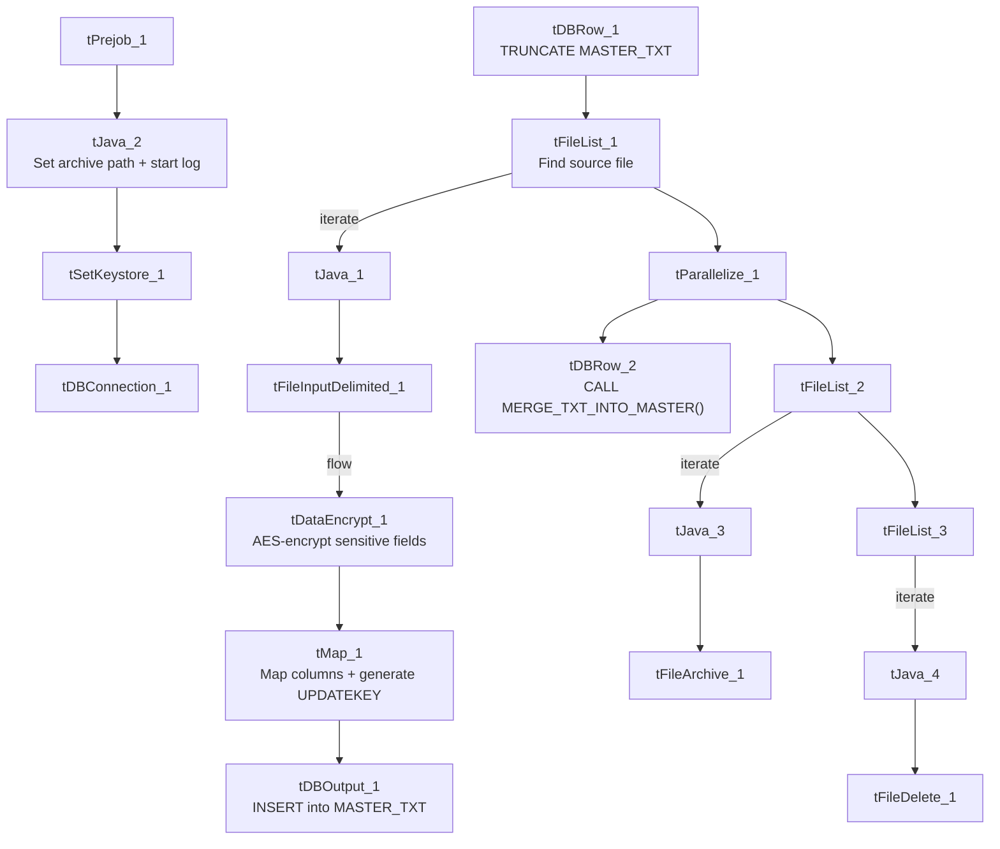

# Talend Job: Master_Table_Text_Load

## Overview

This job loads the core "master" account record (the primary debtor/account table — name, address, balances across ten aging buckets, desk/queue assignment, attorney and rehab/AWG/consolidation eligibility fields, SSN, and more) into Snowflake. It follows the standard truncate → load → merge → archive/delete pattern, with one addition not seen in most peer jobs: the source data is run through a `tDataEncrypt` component before being mapped and loaded, presumably to encrypt sensitive fields (e.g. SSN) at rest in the staging table.

**Important — shared staging table and merge procedure:** this job writes to staging table `MASTER_TXT` and calls `MERGE_TXT_INTO_MASTER()`, and so does a separate job, `Master_Table_Text_Load_HC15` (documented separately). Both jobs truncate and load the *same* staging table and invoke the *same* merge procedure. If both jobs are scheduled to run close together, one job's `TRUNCATE`/load could wipe out or collide with the other's in-flight data before its merge runs — see Issues observed.

## Detail table

| Field | Value |
|---|---|
| Job name | Master_Table_Text_Load |
| Version | 0.1 |
| Project | LATITUDE |
| Author | jmach@harriscollect.com |
| Created | 2024-10-18T09:16:38.643-0700 |
| Last Modified | 2026-07-12T13:06:41.008-0700 |

## Step-by-step data flow

1. **Set up.** `tPrejob_1` triggers `tJava_2`, which appends today's date to `context.archiveDir` and opens a log file; this chains into `tSetKeystore_1` and `tDBConnection_1`.
2. **Empty the staging table.** `tDBRow_1` runs `TRUNCATE TABLE MASTER_TXT;` (no explicit schema prefix — see Issues observed).
3. **Find the file.** `tFileList_1` lists files in `context.sourceDir` (skipping `*.txt`), with no explicit sort order.
4. **Read the file.** `tFileInputDelimited_1` reads it as pipe-delimited (`|~|`/`|$|`), US-ASCII encoded, with `DIE_ON_ERROR: true` (unlike most peer jobs, which set this to `false`) — meaning a malformed row here stops the job outright rather than continuing.
5. **Encrypt sensitive fields.** `tDataEncrypt_1` runs the row set through AES encryption (`CRYPTO_METHOD: AES`, `ALGO_VERSION: 2`) before mapping, using a key file at `context.cryptoPath` — a context variable not present in the `Directories_0.1` group provided in this metadata (see Issues observed).
6. **Transform.** `tMap_1` maps the encrypted/source columns onto the `MASTER_TXT` schema, adding `LOAD_DT` and an `UPDATEKEY` column not present in the raw input (likely a generated merge key — its derivation isn't visible in this metadata).
7. **Load staging.** Mapped rows flow directly into `tDBOutput_1` (no row counter), inserting into `MASTER_TXT`.
8. **Merge and clean up — in parallel.** Once the file-list subjob completes, `tParallelize_1` splits into: `tDBRow_2` calling `CALL MERGE_TXT_INTO_MASTER();`, and a file-listing chain (`tFileList_2` → archive; then `tFileList_3` → delete).

## Settings tables

### Source: `tFileInputDelimited_1`

| Setting | Value | What it means |
|---|---|---|
| FILENAME | `context.filePath` | Reads whichever file `tFileList_1` just found. |
| FIELDSEPARATOR / ROWSEPARATOR | `\|~\|` / `\|$\|` | Standard project pipe-delimited format. |
| ENCODING | US-ASCII | Plain ASCII text. |
| DIE_ON_ERROR | true | A malformed row fails the job immediately — stricter than most peer load jobs. |

### Encryption: `tDataEncrypt_1`

| Setting | Value | What it means |
|---|---|---|
| CRYPTO_METHOD | AES | Uses AES symmetric encryption on the row data. |
| ALGO_VERSION | 2 | Selects a specific version of Talend's encryption algorithm implementation. |
| CRYPTO_FILE_PATH | `context.cryptoPath` | Points to the key/config file used for encryption — this context variable is not documented in the `Directories_0.1` group provided; see Issues observed. |
| SECRET_TYPE / SECRET_KEY / PASSWORD_M1 | (redacted) | Encryption key material — not visible in this metadata. |

### Target: `tDBOutput_1`

| Setting | Value | What it means |
|---|---|---|
| Table | MASTER_TXT | Staging table for the master account record. |
| Output action | INSERT | Adds rows only. |

### Merge step: `tDBRow_2`

| Setting | Value | What it means |
|---|---|---|
| Query | `CALL MERGE_TXT_INTO_MASTER();` | Snowflake procedure that folds staged rows into the permanent `MASTER` table — shared with `Master_Table_Text_Load_HC15`. |

## Dependencies & configuration

- **Triggers/depends on other jobs:** none found — no `tRunJob` links. (Note: this job does *not* call `Master_Table_Text_Load_HC15`, nor vice versa, per the metadata — they are independent jobs that happen to target the same staging table and procedure; see Issues observed.)
- **Context variables used:** `context.sourceDir`, `context.archiveDir`, `context.filePath`, `context.fileName`, `context.logDir`, `context.keystorePath`, plus `context.cryptoPath` (used only by `tDataEncrypt_1` and not part of the `Directories_0.1` group in the shared context data). Uses the shared Snowflake connection object, not `LEGACY_DW_*` variables directly.
- **Hardcoded values found:** `tFileInputDelimited_1.TEMP_DIR`, `tFileArchive_1.SOURCE_FILE`, `tFileDelete_1.DIRECTORY`/`PATH`, and `tSetKeystore_1.SSL_TRUSTSERVER_TRUSTSTORE` are fixed paths rather than context variables.

## Glossary

| Component type | Plain-English meaning |
|---|---|
| `tPrejob` / `tParallelize` | Setup-before-main-start, concurrent branches (see job_Address_Text_Load.md). |
| `tFileList` | Lists files for the job to loop over (see job_Address_Text_Load.md). |
| `tFileInputDelimited` | Reads a delimited text file (see job_Address_Text_Load.md). |
| `tMap` | Maps/transforms columns (see job_Address_Text_Load.md). |
| `tDBOutput` / `tSnowflakeOutput` | Writes rows into Snowflake (see job_Address_Text_Load.md). |
| `tDBRow` / `tSnowflakeRow` | Runs a single SQL statement (see job_Address_Text_Load.md). |
| `tJava` | Custom Java code block (see job_Address_Text_Load.md). |
| `tFileArchive` | Zips a file into an archive location (see job_Address_Text_Load.md). |
| `tFileDelete` | Deletes a file from disk (see job_Address_Text_Load.md). |
| `tSetKeystore` | Configures the SSL keystore for the Snowflake connection (see job_Address_Text_Load.md). |
| `tDataEncrypt` | *(Not covered in the reference docs.)* Encrypts row data in-flight using a configured algorithm (here AES) and key file, before it's written downstream — used here to protect sensitive fields (most likely SSN and similar) before they land in Snowflake staging. |

## Issues observed

- **Shares a staging table and merge procedure with `Master_Table_Text_Load_HC15`.** Both jobs truncate/load `MASTER_TXT` and call `MERGE_TXT_INTO_MASTER()`. If they run close together (overlapping schedules), one job's truncate or insert could interleave with the other's in-flight staging data before either merge executes, risking lost or duplicated rows in the merge step. This is flagged project-wide in `06_dependency_matrix.md` — confirm the two jobs' schedules never overlap, or that there's an external locking/sequencing mechanism not visible in this metadata.
- **`context.cryptoPath` is referenced but not documented in the shared `Directories_0.1` context group** provided for this analysis — its actual value (and thus where the encryption key file lives) is unable to be determined from metadata; verify with the team.
- **`DIE_ON_ERROR` is `true`** on `tFileInputDelimited_1`, unlike most peer text-load jobs (`false`) — a single malformed row in the source file will stop this job rather than skip/reject the row, which is a stricter and inconsistent posture worth confirming is intentional given how central the `MASTER` table is.
- **The staging truncate doesn't qualify its schema** (`TRUNCATE TABLE MASTER_TXT;`, no `LIQUID_STAGING.` prefix) — same pattern as other jobs in this batch.
- **The merge procedure's own logic is outside Talend** and not visible in this metadata.
