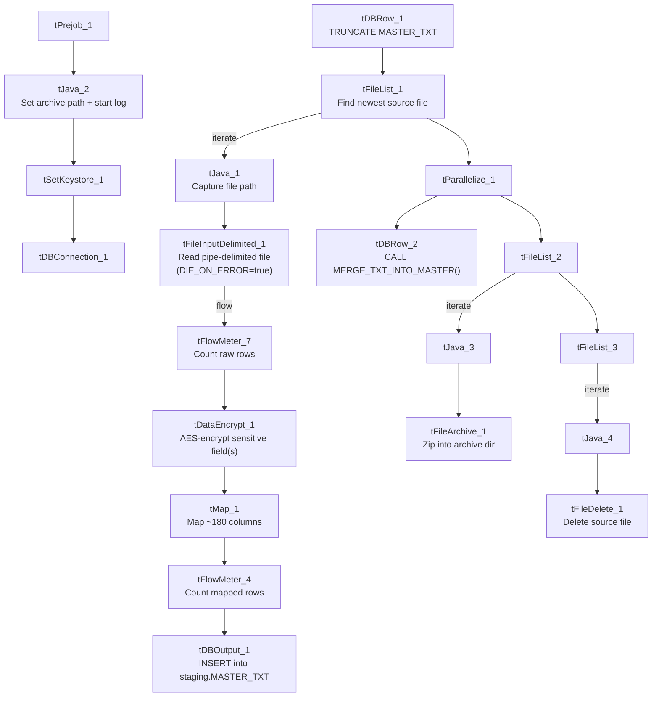

# Talend Job: Master_Table_Text_Load_HC15

## Overview

This job loads the "master" debtor/account record — the single widest table in this batch, with roughly 180 business columns covering name/address, balances, dates, queue/desk assignment, attorney and legal-status fields, portfolio/placement history, and an SSN field — from a shared folder into Snowflake. It follows the project's standard truncate-load-merge-archive pattern (see `job_Address_Text_Load.md`), but adds one step none of this batch's other jobs have: a `tDataEncrypt` component that encrypts the row data before it reaches the `tMap` transform. It writes to the same staging table (`MASTER_TXT`) and calls the same merge procedure (`MERGE_TXT_INTO_MASTER()`) as a separate job, `Master_Table_Text_Load` — see Issues observed for the collision risk this creates. It has no scheduling information in this metadata — something outside Talend decides when it runs.

## Detail table

| Field | Value |
|---|---|
| Job name | Master_Table_Text_Load_HC15 |
| Version | 0.1 |
| Project | LATITUDE |
| Author | jmach@harriscollect.com |
| Created | 2026-07-12T13:21:02.519-0700 |
| Last Modified | 2026-07-12T13:37:05.892-0700 |

## Step-by-step data flow

1. **Set up.** `tPrejob_1` starts the job; `tJava_2` appends today's date to `context.archiveDir` and opens a log file; `tSetKeystore_1` configures the SSL client keystore; `tDBConnection_1` opens the Snowflake connection.
2. **Empty the staging table.** In a separate, parallel start point, `tDBRow_1` runs `TRUNCATE TABLE MASTER_TXT;`.
3. **Find and read the file.** `tFileList_1` lists files in `context.sourceDir` (skipping `.txt`); `tJava_1` captures the found path into `context.filePath`; `tFileInputDelimited_1` reads it as a pipe-delimited, US-ASCII-encoded file (using the repository schema named `master`) with a header row. `DIE_ON_ERROR` is set to `true` here — a malformed row stops the job rather than being skipped.
4. **Count, then encrypt.** The raw rows pass through a row counter (`tFlowMeter_7`) and then into `tDataEncrypt_1`, which encrypts the row data using AES before it's transformed (see Settings tables and Issues observed — the specific column(s) targeted for encryption aren't captured explicitly in this metadata, though the schema at this point includes an `SSN` field).
5. **Transform, count again, and load.** `tMap_1` maps the (now partly encrypted) ~180 columns onto the `MASTER_TXT` schema, adding `LOAD_DT`. The mapped rows pass through a second row counter (`tFlowMeter_4`) into `tDBOutput_1`, which inserts them into Snowflake.
6. **Merge and clean up — in parallel.** `tParallelize_1` splits into two branches once the file has been listed:
   - **Merge branch:** `tDBRow_2` calls `CALL MERGE_TXT_INTO_MASTER();`.
   - **Cleanup branch:** the source file is listed again and archived (`tFileArchive_1`, zipped into `context.archiveDir`); it's also listed a third time and deleted (`tFileDelete_1`).

## Settings tables

### Source: `tFileInputDelimited_1`

| Setting | Value | What it means |
|---|---|---|
| FILENAME | `context.filePath` | Reads whichever file `tFileList_1` just found. |
| FIELDSEPARATOR / ROWSEPARATOR | `\|~\|` / `\|$\|` | The project's standard pipe-delimited format. |
| HEADER | 1 | First line is a header, not data. |
| ENCODING | US-ASCII | Plain ASCII, not ISO-8859-15. |
| DIE_ON_ERROR | true | A malformed row fails the job immediately rather than being skipped — same as `cmi_CapioSellerContracts_Table_Text_Load`, differs from most peers. |
| SCHEMA_REJECT:REPOSITORY_SCHEMA_TYPE | `master` (repository schema) | Uses the same centrally-defined "master" column layout referenced by `DebtorCC_Table_Text_Load`'s reject schema. |
| EXCLUDEFILEMASK (on `tFileList_1`) | `*.txt` | `.txt` files are skipped. |

### Encryption: `tDataEncrypt_1`

| Setting | Value | What it means |
|---|---|---|
| CRYPTO_METHOD | AES | Uses AES symmetric encryption. |
| ALGO_VERSION | 2 | A version marker for the encryption algorithm/library used — the specific implementation detail lives outside this metadata. |
| SECRET_TYPE / SECRET_KEY / PASSWORD_M1 | `***REDACTED***` | The encryption key material itself is redacted in this metadata, as expected for a secret. |
| CRYPTO_FILE_PATH | `context.cryptoPath` | Points at a file used by the encryption process — this context variable is **not** one of the `Directories_0.1` variables documented in `_shared_context.json` (see Issues observed). |
| Which column(s) are encrypted | Unable to determine from metadata — verify with team | The component's schema carries the full ~180-column master record (including `SSN`), but the specific field(s) actually run through AES encryption aren't captured in the extracted parameters. Given the schema includes an `SSN` column, that's a reasonable guess, but it isn't confirmed here. |

### Target: `tDBOutput_1`

| Setting | Value | What it means |
|---|---|---|
| Table | MASTER_TXT | Loads the staging copy of the master table — **the same staging table name used by the separate job `Master_Table_Text_Load`** (see Issues observed). |
| Output action | INSERT | Adds rows only. |
| Table action | NONE | Truncation is handled separately by `tDBRow_1`. |

### Merge step: `tDBRow_2`

| Setting | Value | What it means |
|---|---|---|
| Query | `CALL MERGE_TXT_INTO_MASTER();` | Folds staged rows into the permanent table — **the same stored procedure called by `Master_Table_Text_Load`** (see Issues observed). |

## Dependencies & configuration

- **Triggers/depends on other jobs:** none found — no `tRunJob` links in either direction.
- **Context variables used:** `context.sourceDir`, `context.archiveDir`, `context.filePath`, `context.fileName`, `context.logDir`, `context.keystorePath` (all `Directories_0.1`), plus `context.cryptoPath`, which is used by `tDataEncrypt_1` but is not part of the `Directories_0.1` group as documented in `_shared_context.json` (see Issues observed).
- **LEGACY_DW usage:** none — this job uses the shared Snowflake connection object, not `LEGACY_DW_0.1` variables directly.
- **Shared-resource risk:** this job shares its staging table (`MASTER_TXT`) and merge procedure (`MERGE_TXT_INTO_MASTER()`) with `Master_Table_Text_Load`. If both jobs run close together — e.g., overlapping schedules, or one kicked off manually while the other is mid-run — one job's `TRUNCATE` or `INSERT` could interleave with the other's read of the same staging table, corrupting or dropping rows before the merge runs. This is the same risk flagged project-wide in `06_dependency_matrix.md`.

## Glossary

| Component type | Plain-English meaning |
|---|---|
| `tPrejob` / `tParallelize` | Job-flow control. (see `job_Address_Text_Load.md`) |
| `tFileList` | Lists files in a folder so the job can loop over them. (see `job_Address_Text_Load.md`) |
| `tFileInputDelimited` | Reads a delimited text file row by row. (see `job_Address_Text_Load.md`) |
| `tFlowMeter` | Counts rows passing through a point in the job — used twice here, once before and once after the encryption/mapping steps. (see `job_Address_Text_Load.md`) |
| `tMap` | Maps/transforms columns from input to output. (see `job_Address_Text_Load.md`) |
| `tDBOutput` / `tSnowflakeOutput` | Writes rows into a Snowflake table. (see `job_Address_Text_Load.md`) |
| `tDBRow` / `tSnowflakeRow` | Runs a single SQL statement — used here for `TRUNCATE` and `CALL <procedure>`. (see `job_Address_Text_Load.md`) |
| `tJava` | A small block of custom Java code. (see `job_Address_Text_Load.md`) |
| `tFileArchive` | Compresses a file into a `.zip` and archives it. (see `job_Address_Text_Load.md`) |
| `tFileDelete` | Deletes a file from disk. (see `job_Address_Text_Load.md`) |
| `tSetKeystore` | Configures the SSL keystore for the Snowflake connection. (see `job_Address_Text_Load.md`) |
| `tDataEncrypt` | Encrypts one or more fields in each row before they continue down the flow — here configured for AES encryption, keyed via a secret and a crypto file referenced by `context.cryptoPath`. Not covered in the three reference docs. This is the encryption counterpart to a `tDataDecrypt` step (which would reverse the process on read); this job only encrypts, it doesn't decrypt anything. |

## Issues observed

- **Shares its staging table and merge procedure with `Master_Table_Text_Load`.** Both this job and `Master_Table_Text_Load` write to `MASTER_TXT` and call `MERGE_TXT_INTO_MASTER()`. If the two jobs are ever scheduled to run at overlapping times, one job's `TRUNCATE TABLE MASTER_TXT;` or `INSERT` could interfere with the other's in-flight staging data, corrupting or silently dropping rows before either merge runs. This mirrors the collision risk already flagged project-wide in `06_dependency_matrix.md` and should be treated as a scheduling constraint (the two jobs should never run concurrently) until/unless the staging design is revisited.
- **`context.cryptoPath` is referenced but not documented in `_shared_context.json`'s `Directories_0.1` group.** Every other context variable this job (and its peers) use is part of that documented group; `cryptoPath` is not, meaning its actual dev/prod values aren't visible in the shared context metadata provided. Confirm where this variable is defined and what it points to.
- **The exact field(s) encrypted by `tDataEncrypt_1` aren't captured in this metadata.** The component's schema includes an `SSN` column among ~180 others, making SSN a reasonable candidate for the encrypted field, but this is not confirmed — verify directly in Talend Studio or with the job's author.
- **`DIE_ON_ERROR` is `true` on the file reader**, same as `cmi_CapioSellerContracts_Table_Text_Load` — a single malformed row stops the whole job rather than being logged and skipped. Given this table's width (~180 columns) and central importance, that's plausibly intentional, but worth confirming.
- **No explicit error handling on the merge step** (no `tDie`/`tWarn`), same as most peers — a failed `MERGE_TXT_INTO_MASTER()` call would only surface as a generic Talend error.
- **The merge procedure's own logic is outside Talend**, same caveat as every other job that calls a `MERGE_TXT_INTO_*` procedure.
