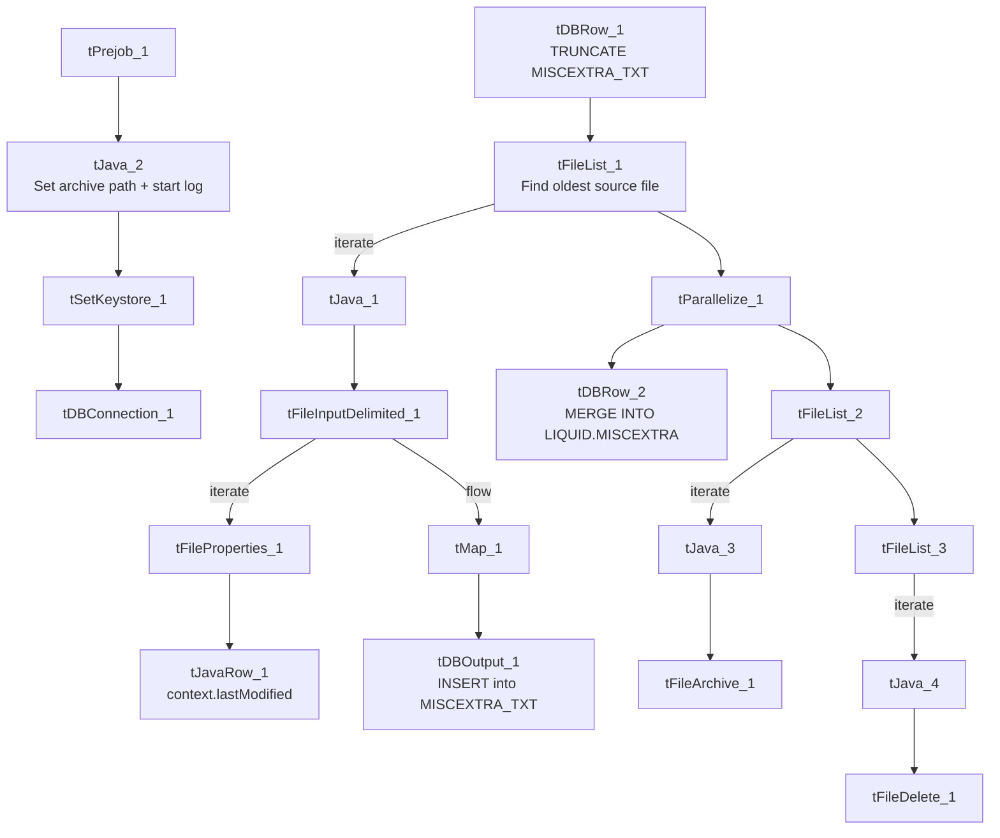

# Talend Job: MiscExtra_Text_Load

## Overview

This job loads a small, generic "miscellaneous extra data" table (`MISCEXTRA` — just an ID, a number, a title, and a data blob) into Snowflake. It follows the truncate → load → merge → archive/delete pattern, but is one of the project's exceptions to the "merge via stored procedure" rule: instead of calling a `MERGE_TXT_INTO_*` procedure, it runs a `MERGE INTO ... USING ...` statement written directly in the job, which also reveals — unusually for this batch of jobs — the actual name and schema of the permanent target table (`LIQUID.MISCEXTRA`).

## Detail table

| Field | Value |
|---|---|
| Job name | MiscExtra_Text_Load |
| Version | 0.1 |
| Project | LATITUDE |
| Author | jmach@harriscollect.com |
| Created | 2024-11-21T12:12:25.303-0800 |
| Last Modified | 2025-10-01T13:39:24.081-0700 |

## Step-by-step data flow

1. **Set up.** `tPrejob_1` → `tJava_2` (appends today's date to `context.archiveDir`, opens a log file) → `tSetKeystore_1` → `tDBConnection_1`.
2. **Empty the staging table.** `tDBRow_1` runs `TRUNCATE TABLE MISCEXTRA_TXT;` (no `LIQUID_STAGING.` schema prefix).
3. **Find and read the file.** `tFileList_1` lists files in `context.sourceDir` (excluding `*.txt`), **sorted by modified date, oldest first**; `tJava_1` captures the path; `tFileInputDelimited_1` reads it (`|~|`/`|$|`, header row, US-ASCII, `DIE_ON_ERROR`=false).
   - The same read also feeds `tFileProperties_1` (per file, gets the last-modified time) → `tJavaRow_1` (stores it in `context.lastModified`).
4. **Transform and load staging.** `tMap_1` maps the file's four columns (`ID`, `Number`, `TheData`, `Title`) onto the staging schema, adding `LASTMODIFIED` and `LOAD_DT`. Rows flow into `tDBOutput_1`, which inserts them into `MISCEXTRA_TXT`.
5. **Merge and clean up — in parallel.** `tParallelize_1` splits into:
   - **Merge branch:** `tDBRow_2` runs an **inline `MERGE INTO`** statement (not a stored-procedure call) that folds `LIQUID_STAGING.MISCEXTRA_TXT` into `LIQUID.MISCEXTRA` (see Settings tables for the full SQL), keeping only the latest row per `ID` and updating only when the incoming row is newer.
   - **Cleanup branch:** `tFileList_2` → `tJava_3` (captures path + name) → `tFileArchive_1` (zips into `context.archiveDir`); and `tFileList_3` → `tJava_4` (captures path + name) → `tFileDelete_1` (deletes the source file).

## Settings tables

### Source: `tFileInputDelimited_1`

| Setting | Value | What it means |
|---|---|---|
| FILENAME | `context.filePath` | Reads whichever file `tFileList_1` just found. |
| FIELDSEPARATOR / ROWSEPARATOR | `\|~\|` / `\|$\|` | Standard project pipe-delimited format. |
| ENCODING | US-ASCII | Plain ASCII. |
| DIE_ON_ERROR | false | Malformed rows are skipped/logged rather than failing the job. |
| ORDER_BY_MODIFIEDDATE (on `tFileList_1`) | true, ascending | Oldest unprocessed file is picked up first. |
| TEMP_DIR | `"C:/Talend-Studio-.../workspace"` | Hardcoded Windows path. |

### Target: `tDBOutput_1`

| Setting | Value | What it means |
|---|---|---|
| Table | MISCEXTRA_TXT | Loads into the staging copy of the table. |
| Output action | INSERT | Adds rows only. |
| Table action | NONE | Table structure untouched. |

### Merge step: `tDBRow_2` (inline SQL, not a stored procedure)

| Setting | Value | What it means |
|---|---|---|
| Query | `MERGE INTO LIQUID.MISCEXTRA AS tgt USING (SELECT ID, LOAD_DT, NUMBER, TITLE, THEDATA, LASTMODIFIED FROM LIQUID_STAGING.MISCEXTRA_TXT QUALIFY ROW_NUMBER() OVER (PARTITION BY ID ORDER BY LASTMODIFIED DESC) = 1) AS src ON (tgt.ID=src.ID) WHEN MATCHED AND ((src.LASTMODIFIED > tgt.LASTMODIFIED) OR (tgt.LASTMODIFIED IS NULL)) THEN UPDATE SET ... WHEN NOT MATCHED THEN INSERT (...)` | Rather than calling an opaque stored procedure like most peer jobs, this merge is written directly in the job: it de-duplicates staged rows by `ID` (keeping only the most recently modified one via `QUALIFY ROW_NUMBER()...=1`), then updates the permanent `LIQUID.MISCEXTRA` table only if the incoming row is newer (or the target has no `LASTMODIFIED` yet), and inserts brand-new `ID`s. This is one of the few places in this documentation set where the actual permanent-table name and schema (`LIQUID.MISCEXTRA`, as opposed to the staging schema `LIQUID_STAGING`) is directly visible. |

## Dependencies & configuration

- **Triggers/depends on other jobs:** none found — no `tRunJob` links.
- **Context variables used:** `context.sourceDir`, `context.archiveDir`, `context.filePath`, `context.fileName`, `context.logDir`, `context.keystorePath`, `context.lastModified` (all `Directories_0.1` or job-local). Uses the shared Snowflake connection object, not `LEGACY_DW_0.1` variables directly.

## Glossary

| Component type | Plain-English meaning |
|---|---|
| `tPrejob` / `tParallelize` | Job-flow control (see job_Address_Text_Load.md). |
| `tSnowflakeConnection` (`tDBConnection`) | Opens the shared Snowflake connection (see job_Bankruptcy_Text_Load.md). |
| `tFileList` | Lists files for iteration (see job_Address_Text_Load.md). |
| `tFileInputDelimited` | Reads a delimited text file (see job_Address_Text_Load.md). |
| `tFileProperties` | Reads file-system metadata (see job_Address_Text_Load.md). |
| `tJavaRow` | Custom code that runs once per row (see job_cmi_Hermes_Recommendations_Load.md). |
| `tMap` | Maps/transforms columns (see job_Address_Text_Load.md). |
| `tDBOutput` / `tSnowflakeOutput` | Writes rows to Snowflake (see job_Address_Text_Load.md). |
| `tDBRow` / `tSnowflakeRow` | Runs a single SQL statement (see job_Address_Text_Load.md) — here running a full `MERGE INTO` statement rather than a `CALL` to a stored procedure. |
| `tJava` | Custom Java code block (see job_Address_Text_Load.md). |
| `tFileArchive` | Zips a file into an archive location (see job_Address_Text_Load.md). |
| `tFileDelete` | Deletes a file (see job_Address_Text_Load.md). |
| `tSetKeystore` | Configures the SSL keystore (see job_Address_Text_Load.md). |

## Issues observed

- **This is one of the project's exceptions to the "merge via stored procedure" convention** — the merge logic (de-dup by latest `LASTMODIFIED`, conditional update, insert-if-new) is written directly into the job as a `MERGE INTO` statement rather than calling a `MERGE_TXT_INTO_*` procedure. This is not a defect, but it means this job's merge logic is fully auditable from Talend, unlike its peers.
- **`TRUNCATE TABLE MISCEXTRA_TXT;` omits the `LIQUID_STAGING.` schema prefix** used explicitly elsewhere — likely resolves correctly if the connection's default schema is already `LIQUID_STAGING`, but worth confirming.
- **Hardcoded, machine-specific paths** on `tFileInputDelimited_1.TEMP_DIR`, `tFileArchive_1.SOURCE_FILE`, `tFileDelete_1.DIRECTORY`/`PATH`, and `tSetKeystore_1.SSL_TRUSTSERVER_TRUSTSTORE` — the same project-wide pattern seen elsewhere.
