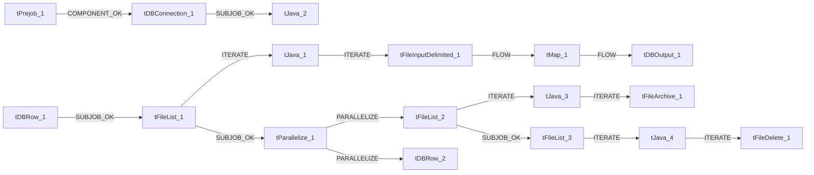

# Talend Job: PDC_Text_Load

- **Project**: LATITUDE
- **Version**: 0.1
- **Job Type**: Standard

- **Author**: jmach@harriscollect.com
- **Created**: 2024-11-27T11:19:28.352-0800
- **Last Modified**: 2025-09-25T08:24:12.084-0700

## Components

| # | Component | Type | Key Parameters |
|---|-----------|------|----------------|
| 1 | tDBConnection_1 | `tSnowflakeConnection` | `CONNECTION_FORMAT`=row, `PROPERTIES`={"@id":2,"@type":"org.talend.components.snowflake. |
| 2 | tFileList_1 | `tFileList` | `DIRECTORY`=context.sourceDir, `LIST_MODE`=FILES, `INCLUDSUBDIR`=false, `CASE_SENSITIVE`=YES, `ERROR`=false |
| 3 | tJava_1 | `tJava` | `CODE`=context.filePath=((String)globalMap.get("tFileList, `IMPORT`=//import java.util.List;, `CONNECTION_FORMAT`=row |
| 4 | tFileInputDelimited_1 | `tFileInputDelimited` | `USE_EXISTING_DYNAMIC`=false, `FILENAMETEXT`="When the input source is a stream or a zip file,f, `FILENAME`=context.filePath, `CSV_OPTION`=false, `ROWSEPARATOR`="|$|" |
| 5 | tMap_1 | `tMap` | `LINK_STYLE`=AUTO, `DIE_ON_ERROR`=true, `LKUP_PARALLELIZE`=false, `LEVENSHTEIN`=0, `JACCARD`=0 |
| 6 | tDBOutput_1 | `tSnowflakeOutput` | `CONNECTION_FORMAT`=row, `PROPERTIES`={"@id":3,"@type":"org.talend.components.snowflake. |
| 7 | tDBRow_1 | `tSnowflakeRow` | `CONNECTION_FORMAT`=row, `PROPERTIES`={"@id":3,"@type":"org.talend.components.snowflake. |
| 8 | tDBRow_2 | `tSnowflakeRow` | `CONNECTION_FORMAT`=row, `PROPERTIES`={"@id":3,"@type":"org.talend.components.snowflake. |
| 9 | tPrejob_1 | `tPrejob` | `CONNECTION_FORMAT`=row |
| 10 | tJava_2 | `tJava` | `CODE`=context.archiveDir = context.archiveDir + TalendDa, `IMPORT`=//import java.util.List;, `CONNECTION_FORMAT`=row |
| 11 | tFileList_2 | `tFileList` | `DIRECTORY`=context.sourceDir, `LIST_MODE`=FILES, `INCLUDSUBDIR`=false, `CASE_SENSITIVE`=YES, `ERROR`=false |
| 12 | tJava_3 | `tJava` | `CODE`=context.filePath = ((String)globalMap.get("tFileLi, `IMPORT`=//import java.util.List;, `CONNECTION_FORMAT`=row |
| 13 | tFileArchive_1 | `tFileArchive` | `SOURCE`=context.sourceDir, `SOURCE_FILE`="C:/Talend-Studio-20211109_1610-V8.0.1/workspace/s, `SUB_DIRECTROY`=false, `TARGET`=context.archiveDir + context.fileName+".zip", `MKDIR`=true |
| 14 | tFileList_3 | `tFileList` | `DIRECTORY`=context.sourceDir, `LIST_MODE`=FILES, `INCLUDSUBDIR`=false, `CASE_SENSITIVE`=YES, `ERROR`=false |
| 15 | tJava_4 | `tJava` | `CODE`=context.filePath = ((String)globalMap.get("tFileLi, `IMPORT`=//import java.util.List;, `CONNECTION_FORMAT`=row |
| 16 | tFileDelete_1 | `tFileDelete` | `FILENAME`=context.filePath, `DIRECTORY`="C:/Talend-Studio-20211109_1610-V8.0.1/workspace/d, `PATH`="C:/Talend-Studio-20211109_1610-V8.0.1/workspace/d, `FAILON`=false, `FOLDER`=false |
| 17 | tParallelize_1 | `tParallelize` | `WAIT_FOR`=All, `SLEEPTIME`=100, `DIE_ON_ERROR`=false, `CONNECTION_FORMAT`=row |

## Schemas

### tFileInputDelimited_1

| Column | Type | Nullable | Length |
|--------|------|----------|--------|
| UID | id_Integer | Yes | -1 |
| number | id_Integer | Yes | -1 |
| ctl | id_String | Yes | 3 |
| PDC_Type | id_Integer | Yes | -1 |
| entered | id_String | Yes | 30 |
| onhold | id_String | Yes | 30 |
| processed1 | id_String | Yes | 30 |
| processedflag | id_String | Yes | 1 |
| deposit | id_String | Yes | 30 |
| amount | id_String | Yes | 20 |
| checknbr | id_String | Yes | 10 |
| SEQ | id_Integer | Yes | -1 |
| LtrCode | id_String | Yes | 5 |
| nitd | id_String | Yes | 30 |
| Desk | id_String | Yes | 10 |
| customer | id_String | Yes | 7 |
| fill1 | id_String | Yes | 255 |
| fill2 | id_String | Yes | 255 |
| fill3 | id_String | Yes | 255 |
| fill4 | id_String | Yes | 255 |
| fill5 | id_String | Yes | 255 |
| SurCharge | id_String | Yes | 20 |
| Printed | id_Integer | Yes | -1 |
| ApprovedBy | id_String | Yes | 20 |
| PromiseMode | id_Integer | Yes | -1 |
| ProjectedFee | id_String | Yes | 20 |
| UseProjectedFee | id_Integer | Yes | -1 |
| Active | id_Integer | Yes | -1 |
| CollectorFee | id_String | Yes | 20 |
| DateCreated | id_String | Yes | 30 |
| DateUpdated | id_String | Yes | 30 |
| CreatedBy | id_String | Yes | 255 |
| SurchargeCheckNbr | id_String | Yes | 10 |
| DepositToGeneralTrust | id_Integer | Yes | -1 |
| DebtorBankID | id_Integer | Yes | -1 |
| ArrangementID | id_Integer | Yes | -1 |
| NSFCount | id_Integer | Yes | -1 |
| PrintedDate | id_String | Yes | 30 |
| ProcessStatus | id_String | Yes | 25 |
| PaymentLinkUID | id_Integer | Yes | -1 |
| IsBatched | id_Integer | Yes | -1 |
| PaymentVendorTokenId | id_Integer | Yes | -1 |
| IsExternallyManaged | id_Integer | Yes | -1 |
| DownPaymentInstallment | id_Integer | Yes | -1 |
| UID | id_Integer | Yes | -1 |
| number | id_Integer | Yes | -1 |
| ctl | id_String | Yes | 3 |
| PDC_Type | id_Integer | Yes | -1 |
| entered | id_String | Yes | 30 |
| onhold | id_String | Yes | 30 |
| processed1 | id_String | Yes | 30 |
| processedflag | id_String | Yes | 1 |
| deposit | id_String | Yes | 30 |
| amount | id_String | Yes | 20 |
| checknbr | id_String | Yes | 10 |
| SEQ | id_Integer | Yes | -1 |
| LtrCode | id_String | Yes | 5 |
| nitd | id_String | Yes | 30 |
| Desk | id_String | Yes | 10 |
| customer | id_String | Yes | 7 |
| fill1 | id_String | Yes | 255 |
| fill2 | id_String | Yes | 255 |
| fill3 | id_String | Yes | 255 |
| fill4 | id_String | Yes | 255 |
| fill5 | id_String | Yes | 255 |
| SurCharge | id_String | Yes | 20 |
| Printed | id_Integer | Yes | -1 |
| ApprovedBy | id_String | Yes | 20 |
| PromiseMode | id_Integer | Yes | -1 |
| ProjectedFee | id_String | Yes | 20 |
| UseProjectedFee | id_Integer | Yes | -1 |
| Active | id_Integer | Yes | -1 |
| CollectorFee | id_String | Yes | 20 |
| DateCreated | id_String | Yes | 30 |
| DateUpdated | id_String | Yes | 30 |
| CreatedBy | id_String | Yes | 255 |
| SurchargeCheckNbr | id_String | Yes | 10 |
| DepositToGeneralTrust | id_Integer | Yes | -1 |
| DebtorBankID | id_Integer | Yes | -1 |
| ArrangementID | id_Integer | Yes | -1 |
| NSFCount | id_Integer | Yes | -1 |
| PrintedDate | id_String | Yes | 30 |
| ProcessStatus | id_String | Yes | 25 |
| PaymentLinkUID | id_Integer | Yes | -1 |
| IsBatched | id_Integer | Yes | -1 |
| PaymentVendorTokenId | id_Integer | Yes | -1 |
| IsExternallyManaged | id_Integer | Yes | -1 |
| DownPaymentInstallment | id_Integer | Yes | -1 |
| errorCode | id_String | Yes | 255 |
| errorMessage | id_String | Yes | 255 |

### tMap_1

| Column | Type | Nullable | Length |
|--------|------|----------|--------|
| LOAD_DT | id_Date | Yes | -1 |
| UID | id_Integer | No | -1 |
| NUMBER | id_Integer | Yes | -1 |
| CTL | id_String | Yes | 3 |
| PDC_TYPE | id_Integer | Yes | -1 |
| ENTERED | id_String | Yes | 30 |
| ONHOLD | id_String | Yes | 30 |
| PROCESSED1 | id_String | Yes | 30 |
| PROCESSEDFLAG | id_String | Yes | 1 |
| DEPOSIT | id_String | Yes | 30 |
| AMOUNT | id_String | Yes | 20 |
| CHECKNBR | id_String | Yes | 10 |
| SEQ | id_Integer | Yes | -1 |
| LTRCODE | id_String | Yes | 5 |
| NITD | id_String | Yes | 30 |
| DESK | id_String | Yes | 10 |
| CUSTOMER | id_String | Yes | 7 |
| FILL1 | id_String | Yes | 255 |
| FILL2 | id_String | Yes | 255 |
| FILL3 | id_String | Yes | 255 |
| FILL4 | id_String | Yes | 255 |
| FILL5 | id_String | Yes | 255 |
| SURCHARGE | id_String | Yes | 20 |
| PRINTED | id_Integer | Yes | -1 |
| APPROVEDBY | id_String | Yes | 20 |
| PROMISEMODE | id_Integer | Yes | 38 |
| PROJECTEDFEE | id_String | Yes | 20 |
| USEPROJECTEDFEE | id_Integer | No | 38 |
| ACTIVE | id_Integer | No | 38 |
| COLLECTORFEE | id_String | Yes | 20 |
| DATECREATED | id_String | Yes | 30 |
| DATEUPDATED | id_String | Yes | 30 |
| CREATEDBY | id_String | Yes | 255 |
| SURCHARGECHECKNBR | id_String | Yes | 10 |
| DEPOSITTOGENERALTRUST | id_Integer | No | -1 |
| DEBTORBANKID | id_Integer | Yes | -1 |
| ARRANGEMENTID | id_Integer | Yes | -1 |
| NSFCOUNT | id_Integer | Yes | -1 |
| PRINTEDDATE | id_String | Yes | 30 |
| PROCESSSTATUS | id_String | Yes | 25 |
| PAYMENTLINKUID | id_Integer | Yes | -1 |
| ISBATCHED | id_Integer | Yes | -1 |
| PAYMENTVENDORTOKENID | id_Integer | Yes | -1 |
| ISEXTERNALLYMANAGED | id_Integer | Yes | -1 |
| DOWNPAYMENTINSTALLMENT | id_Integer | Yes | 38 |

### tDBOutput_1

| Column | Type | Nullable | Length |
|--------|------|----------|--------|
| LOAD_DT | id_Date | Yes | -1 |
| UID | id_Integer | No | 38 |
| NUMBER | id_Integer | Yes | 38 |
| CTL | id_String | Yes | 3 |
| PDC_TYPE | id_Integer | Yes | 38 |
| ENTERED | id_String | Yes | 30 |
| ONHOLD | id_String | Yes | 30 |
| PROCESSED1 | id_String | Yes | 30 |
| PROCESSEDFLAG | id_String | Yes | 1 |
| DEPOSIT | id_String | Yes | 30 |
| AMOUNT | id_String | Yes | 20 |
| CHECKNBR | id_String | Yes | 10 |
| SEQ | id_Integer | Yes | 38 |
| LTRCODE | id_String | Yes | 5 |
| NITD | id_String | Yes | 30 |
| DESK | id_String | Yes | 10 |
| CUSTOMER | id_String | Yes | 7 |
| FILL1 | id_String | Yes | 255 |
| FILL2 | id_String | Yes | 255 |
| FILL3 | id_String | Yes | 255 |
| FILL4 | id_String | Yes | 255 |
| FILL5 | id_String | Yes | 255 |
| SURCHARGE | id_String | Yes | 20 |
| PRINTED | id_Integer | Yes | 38 |
| APPROVEDBY | id_String | Yes | 20 |
| PROMISEMODE | id_Integer | Yes | 38 |
| PROJECTEDFEE | id_String | Yes | 20 |
| USEPROJECTEDFEE | id_Integer | No | 38 |
| ACTIVE | id_Integer | No | 38 |
| COLLECTORFEE | id_String | Yes | 20 |
| DATECREATED | id_String | Yes | 30 |
| DATEUPDATED | id_String | Yes | 30 |
| CREATEDBY | id_String | Yes | 255 |
| SURCHARGECHECKNBR | id_String | Yes | 10 |
| DEPOSITTOGENERALTRUST | id_Integer | No | 38 |
| DEBTORBANKID | id_Integer | Yes | 38 |
| ARRANGEMENTID | id_Integer | Yes | 38 |
| NSFCOUNT | id_Integer | Yes | 38 |
| PRINTEDDATE | id_String | Yes | 30 |
| PROCESSSTATUS | id_String | Yes | 25 |
| PAYMENTLINKUID | id_Integer | Yes | 38 |
| ISBATCHED | id_Integer | Yes | 38 |
| PAYMENTVENDORTOKENID | id_Integer | Yes | 38 |
| ISEXTERNALLYMANAGED | id_Integer | Yes | 38 |
| DOWNPAYMENTINSTALLMENT | id_Integer | Yes | 38 |
| columnName | id_String | No | 255 |
| rowNumber | id_String | No | 255 |
| category | id_String | No | 255 |
| character | id_String | No | 255 |
| errorMessage | id_String | No | 255 |
| byteOffset | id_String | No | 255 |
| line | id_String | No | 255 |
| sqlState | id_String | No | 255 |
| code | id_String | No | 255 |

### tDBRow_1

| Column | Type | Nullable | Length |
|--------|------|----------|--------|
| errorCode | id_String | No | 255 |
| errorMessage | id_String | No | 255 |

### tDBRow_2

| Column | Type | Nullable | Length |
|--------|------|----------|--------|
| errorCode | id_String | No | 255 |
| errorMessage | id_String | No | 255 |

## Data Flow

