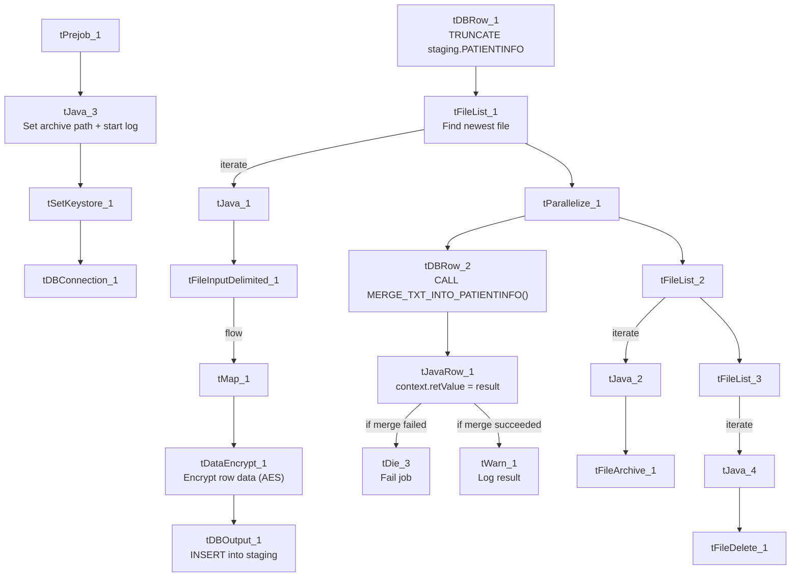

# Talend Job: PatientInfo_Text_Load

## Overview

This job loads hospital/patient billing information (patient demographics, admission/discharge details, facility and doctor details, diagnosis and procedure codes) into Snowflake. It follows the standard truncate → load → merge → archive/delete pattern, encrypts the mapped rows before loading (like `Insurance_Text_Load`), and — like `cmi_Hermes_Recommendations_Load` — explicitly checks whether the Snowflake merge step succeeded, failing the job or logging a row count depending on the outcome.

## Detail table

| Field | Value |
|---|---|
| Job name | PatientInfo_Text_Load |
| Version | 0.1 |
| Project | LATITUDE |
| Author | jmach@harriscollect.com |
| Created | 2026-01-21T09:33:39.210-0800 |
| Last Modified | 2026-02-16T10:26:57.323-0800 |

## Step-by-step data flow

1. **Set up.** `tPrejob_1` starts the job; `tJava_3` sets the dated archive path and opens the log; `tSetKeystore_1` configures the SSL keystore; `tDBConnection_1` opens the Snowflake connection.
2. **Empty the staging table.** `tDBRow_1` runs `TRUNCATE TABLE LIQUID_STAGING.PATIENTINFO;`.
3. **Find the file.** `tFileList_1` lists files in `context.sourceDir` (skipping `.txt`), sorted by last-modified date. The match becomes `context.filePath` (`tJava_1`).
4. **Read, map, and encrypt.** `tFileInputDelimited_1` reads the file as pipe-delimited (`|~|`/`|$|`), US-ASCII encoded, with `DIE_ON_ERROR` set to true (a parse error fails the job outright). `tMap_1` maps the file's columns onto the `PATIENTINFO` schema; the mapped rows then pass through `tDataEncrypt_1` (AES encryption) before reaching `tDBOutput_1`.
5. **Load staging.** `tDBOutput_1` inserts the (encrypted) rows into the staging table.
6. **Merge, check the result, and clean up — in parallel.** `tParallelize_1` splits into two branches:
   - **Merge branch:** `tDBRow_2` calls `CALL MERGE_TXT_INTO_PATIENTINFO();`, which returns a value captured by `tJavaRow_1` into `context.retValue`. Depending on that value, the job runs either `tDie_3` (fails the job with `"MERGE failed - result is " + context.retValue`, exit code 4) or `tWarn_1` (logs `"MERGE succeeded - result is " + context.retValue`, severity 42) — the same result-checking pattern documented in `cmi_Hermes_Recommendations_Load`. As with that job, **the exact condition that routes to one branch vs. the other isn't captured in this metadata** — only that both `RUN_IF` branches exist off `tJavaRow_1`.
   - **Cleanup branch:** the file is listed again, archived into `context.archiveDir` as a `.zip` (`tFileArchive_1`), and deleted (`tFileDelete_1`).

## Settings tables

### Source: `tFileInputDelimited_1`

| Setting | Value | What it means |
|---|---|---|
| FILENAME | `context.filePath` | Reads whichever file `tFileList_1` just found. |
| FIELDSEPARATOR / ROWSEPARATOR | `\|~\|` / `\|$\|` | Standard pipe-delimited format. |
| ENCODING | US-ASCII | Matches `Carrier_Text_Load`/`Insurance_Text_Load`. |
| DIE_ON_ERROR | true | A file-parsing error fails the job. |
| SCHEMA_REJECT | repository schema `"patient"` | Correctly points at a patient-specific reject schema (unlike the "customer" mismatch seen in some other jobs). |

### Encryption step: `tDataEncrypt_1`

| Setting | Value | What it means |
|---|---|---|
| CRYPTO_METHOD | AES | Rows encrypted with AES, same as `Insurance_Text_Load`. |
| ALGO_VERSION | 2 | Version 2 of Talend's encryption algorithm. |
| CRYPTO_FILE_PATH | `context.cryptoPath` | Parameterized via context. |

### Target: `tDBOutput_1`

| Setting | Value | What it means |
|---|---|---|
| Table | PATIENTINFO | Loads into the staging copy of this table. |
| Output action | INSERT | Adds rows only. |
| Table action | NONE | No table create/drop/truncate here. |

### Merge & result check: `tDBRow_2` → `tJavaRow_1` → `tDie_3` / `tWarn_1`

| Setting | Value | What it means |
|---|---|---|
| Query (`tDBRow_2`) | `CALL MERGE_TXT_INTO_PATIENTINFO();` | Runs the Snowflake merge procedure; its `RETVALUE` output column is captured. |
| `context.retValue` assignment | `context.retValue = row2.RETVALUE;` | Copies the procedure's returned value into a context variable for the `tDie`/`tWarn` branches to read. |
| `tDie_3` message | `"MERGE failed - result is " + context.retValue.toPlainString()` (exit code 4, priority 5) | Fails the job if the merge reports failure. |
| `tWarn_1` message | `"MERGE succeeded - result is " + context.retValue.toPlainString()` (code 42, priority 4) | Logs the result and continues if the merge succeeded. |

## Dependencies & configuration

- **Triggers/depends on other jobs:** none found — no `tRunJob` links.
- **Context variables used:** `context.sourceDir`, `context.archiveDir`, `context.filePath`, `context.fileName`, `context.logDir`, `context.keystorePath`, `context.cryptoPath`, plus the job-local `context.retValue` (all `Directories_0.1` except `cryptoPath`/`retValue`, which are job-specific additions). Uses the shared Snowflake connection object, not `LEGACY_DW_0.1` directly.
- **Hardcoded values found:** `tFileInputDelimited_1.TEMP_DIR`, `tFileArchive_1.SOURCE_FILE`, `tFileDelete_1.DIRECTORY`/`PATH`, and `tSetKeystore_1.SSL_TRUSTSERVER_TRUSTSTORE` — the same fixed Windows paths seen project-wide.

## Glossary

| Component type | Plain-English meaning |
|---|---|
| `tPrejob` / `tParallelize` | Job-flow control (see `job_Address_Text_Load.md`). |
| `tFileList` | Lists files to loop over (see `job_Address_Text_Load.md`). |
| `tFileInputDelimited` | Reads a delimited text file (see `job_Address_Text_Load.md`). |
| `tMap` | Maps/transforms columns (see `job_Address_Text_Load.md`). |
| `tDataEncrypt` | Encrypts row data (AES here) before it moves further down the flow — see `job_Insurance_Text_Load.md` for the fuller explanation (not covered in the original three reference docs). |
| `tDBOutput` / `tSnowflakeOutput` | Writes rows to Snowflake (see `job_Address_Text_Load.md`). |
| `tDBRow` / `tSnowflakeRow` | Runs a single SQL statement (see `job_Address_Text_Load.md`). |
| `tJavaRow` | Custom code capturing the merge procedure's return value (see `job_cmi_Hermes_Recommendations_Load.md`). |
| `tDie` | Fails the job immediately with a specific message and exit code (see `job_cmi_Hermes_Recommendations_Load.md`). |
| `tWarn` | Logs a warning without failing the job (see `job_cmi_Hermes_Recommendations_Load.md`). |
| `tJava` | Custom Java code blocks (see `job_Address_Text_Load.md`). |
| `tFileArchive` | Zips a file into an archive location (see `job_Address_Text_Load.md`). |
| `tFileDelete` | Deletes a file from disk (see `job_Address_Text_Load.md`). |
| `tSetKeystore` | Configures the SSL keystore for Snowflake (see `job_Address_Text_Load.md`). |

## Issues observed

- **The pass/fail condition on the merge-result check isn't in the metadata**, same caveat as `cmi_Hermes_Recommendations_Load` — only that both `RUN_IF` branches exist off `tJavaRow_1`.
- **Encryption key/password are redacted**, so it's not possible to independently verify from Talend alone what's encrypted before the merge — worth checking given the sensitive nature of patient billing data (SSN-adjacent fields like `PatientRecNumber`/`GuarantorRecNumber` are present in the schema).
- **Hardcoded, machine-specific paths** exist alongside the parameterized ones — the same project-wide pattern.
