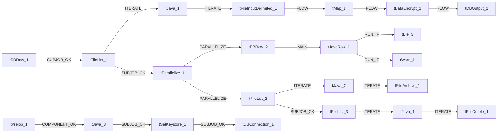

# Talend Job: PatientInfo_Text_Load

- **Project**: LATITUDE
- **Version**: 0.1
- **Job Type**: Standard

- **Author**: jmach@harriscollect.com
- **Created**: 2026-01-21T09:33:39.210-0800
- **Last Modified**: 2026-02-16T10:26:57.323-0800

## Components

| # | Component | Type | Key Parameters |
|---|-----------|------|----------------|
| 1 | tDBConnection_1 | `tSnowflakeConnection` | `CONNECTION_FORMAT`=row, `PROPERTIES`={"@id":2,"@type":"org.talend.components.snowflake. |
| 2 | tFileList_1 | `tFileList` | `DIRECTORY`=context.sourceDir, `LIST_MODE`=FILES, `INCLUDSUBDIR`=false, `CASE_SENSITIVE`=YES, `ERROR`=false |
| 3 | tJava_1 | `tJava` | `CODE`=context.filePath=((String)globalMap.get("tFileList, `IMPORT`=//import java.util.List;, `CONNECTION_FORMAT`=row |
| 4 | tFileInputDelimited_1 | `tFileInputDelimited` | `USE_EXISTING_DYNAMIC`=false, `FILENAMETEXT`="When the input source is a stream or a zip file,f, `FILENAME`=context.filePath, `CSV_OPTION`=false, `ROWSEPARATOR`="|$|" |
| 5 | tMap_1 | `tMap` | `LINK_STYLE`=AUTO, `DIE_ON_ERROR`=true, `LKUP_PARALLELIZE`=false, `LEVENSHTEIN`=0, `JACCARD`=0 |
| 6 | tDataEncrypt_1 | `tDataEncrypt` | `CRYPTO_METHOD`=AES, `CRYPTO_FILE_PATH`=context.cryptoPath, `GEN_CRYPTO_FILE_CONTROLLER`=false, `ALGO_VERSION`=2, `CONNECTION_FORMAT`=row |
| 7 | tDBOutput_1 | `tSnowflakeOutput` | `CONNECTION_FORMAT`=row, `PROPERTIES`={"@id":3,"@type":"org.talend.components.snowflake. |
| 8 | tDBRow_1 | `tSnowflakeRow` | `CONNECTION_FORMAT`=row, `PROPERTIES`={"@id":3,"@type":"org.talend.components.snowflake. |
| 9 | tDBRow_2 | `tSnowflakeRow` | `CONNECTION_FORMAT`=row, `PROPERTIES`={"@id":3,"@type":"org.talend.components.snowflake. |
| 10 | tJavaRow_1 | `tJavaRow` | `CODE`=context.retValue = row2.RETVALUE;, `IMPORT`=//import java.util.List;, `CONNECTION_FORMAT`=row |
| 11 | tPrejob_1 | `tPrejob` | `CONNECTION_FORMAT`=row |
| 12 | tFileList_2 | `tFileList` | `DIRECTORY`=context.sourceDir, `LIST_MODE`=FILES, `INCLUDSUBDIR`=false, `CASE_SENSITIVE`=YES, `ERROR`=false |
| 13 | tJava_2 | `tJava` | `CODE`=context.filePath = ((String)globalMap.get("tFileLi, `IMPORT`=//import java.util.List;, `CONNECTION_FORMAT`=row |
| 14 | tFileArchive_1 | `tFileArchive` | `SOURCE`=context.sourceDir, `SOURCE_FILE`="C:/Talend-Studio-20211109_1610-V8.0.1/workspace/s, `SUB_DIRECTROY`=false, `TARGET`=context.archiveDir + context.fileName+".zip", `MKDIR`=true |
| 15 | tFileList_3 | `tFileList` | `DIRECTORY`=context.sourceDir, `LIST_MODE`=FILES, `INCLUDSUBDIR`=false, `CASE_SENSITIVE`=YES, `ERROR`=false |
| 16 | tJava_4 | `tJava` | `CODE`=context.filePath = ((String)globalMap.get("tFileLi, `IMPORT`=//import java.util.List;, `CONNECTION_FORMAT`=row |
| 17 | tFileDelete_1 | `tFileDelete` | `FILENAME`=context.filePath, `DIRECTORY`="C:/Talend-Studio-20211109_1610-V8.0.1/workspace/d, `PATH`="C:/Talend-Studio-20211109_1610-V8.0.1/workspace/d, `FAILON`=false, `FOLDER`=false |
| 18 | tParallelize_1 | `tParallelize` | `WAIT_FOR`=All, `SLEEPTIME`=100, `DIE_ON_ERROR`=false, `CONNECTION_FORMAT`=row |
| 19 | tJava_3 | `tJava` | `CODE`=context.archiveDir = context.archiveDir + TalendDa, `IMPORT`=//import java.util.List;, `CONNECTION_FORMAT`=row |
| 20 | tSetKeystore_1 | `tSetKeystore` | `SET_TRUSTSTORE`=false, `SET_TRUSTSTORE_KEYSTORE`=false, `TRUSTSTORE_TYPE`=JKS, `SSL_TRUSTSERVER_TRUSTSTORE`="C:/clientTrustStore.trustStore", `KEYSTORE_TYPE`=PKCS12 |
| 21 | tDie_3 | `tDie` | `MESSAGE`="MERGE failed - result is " +context.retValue.toPl, `CODE`=4, `PRIORITY`=5, `EXIT_JVM`=false, `CONNECTION_FORMAT`=row |
| 22 | tWarn_1 | `tWarn` | `MESSAGE`="MERGE succeeded - result is " +context.retValue.t, `CODE`=42, `PRIORITY`=4, `CONNECTION_FORMAT`=row |

## Schemas

### tFileInputDelimited_1

| Column | Type | Nullable | Length |
|--------|------|----------|--------|
| AccountID | id_BigDecimal | Yes | -1 |
| Name | id_String | Yes | -1 |
| Street1 | id_String | Yes | -1 |
| Street2 | id_String | Yes | -1 |
| City | id_String | Yes | -1 |
| State | id_String | Yes | -1 |
| ZipCode | id_String | Yes | -1 |
| Country | id_String | Yes | -1 |
| Phone | id_String | Yes | -1 |
| SSN | id_String | Yes | -1 |
| Sex | id_String | Yes | -1 |
| Age | id_BigDecimal | Yes | -1 |
| DOB | id_String | Yes | -1 |
| MaritalStatus | id_String | Yes | -1 |
| EmployerName | id_String | Yes | -1 |
| WorkPhone | id_String | Yes | -1 |
| PatientRecNumber | id_String | Yes | -1 |
| GuarantorRecNumber | id_String | Yes | -1 |
| AdmissionDate | id_String | Yes | -1 |
| ServiceDate | id_String | Yes | -1 |
| DischargeDate | id_String | Yes | -1 |
| FacilityName | id_String | Yes | -1 |
| FacilityStreet1 | id_String | Yes | -1 |
| FacilityStreet2 | id_String | Yes | -1 |
| FacilityCity | id_String | Yes | -1 |
| FacilityState | id_String | Yes | -1 |
| FacilityZipCode | id_String | Yes | -1 |
| FacilityCountry | id_String | Yes | -1 |
| FacilityPhone | id_String | Yes | -1 |
| FacilityFax | id_String | Yes | -1 |
| DoctorName | id_String | Yes | -1 |
| DoctorPhone | id_String | Yes | -1 |
| DoctorFax | id_String | Yes | -1 |
| KinName | id_String | Yes | -1 |
| KinStreet1 | id_String | Yes | -1 |
| KinStreet2 | id_String | Yes | -1 |
| KinCity | id_String | Yes | -1 |
| KinState | id_String | Yes | -1 |
| KinZipCode | id_String | Yes | -1 |
| KinCountry | id_String | Yes | -1 |
| KinPhone | id_String | Yes | -1 |
| PatientRelationToGuarantor | id_String | Yes | -1 |
| PatientRelationToGuarantorAdditionalInfo | id_String | Yes | -1 |
| AccidentDate | id_String | Yes | -1 |
| AccidentType | id_String | Yes | -1 |
| FinancialClass | id_String | Yes | -1 |
| ImportProcedures | id_String | Yes | -1 |
| LocationCode | id_String | Yes | -1 |
| Modifier | id_String | Yes | -1 |
| PatientType | id_String | Yes | -1 |
| PlaceOfServiceCode | id_String | Yes | -1 |
| ProcedureCode | id_String | Yes | -1 |
| ServicingProviderCode | id_String | Yes | -1 |
| DiagnosisCode1 | id_String | Yes | -1 |
| DiagnosisCode2 | id_String | Yes | -1 |
| DiagnosisCode3 | id_String | Yes | -1 |
| DoctorCode | id_String | Yes | -1 |
| AttendingDoctorName | id_String | Yes | -1 |
| AttendingDoctorPhone | id_String | Yes | -1 |
| AttendingDoctorFax | id_String | Yes | -1 |
| AttendingDoctorCode | id_String | Yes | -1 |
| County | id_String | Yes | -1 |
| FacilityCounty | id_String | Yes | -1 |
| KinCounty | id_String | Yes | -1 |
| AccountID | id_BigDecimal | Yes | -1 |
| Name | id_String | Yes | -1 |
| Street1 | id_String | Yes | -1 |
| Street2 | id_String | Yes | -1 |
| City | id_String | Yes | -1 |
| State | id_String | Yes | -1 |
| ZipCode | id_String | Yes | -1 |
| Country | id_String | Yes | -1 |
| Phone | id_String | Yes | -1 |
| SSN | id_String | Yes | -1 |
| Sex | id_String | Yes | -1 |
| Age | id_BigDecimal | Yes | -1 |
| DOB | id_String | Yes | -1 |
| MaritalStatus | id_String | Yes | -1 |
| EmployerName | id_String | Yes | -1 |
| WorkPhone | id_String | Yes | -1 |
| PatientRecNumber | id_String | Yes | -1 |
| GuarantorRecNumber | id_String | Yes | -1 |
| AdmissionDate | id_String | Yes | -1 |
| ServiceDate | id_String | Yes | -1 |
| DischargeDate | id_String | Yes | -1 |
| FacilityName | id_String | Yes | -1 |
| FacilityStreet1 | id_String | Yes | -1 |
| FacilityStreet2 | id_String | Yes | -1 |
| FacilityCity | id_String | Yes | -1 |
| FacilityState | id_String | Yes | -1 |
| FacilityZipCode | id_String | Yes | -1 |
| FacilityCountry | id_String | Yes | -1 |
| FacilityPhone | id_String | Yes | -1 |
| FacilityFax | id_String | Yes | -1 |
| DoctorName | id_String | Yes | -1 |
| DoctorPhone | id_String | Yes | -1 |
| DoctorFax | id_String | Yes | -1 |
| KinName | id_String | Yes | -1 |
| KinStreet1 | id_String | Yes | -1 |
| KinStreet2 | id_String | Yes | -1 |
| KinCity | id_String | Yes | -1 |
| KinState | id_String | Yes | -1 |
| KinZipCode | id_String | Yes | -1 |
| KinCountry | id_String | Yes | -1 |
| KinPhone | id_String | Yes | -1 |
| PatientRelationToGuarantor | id_String | Yes | -1 |
| PatientRelationToGuarantorAdditionalInfo | id_String | Yes | -1 |
| AccidentDate | id_String | Yes | -1 |
| AccidentType | id_String | Yes | -1 |
| FinancialClass | id_String | Yes | -1 |
| ImportProcedures | id_String | Yes | -1 |
| LocationCode | id_String | Yes | -1 |
| Modifier | id_String | Yes | -1 |
| PatientType | id_String | Yes | -1 |
| PlaceOfServiceCode | id_String | Yes | -1 |
| ProcedureCode | id_String | Yes | -1 |
| ServicingProviderCode | id_String | Yes | -1 |
| DiagnosisCode1 | id_String | Yes | -1 |
| DiagnosisCode2 | id_String | Yes | -1 |
| DiagnosisCode3 | id_String | Yes | -1 |
| DoctorCode | id_String | Yes | -1 |
| AttendingDoctorName | id_String | Yes | -1 |
| AttendingDoctorPhone | id_String | Yes | -1 |
| AttendingDoctorFax | id_String | Yes | -1 |
| AttendingDoctorCode | id_String | Yes | -1 |
| County | id_String | Yes | -1 |
| FacilityCounty | id_String | Yes | -1 |
| KinCounty | id_String | Yes | -1 |
| errorCode | id_String | Yes | 255 |
| errorMessage | id_String | Yes | 255 |

### tMap_1

| Column | Type | Nullable | Length |
|--------|------|----------|--------|
| LOAD_DT | id_Date | Yes | -1 |
| ACCOUNTID | id_BigDecimal | No | 38 |
| NAME | id_String | Yes | 75 |
| STREET1 | id_String | Yes | 128 |
| STREET2 | id_String | Yes | 128 |
| CITY | id_String | Yes | 35 |
| STATE | id_String | Yes | 5 |
| ZIPCODE | id_String | Yes | 15 |
| COUNTY | id_String | Yes | 50 |
| COUNTRY | id_String | Yes | 25 |
| PHONE | id_String | Yes | 20 |
| SSN | id_String | Yes | 255 |
| SEX | id_String | Yes | 1 |
| AGE | id_BigDecimal | Yes | 38 |
| DOB | id_String | Yes | 30 |
| MARITALSTATUS | id_String | Yes | 1 |
| EMPLOYERNAME | id_String | Yes | 75 |
| WORKPHONE | id_String | Yes | 20 |
| PATIENTRECNUMBER | id_String | Yes | 30 |
| GUARANTORRECNUMBER | id_String | Yes | 30 |
| ADMISSIONDATE | id_String | Yes | 30 |
| SERVICEDATE | id_String | Yes | 30 |
| DISCHARGEDATE | id_String | Yes | 30 |
| FACILITYNAME | id_String | Yes | 75 |
| FACILITYSTREET1 | id_String | Yes | 128 |
| FACILITYSTREET2 | id_String | Yes | 128 |
| FACILITYCITY | id_String | Yes | 35 |
| FACILITYSTATE | id_String | Yes | 5 |
| FACILITYZIPCODE | id_String | Yes | 15 |
| FACILITYCOUNTY | id_String | Yes | 50 |
| FACILITYCOUNTRY | id_String | Yes | 25 |
| FACILITYPHONE | id_String | Yes | 20 |
| FACILITYFAX | id_String | Yes | 20 |
| DOCTORNAME | id_String | Yes | 75 |
| DOCTORPHONE | id_String | Yes | 20 |
| DOCTORFAX | id_String | Yes | 20 |
| KINNAME | id_String | Yes | 75 |
| KINSTREET1 | id_String | Yes | 128 |
| KINSTREET2 | id_String | Yes | 128 |
| KINCITY | id_String | Yes | 35 |
| KINSTATE | id_String | Yes | 5 |
| KINZIPCODE | id_String | Yes | 15 |
| KINCOUNTY | id_String | Yes | 50 |
| KINCOUNTRY | id_String | Yes | 25 |
| KINPHONE | id_String | Yes | 20 |
| HARDCOPY | id_String | Yes | 8388608 |
| PATIENTRELATIONTOGUARANTOR | id_String | Yes | 25 |
| PATIENTRELATIONTOGUARANTORADDITIONALINFO | id_String | Yes | 50 |
| ACCIDENTDATE | id_String | Yes | 30 |
| ACCIDENTTYPE | id_String | Yes | 25 |
| FINANCIALCLASS | id_String | Yes | 25 |
| IMPORTPROCEDURES | id_String | Yes | 25 |
| LOCATIONCODE | id_String | Yes | 25 |
| MODIFIER | id_String | Yes | 25 |
| PATIENTTYPE | id_String | Yes | 25 |
| PLACEOFSERVICECODE | id_String | Yes | 25 |
| PROCEDURECODE | id_String | Yes | 25 |
| SERVICINGPROVIDERCODE | id_String | Yes | 25 |
| DIAGNOSISCODE1 | id_String | Yes | 25 |
| DIAGNOSISCODE2 | id_String | Yes | 25 |
| DIAGNOSISCODE3 | id_String | Yes | 25 |
| DOCTORCODE | id_String | Yes | 5 |
| ATTENDINGDOCTORNAME | id_String | Yes | 75 |
| ATTENDINGDOCTORPHONE | id_String | Yes | 20 |
| ATTENDINGDOCTORFAX | id_String | Yes | 20 |
| ATTENDINGDOCTORCODE | id_String | Yes | 5 |

### tDataEncrypt_1

| Column | Type | Nullable | Length |
|--------|------|----------|--------|
| LOAD_DT | id_Date | Yes | -1 |
| ACCOUNTID | id_BigDecimal | No | 38 |
| NAME | id_String | Yes | 75 |
| STREET1 | id_String | Yes | 128 |
| STREET2 | id_String | Yes | 128 |
| CITY | id_String | Yes | 35 |
| STATE | id_String | Yes | 5 |
| ZIPCODE | id_String | Yes | 15 |
| COUNTY | id_String | Yes | 50 |
| COUNTRY | id_String | Yes | 25 |
| PHONE | id_String | Yes | 20 |
| SSN | id_String | Yes | 255 |
| SEX | id_String | Yes | 1 |
| AGE | id_BigDecimal | Yes | 38 |
| DOB | id_String | Yes | 30 |
| MARITALSTATUS | id_String | Yes | 1 |
| EMPLOYERNAME | id_String | Yes | 75 |
| WORKPHONE | id_String | Yes | 20 |
| PATIENTRECNUMBER | id_String | Yes | 30 |
| GUARANTORRECNUMBER | id_String | Yes | 30 |
| ADMISSIONDATE | id_String | Yes | 30 |
| SERVICEDATE | id_String | Yes | 30 |
| DISCHARGEDATE | id_String | Yes | 30 |
| FACILITYNAME | id_String | Yes | 75 |
| FACILITYSTREET1 | id_String | Yes | 128 |
| FACILITYSTREET2 | id_String | Yes | 128 |
| FACILITYCITY | id_String | Yes | 35 |
| FACILITYSTATE | id_String | Yes | 5 |
| FACILITYZIPCODE | id_String | Yes | 15 |
| FACILITYCOUNTY | id_String | Yes | 50 |
| FACILITYCOUNTRY | id_String | Yes | 25 |
| FACILITYPHONE | id_String | Yes | 20 |
| FACILITYFAX | id_String | Yes | 20 |
| DOCTORNAME | id_String | Yes | 75 |
| DOCTORPHONE | id_String | Yes | 20 |
| DOCTORFAX | id_String | Yes | 20 |
| KINNAME | id_String | Yes | 75 |
| KINSTREET1 | id_String | Yes | 128 |
| KINSTREET2 | id_String | Yes | 128 |
| KINCITY | id_String | Yes | 35 |
| KINSTATE | id_String | Yes | 5 |
| KINZIPCODE | id_String | Yes | 15 |
| KINCOUNTY | id_String | Yes | 50 |
| KINCOUNTRY | id_String | Yes | 25 |
| KINPHONE | id_String | Yes | 20 |
| HARDCOPY | id_String | Yes | 8388608 |
| PATIENTRELATIONTOGUARANTOR | id_String | Yes | 25 |
| PATIENTRELATIONTOGUARANTORADDITIONALINFO | id_String | Yes | 50 |
| ACCIDENTDATE | id_String | Yes | 30 |
| ACCIDENTTYPE | id_String | Yes | 25 |
| FINANCIALCLASS | id_String | Yes | 25 |
| IMPORTPROCEDURES | id_String | Yes | 25 |
| LOCATIONCODE | id_String | Yes | 25 |
| MODIFIER | id_String | Yes | 25 |
| PATIENTTYPE | id_String | Yes | 25 |
| PLACEOFSERVICECODE | id_String | Yes | 25 |
| PROCEDURECODE | id_String | Yes | 25 |
| SERVICINGPROVIDERCODE | id_String | Yes | 25 |
| DIAGNOSISCODE1 | id_String | Yes | 25 |
| DIAGNOSISCODE2 | id_String | Yes | 25 |
| DIAGNOSISCODE3 | id_String | Yes | 25 |
| DOCTORCODE | id_String | Yes | 5 |
| ATTENDINGDOCTORNAME | id_String | Yes | 75 |
| ATTENDINGDOCTORPHONE | id_String | Yes | 20 |
| ATTENDINGDOCTORFAX | id_String | Yes | 20 |
| ATTENDINGDOCTORCODE | id_String | Yes | 5 |

### tDBOutput_1

| Column | Type | Nullable | Length |
|--------|------|----------|--------|
| LOAD_DT | id_Date | Yes | -1 |
| ACCOUNTID | id_BigDecimal | No | 38 |
| NAME | id_String | Yes | 75 |
| STREET1 | id_String | Yes | 128 |
| STREET2 | id_String | Yes | 128 |
| CITY | id_String | Yes | 35 |
| STATE | id_String | Yes | 5 |
| ZIPCODE | id_String | Yes | 15 |
| COUNTY | id_String | Yes | 50 |
| COUNTRY | id_String | Yes | 25 |
| PHONE | id_String | Yes | 20 |
| SSN | id_String | Yes | 255 |
| SEX | id_String | Yes | 1 |
| AGE | id_BigDecimal | Yes | 38 |
| DOB | id_String | Yes | 30 |
| MARITALSTATUS | id_String | Yes | 1 |
| EMPLOYERNAME | id_String | Yes | 75 |
| WORKPHONE | id_String | Yes | 20 |
| PATIENTRECNUMBER | id_String | Yes | 30 |
| GUARANTORRECNUMBER | id_String | Yes | 30 |
| ADMISSIONDATE | id_String | Yes | 30 |
| SERVICEDATE | id_String | Yes | 30 |
| DISCHARGEDATE | id_String | Yes | 30 |
| FACILITYNAME | id_String | Yes | 75 |
| FACILITYSTREET1 | id_String | Yes | 128 |
| FACILITYSTREET2 | id_String | Yes | 128 |
| FACILITYCITY | id_String | Yes | 35 |
| FACILITYSTATE | id_String | Yes | 5 |
| FACILITYZIPCODE | id_String | Yes | 15 |
| FACILITYCOUNTY | id_String | Yes | 50 |
| FACILITYCOUNTRY | id_String | Yes | 25 |
| FACILITYPHONE | id_String | Yes | 20 |
| FACILITYFAX | id_String | Yes | 20 |
| DOCTORNAME | id_String | Yes | 75 |
| DOCTORPHONE | id_String | Yes | 20 |
| DOCTORFAX | id_String | Yes | 20 |
| KINNAME | id_String | Yes | 75 |
| KINSTREET1 | id_String | Yes | 128 |
| KINSTREET2 | id_String | Yes | 128 |
| KINCITY | id_String | Yes | 35 |
| KINSTATE | id_String | Yes | 5 |
| KINZIPCODE | id_String | Yes | 15 |
| KINCOUNTY | id_String | Yes | 50 |
| KINCOUNTRY | id_String | Yes | 25 |
| KINPHONE | id_String | Yes | 20 |
| HARDCOPY | id_String | Yes | 8388608 |
| PATIENTRELATIONTOGUARANTOR | id_String | Yes | 25 |
| PATIENTRELATIONTOGUARANTORADDITIONALINFO | id_String | Yes | 50 |
| ACCIDENTDATE | id_String | Yes | 30 |
| ACCIDENTTYPE | id_String | Yes | 25 |
| FINANCIALCLASS | id_String | Yes | 25 |
| IMPORTPROCEDURES | id_String | Yes | 25 |
| LOCATIONCODE | id_String | Yes | 25 |
| MODIFIER | id_String | Yes | 25 |
| PATIENTTYPE | id_String | Yes | 25 |
| PLACEOFSERVICECODE | id_String | Yes | 25 |
| PROCEDURECODE | id_String | Yes | 25 |
| SERVICINGPROVIDERCODE | id_String | Yes | 25 |
| DIAGNOSISCODE1 | id_String | Yes | 25 |
| DIAGNOSISCODE2 | id_String | Yes | 25 |
| DIAGNOSISCODE3 | id_String | Yes | 25 |
| DOCTORCODE | id_String | Yes | 5 |
| ATTENDINGDOCTORNAME | id_String | Yes | 75 |
| ATTENDINGDOCTORPHONE | id_String | Yes | 20 |
| ATTENDINGDOCTORFAX | id_String | Yes | 20 |
| ATTENDINGDOCTORCODE | id_String | Yes | 5 |
| columnName | id_String | No | 255 |
| rowNumber | id_String | No | 255 |
| category | id_String | No | 255 |
| character | id_String | No | 255 |
| errorMessage | id_String | No | 255 |
| byteOffset | id_String | No | 255 |
| line | id_String | No | 255 |
| sqlState | id_String | No | 255 |
| code | id_String | No | 255 |

### tDBRow_1

| Column | Type | Nullable | Length |
|--------|------|----------|--------|
| errorCode | id_String | No | 255 |
| errorMessage | id_String | No | 255 |

### tDBRow_2

| Column | Type | Nullable | Length |
|--------|------|----------|--------|
| RETVALUE | id_BigDecimal | No | -1 |
| RETVALUE | id_BigDecimal | No | -1 |
| RETVALUE | id_BigDecimal | No | -1 |
| errorCode | id_String | No | 255 |
| errorMessage | id_String | No | 255 |

## Data Flow

